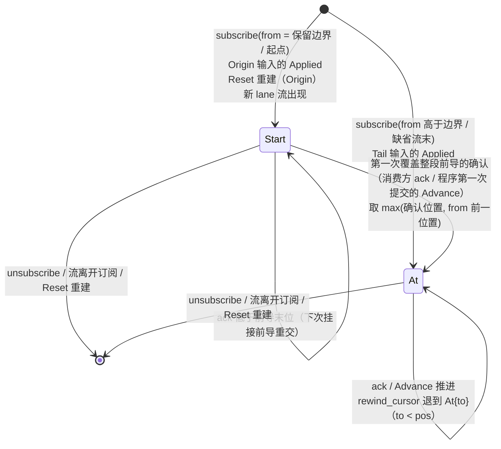
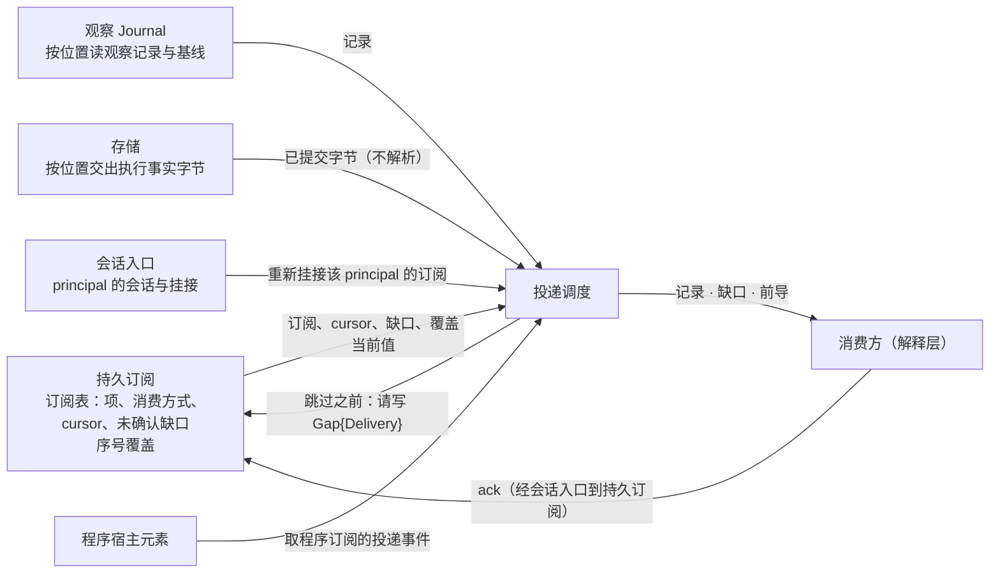

# 持久订阅

## 0 定位

- **层级与元素**：L3 component，核心进程里的“持久订阅”元素。上级：[core/00-design.md §4.5 组件指南](../00-design.md#45-组件指南)。
- **本文决定**：订阅表（订阅、逐项状态、cursor、投递缺口）的内容、转移与唯一写入口；消费方订阅组的操作 `subscribe` / `ack` / `unsubscribe` 与控制动作 `rewind_cursor` 的完整规格；逐项接纳；程序订阅的项与 cursor 的生命周期。配额、`route` 与序号覆盖在 [04-supply.md](04-supply.md)，`backfill`、回填任务、实时边界与回填进度在 [05-backfill.md](05-backfill.md)。
- **读者**：实现持久订阅与它的相邻组件（投递调度、集成会话、程序宿主元素、控制面、读模型）的人；实现集成的人读 [04-supply.md §4.2 核心→集成：route](04-supply.md#42-核心集成routestream-subjects-generation--routedrefused--unavailable)、[05-backfill.md §4.1 核心→集成：backfill](05-backfill.md#41-核心集成backfillstream-window-subjects--covered--unavailable--refused)、[05-backfill.md §4.2 实时边界、回填任务与回填进度](05-backfill.md#42-实时边界回填任务与回填进度) 的对端义务。
- **状态**：已定。
- **非目标**：
  - 记录怎样按 cursor 交给订阅者、何时判定跳过：[投递调度](#投递调度)；本文只拥有“跳过之前先写下缺口”这件事的写入与删除。
  - 一次性读：[02-one-shot-read.md](02-one-shot-read.md)。回填不经一次性读，由本文发起。
  - readiness、握手、声明的两种解释、`generation` 的集成侧义务：[01-integration.md §4.3.2 集成→核心的推送](../04-boundary/01-integration.md#432-集成核心的推送)、[01-integration.md §4.3.1 handshake](../04-boundary/01-integration.md#431-handshake--projection--refused--unavailable)、[01-integration.md §3.6 声明的两种解释](../04-boundary/01-integration.md#36-声明的两种解释-设计)、[01-integration.md §4.4 集成义务清单](../04-boundary/01-integration.md#44-集成义务清单)。
  - 保留边界与引用登记的规则、按键保留：[01-journal.md §2.4 保留：边界与删除规则](01-journal.md#24-保留边界与删除规则)。
  - 健康面的 fold 与 `subscriptions`、`orders` 读模型：[05-views.md §3.2 健康面](../04-boundary/05-views.md#32-健康面-设计)、[05-views.md §4.2 读模型集合](../04-boundary/05-views.md#42-读模型集合)、[07-trade-observation.md §3.3 精确重建的前提与完整界](07-trade-observation.md#33-精确重建的前提与完整界-设计)。
  - 宿主协议与程序的装载、替换、卸载的编排：[01-program-host.md §4.6 宿主协议](../05-runtime/01-program-host.md#46-宿主协议)、[01-program-host.md §4.4 卸载与替换](../05-runtime/01-program-host.md#44-卸载与替换)。
  - 同事务集合与调用计数的提交协议：[core/00-design.md §4.7.4 同事务集合](../00-design.md#474-同事务集合)、[core/00-design.md §4.7.5 调用结果与计数的提交协议](../00-design.md#475-调用结果与计数的提交协议)。

证据标签与编号前缀见 [README.md §0.4 阅读约定](../../README.md#04-阅读约定)。

### 投递调度

- **层级与元素**：L3 component，核心进程里的“投递调度”元素。上级：[core/00-design.md §4.5 组件指南](../00-design.md#45-组件指南)。
- **本文决定**：已提交的记录怎样按订阅的 cursor 交给订阅者（消费方订阅与程序订阅）；三种消费方式在投递侧的语义与损失；背压、conflation 与停投；投递缺口的检测与交出次序；前导与 `compacted` 段的排列；按主体过滤；执行事实的按位置搬运；程序订阅投递事件的取得。
- **读者**：实现投递调度与持久订阅、程序宿主元素、会话入口的人。
- **状态**：已定。
- **非目标**：
  - 订阅表（订阅、项、cursor、投递缺口）的内容、写入、删除与接纳：[§4.5 订阅表（持久化）](#45-订阅表持久化)、[§3.3 投递缺口 Gap{origin: Delivery}](#33-投递缺口-gaporigin-delivery)、[§3.2 cursor 与确认](#32-cursor-与确认)。本组件只读它，并请持久订阅写缺口。
  - 程序 `Advance` 的投递事件的契约（三种事件的含义、排列约束、覆盖事件的初始值与可算位置、`to` 的确认语义）：[01-program-host.md §4.6 宿主协议](../05-runtime/01-program-host.md#46-宿主协议)。本文只写这些事件怎样从存储与订阅表取得。
  - 序号覆盖的 fold 与覆盖检查点：[04-supply.md §4.3 序号覆盖与覆盖检查点](04-supply.md#43-序号覆盖与覆盖检查点)。
  - 保留边界、压缩与基线的保留规则：[01-journal.md §2.4 保留：边界与删除规则](01-journal.md#24-保留边界与删除规则)。
  - 按位置交出已提交字节的存储接口：[02-storage.md §3 接口](../01-base/02-storage.md#3-接口)。

## 1 问题域

### 1.1 分配给本组件的需求与契约

来自上级（需求原文见 [README.md §2 问题域](../../README.md#2-问题域)）：

| 来源 | 分给本组件的部分 |
|---|---|
| P3 | 投递缺口的三种原因 `slow_consumer` / `compacted` / `conflated` 的记录；订阅的挂起与恢复是状态通知，不是损失 |
| P4 | 订阅需求的“机→集成”一半（`route`）、逐项订阅状态、逐主体“来源拒绝” |
| P5 | 历史回填（`backfill`） |
| C5、H5 | 订阅的 owner 是核心、归属 principal，与消费方连接无关 |
| C6 | 不伪造连续：跳过、未覆盖区间、主体从何处起有记录都显式标出 |
| F7、F11 | 上游供给是按主体的、有配额的；多数 venue 无续传游标 |
| Q11、Q12、Q13、Q14、Q15、Q29、Q31 | 见 §2 |

核心进程分配给本组件的接口：核心↔解释层的订阅组与 `rewind_cursor`（[core/00-design.md §4.6 对外接口总表](../00-design.md#46-对外接口总表)）；核心↔集成的 `route`、`backfill`、实时边界与序号覆盖在 [04-supply.md](04-supply.md) 与 [05-backfill.md](05-backfill.md)。本组件在核心进程里的位置与同级元素的互用见 [core/00-design.md §4.7.1 uses 图](../00-design.md#471-uses-图)；本文 §4.4 写本组件一侧的接口。

### 1.2 本组件直接面对的域性质

- **供给是来源的结论** [设计]：UTA 要什么主体是 UTA 的意图；来源此刻确认供给了什么，只有来源在对 `route` 的回答里说得出。所以需求与供给是两个事实，前者在订阅表，后者在流上的路由结论记录（[04-supply.md §4.2 核心→集成：route](04-supply.md#42-核心集成routestream-subjects-generation--routedrefused--unavailable)）。
- **上游历史的可得性由上游决定**：能回填多远、是否保留从起点起的全部修订，是上游的性质；集成以 `backfill_from_origin` 声明，一致性测试查它（[01-integration.md §3.3 投影 Projection](../04-boundary/01-integration.md#33-投影-projection)）。
- **只有可衔接序号能证明衔接** [证据：域 F7；事件时间不定序，见 [01-base/00-design.md §3.2 基础值类型](../01-base/00-design.md#32-基础值类型)]：`joinable_venue_seq` 的流在一个流 epoch 内序号连续、回填与推送同一序号空间；只有事件时间的流不定序，也不能证明某段上游输出是否送达。
- **流 epoch 的边界属于集成**：上游连接是集成的，`Gap{origin: Source}` 由它上报；`generation` 是它创建的名字（[01-integration.md §4.4 集成义务清单](../04-boundary/01-integration.md#44-集成义务清单)）。
- **订阅表在核心独占的 SQLite 文件里**，单写者、事务原子（[02-storage.md §2.1 一个文件、一个写者](../01-base/02-storage.md#21-一个文件一个写者-设计)）。

### 1.3 分配给本组件的需求与契约（投递）

| 来源 | 分给本组件的部分 |
|---|---|
| P3 | 投递损失的三种原因在投递侧的判定：`slow_consumer`、`compacted`、`conflated` |
| C6、B5 | 不静默跳过：每次跳过与合并都可追溯到一条缺口或消费者声明的等待窗口 |
| Q12 | 慢消费者不拖累提交与其他订阅者 |
| Q29 | 重新挂接时先交出未确认的缺口，再从已确认 cursor 之后重投 |
| Q31 | 损失语义由消费者显式声明，消费方式有定义的损失 |

核心进程分配给本组件的接口：核心↔解释层订阅组的投递侧（订阅组的操作规格在 [§4.1 核心↔解释层：订阅组与 rewind_cursor](#41-核心解释层订阅组与-rewind_cursor)）；程序宿主元素组成 `Advance` 时向本组件取投递事件（[core/00-design.md §4.7.1 uses 图](../00-design.md#471-uses-图)）。

### 1.4 本组件直接面对的域性质（投递）

- **消费者的速度各不相同，且不受核心控制**：消费方经解释层连在核心上（[03-session.md §3 模型](../04-boundary/03-session.md#3-模型)），可能慢、停住或断连；程序在宿主进程里按预算运行。
- **投递缓冲有界**：每个订阅的投递缓冲上限是运行期参数（[06-files.md 统一路径文件](../04-boundary/06-files.md)）；核心不为慢消费者无界缓冲。
- **不同流之间没有可比的序**（[01-base/00-design.md §3.1 流、位置与三种进度](../01-base/00-design.md#31-流位置与三种进度)）：跨流的投递先后不携带任何事实。
- **已提交的记录可按位置读出**：观察记录从观察 Journal、执行事实从存储按位置交出已提交的字节（[02-storage.md §3 接口](../01-base/02-storage.md#3-接口)）；保留边界之下的观察记录已被删去，只留下按键或按流 epoch 的基线（[01-journal.md §2.4 保留：边界与删除规则](01-journal.md#24-保留边界与删除规则)）。

## 2 驱动

分配给本组件的质量场景（六要素原文见 [README.md §3.1 质量场景](../../README.md#31-质量场景)），本组件的响应度量：

| Q | 本组件的响应 | 度量（验收） |
|---|---|---|
| Q13 | 超配额的项在路由前被拒或挂起，集成从不收到超限主体，既有订阅不受影响 | 验收 #28、#47 |
| Q14 | 回填与实时的衔接只在可证明时报告闭合；崩溃后从覆盖边界续，同 epoch 无重复 | 验收 #28、#49、#68、#74 |
| Q15 | 订阅逐项接纳，一项被拒不连累其余 | 验收 #48、#75 |
| Q29 | 重连后自动挂接、从已确认 cursor 续，投递缺口先于记录再次交出 | 验收 #29、#37、#70 |
| Q11、Q12 | 断代与投递损失都以缺口显式记下；慢者不拖累他人 | 验收 #70 |
| Q31 | 完备只来自来源证据（序号覆盖） | 验收 #68 |

| Q | 本组件的响应 | 度量（验收） |
|---|---|---|
| Q12 | 慢者只对自己背压或（仅 `latest`）停投，写下缺口之后才跳过；其他订阅者与记录提交不受影响 | 验收 #6；#70 的投递侧（[§6.1 验收标准](#61-验收标准)） |
| Q31 | `latest` 的每次合并可追溯到 `conflated` 缺口或声明的等待窗口；`ordered` 从不跳过 | 验收 #6 |
| Q29 | 重新挂接时未确认缺口先于记录交出；已确认区间不重投 | 验收 #29、#70（§6.1） |

## 3 模型

### 3.1 订阅与项

订阅是核心自有的状态（源头是核心），存在订阅表里（§4.5）。订阅有两种：消费方的订阅（归属 principal，经 `subscribe` 建立），与每个活动程序 id 一个的程序订阅（§4.3）。

消费方订阅的 `selector` 有三种，互斥：

- **观察流**：一组项，每项 `(来源, 流, 主体集?, 用途)`；各项可以是不同的流、不同的来源，来源是 `Integration(_)` 或 `Program(_)`（[01-base/00-design.md §3.1 流、位置与三种进度](../01-base/00-design.md#31-流位置与三种进度) 中的 `Source`）。主体是该流种类的订阅主体（如 instrument 身份）；不带主体集的项即订整条流。`用途` 二选一，缺省为供给：
  - **供给项**：它的主体（整条流为 `All`）进入该流的需求，由核心经 `route` 向集成要推送（[04-supply.md §4.2 核心→集成：route](04-supply.md#42-核心集成routestream-subjects-generation--routedrefused--unavailable)），在配额池里计入用量（[04-supply.md §4.1 核心↔解释层：订阅组与 rewind_cursor（配额）](04-supply.md#41-核心解释层订阅组与-rewind_cursor配额)）；
  - **只投递项**：只搬运该流上已有或将有的记录，不进入需求、不占配额，也不使集成推送任何东西。它在集成来源的流上收到的数据记录只有别的需求带来的推送、回填，以及一次性读、回执与对账写在该流上的记录；在程序产出的流上是该程序的派生记录（[06-derivation.md §3.1 输出契约与程序流](06-derivation.md#31-输出契约与程序流)）。
- **执行事实**：`(来源, WriteScope?)`：该来源（或其一个作用域）的执行事实，包括单据记录、Decision/`Outcome`/`Rejection`、`bypass_lane` 的控制记录 `Applied`、`Prepared` 起的尝试记录（含 `NotSent`、`Abandoned`）、`ResolutionEvidence`、`ReconciliationReopened`、取证 `Gap{origin: Channel}`、`CapabilityObserved`，以及该来源的声明版本。执行事实按 `WriteLaneKey` 各成一条流，针对 `(WriteLaneKey, OperationKind)` 的 `CapabilityObserved` 与带该单据 `WriteLaneKey` 的 `bypass_lane` 控制记录随该 lane 的流；每个来源的声明版本与针对其逻辑流读 / 回填能力的 `CapabilityObserved` 同成该来源的一条声明流。带 `WriteScope` 的订阅得到该作用域各 lane 的流与该来源的声明流。selector 选中的是这组流的**成员规则**，不是订阅时已有的流：此后才出现的 lane 流（新的 `WriteLaneKey` 第一次有记录）自动进入订阅，从它的第一条记录起投递。另有两种不属任何来源的执行事实流：每个程序一条**请求流**，按程序 id，承载该程序的 `EffectRequest` 与全部 `EffectResponse`（[02-requests.md §3.4 完成事实 EffectResponse 与请求流](../05-runtime/02-requests.md#34-完成事实-effectresponse-与请求流-设计)），它是该程序自己的隐含输入（§4.3），不经任何 selector 订阅；核心唯一的一条**控制流**，经下一种 selector 订阅。
- **控制**：`Control`：核心的控制流：登记的采纳记录、除 `bypass_lane` 之外的控制记录（`Applied` / `Rejected`）、`IntegrationHalted`、轮换兑现记录、`ProgramHalted`（控制流的记录模型见 [01-base/00-design.md §4.1 持久化视图](../01-base/00-design.md#41-持久化视图)）。它不属任何来源，不经 `(来源, WriteScope?)` 选中，接纳不看采纳集合与声明。只能 `ordered`，可从起点订阅；执行事实没有保留边界，所以没有投递损失。健康的成员按它 fold（[05-views.md §3.2 健康面](../04-boundary/05-views.md#32-健康面-设计)），所以自行 fold 健康的消费方订阅它与健康流即可。

这些流都有 `LogPosition`，所以 cursor 与确认对三种 selector 同一套（§3.2）。

[设计] 一个观察流订阅可选多条流、跨来源，逐项接纳。理由：下游的一个关注对象（一组 instrument 的报价与 bar、一个账户的订单与持仓）本就跨流甚至跨来源，而订阅状态、cursor 与重连挂接都按订阅给出；每流一个订阅要下游自己维护一组订阅的生死与 cursor。逐项接纳沿用一次性读逐 target 独立的结构，一项被拒不连累其余。不选：每流一个订阅（同上）；只准同一来源的多条流（跨来源的关注对象仍要拆成多个订阅，而逐项判定已使来源之间互不影响）；把观察流与执行事实放进同一 selector（执行事实只能 `ordered`、不受声明与会话影响、没有保留边界，混在一个订阅里整体状态与消费方式都要分叉）。

[设计] 执行事实 selector 按成员规则选流、包括之后才出现的 lane。理由：下游订阅一个账户的执行事实，是要看到它此后的每一笔单据；lane 流在第一笔单据时才出现，若只选订阅时已有的流，新 lane 的单据会静默缺失。不选：订阅时固定流集、新 lane 另订：下游无从得知新 lane 何时出现，除非再订阅执行事实。

[设计] 执行事实可订阅。理由：读模型 `orders`、`lanes` 读执行事实，而“原始记录是消费契约、消费方可自行 fold”（[05-views.md §4.2 读模型集合](../04-boundary/05-views.md#42-读模型集合)）要求这些记录本身可取得；解释层对下游的待审事项、结果未知与已确认推送（[downstream/endpoint/design.md §4.3 推送](../../drafts/downstream/endpoint/design.md#43-推送)）也需要一个与观察订阅同样持久、可续传的来源。不选：提供读模型的变更推送（那是一套新的变更引擎，重连与续传语义要另定）；只准轮询读模型并收窄自行 fold 的承诺（推送变成轮询，续传语义与其余订阅不同）。

单据的偏离（`basis_validity`、`alignment` 的重算）不是记录，不出现在执行事实订阅里：待审事项的出现、决定与关闭经订阅推送；某项此刻是否偏离，解释层在呈现时读 `tickets` 当前态（[05-views.md §4.2 读模型集合](../04-boundary/05-views.md#42-读模型集合)），真正放行仍由核心当次的门判定（[04-decision-chain.md §4.5 放行门](../03-read-write/04-decision-chain.md#45-放行门)）。

**供给项与只投递项分开** [设计]：需求按主体路由、配额按主体计；“接着看一次读的结果”“审计已退役的来源”这样的用法只要搬运已有记录，不向上游多要推送，也就不该占配额。数据记录按主体过滤的投递规则见 [§3.8 按主体投递](#38-按主体投递)。不选：以空主体集表示“只投递”：空集已是“撤回需求”的意思（[04-supply.md §4.2 核心→集成：route](04-supply.md#42-核心集成routestream-subjects-generation--routedrefused--unavailable)），同一个值有两种用途；以供给项等一次读的结果：为接着看一次读而向集成要推送，还占配额。

### 3.2 cursor 与确认

每个订阅者在每条选中流上持有一个 cursor，由本组件作为唯一物理写者持久化（§4.5）。它是一个和类型 [设计]：

```rust
enum CursorPos { Start { from: LogPosition }, At { pos: LogPosition } }   // 每条选中流一个；与输入声明的起点策略 Start { Tail, Origin } 不是一回事
```

- **`At{pos}`**：已确认到 `pos`（含 `pos`），投递从 `pos` 之后开始。`pos` 可能落在保留边界之下（保留边界推进越过它，或 `rewind_cursor` 退到那里），这时按 §3.3 的逐段规则交出 `compacted` 缺口与各段之间留下的记录。
- **`Start{from}`**：cursor 在 `Origin` 或保留边界上建立或重建时取这一支，`from` 是那个起点（观察流的保留边界，执行事实流与控制流的第一条记录；此后才进入订阅的 lane 流为它的第一条记录）。它表示订阅从 `from` 开始、还没有任何确认。cursor 为 `Start{from}` 时，每次挂接与重新挂接（程序订阅是每次 `Advance`）都按位置先后交出：该流此刻在 `from` 之下留下的记录（健康流各键的基线；程序流各流 epoch 的基线与原位置留下的开 epoch 的 `Gap{origin: Source}`，[01-journal.md §2.4 保留：边界与删除规则](01-journal.md#24-保留边界与删除规则)），称为**前导**；然后是 `from` 及以上此刻已被压缩删去的各段的 `compacted` 缺口；然后是 `from` 起的记录（排列的执行见 [§4.7 前导与缺口的排列（按 cursor 的两支投递）](#47-前导与缺口的排列按-cursor-的两支投递)）。`from` 之下被删去的记录不是损失，不记缺口：订阅本就从 `from` 开始。
- **从 `Start` 到 `At`**：开始锚点是 cursor 的建立或重建（确认者是建立它的一方：消费方的 `subscribe`，或控制面的 `Applied`）；结束锚点是第一次覆盖整段前导的确认，确认者是订阅者：消费方的 `ack(c)` 在 `c` 不低于该流此刻在 `from` 之下的每一条留下的记录时生效（前导为空时任何一次确认都满足），程序订阅是第一次提交的 `Advance`（每批都先交出整段前导，[01-program-host.md §4.6 宿主协议](../05-runtime/01-program-host.md#46-宿主协议)）。cursor 由此成为 `At{p}`，`p` 取确认的位置与 `from` 的前一位置中较大者：`from` 之下没有交出的位置都已被删去，不是损失，所以越过它们不确认任何未交出的记录。低于前导末位的 `ack` 不结束 `Start`：前导在下次挂接时照样整段交出，订阅者按 `LogPosition` 去重。这一个和类型就是前导的起止，不另设标志。
- **建立时的取支**：消费方 `subscribe` 的 `from` 等于该观察流的保留边界，或执行事实流 / 控制流的起点，建为 `Start{from}`；高于保留边界的位置 `p` 建为 `At`，投递从 `p` 起（含 `p`），即 `At` 取 `p` 的前一位置；缺省为当前流末，建为 `At{流末}`，不补历史，即使流末恰与保留边界相同。程序的输入按声明的起点：`Origin` 建为 `Start{from}`，`Tail` 建为 `At{流末}`，`Reset` 照同样的起点重建（§4.3）。`rewind_cursor` 只退回 `At{pos}`、只退到低于 `pos` 的 `to`，退回的 cursor 是 `At{to}`，不回到 `Start`（§4.1）。
- **确认 = 消费方已处理**：消费者向核心提交“已处理到 `LogPosition` p”，本组件把 cursor 推进到 p（`Start` 时按上一条）。已投递未确认的记录是消费者内存里的事。
- **重投**：确认前崩溃或断连后，从已确认 cursor 之后重投（`Start` 时从前导重新交出），所以同一记录可能被同一订阅者重复看到。重复只发生在未确认区间；消费者按 `LogPosition` 去重，每条记录的 `(StreamId, Seq)` 唯一（[01-base/00-design.md §3.1 流、位置与三种进度](../01-base/00-design.md#31-流位置与三种进度)）。这是投递去重，只认同一条记录；同一笔执行经不同渠道到达是不同的记录，它们按执行身份计数（[07-trade-observation.md §3.1 成交的计数身份](07-trade-observation.md#31-成交的计数身份-设计)），与投递去重互不替代。
- **已确认区间不重投**。退回 cursor 是显式控制动作 `rewind_cursor`，不是恢复路径。
- **程序订阅同样受此约束**：它不 `ack`，提交的 `Advance` 就是确认（§4.3）。所以程序重启后从其 `Checkpoint` 对应的 cursor 续读，不会看到已折入状态的记录；第一次 `Advance` 提交之前崩溃的，cursor 仍是 `Start{from}`，重启后前导整段重新交出。

cursor 是三种进度之一，与完备进度、保留边界互不替代（[01-base/00-design.md §3.1 流、位置与三种进度](../01-base/00-design.md#31-流位置与三种进度)）：它来自订阅者的确认，不说任何完备。



### 3.3 投递缺口 `Gap{origin: Delivery}`

`reason ∈ {slow_consumer, compacted, conflated}`（P3），分别是 `latest` 订阅的投递缓冲耗尽而被停投、订阅位置已被压缩到保留边界之下、`latest` 消费合并（何时出现由投递调度判定，[§3.6 三种消费方式（投递侧）](#36-三种消费方式投递侧)）。它与来源缺口、渠道缺口的区别见 [02-read/00-design.md §3.1 gap 的三种来源](00-design.md#31-gap-的三种来源)。

- **它是订阅的状态，不是流上的记录**：说的是“这个订阅在这条流上没有收到位置 `from` 到 `to`（两端都含）的记录”，流本身并不缺这些记录。源头是核心的投递，拥有者与唯一写者是本组件，存在订阅表里，按（订阅，流）记，与该流的 cursor 同一粒度：`{流, from, to, reason}`。
- **开始锚点**：投递调度要跳过一段时，请本组件写下这一项，写下之后才跳过，所以崩溃不会留下没有记下的跳过。`to` 是被跳过的最后一个位置：`slow_consumer` 与 `conflated` 为跳过时该流已交出范围的末位。`compacted` 只覆盖压缩删去的位置：该订阅 cursor 之后、保留边界之下，且不在同一（订阅，流）上尚未确认的投递缺口里的被删位置，每一段连续的各记一项，`to` 是这一段的最后一个位置；各段之间留下的基线（健康流按键、程序流按流 epoch，[01-journal.md §2.4 保留：边界与删除规则](01-journal.md#24-保留边界与删除规则)）不在缺口里，与缺口一起按位置先后交出。
- **交出**：确认之前，每次投递与重新挂接都把它按位置交出：排在该流 `to` 之后的记录之前，不排在它自己的 `from` 之前的记录之前（[§4.7 前导与缺口的排列（按 cursor 的两支投递）](#47-前导与缺口的排列按-cursor-的两支投递)）。
- **结束锚点**：订阅者确认一个不低于 `to` 的 cursor，即显式确认这次损失：cursor 推进与该项删除在同一次写里；确认到 `to` 不确认任何尚未交出的记录。程序订阅的确认是提交的 `Advance`，它只确认这一批交给程序的投递事件：每批都按位置交出 cursor 之后仍未确认的缺口，新 cursor 不确认任何未交出的留存记录或缺口，所以新 cursor 不低于 `to` 的那个 `Advance` 一定交出了这一项，该项在那个 `Advance` 事务里由本组件删除（§4.3）。
- **它属于（订阅，流）的 cursor，不属于该流上的某一项**：cursor 沿用时它随之沿用，包括该流的项被重建或重新接纳失败时（§4.3）；项的挂起（如 `StreamUndeclared`）也不动它。它只在四种情形删除：cursor 确认它（上一条）；该流离开订阅（取消订阅，或该流的项与 cursor 一起结束）；`Reset` 重建该流的 cursor（§4.3）；`rewind_cursor` 把该流的 cursor 退到低于它的 `from`：`At{pos}` 把 `pos` 算作已确认，所以只有 `from` 高于新 cursor 的缺口与 cursor 退回同一次写删除，`from` 等于新 cursor 的缺口留着，此后投递重新跳过时照常记新的缺口，其间被压缩删去的段按上文逐段规则重新成为 `compacted` 缺口。
- **谁看得见**：执行事实订阅与控制订阅没有这种缺口。读模型直接 fold 日志、不经投递，所以它不出现在 `Snapshot.gaps` 里（[05-views.md §4.3 Snapshot、gaps 与一致性](../04-boundary/05-views.md#43-snapshotgaps-与一致性)）；消费方订阅者在自己的投递里与 `subscriptions` 读模型里看到它，程序在 `Advance` 的投递事件里、在该流 `to` 之后的记录之前看到它。

[设计] 投递缺口是订阅的状态而不是流上的记录。不选：作为观察流上的记录：它是一个订阅没收到，不是流缺了记录，写在流上会让所有订阅者和读模型都看到别人的损失。

### 3.4 不变量

1. 订阅表的唯一物理写者是本组件；同一订阅的需求变更、cursor 推进与投递缺口在本组件内串行化，不交叠。由单写者与本组件内的串行化保证。
2. 每次跳过都先有一条投递缺口：缺口写下之后投递调度才跳过。由“请求写下 → 提交 → 跳过”的先后保证（§4.4）。
3. 已确认区间不重投；确认一个不低于 `to` 的 cursor 与删除该缺口在同一次写里。
4. 每条流至多一项未了的 `route` 义务，同一流同一时刻至多一次 `route` 在途。
5. 一个流 epoch 至多一个回填任务；它的起点、深度与主体集在建立时取定，此后不变。
6. 一个流 epoch 的 `Covered` 链与 `covered_to` 只来自发出 epoch 就是所在 epoch 的 `backfill` 调用。
7. 序号覆盖只由记录（声明版本、路由结论记录、推送与回填记录、覆盖检查点）求出，不读订阅表；推送只在 e 上同会话、确认整条流供给的路由结论记录之后计入。
8. 回填进度每次改变都与引起它的读结论记录或 `backfill_incomplete` 同事务 append；流 epoch 起点的 `None{epoch}` 与开 epoch 的 `Gap{origin: Source}` 同事务。
9. 程序的 cursor 只有一份，在程序订阅里；它只由提交的 `Advance` 推进。
10. 观察侧的本组件不依赖效应侧类型：接纳所读的声明与程序输出契约都以公共值给出（§4.4）。

### 3.5 术语

| 词 | 在本组件里的意思 |
|---|---|
| 需求 | 核心要集成为一条流推送的主体全集（订阅表 + 核心自己的 `All`），UTA 的意图 |
| 供给 | 来源在一个流 epoch 内对 `route` 的结论，落在路由结论记录上 |
| 前导 | cursor 为 `Start{from}` 时，该流此刻在 `from` 之下留下的记录 |
| 项的“活” | 项已接纳、有记录就投递；不表示实时数据在线（在线看 `health`） |
| 回填任务 | 核心为一个流 epoch 补齐 `[起点, live_from)` 的义务 |
| 到达 / 闭合 | 回填补到 `live_from`：只有事件时间的流称到达（`Reached`），可衔接序号的流称闭合（`Closed`） |

### 3.6 三种消费方式（投递侧）

在 `LogPosition` 的积序 `Set<LogPosition>`（≅ `Map<StreamId, Seq>`）上定义比较子，支持三种消费策略。三种都可用于程序的输入；订阅的消费方式只有 `ordered` 与 `latest`：`await-all` 的要求点是程序输入声明的一部分，订阅契约没有要求点，也不按要求点延迟投递。

| 方式 | 语义 | 损失 |
|---|---|---|
| await-all（只作程序输入） | 待所有指定输入均达到要求点后再行计算：要求点是核心日志位置，或来源证据证明的覆盖在它自己坐标上的一点 | 无（引入等待；慢时只背压，从不停投、不跳过） |
| ordered | 按单条流的顺序依次处理，不跳过中间记录；一个订阅选多条流时各流各自有序，流与流之间不定投递顺序 | 无（引入背压；慢时从不停投、不跳过） |
| latest / conflated | 允许合并中间更新，仅保留最新值 | **有**：通常的合并记为订阅的投递缺口 `Gap{origin: Delivery, reason: conflated}`，或以消费者声明的等待窗口作为其可接受的丢失界；投递缓冲耗尽时对它停投，跳过的区间记为 `Gap{origin: Delivery, reason: slow_consumer}` |

- **`await-all` 在投递侧就是 `ordered`**：程序订阅里 `await-all` 输入的项按 `ordered` 投递；要求点是程序在投递之上的调度，不是订阅项的属性（[§4.3 程序订阅](#43-程序订阅)）；`await-all` 输入不声明等待窗口（结构校验拒绝二者同给，[01-program-host.md §4.2 装载期校验](../05-runtime/01-program-host.md#42-装载期校验)）。它按**来源证据证明的覆盖**触发，而非按消费位置：今天唯一的这种证据是声明 `joinable_venue_seq` 的流上的序号覆盖，要求点是该输入当前流 epoch 的一个 venue 序号，覆盖的 `through` 越过它即满足；要求点为核心日志位置时，它只说日志，核心自己就能判定，不说任何完备。没有完备证据的输入上，按覆盖的要求永远不满足（完备未确立），不以时钟、到达顺序或位置替代。要求覆盖而流不给证据的声明在装载时被拒（[01-program-host.md §4.2 装载期校验](../05-runtime/01-program-host.md#42-装载期校验)）。本组件为 `await-all` 输入取出覆盖推进事件（§4.9），不判定要求点。
- **等待窗口**：跨流按事件时间对齐（“各流 t 之前的记录都到了再算”）没有任何来源证据，所以不提供。要按时间截止的消费者声明自己的等待窗口（例如一条记录到达后再等 w，用那时已到的记录计算）：这是消费者的意图，写在它的消费声明里，不是流的元数据，也不冒充完备；窗口之后到达的记录照常 append、照常投递，窗口就是它接受的丢失界，它的输出以 `basis` / `as_of` 记下实际用到的位置，事后可追溯漏了什么。
- **程序输入的等待窗口由本组件执行** [设计]：程序 `InputDecl.wait` 声明的窗口，由本组件按核心时钟执行，只决定一批 `Advance` 含哪些记录；它不向程序交出时间，不产生时间事件，也不产生不带投递事件的 `Advance`。程序可见的时间只有记录上的（[01-program-host.md §4.6 宿主协议](../05-runtime/01-program-host.md#46-宿主协议)）。
- **`latest` 属于传输层 conflation，而非完备消费**。它的损失有两种，都由本组件判定：通常的合并得 `conflated`；消费者慢到它的投递缓冲耗尽时，本组件对它停投，跳过的区间得 `slow_consumer`，确认之后从 `to` 之后恢复。`ordered` 与 `await-all` 只背压：慢消费者只让自己的 cursor 落后，从不被停投、从不因慢被跳过（cursor 落到保留边界之下的 `compacted` 是压缩的结果，不是慢消费）。UI 报价显示可接受 conflation，但依赖完整状态路径的阈值策略不能默认接受。
- **损失语义必须由消费者显式声明**。[证据：fp-05 命题 2/15；域 C6]

### 3.7 投递的单位与次序

- 投递的单位是（订阅，流）：每条选中流按 cursor 各自推进，按位置先后交出；流与流之间不定投递顺序。订阅不替消费方跨流对齐。
- 每条记录对一个订阅至多投递一次；同一订阅在一条流上有多项时，一条记录落在任一项的范围里就投给该订阅；该流的 cursor 仍是一个位置，过滤掉的记录照样被 cursor 越过。
- 已投递未确认的记录是订阅者内存里的事；本组件不以投递代替确认。重投只从已确认 cursor 之后开始（[§3.2 cursor 与确认](#32-cursor-与确认)）。

### 3.8 按主体投递

观察流的项按主体给出投递范围 [设计]，投递时本组件只看信封里登记的 `subject` 字段（[02-envelope.md §3.2 处理器字段注册表](../04-boundary/02-envelope.md#32-处理器字段注册表)），不解释载荷：

- 数据记录（载荷记录）投给一项，当且仅当它落在该项的范围里：带主体集 `S` 的项要求该记录的 `subject ∈ S`，整条流的项收该流全部数据记录。这条规则不看记录的出处：推送、回填、一次性读、回执与对账写在流上的记录一样按 `subject` 过滤。没有 `subject` 的数据记录不投给任何带主体集的项，它是集成违反义务（[01-integration.md §4.4 集成义务清单](../04-boundary/01-integration.md#44-集成义务清单)），不是可以绕过过滤的记录。
- 控制记录投给该流上的每一项，不论主体：`Gap`（`Source` 与 `Channel`）、读结论记录、路由结论记录。它们说的是这条流的断代、某次读的结论与需求的变化，一个只订了部分主体的订阅者也要靠它们判断自己收到的是否连续、等待的读是否已有结论。
- 理由：需求按主体路由、配额按主体计，投递若不按主体，订一个主体就会收到同一流上别的订阅者与核心自己的 `All` 需求带来的全部记录；按出处区分过滤与否，则同形的记录（一次性读的记录与推送同形，[02-one-shot-read.md §4.1 核心→集成：read](02-one-shot-read.md#41-核心集成readstream-request-range--answered--unavailable--refused)）因来路不同而一个被过滤、一个不被过滤。`subject` 由集成在信封上给出、与 `route` 用同一主体身份，本组件凭它比较相等，与按 `schema_id` 选解释器同理，不必懂载荷。
- 不选：投递整条流、只让路由按主体：订阅的主体集就只约束上游，消费方要自己再按载荷筛；只过滤推送与回填、一次性读等其余记录一律投给该流的每一项：同形记录按出处分流，订 A 的项会收到对 B 的读结果。
[证据：`Pred<Envelope>`，见 [01-value-tree.md §3.1 组合子值树与五个 fold](../01-base/01-value-tree.md#31-组合子值树与五个-fold)]

### 3.9 执行事实的搬运

执行事实订阅与控制订阅的记录由存储元素按位置交出已提交的字节，本组件原样搬运，不经读模型、不解析单据或尝试（[02-storage.md §3 接口](../01-base/02-storage.md#3-接口)）。执行事实流的名字由记录的锚点给出，不需要读声明版本的内容。所以观察侧的本组件不依赖效应侧类型（[core/00-design.md §3.4 两个类型宇宙与唯一边](../00-design.md#34-两个类型宇宙与唯一边)）。执行事实只能 `ordered`，没有保留边界，所以没有投递缺口；慢消费者只对自己形成背压，不延迟提交与其他订阅者。

### 3.10 不变量（投递）

1. 每次跳过之前，持久订阅已提交描述这次跳过的投递缺口；本组件在收到写入完成之前不越过任何未交出的位置。
2. 未确认的投递缺口在每次投递与重新挂接时按位置交出：排在该流 `to` 之后的记录之前，不排在它自己的 `from` 之前的记录之前。
3. `ordered` 与 `await-all` 的投递从不跳过、从不停投。
4. 数据记录只按信封的 `subject` 与项的主体集过滤；控制记录投给该流每一项。
5. 本组件不写订阅表、不写任何流；它的全部持久效果都经持久订阅（缺口）或程序宿主元素（`Advance` 事务）提交。
6. 执行事实按位置原样搬运，不解析。

## 4 结构与接口

### 4.1 核心↔解释层：订阅组与 `rewind_cursor`

本组契约的消费者只有解释层（契约整体的会话、授权与动作轴约定见 [03-session.md §3 模型](../04-boundary/03-session.md#3-模型)）。订阅、一次性读与读模型不按 principal 授权（[03-session.md §4.2 请求的身份与授权的入口](../04-boundary/03-session.md#42-请求的身份与授权的入口)）。

**`subscribe(selector, mode, from?) → Subscription{id, items} | Rejected{items}`**；**`ack(subscription, cursor)`**；**`unsubscribe`**。

- `mode` 是 `ordered` 或 `latest`（语义与损失见 [§3.6 三种消费方式（投递侧）](#36-三种消费方式投递侧)）。`await-all` 不是订阅的消费方式：它的要求点只在程序的输入声明里，订阅契约没有要求点，也不按要求点延迟投递。
- 动作轴：非动作。
- **核心内部结果**：
  - 建 / 改订阅表；`ack` 推进 cursor（§3.2）。cursor 每条选中流一个；它已确认到的位置合起来是一个 `Set<LogPosition>`。
  - `from` 是 `Set<LogPosition>`，每条流至多一个位置；没有给位置的选中流从当前流末开始，cursor 为 `At{流末}`：新订阅不补历史，要历史就显式给 `from`。给出的 `from` 等于观察流的保留边界时，cursor 为 `Start{from}`；高于边界的 `from` 从该位置起投递，cursor 为 `At`。执行事实订阅与控制订阅的 `from` 可以是起点，cursor 为 `Start{第一条记录}`：执行事实不压缩，从起点订阅即可重放全部历史，没有前导。订阅之后才出现的流一律从它的第一条记录起，同样是 `Start{第一条记录}`。
  - 订阅持久、归属 principal，同一 principal 的新会话自动重新挂接，投递从已确认 cursor 续（[03-session.md §4.3 订阅归属与重新挂接](../04-boundary/03-session.md#43-订阅归属与重新挂接)）；程序订阅除外（§4.3）。
  - `unsubscribe` 结束该订阅：它的项、cursor 与投递缺口同一次写删除；它的供给项离开需求，受影响流的全集重算（[04-supply.md §4.2 核心→集成：route](04-supply.md#42-核心集成routestream-subjects-generation--routedrefused--unavailable)）。
  - 投递由投递调度执行（[投递调度](#投递调度)）。执行事实订阅只能用 `ordered`：它无损（压缩与合并都不会发生），慢消费者只对自己形成背压，不被停投、没有 `slow_consumer`，不影响提交与其他订阅者；长期停住的订阅在 `subscriptions` 里可见。它不依赖任何集成的会话，也不受声明变化影响（§4.2）：lane 流一经出现就不会从订阅里消失。执行事实流的名字由记录的锚点给出（来源与 `WriteLaneKey`；带 `WriteScope` 的 selector 以该作用域的键 `WriteScope.key` 选中它的 lane 流），不需要读声明版本的内容。

**订阅状态**（P4）逐项给出，整体状态由逐项派生：至少一项“活”即为“活”；否则有挂起项为“挂起”，再否则有待接纳项为“待接纳”；全部被拒为“被拒”。

- 观察流的项在来源有声明时即为“活”，与来源此刻有没有会话无关：“活”只表示项已接纳、有记录就投递，不表示实时数据在线，也不断言来源此刻有这种能力；供给项的“活”另表示它的主体已在需求里。来源在采纳集合里而从未有过声明版本时，该项为“待接纳”，在该来源第一次握手成功时按其声明转为“活”或“被拒”（§4.4 与集成会话的接口）。`Program(_)` 来源的只投递项一经接纳即为“活”，没有“待接纳”。
- 一条流上有未确认的投递缺口时，`subscriptions` 在该订阅于这条流上的各项下列出它们（来源于订阅表本身，不是推断）：列出的是（订阅，该流）的缺口，不是逐项存的状态，同一订阅在这条流上有几项，每项下列的都是同一组缺口。
- 被路由的主体里上游拒绝推送的，在该项内逐主体列为“来源拒绝”（[04-supply.md §4.2 核心→集成：route](04-supply.md#42-核心集成routestream-subjects-generation--routedrefused--unavailable)），不改变该项的状态。

**错误**：逐项判定，与一次性读的 target 一样各项独立（Q15）。`Subscription.items` 给出每项的接纳结果；没有任何一项被接纳或待接纳时返回 `Rejected{items}`，不建订阅。

- 本条与下两条（供给项、只投递项）只说 `Integration(_)` 来源：来源不在本实例的采纳集合里且从未有过声明版本 → 该项拒绝（来源未登记）。来源在采纳集合里而从未有过声明版本时不按流判定，该项为“待接纳”；该来源首次握手成功时再按其声明与配额判定，所选流不在声明里或放不下即转“被拒”（附原因）。
- 供给项：要来源自己供给，按采纳集合与声明判定：来源不在采纳集合里 → 该项拒绝（来源未登记）；来源已有声明版本而该项引用其最近声明版本里没有的流 → 该项拒绝（需求只按最近声明下发）。
- 只投递项：只读 UTA 自己的日志，只按声明历史判定，不看采纳集合，也不看来源此刻有没有会话：所选流在该来源任何一个声明版本里出现过 → 接纳，不要求在最近的声明版本里；从未声明过 → 拒绝。理由同执行事实：已 append 的记录比声明与登记长寿，核心不为它们补造任何东西；只投递项只搬运它们（包括一次性读 `Pending` 之后的结论，[02-one-shot-read.md §4.2 核心↔解释层：read](02-one-shot-read.md#42-核心解释层readtargets-deadline--vectargetresult)），不向上游要任何东西。所以登记已被移除的来源，其历史流仍可以只投递项订阅（审计已退役的来源）。
- `Program(p)` 来源：接纳依据是控制流上 `p` 的开始成员的 `load_program` `Applied`（含替换的）所记的输出契约（[06-derivation.md §3.1 输出契约与程序流](06-derivation.md#31-输出契约与程序流)），它对程序来源的作用与声明版本对集成来源相同；不看采纳集合与声明。`p` 没有任何这种 `Applied` → 该项拒绝（来源未登记）。供给项 → 该项拒绝（原因 `ProgramStreamNotRouted`：程序流由核心产出，没有可经 `route` 要推送的来源）。带主体集的项 → 该项拒绝：程序流的记录不带 `subject`，只能按整条流投递。整条流的只投递项：所选流在 `p` 任何一条这种 `Applied` 所记的输出契约里出现过 → 接纳，不要求在最近一条里，也不要求 `p` 此刻在活动集合里；从未出现过 → 拒绝。理由同集成来源的只投递项：已 append 的程序流记录比成员长寿，卸载或不再声明的程序流的历史仍可订阅。
- 执行事实 selector 的来源只能是 `Integration(_)`：`Program(_)` → 拒绝（程序的请求流不经任何 selector）。`WriteScope.key` 不在该来源任何一个声明版本里 → 拒绝。不要求在最近的声明版本里，也不看采纳集合：执行事实比声明与登记长寿，已不再声明的作用域、登记已被移除的来源的历史仍可订阅；
- 观察流的某条流上 `from` < 保留边界 → 该项 `BeyondRetention`。这是接纳时对 `from` 的检查，只在建立订阅时判定：`from` 等于边界得 `Start`，高于边界得 `At`；此后保留边界推进越过已有的 `At`，或 `rewind_cursor` 退到边界之下，都不是这一错误，按 §3.3 的逐段规则投递；
- 执行事实或控制订阅用 `ordered` 以外的消费方式 → 拒绝；
- 配额池里的流上不带主体集的供给项 → 该项拒绝；放不下 → 该项 `QuotaExceeded{quota, limit}`。本组件在路由前判定，集成不收到超限主体，既有订阅不受影响（Q13）；
- 断连后从已确认 cursor 重投（cursor 仍为 `Start{from}` 的，前导整段重新交出）；未确认的投递缺口先于记录交出。

[设计] 只投递项与执行事实 selector 按历代声明接纳。不选：只投递项也按最近声明接纳：离线或流不再声明时，已有的历史与 `Pending` 的结论都订不到；只投递项与执行事实 selector 也要求来源在采纳集合里：登记移除之后，已 append 的历史再也订不到，而这些项并不需要来源运行；配额池流上的只投递项只准带主体集或只收控制记录：配额守的是上游供给，只投递项不增加需求，读又不按 principal 授权，多一种项的形状没有要守的范围。

**控制动作 `rewind_cursor(subscription, to)`**（控制组的共同部分：授权、`Applied | Rejected` 的控制记录、所读文件的 hash、受控停止期间的结论，见 [04-control.md §4.2 共同流程](../04-boundary/04-control.md#42-共同流程)）：

- 只退回 `At{pos}`，且只退到低于 `pos` 的位置：把该消费方订阅在 `to` 所涉各流上的 cursor 置为 `At{to}`，与删除这些流上 `from` 高于新 cursor 的未确认投递缺口同一次写（`At{to}` 把 `to` 算作已确认，`from` 等于 `to` 的缺口不删）；此后投递从新 cursor 之后重投，再次跳过时照常记新的缺口，被压缩删去的段按 §3.3 的逐段规则重新成为 `compacted` 缺口。
- 它只指向消费方订阅；程序订阅的 cursor 不经它改动（§4.3）。
- 错误：逐流判定，任一流不通过即整体拒绝，不改任何 cursor 与投递缺口：该流的 cursor 是 `Start{from}` → `Rejected(CursorNotConfirmed)`：`Start{from}` 上还没有确认过的位置可退，退回会不经订阅者确认前导就结束 `Start`；是 `At{pos}` 而 `to` 不低于 `pos` → `Rejected(NotBackward)`：不低于 `pos` 的 `to` 不是退回。

### 4.2 既有订阅随新声明

握手的判定与事务由集成会话编排（[01-integration.md §4.3.1 handshake](../04-boundary/01-integration.md#431-handshake--projection--refused--unavailable)）；本组件在该事务里重算需求与项的状态 [设计]：

- 观察流订阅的 selector 按逻辑流 `(source, stream)` 匹配，不随流 epoch 变。执行事实订阅不受本节影响：它的流由记录锚点命名，与声明无关。
- 新声明不再声明某条已选流时，该订阅对这条流**挂起**（P4），原因 `StreamUndeclared`：这条流的需求不再下发，已 append 的记录仍按 cursor 投递，cursor 不变。挂起与恢复是由订阅状态派生的状态通知（P3），不是损失，不需确认。
- 同一订阅的其他已选流照常。订阅的整体状态由逐项状态派生（§4.1）。
- 这条流再次被声明时需求恢复下发，续接与否按握手的流 epoch 规则：能以游标证明续接则同 epoch、`Seq` 接续（有未兑现的轮换时不续接）；否则新 epoch 首条是 `Gap{origin: Source}`，断代显式。cursor 不重置。
- 集成断连或 `Halted` 不使订阅挂起：流仍在最近一次声明里，没有新记录只是没有会话，由会话状态派生的 readiness `Disconnected` 表达（[01-integration.md §4.3.2 集成→核心的推送](../04-boundary/01-integration.md#432-集成核心的推送)）。
- 待接纳的项在来源第一次握手成功的事务里按新声明转为接纳或被拒（§4.1）。
- 配额上限变小与流进入配额池的重新接纳见 [04-supply.md §4.1 核心↔解释层：订阅组与 rewind_cursor（配额）](04-supply.md#41-核心解释层订阅组与-rewind_cursor配额)。
- 理由：订阅的 owner 是核心、归属 principal（C5），集成换了声明不能删除它；挂起保留需求，流回来时下游不必重新订阅。只停路由、不停投递，是因为已 append 的记录与声明无关。
- 不选：删除订阅或把它转为“被拒”（需求丢失，下游须自行发现后重订）；照旧“活”却不再有供给（与正常安静的流不可区分）。

### 4.3 程序订阅

程序订阅是本组件为程序持有的订阅（程序的输入、宿主协议与装载的编排由程序宿主元素拥有：[01-program-host.md §3.3 程序的输入](../05-runtime/01-program-host.md#33-程序的输入)、[01-program-host.md §4.6 宿主协议](../05-runtime/01-program-host.md#46-宿主协议)）。程序只经三种输入看到记录：程序值 `inputs` 声明的观察输入（`InputDecl`）、`facts` 声明的执行事实输入（每个 `FactDecl` 的 `(source, scope)` 与执行事实订阅同一个 selector `(来源, WriteScope?)`，含此后出现的 lane 流），以及隐含的该程序自己的请求流。每个输入声明起点：`Tail`（缺省：cursor 建立时该流的流末，cursor 为 `At{流末}`）或 `Origin`（执行事实流的第一条记录；观察流的当前保留边界；cursor 为 `Start{from}`，先交出前导）。请求流的起点是 `Tail`。建立之后才出现的 lane 流一律从它的第一条记录起（`Start{第一条记录}`）。

**程序订阅** [设计]：活动集合里的每个程序 id 恰有一个程序订阅，在订阅表里，唯一写者仍是本组件：

- 让该 id 进入活动集合的 `Applied`（首次装载，或 `unload_program` 之后再装载）在同一事务建立它；`unload_program` 的 `Applied` 结束它（全部 cursor、观察项与投递缺口同一事务删除）；替换保留它：它的观察项按下文沿用或重建，不沿用旧状态的替换（`Reset`）按各输入声明的起点重建项与 cursor。这些 `Applied` 由控制面在它们的事务里请本组件写（§4.4）。
- 它的 principal 是当前成员的装载 principal；它在配额重新接纳次序（[04-supply.md §4.1 核心↔解释层：订阅组与 rewind_cursor（配额）](04-supply.md#41-核心解释层订阅组与-rewind_cursor配额)）里的位置按创建它的那条 `Applied` 计。
- 它选中程序的三种输入：各 `InputDecl` 各成一个观察项，次序同 `inputs`，只有这些项有需求、接纳与配额；各 `FactDecl` 按执行事实 selector 的成员规则、该程序的请求流作为隐含的成员，建立即选中，不另判接纳（执行事实输入的作用域键在声明校验里判定，[01-program-host.md §4.2 装载期校验](../05-runtime/01-program-host.md#42-装载期校验)）。几个 `FactDecl` 选中同一条流（同一来源的声明流，或无作用域与带作用域的 selector 共有的 lane 流）时，它们的起点相同（结构校验保证），这条流只有一个 cursor，按那个起点建立。每个观察项按它自己的消费方式投递（`await-all` 按 `ordered`），执行事实与请求流按 `ordered`；它没有消费方订阅那样的单一 `mode` 与整体状态。它只是核心内部的订阅，消费方的 `subscribe` 仍只有互斥的三种 selector，那里不把观察流与执行事实放进同一 selector 的理由只说消费方订阅。
- 消费方会话看不到它：不重新挂接、不接受 `ack`，`unsubscribe` 与 `rewind_cursor` 不指向它，`subscriptions` 读模型不列出它。
- **cursor 只有一份**：程序的 cursor 就是这个订阅在订阅表里每条选中流的 cursor。提交的 `Advance` 就是它的确认，只确认这一批交给程序的投递事件：在程序宿主元素编排的 `Advance` 事务里，本组件写下新的 cursor（值即宿主协议的 `to`），并删去新 cursor 覆盖的 `Gap{origin: Delivery}`（§3.3）；`Checkpoint` 在程序宿主元素自己的表里，同一事务提交（[core/00-design.md §4.7.4 同事务集合](../00-design.md#474-同事务集合)）。
- 理由：程序的供给与消费方的供给是同一种需求，走同一套接纳、路由、配额与投递缺口，订阅表是 cursor 与缺口的唯一源头；程序自己不 `ack`，所以它的确认锚点是 `Advance` 的提交。不选：**cursor 与 `Checkpoint` 存在程序自己的表里、另在订阅表里留项**：同一消费位置有两份，投递缺口没有能删除它的确认者；**另设程序专用的需求表**：同一条流上的需求与配额就有两个写者。

**观察输入的订阅项** [设计]：每个 `InputDecl` 在开始成员的 `Applied` 同一事务里成为程序订阅中的一个观察项 `(来源, 流, 主体集?, 用途)`，用途取声明（缺省供给），按 §4.1 逐项判定接纳：供给项的主体进入该流的需求、计入配额池；来源在采纳集合里而还没有声明版本的项待接纳，该来源第一次握手成功时按其声明转为接纳或被拒。一条流至多一个 `InputDecl`（结构校验），所以程序订阅在每条选中流上至多一个观察项。

- 初次接纳被拒的项（在 `Applied` 里被拒，或待接纳而在来源第一次握手时被拒；原因见 §4.1 的错误，例如来源未登记、`QuotaExceeded`）是**最终的拒绝**：它不进入需求、不会自动恢复，但与消费方订阅不同，它以“被拒”留在程序订阅里，直到成员结束，所以程序宿主元素在崩溃重启之后读到的仍是同一结论；程序宿主元素向本组件取初次接纳结果，据它决定成员失败或等待（[01-program-host.md §4.2 装载期校验](../05-runtime/01-program-host.md#42-装载期校验)）。
- 已接纳的项此后因新声明挂起或恢复，照 [04-supply.md §4.1 核心↔解释层：订阅组与 rewind_cursor（配额）](04-supply.md#41-核心解释层订阅组与-rewind_cursor配额) 与 §4.2 的规则，不使程序失败。
- 项随开始成员的 `Applied` 建立，随 `unload_program` 或替换的 `Applied` 按下列规则结束。沿用旧状态的替换里（是否沿用由程序宿主元素按 [01-program-host.md §4.4 卸载与替换](../05-runtime/01-program-host.md#44-卸载与替换) 判定），**共有输入**是新旧程序值里名字、来源与流都相同的输入：它的 cursor 原样沿用（保留引用的转交见 [01-journal.md §2.4 保留：边界与删除规则](01-journal.md#24-保留边界与删除规则)）；它的订阅项只在主体集与用途也相同、且不是被拒的项时原样沿用，否则同一事务结束旧项、按新声明建立新项并判定接纳，这时 cursor 接着走而项重建，项的结束锚点与 cursor 的不同。被拒的项从不沿用：任何替换的 `Applied` 都结束它，并在同一事务为新成员建立新项、重新判定接纳，cursor 按沿用规则接着走或按 `Reset` 重建；所以腾出配额或采纳来源之后以同一程序值再 `load_program`，就是一次重新接纳。
- 投递缺口属于该流的 cursor，不属于项（§3.3）：cursor 沿用时，未确认的缺口随之沿用，项被重建或重新接纳失败也一样；它只在新 cursor 覆盖它的 `Advance` 提交、该流离开程序订阅（`unload_program`，或新程序不再声明的输入的 cursor 结束）或 `Reset` 重建该流的 cursor 时删除。
- `ordered` 与 `latest` 按 [§3.6 三种消费方式（投递侧）](#36-三种消费方式投递侧) 投递给程序，它们声明的等待窗口由投递调度执行；`await-all` 输入的订阅项按 `ordered` 投递，它的要求点是程序在投递之上的调度，不是订阅项的属性。

**cursor 的生命周期**：该程序的 cursor（程序订阅每条选中流一个）在让它进入活动集合（或替换它）的 `load_program` `Applied` 的同一事务里定下：按各输入声明的起点建立，`Tail` 取该 `Applied` 提交时该流的流末（`At`），`Origin` 为 `Start{from}`。

- 沿用旧状态的替换：共有输入的 cursor 原样沿用；新程序才有的输入按声明的起点建立；旧程序才有的输入的 cursor 与订阅项结束。执行事实流的 cursor 按流沿用，不按输入：新旧成员的 `facts` 都选中的流，cursor 原样沿用；只有新成员的 `facts` 选中的流，按选中它的 `FactDecl` 的起点建立；只有旧成员的 `facts` 选中的流，cursor 在这个 `Applied` 里结束；此后才出现的 lane 流照常从它的第一条记录起。请求流属于程序 id，新旧成员都有，它的 cursor 原样沿用。
- 此后只由 `Advance` 的提交推进，与 `Checkpoint` 同事务：第一次提交的 `Advance` 使每个 `Start{from}` 成为 `At`（§3.2），在它之前崩溃的，重启后前导整段重新交出。
- **`Reset`** 时丢弃状态，全部输入的 cursor（含请求流）按声明的起点重新建立（`Origin` 的重新成为 `Start{from}`），全部观察项按声明重建并判定接纳，重建的 cursor 上未确认的投递缺口随之删除，都在替换的 `Applied` 事务里（`Reset` 的其余处理见 [01-program-host.md §4.5 Reset 与状态迁移](../05-runtime/01-program-host.md#45-reset-与状态迁移)）。
- `unload_program` 的 `Applied` 结束它。
- 理由：cursor 在 `Applied` 里定下，`Tail` 就是控制动作生效那一刻的流末；推迟到首次装载，等待所引用集成来源的声明版本或崩溃都会让起点漂移。

### 4.4 与同级组件的接口

本组件与核心进程里其他组件之间的方向与同事务参与关系在上级定义（[core/00-design.md §4.7.1 uses 图](../00-design.md#471-uses-图)、[core/00-design.md §4.7.4 同事务集合](../00-design.md#474-同事务集合)）；下表是本组件一侧的承诺。经过这些接口的都只是公共值（流名、值类型、接纳结果、位置、声明），不引入任何一侧的类型。

| 对方 | 本组件提供 | 本组件使用 |
|---|---|---|
| 投递调度 | 订阅、项的范围（主体集）、消费方式、每条选中流的 cursor 与未确认的投递缺口；“写下缺口”：投递调度请求写 `{流, from, to, reason}`，本组件提交之后才答复，投递调度收到答复才跳过；序号覆盖的当前值（程序 `await-all` 输入的覆盖推进） | —（投递调度按位置读记录，不经本组件） |
| 集成会话 | 在它编排的握手事务里：重算需求与项的状态（§4.2）、待接纳项转为接纳或被拒、为开新 epoch 的逻辑流写 `None{epoch}`；在它编排的会话内上报 gap 的事务里：为该逻辑流写 `None{epoch}`，并为该流起或并入一项 `route` 义务 | 调用通道发 `route` 与 `backfill`、调用的封闭结果与计数观察的内容；最近声明（供给项接纳、配额）、历代声明出现过的流与作用域键（只投递项、执行事实 selector）、会话有效声明（回填判定、实际发出 `route`）；会话的建立与结束（义务的开始与丢弃） |
| 程序宿主元素 | 各观察项的初次接纳结果；在它编排的 `Advance` 事务里写程序订阅的新 cursor、删被覆盖的投递缺口 | 历代开始成员的 `Applied` 所记的输出契约（流名与值类型），作 `Program(_)` 来源的接纳依据；本组件不读 `Applied` 本身 |
| 控制面 | 在开始、替换、卸载成员的 `Applied` 事务里建立、沿用、重建与结束程序订阅及其项（§4.3）；`rewind_cursor` 的判定与写入（§4.1） | 控制动作的授权与控制记录（[04-control.md §4.2 共同流程](../04-boundary/04-control.md#42-共同流程)） |
| 观察 Journal | append 路由结论记录、回填记录与读结论记录、`backfill_incomplete`、回填进度与覆盖检查点的健康观察、回填的 `Gap{origin: Channel}` | 读路由结论记录、推送与回填记录上的序号、声明版本（序号覆盖的 fold）；保留边界（接纳时的 `BeyondRetention`）；在它编排的保留边界推进事务里被请求写覆盖检查点 |
| 会话入口 | 按 principal 重新挂接的订阅集合 | 消费方会话的 principal |
| 读模型 | 订阅表的当前态（`subscriptions`，只列消费方订阅） | — |

### 4.5 订阅表（持久化）

订阅表是核心自有的状态（源头是核心），存在核心独占的 SQLite 文件里（[02-storage.md §2.1 一个文件、一个写者](../01-base/02-storage.md#21-一个文件一个写者-设计)）。内容：订阅与逐项状态、每条选中流的 cursor（`Start{from} | At{pos}`）、按（订阅，流）记的未确认投递缺口 `{流, from, to, reason}`。订阅有两种：消费方的订阅（归属 principal），与每个活动程序 id 一个的程序订阅；程序的 cursor 只在这里，没有另存的一份。cursor 的 `Start` 支就是边界起步的前导尚未确认这一事实，不另存标志。

- **写**：物理写者只有本组件；按流合成的需求经 `route` 下发给集成，`Routed` 的路由结论记录落观察 `Journal`，不在订阅表里。
  - 订阅需求来自消费方的 RPC 与程序订阅的观察项；cursor 推进来自消费方的 `ack` 与程序订阅所在的 `Advance` 事务；投递缺口来自投递调度的请求：写下之后才跳过。
  - 三类写在本组件内串行化，同一订阅的需求变更、cursor 推进与投递缺口不交叠。确认一个不低于缺口 `to` 的 cursor 时，该缺口在同一次写里删除。缺口随（订阅，流）的 cursor 存亡，不随项。
- **读**：集成路由（需求）、投递（投递调度在每次投递与重新挂接时读未确认的缺口并先交出）、重连恢复、程序宿主元素（初次接纳结果）、读模型 `subscriptions`（当前态，只列消费方的订阅）。
- **传播**：cursor 前进；消费方订阅的退回只经 `rewind_cursor`；程序订阅的 cursor 只在 `Reset` 里按声明的起点重建；投递损失只存为订阅上的缺口，不写进任何流。
- 订阅表不是 `Journal`，没有历史切面：`subscriptions` 只给当前态。
- **内存中的状态**：`route` 义务与在途的 `route`、`backfill` 调用只在内存里，嵌在集成会话里；实例崩溃时随实例结束。回填任务与进度不在订阅表里：它们是读结论记录与健康观察的 fold，启动时由记录重建。

### 4.6 输入与输出



| 对方 | 本组件使用 | 本组件提供 |
|---|---|---|
| 持久订阅 | 订阅与项（主体集、消费方式）、每条选中流的 cursor、未确认的投递缺口；序号覆盖的当前值与覆盖检查点（程序 `await-all` 输入） | 写缺口的请求 `{订阅, 流, from, to, reason}`；收到提交完成后才跳过 |
| 观察 Journal | `read_range`：按位置交出该流实际留下的记录，含边界之下留下的基线与开 epoch 的 `Gap{origin: Source}`，已删的行不交出（[01-journal.md §3.1 对核心进程内组件](01-journal.md#31-对核心进程内组件)）；`retention`：该流当前保留边界 | — |
| 存储 | 按位置读执行事实订阅所选记录的已提交字节 | — |
| 会话入口 | 某 principal 的会话建立（重新挂接）与结束（停止对该会话的投递） | — |
| 程序宿主元素 | — | 给定程序订阅，取 cursor 之后的一批投递事件（§4.9） |
| 消费方 | 背压信号 | 按位置交出的记录、缺口与前导 |

### 4.7 前导与缺口的排列（按 cursor 的两支投递）

对一个（订阅，流），每次投递与重新挂接按下列次序交出（cursor 的语义见 [§3.2 cursor 与确认](#32-cursor-与确认)）：

- **cursor 为 `At{pos}`**：交出 `pos` 之后的内容。`pos` 可能落在保留边界之下（边界推进越过它，或 `rewind_cursor` 退到那里）：这时 `pos` 之后、边界之下已被压缩删去的位置，在请持久订阅按逐段规则写下 `compacted` 缺口之后，与各段之间留下的基线（健康流按键、程序流按流 epoch）一起按位置先后交出。
- **cursor 为 `Start{from}`**：每次挂接（程序订阅是每次取事件）先按位置交出**前导**：该流此刻在 `from` 之下留下的记录（健康流各键的基线；程序流各流 epoch 的基线与原位置留下的开 epoch 的 `Gap{origin: Source}`）；然后是 `from` 及以上此刻已被压缩删去的各段的 `compacted` 缺口；然后是 `from` 起的记录。`from` 之下被删去的记录不是损失，不请写缺口。
- **`compacted` 的检测**：本组件发现要交出的范围里有已被压缩删去的位置时，请持久订阅记下：只覆盖该订阅 cursor 之后、保留边界之下，且不在同一（订阅，流）上尚未确认的投递缺口里的被删位置，每一段连续的各记一项，`to` 是这一段的最后一个位置（规则的规范定义在 [§3.3 投递缺口 Gap{origin: Delivery}](#33-投递缺口-gaporigin-delivery)）。
- **未确认缺口的位置**：每条未确认的缺口排在该流 `to` 之后的记录之前、它自己 `from` 之前的记录之后。
- **按主体过滤**：数据记录按 §3.8 过滤，控制记录不过滤；被过滤掉的位置不交出，但仍在 cursor 可越过的范围内。
- 同一订阅的不同流各自排列，彼此不定次序。

### 4.8 背压、conflation 与停投

- **`ordered`（及程序订阅的 `await-all` 项、执行事实与请求流）**：按位置逐条交出；消费者的投递缓冲满时停止向它交出，直到它确认或读走，只让它自己的 cursor 落后。它从不被停投、从不被跳过。本组件对它的等待不阻塞记录提交，也不阻塞其他订阅者（每个订阅各自一个投递缓冲）。
- **`latest`**：
  - 通常的合并：同一（订阅，流）上尚未交出的中间更新被较新的一条取代时，本组件请持久订阅写下被合并掉的区间为 `Gap{Delivery, conflated}`（`to` 为此时该流已交出范围的末位），写下之后才越过它们；消费者声明了等待窗口时，窗口内的合并以窗口为丢失界，不另记缺口。
  - 投递缓冲耗尽（缓冲上限是运行期参数）：本组件请持久订阅写下 `{流, from, to, slow_consumer}`，`to` 为此时该流已交出范围的末位；写下之后才停投、跳过这一段，并把这条缺口交出，需订阅者显式确认。订阅者确认一个不低于 `to` 的 cursor 之后，从 `to` 之后恢复投递。
- **断连与崩溃**：本组件的投递状态（缓冲、在途批次）只在内存里；重新挂接时从订阅表的 cursor 与未确认缺口重建。所以崩溃不会留下没有记下的跳过：写缺口的请求在提交之前崩溃，就没有跳过，投递从原 cursor 续。

[设计] 慢消费者的处置按消费方式分：只有声明了 `latest` 的订阅者接受损失，所以只有它会被停投；`ordered` 的订阅者要完整路径，只能背压。不选：对所有慢消费者一律停投并记缺口：`ordered` 的无损承诺被破坏，依赖完整状态路径的阈值策略静默丢记录；对 `latest` 也只背压：一个停住的 UI 报价订阅会把自己的缓冲撑到上限而仍然只看到旧值，它声明的是“只要最新”。

### 4.9 程序订阅投递事件的取得

程序宿主元素组成 `Advance` 时向本组件取程序订阅的一批投递事件。事件的种类、排列约束、覆盖事件的初始值与“可算的位置”规则、`to` 的确认语义都是宿主契约，定义在 [01-program-host.md §4.6 宿主协议](../05-runtime/01-program-host.md#46-宿主协议)；本组件按 §4.7 的排列从下列来源取出它们：

- **流上的记录**：该程序订阅各选中流 cursor 之后的记录，与消费方订阅同一套取法：观察流连同流上的控制记录、声明的执行事实流（存储按位置交出字节）与请求流；cursor 为 `Start{from}` 的流每批先交出整段前导，再交出 `compacted` 缺口与 `from` 起的记录。
- **未确认的投递缺口**：从订阅表读该程序订阅上 cursor 之后仍未确认的缺口，与记录按位置合排；需要新记 `compacted` 或（`latest` 输入的）`conflated` / `slow_consumer` 时，照 §4.7、§4.8 先请持久订阅写下。
- **`await-all` 输入的覆盖推进 `{流, through}`**：从持久订阅的序号覆盖取得（[04-supply.md §4.3 序号覆盖与覆盖检查点](04-supply.md#43-序号覆盖与覆盖检查点)）：
  - 在使该流 `through` 前进的每条记录之后各排一条；
  - 初始覆盖与每条 `Gap{Delivery}` 之后的那一条，按已有记录 fold 出：可算时从当前流 epoch 最近的覆盖检查点起，接着 fold 到所要的位置；位置恰是检查点 `folded_below` 的前一位置时，值就是检查点的 `through`；不可算时不给（可算的判定见宿主协议）。
- 本组件只取、不提交：cursor 的推进与被覆盖缺口的删除由程序宿主元素编排的 `Advance` 事务写下（[§4.3 程序订阅](#43-程序订阅)）。事务未提交则这一批视为未发生，下次从同一组已提交的 cursor 重新取；一批含哪些记录由核心按到达调度，下一批可以与崩溃前的不同。
- 投递与宿主不按记录内容挑选，只按位置搬运；程序在自己的解释里按锚点认出自己的事实。

## 5 走查

本节是组件内的细化；各 W 的场景定义见 [README.md §5 场景（W1–W20）](../../README.md#5-场景w1w20)，组件级主 trace 见 [core/00-design.md §5.1 场景 trace（W1–W20）](../00-design.md#51-场景-tracew1w20)，崩溃窗口的编号与恢复总表见 [05-runtime/00-design.md §5.1 崩溃矩阵（#1–#21）](../05-runtime/00-design.md#51-崩溃矩阵121)。

### 5.1 W6 的持久订阅细化（断线、慢消费者）

主 trace：[core/00-design.md §5.1 W6](../00-design.md#w6q11q12q31行情断线-gap慢消费者三种消费方式)。

1. **断线无续传**：200 个主体的供给项在订阅表里。集成重连握手，不能以游标证明续接，集成会话在握手事务里 append 新 epoch 首条 `Gap{origin: Source, disconnect}`，并请本组件在同一事务写该逻辑流的 `None{e'}`（[05-backfill.md §4.2 实时边界、回填任务与回填进度](05-backfill.md#42-实时边界回填任务与回填进度)）；同一事务里本组件按新声明重算需求（§4.2）。会话建立，本组件为需求非空的该流起一项 `route` 义务，发 `route(stream, 200 个主体, generation = 0)`（新会话里尚未接受会话内 gap）。集成在收到之前不推送；`Routed{}` → 同一事务 append 路由结论记录与计数观察。这些主体在 e' 里的记录从这条记录之后开始。需求不是 `All`，所以 e' 没有序号覆盖（[04-supply.md §4.3 序号覆盖与覆盖检查点](04-supply.md#43-序号覆盖与覆盖检查点)）。
2. **有游标变体**：续用原 epoch；新会话的第一条路由结论记录不重置主体的记录起点（[04-supply.md §4.2 核心→集成：route](04-supply.md#42-核心集成routestream-subjects-generation--routedrefused--unavailable)）。
3. **会话内再断代**：集成上报 `Gap{Source, generation = 1}`；集成会话编排该事务，本组件写 `None{e''}`，并为该流起一项义务（已有则并入）。此后发出的 `route` 带 1；此前已发出、带 0 的 `route` 由集成答 `Unavailable`，按 pacing 再发（带 1）——同一项义务。
4. **慢消费者**：一个 `latest` 订阅者的投递缓冲耗尽，投递调度请本组件写 `{流, from, to, slow_consumer}`；提交之后投递调度才停投、跳过。该订阅者确认 `c ≥ to`：cursor 推进与缺口删除同一次写（§3.3）。确认前重连：缺口仍在订阅表里，先于 `to` 之后的记录交出。`ordered` 的慢者不走这一支。

### 5.2 W14 的持久订阅细化（下游断连重连）

主 trace：[core/00-design.md §5.1 W14](../00-design.md#w14q29下游alice断连重连)。

1. 消费方会话结束：本组件不写任何东西；订阅、cursor、未确认缺口都在订阅表里。
2. 同一 principal 的新会话建立：会话入口取该 principal 的订阅集合，本组件把它们交给投递调度重新挂接；投递调度先交出未确认缺口，再从已确认 cursor 之后重投；cursor 仍为 `Start{from}` 的，前导整段重交。
3. 执行事实订阅同样续，没有投递缺口。

### 5.3 W20 步 4 的持久订阅细化（多项订阅与配额）

主 trace：[core/00-design.md §5.1 W20](../00-design.md#w20q13q15q16解释层取得声明按账户与无账户来源读推送待审与结果未知)。

一个订阅选 P 的报价流（配额池，带主体集）、P 最近声明里没有的一条流、X 某账户的持仓流三项。按项次序判定：第一项主体并入后超上限 → `QuotaExceeded{quota, limit}`；第二项供给项的流不在最近声明里 → 拒绝；第三项接纳为“活”。返回 `Subscription`，逐项结果。第三项进入需求；X 会话建立后，本组件对该持仓流按 [04-supply.md §4.2 核心→集成：route](04-supply.md#42-核心集成routestream-subjects-generation--routedrefused--unavailable) 会话建立的规则 `route` 一次全集（`All`）；此后 X 的持仓推送才到达该订阅。集成不收到超限主体。

### 5.4 程序订阅：替换与 `Reset`

1. 程序 P 首次 `load_program`：控制面的 `Applied` 事务里，本组件建立 P 的程序订阅：`InputDecl` A（`Tail`，供给）建项并判定接纳、cursor `At{流末}`；`FactDecl`（`Origin`）选中的流 cursor 为 `Start{第一条记录}`；请求流 cursor `At{流末}`。
2. 程序宿主元素向本组件取 A 的初次接纳结果（活），做声明校验、装载。
3. 第一次 `Advance` 提交：本组件在该事务里写新 cursor（`Start` 成为 `At`），删去被覆盖的缺口。
4. 沿用旧状态的替换，新程序把 A 的主体集改了：同一事务结束 A 的旧项、建新项并判定接纳；A 的 cursor 与未确认缺口原样沿用。
5. 不沿用（`Reset`）：同一事务按声明起点重建全部 cursor 与项，删除重建 cursor 上的未确认缺口。
6. `unload_program`：程序订阅整体结束，同一事务删除 cursor、项与缺口。

### 5.5 本组件拥有的崩溃窗口细节

| 窗口 | 持久状态 | 恢复 |
|---|---|---|
| 记录已提交、cursor 未推进（崩溃矩阵 #6） | 订阅表里仍是旧 cursor | 从已确认 cursor 之后重投，未确认区间重复可见，按 `LogPosition` 去重 |
| 投递缺口写下之前 | 没有缺口、也没有跳过 | 投递从原 cursor 续 |
| 投递缺口写下之后、确认之前 | 缺口在订阅表里 | 重新挂接时先于 `to` 之后的记录交出 |
| `Routed` 已返回、路由结论记录未提交 | 无记录 | 义务在内存里随实例结束；重启后会话建立时按需求重新起 `route` |
| `Covered` 已返回、读结论未提交 | 无结果记录、无读结论、进度不变 | 从最近的读结论续；同 epoch 无重复 |
| 保留边界推进的事务中途 | 边界、`Applied`、覆盖检查点与删除都不在 | 覆盖照旧从原记录 fold；动作没有结论、不生效（[01-journal.md §5 走查](01-journal.md#5-走查) 走查 4）。事务提交之后崩溃则四者都在，覆盖从检查点接着 fold |

### 5.6 卡点

走查 5.1–5.5、[05-backfill.md §5.1 回填：正常、失败与崩溃](05-backfill.md#51-回填正常失败与崩溃)、[04-supply.md §5.1 序号覆盖的压缩与重启](04-supply.md#51-序号覆盖的压缩与重启) 的每一步，写者、事务编排者与确认者都在本文或所引组件里有定义，卡点：无。走查经过的两处跨组件衔接：覆盖检查点在观察 `Journal` 编排的 `advance_retention` 生效事务里由本组件写（[04-supply.md §4.3 覆盖检查点](04-supply.md#覆盖检查点)、§4.4 观察 Journal 一行）；程序 `await-all` 输入的覆盖推进由本组件给出覆盖当前值，投递调度把它组成投递事件（§4.4 投递调度一行；[§4.9 程序订阅投递事件的取得](#49-程序订阅投递事件的取得)）。

### 5.7 W6 的投递细化（慢消费者与三种消费方式）

主 trace：[core/00-design.md §5.1 W6](../00-design.md#w6q11q12q31行情断线-gap慢消费者三种消费方式)。

1. 三个订阅者订同一组 200 个主体的 tick 流：A、B 为 `ordered`，C 为 `latest`，都不在配额池里。记录 append 后，本组件按各订阅的 cursor 与主体集交出；三者各自一个投递缓冲。
2. C 停止确认，缓冲耗尽：本组件请持久订阅写 `{流, from, to, slow_consumer}`；持久订阅提交后答复；本组件停投 C，把缺口交给 C。A、B 的投递与记录提交不受影响。
3. C 恢复并确认 `c ≥ to`：持久订阅在同一次写里推进 cursor、删除缺口；本组件从 `to` 之后恢复对 C 的投递。
4. 若 A 慢：只对 A 背压，A 的 cursor 落后，不写缺口、不停投。
5. C 在第 2 步写缺口的请求提交之前核心崩溃：重启后没有缺口也没有跳过；C 重新挂接，从原 cursor 续。
6. 程序以 `await-all` 声明这组流：这组流按 200 个主体路由，需求不是 `All`，没有序号覆盖，装载时就被拒（[01-program-host.md §4.2 装载期校验](../05-runtime/01-program-host.md#42-装载期校验)）；本组件不会为它取覆盖推进。

### 5.8 W14 的投递细化（重新挂接）

主 trace：[core/00-design.md §5.1 W14](../00-design.md#w14q29下游alice断连重连)。

1. 消费方会话结束：本组件停止向它投递，丢弃它的投递缓冲；订阅表不变。
2. 同一 principal 的新会话建立，会话入口通知重新挂接：本组件按订阅表先交出各流未确认的缺口（按 §4.7 的位置），再从已确认 cursor 之后交出记录；cursor 仍为 `Start{from}` 的流先交出整段前导。未确认区间可能重复可见，由订阅者按 `LogPosition` 去重。
3. 执行事实订阅同样续交，没有缺口。

### 5.9 一次 `Advance` 的取事件

1. 程序宿主元素向本组件取程序 P 的下一批：A 输入（`ordered`，cursor `At{p}`）有 3 条新记录；B 输入（`await-all`，要求序号覆盖）cursor `Start{from}`，`from` 之下的前导已被压缩只剩基线；请求流有 1 条 `EffectResponse`。
2. 本组件交出：A 的 3 条；B 的前导、`from` 以上被删段的 `compacted` 缺口（先请持久订阅写下）、B 的初始覆盖推进（从当前 epoch 的覆盖检查点起 fold，可算时才给）、`from` 起的记录与其间的覆盖推进；请求流的 1 条。流间不定次序。
3. 程序宿主元素把这批交给宿主；`Advance` 事务提交时持久订阅写下新 cursor、删去被覆盖的缺口。事务未提交则下次从同一 cursor 重取。

### 5.10 卡点（投递）

走查未发现本组件的卡点。

## 6 评估

替代方案与“不选”就近写在各决定旁（§3.1、§3.3、§3.8、§4.1–§4.3、§4.8；[04-supply.md §4.1–§4.3](04-supply.md#4-结构与接口)、[05-backfill.md §4.1–§4.2](05-backfill.md#4-结构与接口)）。本组件没有分配到的风险 / 敏感点条目与证伪条件。

### 6.1 验收标准

- **验收 #6 窗口追溯**（对应 Q31）：`latest` 消费者的每次合并，都可追溯到它声明的等待窗口或该订阅上的 `conflated` 投递缺口；它的投递缓冲耗尽而被停投时，跳过的区间是该订阅上的 `slow_consumer` 投递缺口；`ordered` 消费者慢时只背压，不出现这两种缺口；声明等待窗口的消费者，其输出的 `basis` / `as_of` 记下实际用到的位置，窗口之后到达的记录照常 append 与投递。

- **验收 #29 执行事实订阅**（对应 Q9/Q29）：
  - 从起点订阅某来源的执行事实，fold 得到的 `lanes` 与 `read_model(lanes)` 相等；
  - 执行事实订阅不接受 `ordered` 以外的消费方式，从不出现 `Gap{origin: Delivery}`；一个停住的执行事实订阅者不延迟记录提交与其他订阅者的投递；
  - 集成无会话期间，执行事实订阅照常投递；
  - 解释层断连重连后，断连期间的送审、决定、`Undetermined` 与取证终结都按原顺序补到，按 `LogPosition` 去重后与不断连时相同。

- **验收 #37 重握手不再声明的流**（对应 Q14/Q29）：订阅选中流 A、B，重握手后声明只剩 A：
  - 该订阅对 B 挂起（原因 `StreamUndeclared`），订阅者收到挂起通知且不需确认；A 照常投递；B 在挂起前已 append 而未确认的记录仍照常投递，cursor 不变；
  - B 再被声明：订阅者收到恢复通知；能以游标证明续接则同 epoch 续投，否则先收到 `Gap{origin: Source}`；
  - 集成断开或 `Halted` 时订阅不挂起，只见由会话状态派生的 readiness `Disconnected`。

- **验收 #48 多流订阅与执行事实的新 lane**（对应 Q13/Q15/Q29）：
  - 一个观察流订阅选中两个来源的三条流：一条来源未登记、一条超配额、一条可接纳：返回 `Subscription`，逐项结果依次为拒绝、`QuotaExceeded`、活；三项都不可接纳时返回 `Rejected{items}`、不建订阅；
  - 投递在每条流内按位置有序；对不同流不断言投递先后；cursor 每条流一个位置，断连重连后每条流各自从已确认位置续；
  - 该订阅的一条流被重握手撤掉：该项挂起，整体仍为“活”；只剩挂起项时整体为“挂起”；
  - 执行事实订阅在某作用域尚无单据时建立，之后该作用域第一次出现新的 `WriteLaneKey`：订阅者从该 lane 的第一条记录起收到它，不需重订；重握手不再声明该作用域后，已有与新到的 lane 记录照常投递；
  - 以某来源历史上声明过、最近声明里已没有的 `WriteScope.key` 订阅执行事实：被接纳，可从起点重放；从未声明过的键被拒；
  - 程序来源：程序 P 的开始成员的 `Applied` 所记输出契约含流 `alerts`；以整条流的只投递项订 `(Program(P), alerts)`：被接纳且为“活”，收到 P 此后写在其上的派生记录与开 epoch 的 `Gap{Source}`；以带主体集的只投递项订同一条流：该项拒绝（程序流的记录不带 `subject`）；以供给项订同一条流：该项拒绝，原因 `ProgramStreamNotRouted`，任何集成都收不到对它的 `route`；订 P 从未在任何 `Applied` 的输出契约里记下的流：被拒；订一个从无开始成员 `Applied` 的程序 id：被拒（来源未登记）；P 卸载之后、或被不声明 `alerts` 的成员替换之后，再以只投递项订 `alerts`：仍被接纳，从 `from` 收到已 append 的记录；与 P 同名的集成 id 的流与 `(Program(P), alerts)` 互不相干，各按自己的规则接纳；以 `Program(P)` 为来源的执行事实 selector 被拒，对 `(Program(P), alerts)` 的一次性 `read` 得 `UnknownTarget`、不调用任何集成。

- **#54 按主体投递与只投递项**（[02-envelope.md §3.3 payload_schema 与 schema 发布](../04-boundary/02-envelope.md#33-payload_schema-与-schema-发布)、[§3.8 按主体投递](#38-按主体投递)、[§4.1 核心↔解释层：订阅组与 rewind_cursor](#41-核心解释层订阅组与-rewind_cursor)、[02-one-shot-read.md §4.2 核心↔解释层：read](02-one-shot-read.md#42-核心解释层readtargets-deadline--vectargetresult)）：以 fixture 上游与一条主体为 A、B 的报价流驱动：（对应 Q13/Q15/Q16）
    - 一个订阅以主体集 {A} 订该流：推送、回填、一次性读与回执写在该流上的 B 的记录都不投给它，A 的记录都投给它；该流上的 `Gap`、读结论记录与路由结论记录都投给它；同一订阅在该流上另有主体集 {A, B} 的项时每条记录只投递一次；
    - fixture 集成推送一条缺 `subject` 的数据记录：它不投给任何带主体集的项，只投给整条流的项；集成一致性测试把它判为违约；
    - 只投递项：在配额池已满的流上以整条流或 {B} 订一个只投递项：被接纳，`route` 全集不变，配额用量不变，fixture 未收到新的推送需求；它收到因别的需求已有的记录；
    - 一次性读得 `Pending{from, request, instance_id}` 后，以 `from` 订阅一个只投递项，无论订阅建在结论 append 之前还是之后，都恰收到一条与 `Pending.request`、`from` 及本会话 principal 相符的结论或 `Gap{origin: Channel}`；同一流上另一次请求身份不同、`from` 相同的读的结论或 gap 也投给这一项，但不与这次读相符；fixture 在作答前注入核心崩溃（非受控停止）后重启：新会话握手得到的 `instance_id` 与之不同，该流上此后没有这次读的结论或 gap，下游显示需重新读取，不显示为仍在等待；继任实例在同一 `from` 上以同一请求身份作答的结论带继任实例的 `instance_id`，不与这次读相符；在结论 append 之后、订阅之前重启核心：以 `from` 订阅仍收到这条结论。

- **验收 #70 投递缺口的生命周期**（对应 Q12/Q29）：一个 `latest` 订阅的投递缓冲耗尽，被停投、跳过一段：
  - 在持久订阅写下缺口 `{流, from, to, reason}` 之前注入崩溃：重启后没有被跳过的记录，投递从原 cursor 续；写下之后崩溃：缺口仍在订阅表里，重新挂接时先于 `to` 之后的记录交出；
  - 观察 `Journal` 上没有任何投递缺口记录，同一流的其他订阅者与 `read_model` 的 `gaps` 都看不到它；`subscriptions` 对该（订阅，流）列出它；
  - 订阅者确认一个低于 `to` 的 cursor，缺口仍在；确认不低于 `to` 的 cursor，缺口在同一次写里删除，之后重连不再交出；取消订阅或移除该流时缺口随之删除；
  - 同一场景里以 `ordered` 订阅的慢者（其间保留边界不推进）：不写投递缺口、不被停投，只有它自己的 cursor 落后，其他订阅者的投递不受影响。

- **验收 #75 只投递项按历史声明接纳**（对应 Q15/Q29）：来源离线，或重握手后的声明里已没有某条流：以只投递项订该流被接纳为“活”，从 `from` 收到已 append 的记录与之后的读结论；以供给项订同一条流按最近声明判定（流不在最近声明里则被拒）；从未被任何声明提到的流上的只投递项被拒；`from` 低于保留边界时仍按保留语义处理。
