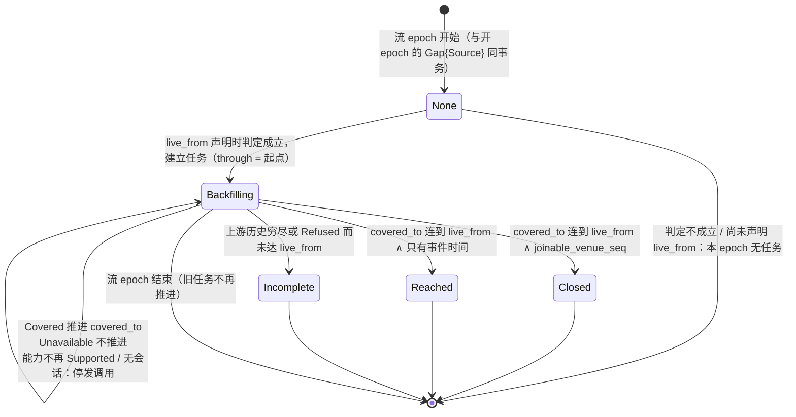
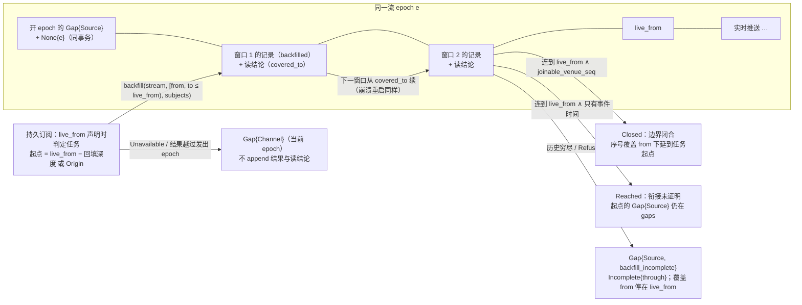

# 回填

## 3 模型

### 3.1 回填任务与回填进度

一次**回填任务**是核心为一个流 epoch 补齐 `[起点, live_from)` 的义务；每个流 epoch 至多一个，在该 epoch 的 `live_from` 声明时一次判定是否建立（§4.2）。进度值是它的 fold，写成健康观察：

## 4 结构与接口

### 4.1 核心→集成：`backfill(stream, window, subjects) → Covered | Unavailable | Refused`

- **语义**：历史回填（P5）：取该流在 `window` 内、`subjects` 的历史记录。`window = [from, to)` 用该流 `live_from` 的坐标（声明 `joinable_venue_seq` 的流用 venue 序号，否则用事件时间），`to` 不超过 `live_from`。`from` 是该坐标上的一个值，或 `Origin`：上游该流历史的真实起点，只对声明 `backfill_from_origin` 的流合法；任务的第一个窗口从起点开始，后续窗口从上一次的 `covered_to` 续。`subjects` 是回填任务建立时该流被路由的主体集（整条流为 `All`），同一任务的各窗口不变，记在每条读结论记录里。任务建立后才加入需求的主体在本 epoch 不回填：它在本 epoch 的记录从加入它的路由结论记录之后开始，更早的历史用带 `range` 的一次性 `read` 取（[02-one-shot-read.md §4.1 核心→集成：read](02-one-shot-read.md#41-核心集成readstream-request-range--answered--unavailable--refused)）；已撤出需求的主体照常补完本任务。每次调用属于发出它的任务所在的流 epoch，即这次调用的**发出 epoch**，`window` 就在这个 epoch 的坐标上。**动作轴**：**读**。
- **谁调、何时调**：本组件按回填任务发起（§4.2）：任务定起点，本组件决定切成几个窗口；经集成会话的调用通道发出，按会话有效声明判定回填能力。
- **返回**：`Covered{records, covered_to}` / `Unavailable` / `Refused(reason)`。
  - `covered_to` 表示本次实际取得的是从 `from` 起到 `covered_to` 的连续前缀；只在上游历史已穷尽时小于 `to`。
  - 从 `Origin` 起的窗口，`Covered` 断言取得的是上游该流（对 `subjects`）自有历史以来、到 `covered_to` 为止的全部记录，含归并所需的修订与作废，且落在与实时相同的回填坐标上。取不全时不能以 `Covered` 作答：一次取失败是 `Unavailable`；上游已不保留起点处的历史，说明 `backfill_from_origin` 声明不实，由一致性测试查出，不能把“上游此刻保留的最早一条”当作起点。
  - 上游分页、pacing 与重试都在适配器内：一次调用一个封闭结果，任一页失败即整体 `Unavailable`，不交出缺项结果。
- **核心内部结果**：记录打 `backfilled` 标记 append 观察 `Journal`，与实时推送同形、同 epoch（发出 epoch），`LogPosition` 仍由核心按到达顺序分配；同一事务再 append 一条读结论记录，带窗口、`covered_to` 与 `subjects`；`Refused` 只 append 结论记录。回填进度的健康观察与计数观察在同一事务（§4.2；[core/00-design.md §4.7.5 调用结果与计数的提交协议](../00-design.md#475-调用结果与计数的提交协议)）。覆盖到 `live_from` 时，`joinable_venue_seq` 的流边界闭合，序号覆盖的起点下延到任务起点；其余的流补到实时起点而衔接未证明（§4.2）。
- **错误**：
  - `Unavailable` → 该流上 `Gap{origin: Channel}`（渠道为回填），可再发；
  - 结果到达时该流的当前流 epoch 已不是这次调用的发出 epoch（会话内集成上报的 `Gap{origin: Source}` 已开新 epoch：集成在送出 gap 之后才收到这次调用的，是合规的竞态；送出之前已收到、却在之后作答的，是集成违约）→ 不论集成返回什么，核心把这次调用完成为 `Unavailable`：在当前 epoch 上记 `Gap{origin: Channel}`，不 append 结果记录与读结论记录，所以该流的 `Covered` 链与 `covered_to` 只来自发出 epoch 就是所在 epoch 的调用。发出 epoch 的任务已被新 epoch 取代、不再推进，核心不为它再发；
  - `Refused` → 上游明确拒绝这次回填（如未开通该历史数据）；不记 `Gap{origin: Channel}`（渠道没有失败），该窗口按穷尽处理；
  - `covered_to < to` 或 `Refused` 使边界无法闭合 → `Gap{origin: Source, reason: backfill_incomplete}` 标出未覆盖的区间；
  - 该流在会话有效声明里的 `backfill` 能力不是 `Supported`（`Unsupported`、`Unknown`，或来源此刻没有已建立会话）→ 核心不调用。任务是否建立在该 epoch 声明 `live_from` 时一次判定（§4.2）；已建立的任务在能力不再是 `Supported` 或没有会话期间不发调用、停在 `Backfilling`，恢复后从最近的 `covered_to` 续；
  - 窗口内某笔成交给不出上游证明的执行身份时返回 `Unavailable`，不返回删过项的集合；上游回应里不是成交的行由记录映射丢弃，不算缺项（[07-trade-observation.md §3.1 成交的计数身份](07-trade-observation.md#31-成交的计数身份-设计)）。
- **重试**：可重试。核心可以把一个窗口切成若干连续的小窗口依次请求，续点是已覆盖的边界，不需要集成保存游标；窗口之间、崩溃重启之后都从最近的读结论接着请求。有多少次上游调用、按什么节奏发，是适配器的事。

[设计] 回填与一次性读一样，分页留在适配器内：核心只需要“这一段有没有取全”，续点由已 append 记录的覆盖边界给出，崩溃后从这里重发即可。不选：由集成交出不透明的 `next_cursor` 让核心逐页驱动：核心要持久化一个自己不懂的游标才能续，且 pacing 本是上游的限制，放在核心就要把它声明成值再由核心执行。

### 4.2 实时边界、回填任务与回填进度

**实时边界** [设计]。

- 集成在 readiness 进入 `Live` 时声明 `live_from`：实时供给在该流回填坐标上的起点（readiness 的推送与 fold 见 [01-integration.md §4.3.2 集成→核心的推送](../04-boundary/01-integration.md#432-集成核心的推送)）。声明 `joinable_venue_seq` 的流上，序号从 `live_from` 起的记录都由推送送达；只有事件时间的流上，它只表示实时供给已建立，不保证事件时间不早于它的记录都会被推送（见“衔接”）。
  - 声明 `joinable_venue_seq` 的流：实时订阅一经上游确认即声明，`live_from` 为下一个期望的 venue 序号，不必等首条记录。
  - 其余流：`live_from` 是首条实时记录的事件时间，与该记录同时或先于它声明。订阅确认的时刻本身不是边界：迟到或修订的记录可能带更早的事件时间。
  - 核心在 `live_from` 声明之后才请求回填，所以同一条流上实时记录照常到达、回填同时进行。
- 核心只请求 `< live_from` 的回填窗口。各窗口的 `covered_to` 连成一段、到达 `live_from` 时，这次回填到达终点。声明 `joinable_venue_seq` 的流上，序号覆盖的起点由此从 `live_from` 下延到任务起点（[04-supply.md §4.3 序号覆盖与覆盖检查点](04-supply.md#43-序号覆盖与覆盖检查点)）；只有事件时间的流没有完备进度，到达不改变这一点，它所在 epoch 起点的 `Gap{origin: Source}` 仍在读模型的 `gaps` 里。
- **衔接** [设计]：只有可衔接序号能证明回填与实时之间既不重叠也不留洞。
  - 声明 `joinable_venue_seq` 的流：回填止于 `live_from` 的前一个序号，实时从 `live_from` 起，序号连续，边界**闭合**。Q14 在这类流上成立：边界本身不产生重复，也不留洞，不靠逐条去重。上游自己重放或乱序送来的记录仍照常 append、打 `replayed` / `out_of_order` 标记（[01-integration.md §4.3.2 集成→核心的推送](../04-boundary/01-integration.md#432-集成核心的推送)），不使 `Closed` 失效。`joinable_venue_seq` 所断言的序号语义以上游文档为证据；一致性测试只验证适配器按声明行事（证伪 #21）。
  - 只有事件时间的流：回填补到 `live_from`，称**到达**，不称闭合。实时订阅确认之前上游已发出、事件时间不早于首条实时记录的记录，既不在回填窗口里，也不在实时推送里；首条实时记录迟到时，这样的洞核心看不出来。迟到或修订的实时记录也可能与回填取得的同一对象并存：二者照常 append，按该种类的 fold 语义取值，核心不逐条去重。所以该 epoch 起点的 `Gap{origin: Source}` 不因到达而视为由回填闭合：它仍列在读模型的 `gaps` 里，成交完整性的条件 1 不成立（[07-trade-observation.md §3.3 精确重建的前提与完整界](07-trade-observation.md#33-精确重建的前提与完整界-设计)）。
  - 理由：事件时间不定序，也不能证明某段上游输出是否送达；把到达当闭合，就是把可能存在的洞报告成连续（C6）。不选：以订阅确认时刻或其前的某个时间为边界、向后多回填一段再按内容去重：确认时刻不在该流坐标上，按内容去重会并掉两条真实的相同记录；也不选：没有可衔接序号的流一律不回填：丢掉仍有价值的历史，而衔接未证明本身可以如实标出。
- 上游历史穷尽（`covered_to` 小于窗口末端）或上游拒绝回填（`Refused`）而未达 `live_from`，则 append `Gap{origin: Source, reason: backfill_incomplete}` 标出未覆盖的区间（C6：不伪造连续）；它不结束也不开流 epoch，所以不重置该流的 readiness、路由结论与 `generation`；序号覆盖的起点停在 `live_from`，不越过这段区间。

**回填任务的判定** [设计]：是否建立任务，在该 epoch 的 `live_from` 声明时一次判定，每个流 epoch 至多一次；下列条件在那一刻全部成立，本组件为该 epoch 建立任务，否则这个 epoch 没有任务：

- 该 epoch 以 `Gap{origin: Source}` 开始：握手时开的新 epoch 与会话内集成上报开的新 epoch 一样（握手以 venue 游标续接原 epoch 的不开任务）；
- 该流在会话有效声明里的 `backfill` 为 `Supported`；
- 该流的需求非空：[04-supply.md §3.1 需求、route 义务与路由结论记录](04-supply.md#31-需求route-义务与路由结论记录) 合成的全集，含核心自己的 `All`；
- 该逻辑流的**回填深度**不为 0；为 `Origin` 时，会话有效声明含 `backfill_from_origin`。

判定之后能力、需求、深度或声明的变化只影响下一个流 epoch 的判定，不在本 epoch 补建、改建或撤销任务：epoch 中途新增的需求不建任务，已建立的任务在需求撤去后仍按建立时的主体集进行（需求的变化只改 `route` 下发的全集，不改任务；任务的主体集不是需求）。理由：本设计让一个流 epoch 至多有一个回填任务，它的起点与主体集在 `live_from` 声明时取定，`health` 与完整界说的都是这一个任务。中途才订阅的消费方：若该 epoch 没有任务，或任务没有闭合起点的 `Gap{origin: Source}`，这条 gap 仍标出未覆盖的区间，要那段历史就用带 `range` 的一次性读。

已建立的任务在能力不再是 `Supported` 或来源没有已建立会话期间不发调用、停在 `Backfilling{through}`；恢复后从最近的 `covered_to` 续，直到终态或该 epoch 结束。一直恢复不了的任务没有终态：到 epoch 结束仍是 `Backfilling`，下一 epoch 开新的判定，旧任务不再推进；它在 epoch 结束时仍在途的调用，集成已收到的由集成在 gap 之前以 `Unavailable` 完成，在途跨过 gap 的由核心按发出 epoch 完成为 `Unavailable`，结果都不 append（§4.1），那段未补的历史由 e 起点的 `Gap{origin: Source}` 继续标出。

**回填深度**是运行期参数（文件与重载见 [06-files.md 统一路径文件](../04-boundary/06-files.md)），按逻辑流给，缺省取全局值；取值是该流回填坐标上的一段长度、`0`（不回填），或 `Origin`。长度的单位随坐标：声明 `joinable_venue_seq` 的流为 venue 序号个数，其余流为时长；全局缺省因此给两个值，按流的坐标取其一。起点 = `live_from` 往前一个回填深度；深度为 `Origin` 时起点为 `Origin`，即上游该流历史的真实起点。深度、起点与主体集在任务建立时取定，同一任务内不变；`reload_config(runtime)` 改了深度，只影响之后的判定。

**回填进度**（按流 epoch，本组件判定）[设计]。没有任务的流 epoch（判定时条件不全：握手以 venue 游标续接原 epoch、能力不支持回填、需求为空、回填深度为 0、或深度为 `Origin` 而声明没有 `backfill_from_origin`；以及尚未声明 `live_from` 的 epoch）没有回填进度，不显示为已补齐。有任务的，进度取值如下：

- `Backfilling{through}`：任务建立即是此状态，`through` 为起点；此后是最近一次成功的 `covered_to`，即由读结论记录证明的、从起点起的连续覆盖上界，用与回填窗口、`live_from` 相同的该流坐标（不是核心分配的 `Seq`）。`Unavailable` 不推进它，任务仍在进行。
- `Closed`：声明 `joinable_venue_seq` 的流，`covered_to` 连到 `live_from`，边界闭合。它只说这一个流 epoch 的这一次任务，不说该流任意历史都可取得。
- `Reached`：只有事件时间的流，`covered_to` 连到 `live_from`：`[起点, live_from)` 已取得，与实时的衔接未证明。它与 `Closed` 同为终态，不再请求回填。
- `Incomplete{through}`：上游历史穷尽或 `Refused` 而未达 `live_from`，已 append `Gap{origin: Source, reason: backfill_incomplete}`；`through` 保留实际取得的上界。
- 本组件在任务建立时 append 一条 `Backfilling{起点}` 的健康观察；此后进度每改变一次，在 append 那条读结论记录或 `backfill_incomplete` 的同一事务 append 一条健康观察，所以崩溃不会留下与读结论记录分叉的进度。新 epoch 开新任务，旧任务的终态不沿用；断连不改变已取得的覆盖。
- 进度值都带所属的流 epoch；没有任务的 epoch 的值是 `None{epoch}`，健康的 `backfill` 字段不列它。流 epoch 起点的 `Gap{origin: Source}` 与该逻辑流的 `None{epoch}` 在同一事务 append：握手时开的与会话内上报开的新 epoch 一样，由集成会话编排这一事务，`None{epoch}` 由它请本组件写（[03-consumption.md §4.4 与同级组件的接口](03-consumption.md#44-与同级组件的接口)）；这一 epoch 建立任务时由 `Backfilling{起点}` 取代。上一 epoch 的 `Closed` 或 `Reached` 因此不会被当作新 epoch 的进度，崩溃也不会把 gap 与 `None` 分开。健康观察的键、按键保留与 `health` 的 fold 见 [05-views.md §3.2 健康面](../04-boundary/05-views.md#32-健康面-设计)。
- 理由：`through` 与边界闭合只有核心凭读结论记录能证明，集成不持有这些记录；而回填必须在 `live_from` 之后才有终点。把二者都塞进集成推送的 readiness，要么回填先于它的终点，要么由集成宣布它证明不了的覆盖。
- 理由（回填深度）：`live_from` 之前要补多少，是运维者按成本与用途定的取舍，不是哪个订阅能表达的量：订阅的 `from` 是核心日志上的位置，说不出上游坐标上的一段历史；多个订阅各要一段，还要再合并一次，且任务建立后仍会变。回填深度与需求一样按逻辑流给，任务在建立时取定它，窗口序列与读结论记录因此只对应一个起点。
- 不选：从上一 epoch 的最后覆盖接着补：新 epoch 正是因为续接无法证明才开的，`joinable_venue_seq` 的序号只在一个流 epoch 内可比，拿旧 epoch 的覆盖上界当新 epoch 的起点，是把不可比的两个坐标当作一条；一律从 `Origin` 起：每个不能以游标续接的 epoch 都要把该流的全部历史重取一次，而多数用途只需要近处一段；由最早的订阅需求决定起点：订阅说不出上游坐标上的历史；epoch 中途按新能力、需求或深度补建任务：同一 epoch 有两个起点可说；拼接多个 epoch 的有限回填：序号跨 epoch 不可比。

**安静的无序号流** [设计]：没有可衔接序号而一直没有实时记录的流，在首条记录到达前不回填；健康里可见它仍是 `Starting`、没有回填进度，读模型的 `gaps` 仍列着该 epoch 起点的 `Gap{origin: Source}`。回填只是推迟：首条记录一到，`live_from` 随之确定，回填窗口取 `[起点, live_from)` 内上游给得出的历史，终态为 `Reached`，与实时的衔接同样未证明。等待期间要历史的消费方用带 `range` 的一次性 `read` 取，它不推进完备进度，也不闭合 gap。理由：这类流的回填终点只能是首条实时记录的事件时间，此前没有落在该流坐标上的终点。不选：以订阅确认时刻或核心的当前时间作 `live_from`：它不在该流的事件时间坐标上，确认之前发出、事件时间更晚的记录会同时出现在回填与实时里，或两边都不在；先无终点地回填到“现在”、首条记录到达后再补一段：两段之间的衔接同样无从证明，却多出一次回填与一种进度状态。

## 5 走查

### 5.1 回填：正常、失败与崩溃

1. e 以 `Gap{Source}` 开始，`None{e}` 同事务。集成推送 readiness `Live{live_from}`（`joinable_venue_seq` 流在上游确认订阅时即声明）。本组件判定：会话有效声明 `backfill = Supported`、需求非空、回填深度 d ≠ 0 → 建任务，起点 `live_from − d`，主体集取此刻路由的全集，append `Backfilling{起点}`。
2. 发 `backfill(stream, [起点, w1), subjects)` → `Covered{records, covered_to = w1}`：同一事务 append `backfilled` 记录、读结论记录、`Backfilling{w1}` 与计数观察。
3. 下一窗口 `[w1, live_from)` 得 `Unavailable`：记 `Gap{Channel}` 与计数观察，进度不变，按 pacing 再发。
4. **崩溃**于第 3 步再发之前：重启后回填任务由读结论记录与健康观察重建（`Backfilling{w1}`），会话重新建立后从 `w1` 续；同 epoch 无重复记录，因为续点来自已提交的读结论。
5. 再发得 `Covered{covered_to = live_from}` → `Closed`（同事务）；序号覆盖 `from` 下延到起点。
6. **epoch 更替变体**：第 3 步的调用在途时集成上报 `Gap{Source, generation}`：已收到的调用由集成在 gap 前以 `Unavailable` 完成；跨过 gap 才返回的，本组件按发出 epoch 完成为 `Unavailable`，在当前 epoch 记 `Gap{Channel}`，不 append 结果。e 的任务停在 `Backfilling{w1}`，不再推进；e' 在它自己的 `live_from` 声明时重新判定。
7. **拒绝变体**：上游对窗口 `Refused`：只 append 拒绝的读结论记录，`Gap{Source, backfill_incomplete}` 标出 `[w1, live_from)`，`Incomplete{w1}`，同事务；计数按成功计。

## 6 评估

### 6.1 证伪条件

- **证伪 #21 边界证明的依据**：两个方向。其一，声明 `joinable_venue_seq` 的某上游被观测到流 epoch 内序号跳号而无记录缺失、或回填与实时用不同的序号空间 → 该流的声明不成立，须撤为只有事件时间；若范围内的 venue 普遍如此，`Closed` 须另找证明依据。其二，某在范围内的 venue 的流没有可衔接的 venue 序号，而下游（S10）确实需要该流回填与实时之间可证明无洞、无重复（例如按每根 bar 精确累计的程序），且上游另有能证明衔接的依据（例如订阅快照附带的截止事件时间并承诺其后全部推送）→ “只有事件时间的流只能 `Reached`”过于保守，须把该依据定为第二种可衔接证明并写进流声明与一致性测试。（§4.2 衔接）

- **证伪 #23 回填起点的可证明性**：某在范围内、下游（S10）确实需要成交可证明完整的 venue，其成交流在任何渠道都取不到从上游历史起点起、含修订与作废的全部记录（只保留最近一段，或最早的记录已被上游改写），或能取到但不在与实时相同的可衔接序号坐标上 → 该 venue 永远没有完整界：若这不可接受，“下界只能来自上游历史起点”须重定，另找上游对某个序号以下历史的完整性证明（例如上游给出的“此序号之前的全部执行”快照），完整界的形状随之改为序号坐标上带下端的区间。（§4.1 `Origin`、§4.2 回填进度；完整界见 [07-trade-observation.md §3.3 精确重建的前提与完整界](07-trade-observation.md#33-精确重建的前提与完整界-设计)）

### 6.2 验收标准

- **验收 #28 读侧声明：配额、回填、数据等级**（对应 Q13/Q14）：
  - 同一流同一主体被两个 principal 订阅，配额用量只计一次；配额池里的流上的整流订阅被拒；重新握手使上限变小后，按创建先后保留、超出者转挂起（原因 `QuotaExceeded`），集成不收到超限主体，有余量时按同一顺序恢复；
  - 回填：注入任一页失败得 `Unavailable`：不 append 部分页的记录，也不 append 读结论记录，按失败契约记 `Gap{origin: Channel}` 与健康观察；上游历史穷尽时 `covered_to` 为连续前缀，未覆盖区间以 `Gap{Source, backfill_incomplete}` 标出；崩溃重启后从最近的读结论接着请求，同 epoch 无重复记录；
  - 回填：fixture 上游明确拒绝一个未覆盖到 `live_from` 的窗口（`Refused`）：该流上只有一条拒绝的读结论记录、没有结果项、不记 `Gap{origin: Channel}`，未覆盖区间以 `Gap{Source, backfill_incomplete}` 标出，健康里该流 epoch 的回填进度为 `Incomplete{through}` 且 `through` 不前进；健康把这次 `Refused` 计为成功回答；
  - 回填进度：集成声明 `live_from` 之后才出现回填请求，回填期间实时记录照常 append；声明 `joinable_venue_seq` 的流在没有任何实时记录时也于订阅确认后声明 `live_from` 并开始回填；任务建立即有 `Backfilling`，各窗口连到 `live_from` 后恰一次变为终态（`Closed` 或 `Reached`，见 #49）；尚未声明 `live_from`、以 venue 游标续接原 epoch、能力不支持回填、需求为空或回填深度为 0 的流没有回填进度，不显示为终态；新 epoch 开新任务，`health` 只给当前 epoch 的进度；崩溃重启后回填进度与重启前相同；
  - 声明的名义数据等级与记录上报告的实际等级不同时，下游对该记录显示记录上的等级。

- **验收 #49 实时边界的两种终态**（对应 Q14）：
  - 声明 `joinable_venue_seq` 的流：fixture 在回填与实时之间不留洞、不重叠，进度恰一次变为 `Closed`；同 epoch 无重复记录；
  - 只有事件时间的流：fixture 在实时订阅确认前发出一条事件时间晚于首条实时记录的记录、并让首条实时记录迟到：进度恰一次变为 `Reached`，不是 `Closed`；该 epoch 起点的 `Gap{origin: Source}` 仍在读模型的 `gaps` 里；迟到或修订的实时记录与回填记录并存时二者都 append、核心不去重；
  - 只有事件时间、一直没有实时记录的流：没有回填任务，健康为 `Starting`、无回填进度，`gaps` 里仍有该 epoch 起点的 `Gap{origin: Source}`；此间带 `range` 的一次性 `read` 可取得历史，不改变回填进度与完备进度；首条实时记录到达后建立任务，回填窗口为 `[起点, live_from)`，终态为 `Reached`；
  - 集成一致性：`joinable_venue_seq` 只在上游序号于流 epoch 内连续、回填与实时同一序号空间时声明；`live_from` 的声明时机按两种流各自的规则。

- **#55 回填起点与完整界**（[01-integration.md §3.3 投影 Projection](../04-boundary/01-integration.md#33-投影-projection)、[07-trade-observation.md §3.3 精确重建的前提与完整界](07-trade-observation.md#33-精确重建的前提与完整界-设计)、[§4.1 核心→集成：backfill](#41-核心集成backfillstream-window-subjects--covered--unavailable--refused)、[§4.2 实时边界、回填任务与回填进度](#42-实时边界回填任务与回填进度)、[07-trade-observation.md §3.3 精确重建的前提与完整界](07-trade-observation.md#33-精确重建的前提与完整界-设计)）：（对应 Q14/Q31）
    - 回填深度为 N 时，新 epoch 的任务从 `live_from − N` 起请求（N 的单位随该流坐标）；任务在 `live_from` 声明时判定，之后改深度、能力或需求只影响下一 epoch 的任务；深度为 0、该流需求为空、或深度为 `Origin` 而该流会话有效声明没有 `backfill_from_origin` 时，不建任务、不调用 `backfill`，健康里没有该 epoch 的回填进度；
    - 新 epoch 的任务起点从不取上一 epoch 的覆盖上界；
    - 从 `Origin` 起、对 `All`、`Closed` 的成交流：`orders` 给出完整界（正例同 #40）；同一 fixture 以有限深度回填、即使 `Closed` 且覆盖了 W 的全部执行，`orders` 也不给完整界；
    - 集成一致性：声明 `backfill_from_origin` 的集成，对从 `Origin` 起的窗口给出的 `Covered` 含 fixture 上游自有历史以来的全部记录与修订；fixture 丢弃最早一段历史时，集成返回 `Unavailable` 而不是从“此刻最早一条”起作答，一致性测试把该声明判为不实。

- **验收 #74 回填任务一次判定**（对应 Q14）：新 epoch 声明 `live_from` 时需求为空：该 epoch 没有任务，之后新增的订阅不建任务，该 epoch 起点的 `Gap{origin: Source}` 仍在 `gaps` 里，带 `range` 的一次性读能取到那段历史；另一 epoch 建任务后需求撤空：任务仍按原主体集进行到终态；任务进行中能力变为 `Unsupported` 或会话断开：不发 `backfill` 调用、进度停在 `Backfilling{through}`，恢复后从最近的 `covered_to` 续。
