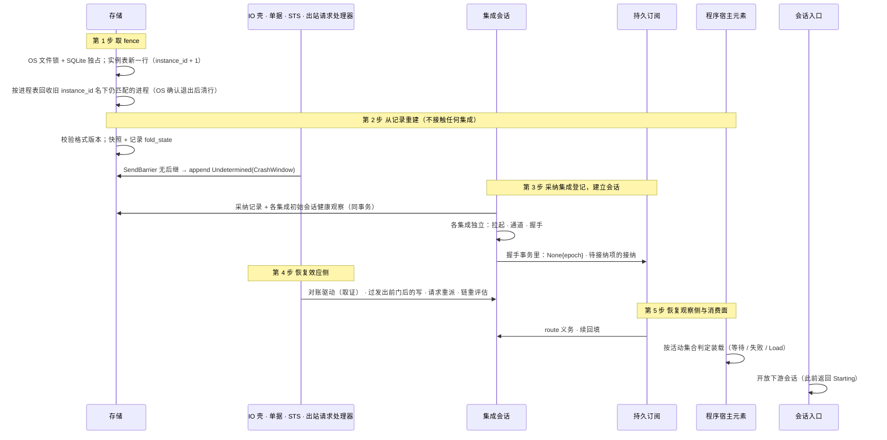

# 核心进程

## 0 定位

- **层级与元素**：C4 L2（container），元素是 core 系统里的**核心进程**：独占状态库、持有两侧 `Journal`、单据、lane、IO 壳、订阅表与读模型的那一个 OS 进程。上级文档：[core/00-design.md §4.1 容器](../00-design.md#41-容器)。同一系统里的另一个容器是程序宿主进程（[04-program-host-process.md](04-program-host-process.md)）。
- **本目录**：本文（核心进程：进程视图与生命周期；崩溃矩阵）、[01-program-host.md](01-program-host.md)（程序宿主元素）、[02-requests.md](02-requests.md)（出站请求处理器）、[03-timer.md](03-timer.md)（定时器）、[04-program-host-process.md](04-program-host-process.md)（程序宿主进程）。
- **本文决定什么**：核心进程的进程生命周期视图（进程形状、传输与编码、生命周期与嵌套、启动五步、受控停止）与崩溃矩阵 #1–#21。
- **不在本文**：核心进程内部的模型、它分解成哪些组件、组件之间的接口与 W1–W20 的组件级走查，在 [core/00-design.md](../00-design.md)（§3、§4.4–§4.8、§5.1）；持久化视图在 [01-base/00-design.md §4.1 持久化视图](../01-base/00-design.md#41-持久化视图)，统一路径文件在 [06-files.md 统一路径文件](../04-boundary/06-files.md)；任何组件的内部（状态机、转移表、每个对外操作的规格），它们写在各组件文档，本文以链接指过去；对外操作的完整规格也在实现它的组件文档（[core/00-design.md §4.6 对外接口总表](../00-design.md#46-对外接口总表)只给总表）；全局原则、问题域登记与需求编号（[README.md §2 问题域](../../README.md#2-问题域)）；程序宿主进程内部（[04-program-host-process.md](04-program-host-process.md)）；集成与解释层两个部分的内部（[integration/design.md](../../drafts/integration/design.md)、[downstream/design.md](../../drafts/downstream/design.md)）；可选行情派生计算子系统（只在它与程序宿主元素的接口处出现，[01-program-host.md §4.7 核心↔可选行情派生计算子系统](01-program-host.md#47-核心可选行情派生计算子系统)）。
- **读者**：核心的实现者与评审者；写组件文档与改组件契约的人。审批者：维护者。
- **状态**：已定。
- **阅读约定**：证据标签 `[证据]`/`[设计]`/`[推断]`、编号前缀与跨文档引用写法见 [README.md §0.4 阅读约定](../../README.md#04-阅读约定)。“观察 J”= 观察 `Journal`，“执行 J”= 执行事实 `Journal`。

## 1 问题域

### 1.1 核心进程直接面对的域

下列是核心进程读写、却不由它设计的东西的固有性质。它们约束本文的持久化视图与生命周期视图。

| 域 | 性质 | 证据 |
|---|---|---|
| SQLite 单文件（WAL） | 一个事务要么全部可见要么全部不可见；`fsync` 返回之后的提交跨断电保留；单写者 | [证据：`investigation/rust-feasibility.md`] |
| OS 文件锁 | 由持有它的进程持有、随进程消亡释放；取到即蕴含上一持有者已退出 | [证据：H10；`existing-capabilities.md:239`] |
| OS 进程 | 进程身份只有 `(pid, start_time)` 能跨 pid 复用可靠辨认；存亡只能问 OS；父进程死而子进程活是真实情形（Windows 上 kill 只到 wrapper） | [证据：H10；`scripts/guardian/shared.ts:271-276`] |
| OS 继承句柄 / 通道 | 三个目标 OS 都能创建只交给被拉起子进程、别的进程连不上、关闭可确认的通道（`socketpair` / 匿名管道对） | [证据：[README.md §2.4 调查结论摘录](../../README.md#24-调查结论摘录)；H8] |
| 时钟 | UTC 时刻可持久化、跨重启可比；运行期计时用单调钟；二者都不给出上游的来源顺序 | [证据：域 F11；fp-04 命题 9/11] |
| 统一路径文件（`OPENALICE_HOME` 下） | 写者是 Alice；整文件原子替换（临时文件 + rename），不存在半写可见态 | [证据：O9；`existing-capabilities.md:189`] |

## 4 结构

### 4.1 进程视图与生命周期

#### 4.1.1 进程形状

- 核心进程是一个 OS 进程，独占状态库；集成进程、程序宿主进程都是它之外的独立 OS 进程，可选子系统在 core 之外（部署与信任边界的结论在 [core/00-design.md §4.3 部署与信任](../00-design.md#43-部署与信任)）。
- 核心进程内的组件之间是函数调用与共享内存，没有 IPC；并发模型、线程与任务划分是实现（`ARCHITECTURE.md`），不改本文的组件边界。本文只要求两件并发事实：存储是单写者，每次事务原子；持久订阅对同一订阅的需求变更、cursor 推进与投递缺口串行化（[03-consumption.md §4.5 订阅表（持久化）](../02-read/03-consumption.md#45-订阅表持久化)）。

**传输与编码** [设计]：

- 核心↔集成、核心↔解释层的语义由一份 IDL 固定。IDL 之下的编码与信道按 OS 选择。核心↔集成的信道由集成会话创建（[01-integration.md §3.5 会话：核心创建的通道化身](../04-boundary/01-integration.md#35-会话核心创建的通道化身-设计)）；核心↔解释层在 Windows 上缺少 UDS，传输层退化为本地回环 + 本地令牌或命名管道，只改编码 / 信道，**不改 IDL**。
- 默认文本序列化 JSON-RPC：跨语言、可读、可录制回放。
- 验收 #19 的负载下推送流不达标时，另加二进制编码，定位为同一 IDL 的另一种编码，而非第二套协议。
- 不选：**默认二进制协议**：牺牲可读与跨语言。[证据：`investigation/rust-feasibility.md`（gRPC 单流有序、流间独立）]

#### 4.1.2 生命周期与嵌套

启动与停止的调用顺序由下表推出：内层在外层之内开始；结束外层之前先结束它的全部内层，最后写外层的结束锚点。每个锚点写明确认者；只在内存里的对象，锚点由持有它的组件确认。表只列到组件粒度，锚点的精确条件在右列所指的组件文档。

| 对象 | 开始锚点（确认者） | 结束锚点（确认者） | 外层 | 精确定义 |
|---|---|---|---|---|
| 核心实例 | 第 1 步 fence 事务：OS 文件锁 + SQLite 独占 + `instance_id` 加一（OS、SQLite） | 受控停止：全部内层结束之后写的实例结束锚点，之后释放 fence（存储）；崩溃：没有结束锚点，继任实例取得 fence 的事务就是它的失权点（继任者确认） | — | [02-storage.md §4.2 实例表](../01-base/02-storage.md#42-实例表) |
| 消费方会话 | `handshake` 返回 `Session`（会话入口，OS 对端凭据） | 传输关闭，或受控停止第 1 步由会话入口关闭；实例死亡 | 核心实例 | [03-session.md §4.4 会话的生命周期](../04-boundary/03-session.md#44-会话的生命周期-设计) |
| 集成运行（每个采纳的集成登记 × 实例） | 让该集成进入初始状态的 `Connecting` 健康观察所在的事务（第 3 步、`restart_integration` 采纳新 id、解除 `Halted` 的 `Applied`）（集成会话、控制面） | `Halted` 路径：最后一个集成进程 OS 确认退出并清除其进程表行；或实例结束锚点 / 继任者的 fence | 核心实例 | [01-integration.md §4.6 会话状态机](../04-boundary/01-integration.md#46-会话状态机) |
| 集成进程 | 拉起并写进程表（OS） | OS 确认退出之后清除该行；未确认的由继任实例第 1 步回收 | 集成运行；同一集成同时至多一个 | [01-integration.md §4.6 会话状态机](../04-boundary/01-integration.md#46-会话状态机) |
| 凭据副本 | 拉起时经继承句柄交付（集成会话） | 该进程 OS 确认退出 | 集成进程 | [01-integration.md §4.5 进程、通道与凭据](../04-boundary/01-integration.md#45-进程通道与凭据) |
| 集成会话（通道化身） | 拉起时创建通道、分配 `SessionEpoch`（集成会话） | 在途调用恰好完成一次、丢弃未了 `route` 义务、关闭通道（集成会话） | 集成进程：一个进程恰有一个会话 | [01-integration.md §3.5 会话：核心创建的通道化身](../04-boundary/01-integration.md#35-会话核心创建的通道化身-设计) |
| `Established` | 握手事务（集成会话） | 会话结束 | 集成会话 | [01-integration.md §4.3.1 handshake](../04-boundary/01-integration.md#431-handshake--projection--refused--unavailable) |
| 流 epoch（集成来源） | 开 epoch 的 `Gap{origin: Source}`（边界由集成确认；未兑现轮换强制的由集成会话确认） | 下一条开 epoch 的 `Gap{origin: Source}` | 不嵌在实例或会话里：握手以游标续接时跨会话、跨实例延续 | [01-integration.md §4.3.2 集成→核心的推送](../04-boundary/01-integration.md#432-集成核心的推送) |
| 流 epoch（程序产出） | 开始不沿用旧状态之成员的 `Applied` 事务里的 `Gap{origin: Source}`（控制面） | 同一程序 id 此后第一个声明该流、不沿用旧状态的成员开始时 | 不嵌在实例或程序成员里 | [06-derivation.md §3.1 输出契约与程序流](../02-read/06-derivation.md#31-输出契约与程序流) |
| 在途读侧调用（`read`、`backfill`、`route`） | 经通道发出（集成会话）；发出时的流 epoch 是它的发出 epoch | 封闭返回值；会话结束的强制完成；实例崩溃时随实例结束 | 集成会话；发出 epoch 是调用的属性，不是外层 | [02-one-shot-read.md §4.1 核心→集成：read](../02-read/02-one-shot-read.md#41-核心集成readstream-request-range--answered--unavailable--refused)、[04-supply.md §4.2 核心→集成：route](../02-read/04-supply.md#42-核心集成routestream-subjects-generation--routedrefused--unavailable) |
| `route` 义务（每条逻辑流至多一项） | 会话建立时为需求非空的流起；会话内接受该流的 gap 或需求变化时起或并入（持久订阅） | 第一次 `Routed`；会话结束时丢弃；实例崩溃时随实例结束 | 集成会话 | [04-supply.md §4.2 核心→集成：route](../02-read/04-supply.md#42-核心集成routestream-subjects-generation--routedrefused--unavailable) |
| 在途写与取证调用 | 经通道发出（集成会话） | 封闭返回值；会话结束的强制完成；实例崩溃时随实例结束（写由第 2 步记为 `Undetermined(CrashWindow)`） | 集成会话：按作用域寻址，不是流 epoch 的内层 | [07-resolution.md §4.5 崩溃恢复与集成崩溃两故障面](../03-read-write/07-resolution.md#45-崩溃恢复与集成崩溃两故障面) |
| 在途定时唤醒（程序定时器请求） | 出站请求处理器分派该请求时挂上（出站请求处理器） | 该请求的 `EffectResponse` append；或本实例结束；不写结束锚点记录 | 核心实例；请求本身跨实例持续，下一实例第 4 步由重派重新挂上 | [03-timer.md §4.1 定时器处理器](03-timer.md#41-定时器处理器-设计) |
| 程序（活动集合的成员） | `load_program` 的 `Applied`（控制面） | `unload_program` 的 `Applied` 或替换它的那个 `Applied`，只在宿主执行已结束之后 append | 不嵌在实例里：跨实例持续 | [01-program-host.md §4.4 卸载与替换](01-program-host.md#44-卸载与替换) |
| 程序订阅 | 让程序 id 进入活动集合的 `Applied` 同一事务（持久订阅） | `unload_program` 的 `Applied`；其中的项与 cursor 另可在替换里结束 | 程序 id 在活动集合里的时段：跨替换 | [03-consumption.md §4.3 程序订阅](../02-read/03-consumption.md#43-程序订阅) |
| 程序宿主执行 | 引用原生 op 的，子系统接受交出之后；然后拉起、登记、`Load`（OS、宿主） | `Unload` 或终止之后 OS 确认退出、清除该行；继任实例回收；拉起未成即结束 | 程序成员 ∩ 核心实例 | [01-program-host.md §4.6 宿主协议](01-program-host.md#46-宿主协议) |
| 交给子系统的原生 op 内容 | 这次宿主执行的开始（子系统接受） | 这次宿主执行结束 | 程序宿主执行 | [01-program-host.md §4.7 核心↔可选行情派生计算子系统](01-program-host.md#47-核心可选行情派生计算子系统) |
| `Checkpoint` 的保留引用 | 进入活动集合之后的第一个 `Checkpoint` | [core/00-design.md §4.7.6 保留引用的登记与解除](../00-design.md#476-保留引用的登记与解除) | 程序成员 | [core/00-design.md §4.7.6 保留引用的登记与解除](../00-design.md#476-保留引用的登记与解除) |
| 已安装的原生 op | `install_native_op` 的 `Applied`（控制面） | 同名 `remove_native_op` 的 `Applied`；活动成员引用时被拒 | 不嵌在实例里 | [01-program-host.md §4.7 核心↔可选行情派生计算子系统](01-program-host.md#47-核心可选行情派生计算子系统) |

表外还有几种不嵌在实例里、跨实例持续的对象，都是核心作为源头的持久事实，由控制流的 fold 恢复：`Halted` 抑制、程序的失败抑制、集成登记的采纳、未兑现的轮换；以及消费方的订阅（归属 principal，止于 `unsubscribe`）与单据（止于 `Close`）。

#### 4.1.3 启动五步

启动顺序由生命周期表、存储归属与写边界恢复推出。失败分两级 [设计]：

- **核心级**：核心自身不能安全运行时整体拒绝启动，不进入部分运行态。只有四种：第 1 步取不到 fence（专用退出码，此时无权写 SQLite）；第 2 步格式版本校验或迁移失败（C14）；第 2 步从快照 + 记录重建失败（状态重建不出，核心就无法判定哪些写可能已经发出）；第 3 步读取统一路径配置失败（C14）。后三种以专用退出码与诊断报告原因。
- **单元级**：只涉及一个集成或一个程序的失败，只使该单元不可用，其余照常启动：集成处于 `Connecting` 或 `Halted`；程序声明校验失败、宿主拉起未成、被失败抑制，或所引用的集成来源在采纳集合里而还没有声明版本、因而等待。
- 理由：集成与程序宿主各是独立故障域；一个 venue 不通就让全部账户与程序停摆，违背 Q15、Q18 的隔离。C14 管的是持久格式与迁移，不管集成是否可用。

1. **取 fence**（存储）。OS 文件锁 + SQLite 独占（H10）；取不到即以专用退出码退出，不做接管。锁由进程持有、随进程消亡，所以取到 fence 蕴含旧核心已退出；仍可能存活的，是它拉起的集成进程与程序宿主进程（H10 的孤儿）。取到 fence 即在实例表写入新一行，`instance_id` 加一，与 fence 同事务；上一实例若没有结束锚点，这一事务就是它的失权点：它的全部会话与在途调用随之结束。
   - **回收孤儿**：核心拉起的每个集成进程与程序宿主进程都以 `(instance_id, pid, start_time, role)` 登记在进程表。新实例对旧 `instance_id` 名下、`(pid, start_time)` 仍匹配的进程，先请求退出，超时后强制终止，OS 确认退出之后清除该行。受控停止之后这里没有要回收的行。
   - 未登记或匹配失败的孤儿也无法造成双写：它的通道只通向已经退出的旧核心，新实例从不读它，且它不接触 SQLite。
2. **从记录重建**（存储、各组件）。校验格式版本（C14），失败拒绝启动；从快照 + 记录 `fold_state` 重建各尝试、单据、订阅表与程序的活动集合，失败拒绝启动；IO 壳按恢复规则把 `SendBarrier` 无后继者 append 为 `Undetermined(CrashWindow)`（[07-resolution.md §4.5 崩溃恢复与集成崩溃两故障面](../03-read-write/07-resolution.md#45-崩溃恢复与集成崩溃两故障面)）。这一步**不接触任何集成**：恢复结论只来自记录，不依赖外部回音。
3. **采纳集成登记，建立会话**（集成会话，持久订阅参与握手事务）。读统一路径配置。集成会话 append 采纳记录，同一事务为每个采纳的集成 append 初始会话健康观察（`Connecting`，或从控制流恢复的 `Halted`）；持久的 `Halted` 保持、不拉起；其余拉起进程、创建通道、握手。各集成独立推进，不等全部集成建立会话；旧实例的会话不延续。采纳、被移除的登记、会话状态机与转移、进入 `Halted`、会话 epoch 的全部规则在 [01-integration.md §4.7 集成登记的采纳](../04-boundary/01-integration.md#47-集成登记的采纳) 与 [01-integration.md §4.6 会话状态机](../04-boundary/01-integration.md#46-会话状态机)。
4. **恢复效应侧**（IO 壳、出站请求处理器、STS 规则链）。按恢复判定依次：
   1. 为每条结果未知且未被放弃的 `Undetermined`，以及最近一次重开是放弃之后的 `Manual`、该轮渠道尚未穷尽的 `Abandoned` 尝试，启动对账驱动（读，可重试）；渠道已穷尽而停等者，在其集成建立新会话时自动 append `ReconciliationReopened{SessionRestored}` 后重走一轮（[07-resolution.md §4.1 对账驱动](../03-read-write/07-resolution.md#41-对账驱动)）。
   2. 对无 `SendBarrier` 的尝试过发出前门：过期则 `Expired`；会话已建立且会话有效声明下可执行则 `SendBarrier` → 写调用；否则等待（[06-write.md §4.2 发送屏障与发出前门](../03-read-write/06-write.md#42-发送屏障与发出前门)）。
   3. 出站请求处理器 fold 出无 `EffectResponse` 的 `EffectRequest` 重派；定时器请求由此重新挂上唤醒，`fire_at` 已过的立即得 `Fired`（[02-requests.md §4.2 重启重派](02-requests.md#42-重启重派)）。
   4. STS 链按记录重新评估每张待决单据；过期计时器按各单据的 `deadline`（UTC）重新装上（[04-decision-chain.md §3.5 等待与重入](../03-read-write/04-decision-chain.md#35-等待与重入-设计)）。
   - 顺序理由：取证在前，可让已结束等待的尝试先移出阻塞头集合；发送与取证都需要该集成已建立的会话，尚无会话的集成，其尝试在发出前门等会话建立再发、其取证等会话建立再续。
5. **恢复观察侧与消费面**（持久订阅、程序宿主元素、会话入口）。
   1. 为已建立会话的集成，持久订阅按订阅表与核心自己的需求（每个不在配额池里的作用域订单状态流与成交流恒为 `All`）合成各流需求，按会话建立时起的 `route` 义务下发，并续回填（[04-supply.md §4.2 核心→集成：route](../02-read/04-supply.md#42-核心集成routestream-subjects-generation--routedrefused--unavailable)）。
   2. 程序宿主元素装载活动集合里未被失败抑制的程序，按装载期校验“等待的先后”逐个判定：等待、`ProgramHalted` + `ProgramFailed`，或核对内容、交出原生 op、拉起宿主、以本成员可交回的最近 `Checkpoint` `Load`（[01-program-host.md §4.2 装载期校验](01-program-host.md#42-装载期校验)）。
   3. 最后会话入口开放下游会话。
   - 第 4、5 步只建立恢复任务与路由，不等取证收敛、回填完成或全部程序装载成功；之后才建立会话的集成，在会话建立时做同样的恢复。消费方在第 5 步之前连接，得到 `Starting`，不得到部分状态；启动完成后个别集成或程序不可用不是 `Starting`（[03-session.md §4.1 handshake](../04-boundary/03-session.md#41-handshakecontract_version-actor--sessionprincipal-instance_id-contract_version)）。

#### 4.1.4 受控停止 [设计]

核心收到 OS 的停止请求（服务管理器、终端中断）时，按生命周期表从内到外结束本实例：

1. **关闭新工作的入口**：
   - 会话入口不再接受消费方会话，关闭已有的全部消费方会话；控制面不再接受新的控制动作（已在执行的见下文）。
   - 核心内不再发起新的集成调用：IO 壳不再 append `SendBarrier`、不再推进取证（已 append 的 `SendBarrier` 的写调用照常发出，它是同一动作的一部分）；持久订阅不再发 `route` 与 `backfill`（未了的 `route` 义务不再发出，第 3 步随会话丢弃）；一次性读不再发调用；出站请求处理器不再分派，在途定时唤醒随之撤去，不等 `fire_at`、不写记录，下一实例第 4 步由重派重新挂上；过期计时器与链的重新评估停止。
   - 集成会话不再拉起任何集成进程，`Connecting` 的会话也不再发新的握手；已拉起的进程由第 3、4 步结束。
   - 程序宿主元素不再开始任何新的装载步骤，等待中的成员也不再判定装载；已发出的装载步骤在第 5 步之前等到结论（这一等待不挡第 2–4 步），按原有规则处理：真实的装载失败照常同事务 append `ProgramHalted` 与 `ProgramFailed`，停止不吞掉它；交出已被子系统接受而宿主还没有拉起的不再拉起，不拉起就是它的结束（[01-program-host.md §4.4.2 装载中的成员](01-program-host.md#442-装载中的成员)）。已在途的调用照常等结果。
2. **程序**（程序宿主元素）：每个程序在途的 `Advance`，等它的输出事务提交（或确知不提交），然后 `Unload`。受控停止本身不改变成员：它不是 `unload_program`。下一实例第 5 步照常判定装载活动集合里的程序。
3. **集成会话**（集成会话，发起方提交结果）：每个会话按“会话结束时在途调用恰好完成一次”结束（[core/00-design.md §4.7.5 调用结果与计数的提交协议](../00-design.md#475-调用结果与计数的提交协议)），然后关闭通道。
4. **进程**（集成会话、程序宿主元素）：请求每个集成进程与程序宿主进程退出，超时后强制终止；OS 确认退出之后清除进程表的行。
5. **实例结束锚点**（存储）：在实例表本实例的行上写结束锚点。这是本实例的最后一次写。
6. **释放 fence**（存储）：关闭 SQLite，释放 OS 文件锁。

**停止之前已在执行的控制动作** [设计]：第 1 步之后不再接受新的控制动作；停止开始时已在执行的控制动作照常完成，结论在第 5 步之前得出。

| 动作 | 停止中的处置 | 规格 |
|---|---|---|
| `unload_program` 与替换 | 已发出的装载步骤照第 1 步等到结论；在途 `Advance` 在第 2 步提交或确知不提交，然后 `Unload`；宿主 OS 确认退出（至迟第 4 步）之后 append 结束成员的 `Applied`。替换的 `Applied` 照常开始新成员，但停止中不为新成员开始任何装载步骤 | [01-program-host.md §4.4 卸载与替换](01-program-host.md#44-卸载与替换) |
| `abandon` | 它等的在途取证调用自行完成，或在第 3 步被强制完成为 `Unavailable`；然后照常在一个事务里重查：仍未知则 `Abandoned`，否则不写、返回 `Rejected(NotUndetermined)` | [07-resolution.md §4.4 结果未知组（核心↔解释层）：放弃跟踪与重开](../03-read-write/07-resolution.md#44-结果未知组核心解释层放弃跟踪与重开) |
| `restart_integration` 与 `rotate_credential` | `Applied` 还没有提交的，不论在等旧进程 OS 确认退出还是要采纳本实例尚未运行的 id，都在第 1 步以 `Rejected(Stopping)` 结束：不采纳、不解除 `Halted`、不换凭据、不留下未兑现的轮换。已提交 `Applied` 的，记下的事实不变，新进程还没有拉起的不再拉起，那次运行以实例结束锚点结束；`rotate_credential` 留下的未兑现轮换照常留着 | [01-integration.md §4.8 控制动作 restart_integration 与 rotate_credential](../04-boundary/01-integration.md#48-控制动作-restart_integration-与-rotate_credential) |

- 这些结论记录（`Applied`、`Rejected(Stopping)`、`Abandoned`）都在实例结束锚点之前提交。发起它的消费方会话已在第 1 步关闭，会话不拥有它；发起方重连之后从记录得知结果：程序与集成的动作看控制流，`abandon` 看该尝试的执行事实。
- **未完成的控制动作的结束锚点**：`unload_program` 或替换等的结论始终没有到（停止之前已发出的交出没有回答，或它等的宿主进程得不到 OS 确认退出）时，停止按下文失败。这个控制动作没有 `Applied` 也没有 `Rejected`：它随实例结束，结束锚点即继任者取得 fence 的事务，不留记录、不生效；它要结束的成员仍在活动集合里，继任实例第 5 步照常判定装载。
- 理由：`unload_program`、替换与 `abandon` 的每个内层都有确认者，而停止本来就要等到它们结束，所以动作的结论能在外层结束之前写下；停止时丢弃这样一个已在执行的动作，就要为一个已开始、内层已部分结束的动作另定取消记录与确认者。`restart_integration` 与 `rotate_credential` 生效就是开始或延续一次集成运行，而实例正在结束，它的内层运行不能在这时开始；若让它们在停止开始之后提交 `Applied` 却不开始运行，采纳或解除就成了停止自己制造的、没有运行的事实，下一实例还要另定怎样接续它。

**停止失败**：两种情形下停止失败：第 4 步有进程得不到 OS 确认退出；或第 2–4 步都已完成时，停止之前已发出的原生 op 交出仍没有子系统的回答。两种情形都不写结束锚点、不释放 fence，停止以失败报告；后一种不因这次没有回答而 append `ProgramHalted`：核心不替子系统判定超时，也不把没有回答当作未被接受或已被接受。之后实例被外力结束，就是崩溃：继任实例取得 fence 即本实例的失权点，由它回收孤儿，第 5 步照常判定装载。理由：这次交出的结论只有子系统是源头；没有回答的等待没有上界，只能以报告失败的停止结束，不能以核心猜出的结论结束。

- 受控停止不为各集成另写会话健康观察：集成运行是实例的内层，实例结束锚点即是它们的结束锚点；下一实例第 3 步为每个采纳的集成写初始状态。
- 崩溃路径不变：没有结束锚点的实例由继任者的 fence 事务结束，孤儿进程在第 1 步回收，无后继的 `SendBarrier` 在第 2 步记为 `Undetermined(CrashWindow)`，在途的一次性读随实例结束不再有结论。受控停止后这三件都不会发生：第 3 步已为在途的写与读留下结果。
- **为什么**：没有停止顺序时，停止就是一次崩溃：外层（实例）结束时它的会话、在途调用、程序宿主与集成进程都还活着，全部留给继任者的崩溃恢复。按嵌套从内到外结束，每个内层都有自己的结束与确认者，实例的结束锚点最后写。结果：停止成功时没有孤儿进程、没有无后继的 `SendBarrier`、每个在途调用都有结果；继任实例能区分上一实例是受控停止还是崩溃（Q20/Q21）。[证据：README 权威源头与生命周期；H10]
- **不选**：
  - 停止即退出、交给继任者的崩溃恢复：每次停止都产生孤儿与 `Undetermined(CrashWindow)`；
  - 以控制动作触发停止：停止要在控制面也关闭之后完成，且同一 OS 用户的进程本就能终止核心（H7）；
  - 第 3 步等在途调用自然返回：等待没有上界，而会话结束的强制完成已给每个调用恰好一个结果；
  - 为没有回答的原生 op 交出设核心超时，记为联系不上（`NativeHandoverFailed`）：核心就成了子系统结论的作者，还留下跨重启的 `ProgramHalted`，挡住下一实例的自动装载；超时后当作这次交出随停止结束：交出是否被接受没有源头确认，实例的结束锚点之前便有一个内层没有确认者；
  - 停止时为每个集成另写会话健康观察：实例结束锚点已是各集成运行的结束。

## 5 走查

### 5.1 崩溃矩阵（#1–#21）

行 = 崩溃窗口；恢复动作写到组件粒度，组件内部的恢复规则在所指文档。#17–#19 只写核心侧处置。

| # | 崩溃窗口 | 崩溃后持久状态 | 重启后恢复动作（由谁） | 对外可见结果 | 验收 |
|---|---|---|---|---|---|
| 1 | 单据 `Close(Prepared)` + `Prepared` 同事务中途 | 二者皆无 | 存储：事务原子回滚；单据仍 `AwaitingDecision`，STS 链按记录重新评估 | 无 `Prepared`；单据可重新放行 | #8(d) |
| 2 | `Prepared` 已持久、`SendBarrier` 未持久 | `Prepared` 有、无 `SendBarrier` | IO 壳：确未发出 → 第 4 步过发出前门（可发则发、条件不成立等待、过期则 `Expired`）（[07-resolution.md §4.5 崩溃恢复与集成崩溃两故障面](../03-read-write/07-resolution.md#45-崩溃恢复与集成崩溃两故障面)） | 不产生 venue 调用；不误升 `Undetermined` | #8(a)；[06-write.md §6.3 验收](../03-read-write/06-write.md#63-验收) #14 |
| 3 | `SendBarrier` 已 fsync、写调用未发 | `SendBarrier` 有、无后继 | IO 壳：第 2 步 append `Undetermined(CrashWindow)`，第 4 步进对账 | 尝试 `Undetermined`；lane 阻塞；无第二 `SendBarrier` | #8(b)(c) |
| 4 | 写调用已发、回执未到 | `SendBarrier` 有、无回执 | IO 壳：同 #3，按渠道取证收敛 | `Undetermined` → found/absent，或停等后放弃跟踪 | #3；[07-resolution.md §6.3 验收](../03-read-write/07-resolution.md#63-验收) #17 |
| 5 | 回执或 `NotSent` 已到、未 append | `SendBarrier` 有、结果丢在内存 | IO 壳：视为无后继 → `Undetermined(CrashWindow)` → 对账（按键回读重得同一状态；当时未交出的在唯一期内得 `Absent`） | 经 `ResolutionEvidence{ByKey, Found / Absent}` 收敛 | #3；[07-resolution.md §6.3 验收](../03-read-write/07-resolution.md#63-验收) #17、[06-write.md §6.3 验收](../03-read-write/06-write.md#63-验收) #59 |
| 6 | 记录已提交，投递 / cursor 推进前崩溃 | 记录已提交、cursor 未推进 | 持久订阅与投递调度：从已确认 cursor 之后重投 | 记录不丢；重复只出现在未确认区间 | — |
| 7 | 对账取证中途 | 部分 `ResolutionEvidence` 已 append | IO 壳：等待仍 `Active` 者按 fold 出的本轮进度续取证（读可重放） | 收敛进度不丢 | [07-resolution.md §6.3 验收](../03-read-write/07-resolution.md#63-验收) #17 |
| 8 | `abandon` 进行中、`Abandoned` 未 append | 在途取证的结果有或无；无 `Abandoned` | IO 壳：日志里没有“放弃中”的记录，等待仍 `Active`，会话建立后续跑；已提交的在途结果照常计入；principal 重发 `abandon` 是一次新调用（[07-resolution.md §4.4 结果未知组（核心↔解释层）：放弃跟踪与重开](../03-read-write/07-resolution.md#44-结果未知组核心解释层放弃跟踪与重开)） | 不出现“放弃中”的中间态 | [07-resolution.md §6.3 验收](../03-read-write/07-resolution.md#63-验收) #58 |
| 9 | 观察 append 中途 | 半写事务未提交 | 存储：原子回滚；`fold_state` 重建 | 无半条记录；订阅者按 cursor 续接 | #8(d) |
| 10 | 派生重算中途：核心崩溃，或只有宿主进程崩溃 | 核心崩溃：这批 `Advance` 的输出事务整批未落；宿主崩溃：同 #16 的 trap | 程序宿主元素：核心崩溃 → 第 5 步从与 cursor 同事务的 `Checkpoint` 重新 `Load`、从已提交 cursor 重推进；宿主崩溃 → 失败抑制 | 程序流上只有已提交批次的记录，不出现半批；重算可与崩溃前分批不同 | [01-program-host.md §6.4 验收](01-program-host.md#64-验收) #16 |
| 11 | 快照写入中途（按频率的快照，或 `request_snapshot` 的快照 + `Applied` 事务） | 新快照未提交，只有旧快照有效；`request_snapshot` 的这次没有 `Applied` | 存储：从旧快照（或从头）加记录重建（[02-storage.md §3.1 控制动作 request_snapshot](../01-base/02-storage.md#31-控制动作-request_snapshot)） | 重启延迟增大，语义不变；`request_snapshot` 没有结论、未生效 | [02-storage.md §6.2 验收](../01-base/02-storage.md#62-验收) #88 |
| 12 | 配置文件重载中途 | 文件原子替换半途 | 两层：Alice 的文件契约保证 rename 未落则旧文件完整、已落则新文件完整；核心按 [06-files.md 统一路径文件](../04-boundary/06-files.md)：重载失败保留上一有效版本并 append `Rejected(reason)`，启动期失败按 C14 拒绝启动 | 重载成功或整体拒绝；无半写可见态 | — |
| 13 | 集成崩溃（观察流侧） | 观察流断代 | 集成会话：会话结束、换进程、握手时按续接或新 epoch 决定（新 epoch 首条 `Gap{origin: Source}`）；持久订阅按回填补齐或标 gap | 该流 gap 显式；核心与其他流不受影响 | #9 |
| 14 | 集成崩溃（写调用中） | 已 `SendBarrier`、写调用中途 | 集成会话：会话结束时在途写恰好完成为 `NoResponse`；IO 壳 → `Undetermined` → 对账；不区分“集成挂”与“venue 没回” | 尝试 `Undetermined`，靠证据非猜 | #9 |
| 15 | 旧核心已退出但其集成 / 宿主进程仍存活，新核心接管 | 孤儿持已退出核心的通道 | 存储第 1 步：取 fence、按进程表回收孤儿；孤儿的通道新实例不读；venue 已受理的写经新会话观察记录或对账取证并入同一尝试（W2 步 4） | 不产生双写；已结束会话化身的消息不进入核心 | #8(c)；[01-integration.md §6.3 验收标准](../04-boundary/01-integration.md#63-验收标准) #78 |
| 16 | 宿主 trap，或核心在 `Advance` 输出持久化前崩溃 | state 依最近已提交的 `Checkpoint`；未提交的输出整体不存在；trap 时同事务有 `ProgramHalted{Trap}` 与 `ProgramFailed` | 程序宿主元素：trap → 失败抑制，只有引用它的 `load_program` 才重新装载；核心崩溃 → 第 5 步从 `Checkpoint` 重新 `Load`，重放 cursor 之后的记录（[01-program-host.md §4.11 崩溃恢复](01-program-host.md#411-崩溃恢复)） | 从 checkpoint 续跑，不重复 `Emit` | [01-program-host.md §6.4 验收](01-program-host.md#64-验收) #16 |
| 17 | 可选子系统 op 崩溃 | 段借用未释放（子系统一侧） | 子系统回收借用；程序宿主元素在观察 J 记该程序的派生失败观察，不改名为 `Gap{origin: Source}` 或 `NoResponse` | 核心与其他程序不受影响 | — |
| 18 | op 已产生结果、核心在结果持久化前崩溃 | op 的输出值还没有随 `Advance` 输出事务提交 | 程序宿主元素：重启后由 `Pooled` 重洗重算；op 输出只在 `outputs` 导出时随输出事务落程序流，未提交的不半接入 | 下游只见已提交的程序流记录 | — |
| 19 | 核心崩溃时 op 孤儿 | op 进程存活、核心死 | 存储第 1 步回收宿主进程、结束宿主执行，这次执行的交出随之结束；op 进程的孤儿回收属子系统 | 无双写；宿主执行已结束 | — |
| 20 | 下游或解释层崩溃 | 核心订阅 / 程序 / lane 完整；解释层无持久状态 | 核心独立存活；下游重连后会话入口取 principal，持久订阅重新挂接，读模型给 `as_of`（W14） | 断连损失以缺失通知给出 | [downstream/design.md §6.2 验收](../../drafts/downstream/design.md#62-验收) #23 |
| 21 | `EffectRequest` 已随 `Advance` 输出提交，处理器未执行或 `EffectResponse` 未持久化 | `EffectRequest` 有、无 `EffectResponse` | 出站请求处理器：第 4 步 fold 出无响应的请求重派：读处理器重新执行一次；定时器重新挂上唤醒，`fire_at` 已过即 `Fired`，未到不产生响应；写处理器重新开单（`Draft` 与 `EffectResponse{Drafted}` 同事务，不存在“有 `Draft` 无响应”），按请求所记发出成员 `member` 所指 `Applied` 的事实处理（[02-requests.md §4.2 重启重派](02-requests.md#42-重启重派)） | 每条请求最终恰一条 `EffectResponse`（定时器在 `fire_at` 之后）；写至多一张单据；`Unhandled` 不重派 | [01-program-host.md §6.4 验收](01-program-host.md#64-验收) #16；[02-requests.md §6.2 验收](02-requests.md#62-验收) #85 |

## 6 评估

### 6.1 风险 / 敏感点 / 权衡点

组件级的风险、敏感点与权衡（单写者吞吐、快照周期、保留时长、lane 阻塞半径、`basis` 窗口、IO 壳体量、取证日志体积、`responsible` 与互斥、拒绝粒度、程序经 facts 看自己的结果等）在各所有者组件文档。核心进程级：

- **权衡点：JSON-RPC 可读可回放 vs 高频吞吐**（§4.1.1）：默认文本编码换来跨语言、可读、可录制回放；代价是高频推送流吞吐可能不达标，需另加二进制编码作同一 IDL 的另一种编码。影响 Q22；由验收 #19（§6.3）的负载测量决定是否启用。
- **风险：受控停止依赖 OS 确认子进程退出**（§4.1.4）：某 OS 上得不到确认时停止总是失败、退化为崩溃路径。影响 Q20/Q21 的“停止后无孤儿”响应，不影响正确性（崩溃路径照常收敛）。证伪 #35。
- **敏感点：启动失败的两级划分**（§4.1.3）：把单元级失败提升为核心级，Q15/Q18 的隔离即失效；把核心级失败降为单元级（例如重建失败仍启动），核心就无法判定哪些写可能已经发出。

### 6.2 证伪条件

- **#35 受控停止能确认全部内层结束**（§4.1.4）：某个目标 OS 上核心在停止时无法确认子进程已退出（例如服务管理器在超时后直接结束核心、不留确认时间），使受控停止在实践中总是失败 → 受控停止退化为崩溃路径，结束锚点与“停止后无孤儿”的验收在该 OS 上须重定，或改由 OS 的作业对象 / 进程组保证子进程随核心结束。

### 6.3 验收标准

- **#8 崩溃矩阵可测项**（§5.1 #1–#3、#9）：`Prepared`/`SendBarrier`/`submit` 各窗口 fsync 崩溃注入后重启，观测：（对应 Q2/Q4/Q17）
   - (a) 无 `SendBarrier` 的 `Prepared` 确未发出；
   - (b) 无后继的 `SendBarrier` 升为 `Undetermined`；
   - (c) 同一尝试不重复投放，fixture venue 调用 ≤ 1；
   - (d) 追加 / 替换中途崩溃后无半条记录、同事务原子回滚、订阅者可按游标恢复。

- **#19 秒级负载不落后**（[01-value-tree.md §3.1 组合子值树与五个 fold](../01-base/01-value-tree.md#31-组合子值树与五个-fold)、§4.1.1；[02-storage.md §2.1 一个文件、一个写者](../01-base/02-storage.md#21-一个文件一个写者-设计)、[04-program-host-process.md §4.1 组件](04-program-host-process.md#41-组件)、[01-journal.md §6.1 敏感点](../02-read/01-journal.md#61-敏感点)）：以 Q24 沟通场景规模（约 1500 流选 15、24 h 逐秒）构造 Q22 负载：（对应 Q22、B1）
    - 秒级 bar 的清洗 + 增量指标在下一根 bar 到达前完成，积压不随时间增长，分发不阻塞清洗；
    - 推送流的文本 JSON-RPC 在同一负载下不丢记录、`latest` 订阅不触发 `slow_consumer`（`ordered` 订阅只背压）；否则启用同一 IDL 的二进制编码（§4.1.1）后须达标；
    - 同一负载运行期间，对观察流执行若干次 `advance_retention`，每次的删除量与该负载下一个留存窗口推进一步应删的行数相当（生效事务同时写边界、`Applied`、覆盖检查点并删行，[01-journal.md §3.2 控制动作 advance_retention(to: Set<LogPosition>)](../02-read/01-journal.md#32-控制动作-advance_retentionto-setlogposition)）：在这些事务执行期间，秒级 bar 仍在下一根到达前完成、积压不增长，`latest` 订阅不因此触发 `slow_consumer`，`ordered` 订阅只背压、不丢记录。

- **#24 启动故障隔离**（§4.1.3、[01-integration.md §4.3.1 handshake](../04-boundary/01-integration.md#431-handshake--projection--refused--unavailable)）：（对应 Q15/Q18/Q20/Q21）
    - 启动时一个集成握手被拒（投影不合法、契约版本不兼容，或 `handshake` 返回 `Refused`）、另一个集成不可达：核心完成启动并开放下游会话；被拒者有 P14 记录，其进程在记录提交之后被终止、OS 确认退出，且不被自动重新拉起；不可达者在同一通道上继续握手；其余集成与程序照常运行；
    - 核心重启后，上次处于 `Halted` 的集成仍是 `Halted`，不被拉起、不被握手；
    - 停等的 `Undetermined` 只在其集成真正建立新会话后才出现 `ReconciliationReopened{SessionRestored}`；
    - 取不到 fence、格式版本不符或迁移失败、从快照 + 记录重建失败、统一路径配置读不出时，核心以专用退出码拒绝启动；
    - 启动第 5 步之前，`handshake` 成功，其余操作（含 `health`、`read_model`、`subscribe`、`read` 与单据组）都返回 `Starting`；第 5 步之后没有操作因个别集成 `Connecting` 或 `Halted` 返回 `Starting`。

- **#81 受控停止**（§4.1.4、§4.1.2；[01-program-host.md §4.4 卸载与替换](01-program-host.md#44-卸载与替换)；[07-resolution.md §4.4 结果未知组（核心↔解释层）：放弃跟踪与重开](../03-read-write/07-resolution.md#44-结果未知组核心解释层放弃跟踪与重开)；[01-integration.md §4.8 控制动作 restart_integration 与 rotate_credential](../04-boundary/01-integration.md#48-控制动作-restart_integration-与-rotate_credential)）：在各目标 OS 上以服务管理器与终端中断发出停止请求：（对应 Q20/Q21）
    - 有在途写、在途读、在途 `Advance` 时停止：在途写恰得 `NoResponse`（→ `Undetermined`）、在途读恰得 `Unavailable`，各与计数同事务；程序最近的 `Checkpoint` 与 cursor 同事务；进程表清空、实例表本行有结束锚点；OS 进程列表中没有该实例拉起的进程；
    - 停止后启动新实例：第 1 步没有要回收的行，第 2 步没有无后继的 `SendBarrier`；受控停止本身不改变成员，停止前已在执行的控制动作照常完成（见下四条），新实例的活动集合与停止之前只差这些动作的 `Applied` 所记下的变化；受控停止前处于 `Halted` 的集成仍 `Halted`（停止开始时还没有提交的解除得 `Rejected(Stopping)`，见下）；停止期间 fixture 观测不到任何新拉起的集成进程（`Connecting` 按 pacing 的重拉也没有）；
    - 在 `unload_program` 处于“结束宿主执行中”时停止（宿主正在 `Advance`，或 fixture 子系统对它的交出尚未回答、在停止第 2–4 步完成之前作答）：该 `unload_program` 的 `Applied` 出现在实例结束锚点之前，新实例的活动集合里没有该程序；替换同样如此：替换的 `Applied` 在结束锚点之前，停止期间新成员没有任何装载步骤（fixture 子系统没有收到它的交出，没有宿主被拉起），新实例第 5 步照常判定装载新成员；
    - 在 `abandon` 等在途取证调用时停止：在途调用在停止第 3 步得 `Unavailable`（fixture 不作答时）或照常作答，之后在实例结束锚点之前要么有 `Abandoned`（结果仍未知），要么没有 `Abandoned` 而结果已由在途调用的证据确立（返回 `Rejected(NotUndetermined)`）；新实例里该尝试的等待与这一结论一致；
    - 在解除 `Halted` 的 `restart_integration` 等旧进程 OS 确认退出时停止：控制流上在实例结束锚点之前有它的 `Rejected(Stopping)`，没有它的 `Applied`，也没有 `Connecting` 健康观察，停止期间没有为该集成拉起进程、没有握手；新实例第 3 步该集成仍 `Halted`（那条 `IntegrationHalted` 没有被解除），不拉起；新实例里重新发起的 `restart_integration` 照常解除它。停止开始时已在执行、要采纳本实例尚未运行的 id 的 `restart_integration`，同样在结束锚点之前得 `Rejected(Stopping)`，没有 `Applied`：该 id 不进入本实例的采纳集合，任一 `as_of` 的健康切面都不列它，停止期间没有为它拉起进程；
    - 在 `rotate_credential` 等旧进程 OS 确认退出时停止：控制流上在实例结束锚点之前有它的 `Rejected(Stopping)`，没有它的 `Applied`，也没有未兑现的轮换；停止期间没有拉起新进程；新实例里该集成第一次成功的握手照常按游标证明决定续接或新 epoch，fixture 能以游标证明续接即续接，控制流上没有轮换兑现记录。`rotate_credential` 的 `Applied` 在停止开始之前提交、新进程还没有拉起时停止：停止期间不拉起新进程，停止不为该集成写健康观察，这条 `Applied` 仍是未兑现的轮换；新实例里该集成第一次成功的握手使各流开新 epoch，`Gap{origin: Source}` 的原因是 `credential_rotated`，fixture 能以游标证明续接也不续接，同一事务在控制流上有一条以位置引用该 `Applied` 的轮换兑现记录；此后再重启核心，握手照常按游标续接；新实例里第一次握手返回 `Unavailable`（或 `Refused`）时控制流上没有兑现记录，之后第一次成功的握手照样开新 epoch 并兑现；在 `rotate_credential` 的 `Applied` 提交之后、新进程握手成功之前注入核心崩溃（非受控停止），或在握手已返回合法投影、事务提交之前注入崩溃：继任实例里该集成第一次成功的握手同样开新 epoch 并写兑现记录；
    - fixture 子系统对 `unload_program` 所等的交出始终不回答时停止：停止以失败报告，控制流上没有这次 `unload_program` 的 `Applied` 或 `Rejected`；外力结束之后继任实例的活动集合仍含该程序，第 5 步照常判定装载；
    - 注入一个不响应退出请求且无法被终止的子进程：停止以失败报告，实例表没有结束锚点，fence 未释放；
    - fixture 子系统对停止之前已发出的交出始终不回答：第 2–4 步照常完成，停止以失败报告，实例表没有结束锚点，fence 未释放，控制流上没有该程序新的 `ProgramHalted`；之后外力结束实例，继任实例第 1 步取得 fence，第 5 步照常判定装载该程序；
