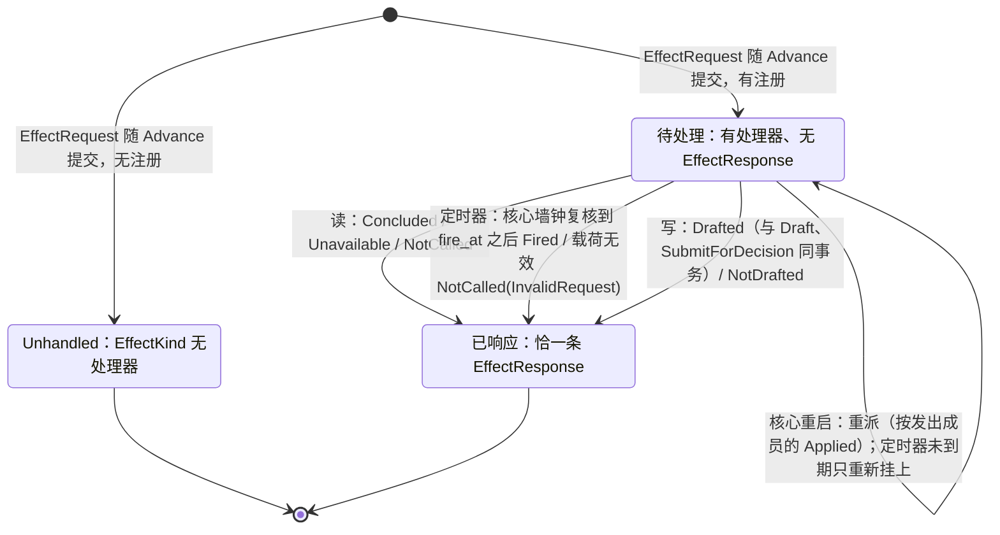

# 出站请求处理器

- **层级与元素**：L3 component，核心进程内的出站请求处理器。
- **上级文档**：[core/00-design.md §4.5 组件指南](../00-design.md#45-组件指南)。
- **决定什么**：程序的副作用怎样离开程序：`EffectRequest` 是唯一出口，程序规则时限 `Expire` 按定义化归为经这个出口发出的定时器请求；谁接手（按 `EffectKind` 注册的读 / 写处理器，读处理器含经一次性读作答的与按核心时钟作答的定时器）；每条请求恰得一条完成事实 `EffectResponse`，它落在哪里、怎样在重启后重派；写请求怎样变成一张单据、以谁为负责人、何时不开单。
- **读者**：核心实现者；程序作者需要知道的对外语义以本文 §4 为准。
- **状态**：已定。
- **非目标**：意图的锚点、参数合规与单据状态机（[01-ticket.md §3.3 意图构造与锚点：构造不出的不是意图](../03-read-write/01-ticket.md#33-意图构造与锚点构造不出的不是意图)）；程序值、`DecisionStep` 与解释②（[03-intent.md §3.1 解释②：决策](../03-read-write/03-intent.md#31-解释②决策)）；`Advance` 输出事务的编排（[01-program-host.md §4.6.2 Advance](01-program-host.md#462-advanceevents-to-cursor--outputeffects-derivations-checkpoint)）；一次性读的执行（[02-one-shot-read.md §4.1 核心→集成：read](../02-read/02-one-shot-read.md#41-核心集成readstream-request-range--answered--unavailable--refused)）；程序怎样声明并接收执行事实输入（[01-program-host.md §3.3 程序的输入](01-program-host.md#33-程序的输入)）。

证据标签与编号前缀的约定见 [README.md §0.4 阅读约定](../../README.md#04-阅读约定)。

## 1 问题域

### 1.1 上级分配给本组件的需求

| 来源 | 内容 |
|---|---|
| P6（[README.md §2.2 机器与域共享的现象](../../README.md#22-机器与域共享的现象)） | 程序的输出是意图与请求，不是对 venue 的直接调用。 |
| H2 | 程序不可信，会输出非法值；它不能拿到一条绕过审批的外部写通道。 |
| C4 | 程序在隔离宿主里运行，副作用只经核心。 |
| Q1、Q8、Q9、Q19、Q25 | 程序的写与人的写得到同一对记录（意图 + 否决）；程序能按自己请求的结果决定下一步；替换或卸载程序之后，已提交请求的处理不随后来的装载者漂移。 |

核心进程分配给本组件的接口（[core/00-design.md §4.7 组件间接口](../00-design.md#47-组件间接口)）：

- 在程序宿主元素编排的 `Advance` 输出事务里写下该批输出的 `EffectRequest` 记录（同事务集合见 [core/00-design.md §4.7.4 同事务集合](../00-design.md#474-同事务集合)）；
- 执行事实唯一写入口中 `EffectRequest` 与 `EffectResponse` 的写者（[core/00-design.md §4.7.3 执行事实的唯一写入口](../00-design.md#473-执行事实的唯一写入口)）。

### 1.2 本组件直接面对的域性质

- **程序不可信**（H2）：请求载荷里的任何值都可能非法或恶意；它只是数据，处理器只按注册的语义处理它。
- **请求流与控制流之间没有可比的序**（[01-base/00-design.md §3.1 流、位置与三种进度](../01-base/00-design.md#31-流位置与三种进度)）：请求记录与开始某个程序成员的 `Applied` 分在两条执行事实流上，不能按位置先后推断“这条请求是哪个成员发出的”。
- **观察记录可压缩，`EffectRequest` 永存**（[01-journal.md §2.4 保留：边界与删除规则](../02-read/01-journal.md#24-保留边界与删除规则)）：一条请求“是否已处理”必须由与请求同寿命的事实回答，不能依赖读结论这类可能落到保留边界下的观察记录。
- **程序值文件由 Alice 写，可被改或删去**（[06-files.md 统一路径文件](../04-boundary/06-files.md)）：处理请求时不能重读它得到发出者的事实。

## 2 驱动

本组件承担的质量场景：Q1（程序看自己的结果）、Q8（非法参数得到意图 + 否决）、Q9（审计可追溯到发出成员）、Q19（负责人不漂移）、Q25（程序代数不随副作用种类膨胀）。场景的六要素定义见 [README.md §3.1 质量场景](../../README.md#31-质量场景)；本组件的响应度量写在 §6.2 各验收项。

## 3 模型

### 3.1 `EffectRequest`：唯一出口，请求是值

```rust
Emit(EffectRequest { effect_kind: EffectKind, payload: Bytes, basis: Basis })   // 程序值里的构造子（解释②）
// 核心 append 的记录另带 member：开始发出成员的 Applied 在控制流上的位置

enum DecisionStep {
    On(Pattern, …),
    Emit(EffectRequest),
    Require(Guard, OnFail),
    Expire(Id, Box<DecisionStep>),   // Id：值树里类型为 UTC 时刻的节点，截止时刻 t；Box<DecisionStep>：到时执行的回调 k
}
```

- 程序需要请求核心不认识的副作用：发通知、拉一次历史 K 线、调外部模型、下单。程序的**唯一出口**是一个 `EffectRequest`，不是对每种副作用各加一个构造子。
- **请求是值，不是调用**（`IO a` 的纪律，[06-write.md §3.2 IO 壳是效应侧的解释器](../03-read-write/06-write.md#32-io-壳是效应侧的解释器)）。它被 append 为执行事实记录；核心不解释 `payload`。
- **请求不带调用方键**：写请求的键只在发出时由 IO 壳按尝试铸造（[06-write.md §3.4 调用方键的铸造](../03-read-write/06-write.md#34-调用方键的铸造-设计)）；`EffectRequest` 没有键字段。
- 下单 `trade.place`（写）、发通知 `notify.telegram`（写，对外部世界也是写）、拉历史 `fetch.bars`（读），对程序是同一构造子；区别只在 `EffectKind` 注册了哪一种处理器。
- **`Expire(t, k)` 是一个固定组合，不是新的出口** [设计]：它的语义定义为 `Emit(EffectRequest{effect_kind: timer, payload: {fire_at: t, tag}, basis})` 加上 `On(该 tag 请求的 Fired 响应, k)`。定时器请求由定时器处理器按核心时钟作答（[03-timer.md §4.1 定时器处理器](03-timer.md#41-定时器处理器-设计)）；k 是去函数化的回调：一个值，随程序状态存进 `Checkpoint`，由解释②在消费响应时执行，核心与定时器处理器都不执行它。`tag` 由解释器生成，t 的来源、待触发集合与执行 k 的规则写在 [03-timer.md §3.1 解释②：决策（定时器）](03-timer.md#31-解释②决策定时器)。
  - 理由：程序要在“没有新输入”时也能在某个时刻做事，而宿主进程不读时钟（重放要确定）。把注册做成一条请求，时间就以一条有位置的记录（请求流上的 `EffectResponse{Fired}`）进入程序的输入与 cursor 的重放边界；注册随 `Advance` 输出事务持久化，重启由重派重新挂上（§4.2）。STS 的 `deadline` 计时器不这样做，因为规则状态本就是记录与核心时钟的 fold，重启可按记录重装（[04-decision-chain.md §3.4 RuleState 是记录的 fold，不另存](../03-read-write/04-decision-chain.md#34-rulestate-是记录的-fold不另存-设计)）；程序状态在 `Checkpoint` 字节里，核心不解释它，只能由一条核心读得懂的请求载荷带上 `fire_at`。
  - 不选：**让作者自己写 `Emit(timer)` + `On(Fired)`**：代数不动，但 tag 冲突与“忘记忽略失效的定时器”都交给了不可信的作者；**`Advance` 另带一个时间输入**：宿主协议多一种输入，时间不在任何记录里，重放要另存它。

为什么：若为每种副作用各加一个构造子，程序的封闭代数就随副作用种类膨胀，突破“构造子膨胀”红线（[03-intent.md §3.1 解释②：决策](../03-read-write/03-intent.md#31-解释②决策)）。把副作用的种类推到注册表，`DerivationNode`/`DecisionStep` 就不动。[证据：fp-01 M7 Mercury Workflow]

不选：

- **对每种副作用各加一个 `DecisionStep` 构造子**：代数随副作用膨胀，退化为 Pine-with-limits。

### 3.2 处理器注册表：出现了什么，则做什么

- **响应由处理器决定。** 注册了该 `EffectKind` 的处理器接手。未注册则记录留在日志里为 `Unhandled`：有请求无处理器不是错误，与入站字段无处理器不触发同理（[02-envelope.md §3.2 处理器字段注册表](../04-boundary/02-envelope.md#32-处理器字段注册表)）。
- **处理器在注册时声明读 / 写。** 读处理器有两种作答来源：经一次性读的读处理器向集成执行一次只读查询（[02-one-shot-read.md §4.5 读处理器](../02-read/02-one-shot-read.md#45-读处理器)）；定时器按核心时钟作答，不向外部读，结果只落请求流（[03-timer.md §4.1 定时器处理器](03-timer.md#41-定时器处理器-设计)）。不另设处理器类别。写处理器把请求当作意图，送进单据 → STS → IO 壳的完整效应路径。
- **两个注册表对称**：入站字段 → 处理器（[02-envelope.md §3.2 处理器字段注册表](../04-boundary/02-envelope.md#32-处理器字段注册表)）；出站请求 → 处理器（本文）。都是“出现了什么，则做什么”。

### 3.3 发出成员

每条 `EffectRequest` 记下发出它的程序成员 `member`，即开始该成员的 `load_program` 或替换 `Applied` 在控制流上的位置。核心在 `Advance` 的输出事务里写下它：哪个成员在运行是核心自己的控制事实（[01-program-host.md §3.2 成员、活动集合与失败抑制](01-program-host.md#32-成员活动集合与失败抑制)）。

- 该 `Applied` 以值记下成员的事实：装载 principal（该控制动作的 principal）、`facts` 声明的执行事实输入集合、值树引用的原生 op 名集合、输出契约、钉住的内容 hash 与接受的 `state_version` 集合（[01-program-host.md §4.1 load_program(manifest_ref, cold_start?)](01-program-host.md#load_programmanifest_ref-cold_start)）。
- 写处理器与重启重派**只读发出成员的这些事实**，不读当前成员的，也不重读程序值文件。请求可以在发出成员结束之后才被处理（[01-program-host.md §4.4 卸载与替换](01-program-host.md#44-卸载与替换)）；`Applied` 是控制流上的执行事实，成员结束、程序值文件被改或删去之后照样可读。

不选：

- **按处理时的当前成员判定**：替换或卸载之后分派的请求会以另一成员的 principal 开单、按另一份声明判定作用域，卸载之后则无成员可读；
- **按请求与 `Applied` 的位置先后推断成员**：请求流与控制流之间没有可比的序；
- **结束成员之前处理完它的全部请求**：`Unhandled` 请求永远没有响应，在途读没有上界；
- **处理时重读程序值文件**：文件可被改或删去，钉住的 hash 只能发现不符，给不出原内容。

### 3.4 完成事实 `EffectResponse` 与请求流 [设计]

- 每条被处理的 `EffectRequest` 恰有一条执行事实记录 `EffectResponse{request: LogPosition, outcome}`。
- `outcome` 按处理器分，是封闭的 sum：

| 处理器 | `outcome` | 伴随记录（同一事务） |
|---|---|---|
| 读 | `Concluded(conclusion: LogPosition)`：读结论记录，含零条结果与上游拒绝 | 该流上作答的观察记录与读结论记录（[02-one-shot-read.md §3.1 一次性读的记录](../02-read/02-one-shot-read.md#31-一次性读的记录)） |
| 读 | `Unavailable(gap: LogPosition)` | 该流上的 `Gap{origin: Channel}` |
| 读 | `NotCalled(reason)`，`reason ∈ {Unsupported, Unconfirmed, NoSession, InvalidRequest, UnknownTarget}` | 无 |
| 读（定时器） | `Fired`：核心墙钟已到载荷里的 `fire_at`；不带字段，触发时刻就是这条记录自己的记录时间 | 无 |
| 读（定时器） | `NotCalled(InvalidRequest)`：载荷解析不出 UTC 时刻 | 无 |
| 写 | `Drafted(ticket_id)` | 该单据的 `Draft` 与 `SubmitForDecision` |
| 写 | `NotDrafted(Malformed{reason} \| ScopeNotObserved)` | 无 |

- 经一次性读作答的读处理器，`NotCalled` 的五种原因与一次性读对消费方给出的结果一一对应：来源从未有过声明版本与此刻无已建立会话同为 `NoSession`，对应一次性读的 `Unavailable{source_state}`（[02-one-shot-read.md §3.4 判定顺序先看会话，再看声明](../02-read/02-one-shot-read.md#34-判定顺序先看会话再看声明)）。
- **落点**：`EffectRequest` 与它的 `EffectResponse`（全部结果，含 `NotCalled` 与 `NotDrafted`）都在该程序的**请求流**上：按程序 id 各成一条的执行事实流。它们是 UTA 关于这个程序自己生命周期的事实，不属任何来源、lane 或作用域，所以没有有效 lane 或未登记来源的请求也有落点。请求流怎样作为程序的隐含输入投递，见 [01-program-host.md §3.3 程序的输入](01-program-host.md#33-程序的输入)。
- 理由：观察记录可压缩，`EffectRequest` 永存；“是否已处理”必须能从与请求同寿命的事实重建。`Concluded` 引用的读结论记录落到保留边界下后，`EffectResponse` 仍成立，不钉住保留。
- `Unhandled` 请求没有 `EffectResponse`，也不重派。

不选：

- **`EffectRequest` 与 `EffectResponse` 随 lane 流**：没有有效 lane 的 `NotDrafted` 与读请求的响应无处可落。
- **只在返回值里表示完成**：请求随 `Advance` 持久化、处理在其后，没有“返回值”可言；程序与审计都只能读记录。

### 3.5 请求与响应的关联是引用，不是事务

`EffectRequest` 记录随程序 `Advance` 输出持久化，处理器在其后执行。二者的关联是 `EffectResponse.request` 这个位置引用；它们不在同一事务里，也不需要在：

- 核心重启时 fold 出**无 `EffectResponse`** 的已注册请求重派（§4.2）；
- 写处理器的 `Drafted` 与 `Draft` 同事务，所以“有 `Draft` 无 `EffectResponse`”不可达。

核心对程序副作用只保证：写类走两阶段，读类可重试，两类都被记录、都带 `basis`。

### 3.6 不变量

- `Emit(EffectRequest)` 是唯一出口；副作用的种类是注册表的事，程序代数不膨胀。由单一出口构造子保证。
- **写处理器不绕过效应路径**：注册为写处理器即意味着经过规则链（至少授权与预算），不因“只是发个消息”就直通。否则程序拿到一条不经审批的外部写通道，H2 的不可信程序前提被破坏。由处理器注册语义保证。[域 H2]
- 每条被处理的请求恰一条 `EffectResponse`；定时器请求的那一条在核心墙钟到 `fire_at` 之后；写请求至多一张单据。由 `Drafted` 与 `Draft` 同事务、重派只针对无 `EffectResponse` 的请求、定时器只在复核墙钟到点之后 append 保证。
- 写处理器与重派的负责人与作用域判定只取发出成员 `Applied` 所记的事实。由 `member` 字段保证。

不选：

- **让写处理器“轻量”消息直通、不走规则链**：破坏不可信程序前提。

## 4 结构

### 4.1 接口

| 方向 | 对方 | 交换 | 语义 |
|---|---|---|---|
| 被用 | 程序宿主元素 | 一批 `Output` 里的 `Emit` 值 | 在 `Advance` 输出事务内 append `EffectRequest{…, member}`；同一事务的其他参与者见 [core/00-design.md §4.7.4 同事务集合](../00-design.md#474-同事务集合)。宿主协议本身见 [01-program-host.md §4.6 宿主协议](01-program-host.md#46-宿主协议) |
| 使用 | 一次性读 | 一次 `read`，发起方 `Request(该 EffectRequest 的位置)` | 读处理器的执行（[02-one-shot-read.md §4.5 读处理器](../02-read/02-one-shot-read.md#45-读处理器)） |
| 使用 | 单据 | `Draft` + `SubmitForDecision` | 写处理器开单（[03-intent.md §4.1 写处理器](../03-read-write/03-intent.md#41-写处理器-设计)），与 `EffectResponse{Drafted}` 同一事务 |
| 使用 | 存储 | append 接口 | 写 `EffectRequest`、`EffectResponse`（[02-storage.md §3 接口](../01-base/02-storage.md#3-接口)） |
| 读 | 控制流 | 发出成员的 `Applied` | 负责人与作用域判定（§3.3） |
| 使用 | 核心时钟 | 定时器请求的 `fire_at` | 定时器处理器（[03-timer.md §4.1 定时器处理器](03-timer.md#41-定时器处理器-设计)）；复核规则见 [01-base/00-design.md §3.2 基础值类型](../01-base/00-design.md#32-基础值类型) |

### 4.2 重启重派

核心重启时 fold 出无 `EffectResponse` 的已注册请求（崩溃 #21，[05-runtime/00-design.md §5.1 崩溃矩阵（#1–#21）](00-design.md#51-崩溃矩阵121)）：

- 读处理器重新执行一次；定时器由此重新挂上唤醒：`fire_at` 已过即 append `Fired`，未到期则重启本身不产生响应；
- 写处理器重新开单。`NotDrafted` 已是响应，不重派；
- 重派同首次分派一样按发出成员的 `Applied` 所记事实开单与判定作用域；发出成员此后已被替换或卸载、程序值文件已被改或删去时亦然；
- `Unhandled` 请求不重派。

### 4.3 一条请求的状态（fold，不另存）



## 5 走查

本节只走本组件内部的步骤；各场景的组件级主 trace 在 [core/00-design.md §5.1 W1（Q1）正常下单闭环](../00-design.md#w1q1正常下单闭环) 等处。

**崩溃 #21 的恢复细节。** `EffectRequest` 已提交、`EffectResponse` 未持久化时崩溃：重启 fold 出它（无 `EffectResponse`）→ 按 `member` 所指 `Applied` 重派；若崩溃前后发出成员已被替换或卸载、程序值文件已被改或删去，负责人仍是该 `Applied` 的装载 principal，作用域仍按它所记的执行事实输入判定；写请求至多一张单据，因为 `Drafted` 与 `Draft` 同事务。

**替换之后分派（验收 #85 的路径）。** P 装载的成员 A 在一次 `Advance` 里发出作用域 S、T 与一个构造不出的写请求；分派之前 Q 以另一成员替换 A。分派时三条请求都读 A 的 `Applied`：S → `Drafted`，负责人 P；T → `NotDrafted(ScopeNotObserved)`；构造不出的 → `NotDrafted(Malformed)`，不经作用域判定。

**卡点。** 走查中没有停在本组件之内的步骤。上述路径依赖的外部事实：`member` 由程序宿主元素在输出事务中提供位置，本组件只 append；执行事实输入的“选中”与订阅同一 selector 规则；`tag` 与回调由解释②持有。三者在对应文档里定义，本组件只读或只搬运。

## 6 评估

### 6.1 证伪条件

本组件的决定没有单独的证伪条件；程序表示整体的证伪见证伪 #1（[01-value-tree.md §6.2 证伪条件](../01-base/01-value-tree.md#62-证伪条件)）。

### 6.2 验收

85. **请求按发出成员处理**（本文 §3.3、§4.2、[01-program-host.md §4.4 卸载与替换](01-program-host.md#44-卸载与替换)、崩溃 #21）：以 fixture 推迟出站请求处理器的分派：（对应 Q9/Q19/Q25）
    - principal P 装载声明执行事实输入 `(X, S)` 的程序 A；A 的一次 `Advance` 发出三个写请求：作用域 S 的、作用域 T 的、锚点构造不出且作用域为 T 的。三条 `EffectRequest` 的 `member` 都是 P 的 `Applied` 位置；
    - 该输出事务提交之后、分派之前，principal Q 以声明 `(X, T)` 的新程序替换 A；替换的 `Applied` 之后分派：S 的得 `Drafted`，单据负责人为 P；T 的得 `NotDrafted(ScopeNotObserved)`；构造不出的得 `NotDrafted(Malformed)`，不经作用域判定；
    - 同一场景改为 `unload_program`：三条请求照常分派，结果同上；
    - 在 `EffectRequest` 提交之后、`EffectResponse` 持久化之前注入核心崩溃，重启之前改写或删去 A 的程序值文件，再以 Q 替换或卸载：重启后重派的结果、负责人与判定同上，每条请求恰一条 `EffectResponse`，写请求至多一张单据。

效应路径唯一（代码中不存在第二条到集成写接口的调用路径）的验收见 [core/00-design.md §6.1 验收 #10](../00-design.md#61-验收标准)。
