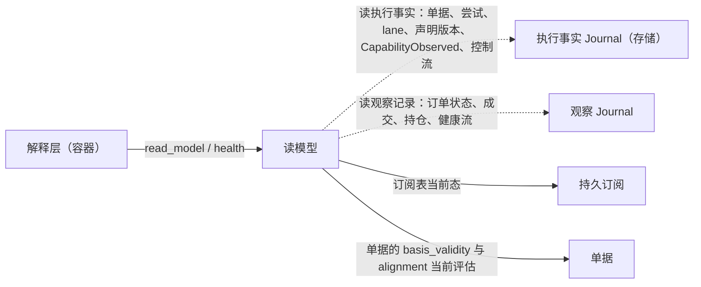

# 读模型

## 0 定位

- **层级与元素**：L3 component，核心进程里的**读模型**。它是效应侧的元素：有的种类读执行事实；它读观察记录，走效应侧读观察侧的那条单向边（[core/design.md §3.4 两个类型宇宙与唯一边](../design.md#34-两个类型宇宙与唯一边)）。
- **上级文档**：[核心进程](../runtime/design.md)（L2）。上级把核心↔解释层契约里的 `read_model` 与 `health` 分配给本组件（[core/design.md §4.6 对外接口总表](../design.md#46-对外接口总表)）；核心↔集成契约里“成交与订单状态的契约语义”在 [trade-observation.md](../read/trade-observation.md)。
- **本文决定**：
  - 核心维护哪些读模型（封闭集合），各自读什么、能否按历史 `as_of` 重建；
  - `Snapshot`、`as_of`、`gaps` 的含义与一致性承诺；
  - `read_model` 与 `health` 两个操作的完整规格；
  - 健康面 `IntegrationHealth` 的字段与 fold 规则。
- **读者**：实现核心进程的工程师；实现解释层的工程师（`read_model` 与 `health` 的调用方）；自行 fold 原始记录的下游开发者。审批者：仓库维护者。
- **状态**：已定。
- **非目标**：
  - 公共 schema 里成交与订单状态两个种类的契约语义（执行身份、按执行计数、订单身份、来源顺序、最近观察、完整界的前提），在 [trade-observation.md](../read/trade-observation.md)；
  - 健康观察的写入（会话状态与调用计数由集成会话写，回填进度与覆盖检查点由持久订阅写），在 [integration.md §4.6 会话状态机](integration.md#46-会话状态机)、[backfill.md §4.2 实时边界、回填任务与回填进度](../read/backfill.md#42-实时边界回填任务与回填进度)；
  - readiness 的语义与上报，在 [integration.md §4.3.2 集成→核心的推送](integration.md#432-集成核心的推送)；
  - 读模型之外的订阅与投递，在 [consumption.md §4.1 核心↔解释层：订阅组与 rewind_cursor](../read/consumption.md#41-核心解释层订阅组与-rewind_cursor)；
  - 解释层把读模型翻成对外概念，在[解释层的翻译组件](../../drafts/downstream/endpoint/translation.md)。
- 证据标签与编号约定见 [README.md §0.4 阅读约定](../../README.md#04-阅读约定)。

## 1 问题域

### 1.1 分配给本组件的需求与契约

| 来源（[README.md §2 问题域](../../README.md#2-问题域)） | 内容 | 本组件承担的部分 |
|---|---|---|
| S10 | Alice 的消费面可实现，不必每个消费方重复 fold | 提供读模型；读模型等于对原始记录的独立 fold |
| Q1、Q5 | 同一笔执行、同一笔订单经多个渠道到达，只计一次、不倒退 | 按执行计数的 fold；最近观察 |
| Q13、Q16 | 解释层取得声明；“不支持 / 未确认”与写门用的是同一份能力 | `sources` |
| Q29 | 下游断连重连后按 `as_of` 取当前状态 | `Snapshot{as_of}` |
| Q31、Q14 | 显式缺失，不伪造完整 | `gaps`；完整界只在有来源证据时给出 |
| Q32、P16、O4 | 按调用目标看出“公共可用、私有失败” | `health` |
| Q11、Q12、Q15 | 三种 gap 各在各处可见 | `gaps` 只列来源缺口 |
| 核心↔集成契约 | 成交与订单状态的契约语义 | [trade-observation.md §3.1–§3.3](../read/trade-observation.md#3-模型)；集成怎样按映射填出这些字段见 [integration.md §3.4 记录映射](integration.md#34-记录映射-设计) |
| 核心↔解释层契约 | `read_model(kind, as_of?)`、`health()` | §4.1、§4.4 |

### 1.2 本组件直接面对的域

- **上游的执行身份**。上游给不给一笔执行的稳定身份、给不给修正次序，是上游的事实，UTA 不能设计。[证据：F12] IBKR 的修正是另一条执行回报，除 execId 最后一个点之后的数字外参数全同；文档证明了修正关联，没有说明这些数字的先后。Binance 执行回报里 trade id 为 -1 的行不是执行；它的 `I` 字段是非成交事件也带的回报编号。
- **上游的订单身份**。订单号在订单生命周期内是否不变、在什么范围内唯一，由上游文档给出。
- **来源顺序**。同一订单两条记录谁更新，只有上游知道；UTA 只能凭来源声明的定序证据比较（[trade-observation.md §3.2 订单身份、来源顺序与最近观察](../read/trade-observation.md#32-订单身份来源顺序与最近观察-设计)）。这些声明可能是错的，要由一致性测试证伪。
- **流与时钟**。流与流之间没有可比的序；墙钟不定序（[base/design.md §3.1 流、位置与三种进度](../base/design.md#31-流位置与三种进度)、[base/design.md §3.2 基础值类型](../base/design.md#32-基础值类型)）。
- **保留边界**。观察记录可被压缩；执行事实没有保留边界（[journal.md §2.4 保留：边界与删除规则](../read/journal.md#24-保留边界与删除规则)）。读模型的历史切面只能在保留边界之上精确重建。

## 2 驱动

| Q | 本组件的响应 | 响应度量 |
|---|---|---|
| Q1、Q5 | 同一执行在任何 fold 里至多贡献一次；订单状态只按来源证据取代 | 验收 #39、#45、#69 |
| Q29、Q31 | 每个可重建的读模型与对 `as_of` 以内原始记录的独立 fold 相等 | 验收 #18 |
| Q13、Q16 | `sources` 与写门、读路由使用的会话有效声明逐项相同 | 验收 #25 |
| Q14、Q16、Q31 | 完整界只在全部前提成立时给出；无身份来源读成交得 `Unsupported` | 验收 #40 |
| Q32 | 健康不留旧值；计数按目标；跨保留与重启不变 | 验收 #38、#56 |
| Q11、Q12、Q15 | `gaps` 只含 `Gap{origin: Source}` | 验收 #71 |

## 3 模型

### 3.1 读模型是非权威的 fold

- **读模型**（read model）是读副作用的一种消费产物：核心对记录的**非权威**只读 fold（订单、持仓等），经核心↔解释层契约由 `read_model` 读取。每一种读什么（执行事实、观察记录，或 `subscriptions` 的订阅表当前态）、能否按历史 `as_of` 重建，在 §4.2 一处定。
- 读模型不作权威、不被规则引用，只服务下游可实现性，避免每个消费方重复 fold。规则禁止引用读模型由关系表保证（[core/design.md §3.4 两个类型宇宙与唯一边](../design.md#34-两个类型宇宙与唯一边)）。
- 消费方也可直接订阅原始记录自行 fold：**原始记录是消费契约**（§4.3）。
- 一次性读的结果是观察流上与推送同形的记录（[one-shot-read.md §4.1 核心→集成：read](../read/one-shot-read.md#41-核心集成readstream-request-range--answered--unavailable--refused)），所以读模型对它与对推送用同一套 fold，只按 [trade-observation.md §3.2 订单身份、来源顺序与最近观察](../read/trade-observation.md#32-订单身份来源顺序与最近观察-设计) 的来源顺序区分。
- 不选：
  - **让规则直接引用读模型（把它当权威）**：读模型是可重建 fold，一旦被规则依赖就要为它承担权威与一致性，违反“核心状态最小化”；
  - **为每个消费方各自 fold 而不提供读模型**：S10 要求 Alice 消费面可实现，重复 fold 是浪费且易分叉。

### 3.2 健康面 [设计]

每个集成一份 `IntegrationHealth`，经读模型对解释层可见（P16）。它有两个输入：

- **成员**是 `as_of` 时的采纳集合，由控制流上的执行事实（采纳记录与之后带同一 `instance_id` 的 `restart_integration` `Applied`）按 `as_of` 在控制流上的位置 fold 出（[integration.md §3.7 由控制流 fold 出的四项持久事实](integration.md#37-由控制流-fold-出的四项持久事实)）。被移除的登记不在其中：它的健康观察仍在健康流里，可订阅、可按历史 `as_of` 读，核心不为它补写记录。
- **每个成员的各字段**只由健康观察 fold 出：

| 字段 | 含义 | 源头与写者 |
|---|---|---|
| `session` | `Connecting{since}` / `Established{epoch, since}` / `Halted{cause, since}` / `Unobserved`；`epoch` 是该会话的 `SessionEpoch`；一个切面上的值按下文“会话值”取；`Unobserved` 不是记录 | 核心自己的会话生命周期；集成会话在会话状态改变时 append，每条会话观察带 append 它的核心实例的 `instance_id`（`Established` 的即其 `SessionEpoch.instance_id`）（[integration.md §4.6 会话状态机](integration.md#46-会话状态机)） |
| `readiness` | 每条流的 readiness（下文“readiness 的 fold”）；`Disconnected` 是派生值 | 集成在某个会话里、对某个流 epoch 的陈述（副本）；核心盖上到达会话的 `SessionEpoch` 与该流当时的流 epoch 后 append（[integration.md §4.3.2 集成→核心的推送](integration.md#432-集成核心的推送)） |
| `backfill` | 每条流当前流 epoch 的回填进度；值为 `None` 的不列 | 持久订阅：进度改变时与读结论记录同事务 append；epoch 起点的 `None{epoch}` 与起点的 `Gap{origin: Source}` 同事务（[backfill.md §4.2 实时边界、回填任务与回填进度](../read/backfill.md#42-实时边界回填任务与回填进度)） |
| 按调用目标的 `consecutive_failures`、`last_success_at` | 下文“调用结果计数” | 集成会话给出内容，调用发起方在记录该结果的同一事务里提交（[integration.md §4.10 调用结果的计数](integration.md#410-调用结果的计数)、[core/design.md §4.7.5 调用结果与计数的提交协议](../design.md#475-调用结果与计数的提交协议)） |

健康流上另有持久订阅 append 的**覆盖检查点**（[supply.md §4.3 覆盖检查点](../read/supply.md#覆盖检查点)），它是 `health` 的 fold 输入之一，供序号覆盖在压缩后重建。

**每条健康观察是状态值**：它带所属键（集成、流、逻辑流、调用目标）上的完整当前值，同键后一条取代前一条。健康流因此按键保留（[journal.md §2.4 保留：边界与删除规则](../read/journal.md#24-保留边界与删除规则)），`IntegrationHealth` 对任一不低于保留边界的 `as_of` 都 fold 得出，且与压缩前相等；唯一的例外是某个成员走到下文“会话值”的 `BeyondRetention` 分支，这个切面得 `BeyondRetention`。

**健康不留旧值。** 健康流按键只保留最近一条，一个键上的值只在有新观察时改变。所以旧值会因流 epoch 更替或核心重启而失效的键，要么在失效的那一刻由它的写者写入新值，要么由 fold 规则限定它的适用范围：

- **回填进度**：写者义务。流 epoch 起点的 `Gap{origin: Source}` 与该逻辑流的 `None{epoch}` 在同一事务 append（握手时开的与会话内上报开的新 epoch 一样，由集成会话编排这一事务，`None{epoch}` 由持久订阅写）；这一 epoch 建立任务时由 `Backfilling{起点}` 取代。上一 epoch 的 `Closed` 或 `Reached` 因此不会被当作新 epoch 的进度，崩溃也不会把 gap 与 `None` 分开。
- **会话**：写者义务与 fold 规则各一半。写者义务：核心启动第 3 步让各集成进入初始状态时，集成会话为每个集成 append 一条会话健康观察，与采纳记录同一事务；进入 `Connecting` 的为 `Connecting{since = 本步时刻}`，恢复为 `Halted` 的沿用那条未解除的 `IntegrationHalted` 的原因与起始时间（[integration.md §4.6 会话状态机](integration.md#46-会话状态机)）。**会话值的 fold 规则**：一个切面（`as_of`）上集成 X 的会话值，设 i 是该切面控制流前缀里 X 最近一次采纳（第 3 步的采纳记录，或采纳 X 的 `restart_integration` `Applied`）所带的 `instance_id`：
  - 该切面健康流前缀里有带 i 的 X 的会话观察：取其中最近一条，它就是会话值。
  - 没有：看健康流前缀里 X 最近的一条会话观察（不论实例），设它带 j。没有这样一条，或控制流前缀里有带 j 的采纳：会话值为 `Unobserved`，这个切面把 i 的采纳与它的初始观察分开了，i 的实例还没有写下会话观察。控制流前缀里没有带 j 的采纳：对 X 而言健康流走在控制流前缀前面，而 i 的观察已被压缩删去，这个切面的 `health` 读得 `BeyondRetention`。
  - 实例的先后只由采纳在控制流上的位置给出，不比较不同流上记录的先后。所以含整个事务的切面（第 3 步的采纳记录与初始观察，或采纳本实例尚未运行的 id 的 `Applied` 与它的 `Connecting`）给出初始观察；把二者分开的切面（控制流位置含采纳，健康流位置在初始观察之前）给出 `Unobserved`；上一实例的 `Established` 在之后的采纳之后从不适用，第 5 步开放下游会话之前也不会显得仍在。
  - 这一规则只读两条流上已有的字段（采纳所带的 `instance_id`、会话观察所带的 `instance_id`），对任一合法切面都确定：独立 fold 控制流与健康流的消费方，从同样的两个前缀得到同一个值或同一个 `BeyondRetention`；不需要判定切面是否“完整”，也不需要跨流的全局序。
- **readiness**：不另写，由 fold 规则限定（下一条）。旧会话、旧实例、旧流 epoch 的 `Live` 随会话值或回填进度的更替自动失效，所以不为各流 append `Disconnected` 或 `Starting`。

**readiness 的 fold。** 一条流当前的 readiness 只取同时带着该集成的会话值（上文，按会话值一条取）的 `SessionEpoch` 与该流当前流 epoch 的值，且只在会话值是 `Established` 时。该流当前流 epoch 取自健康流上该逻辑流最近一条回填进度所带的 epoch（新 epoch 的 `None{epoch}` 与起点 gap 同事务 append），所以取当前流 epoch 不读健康流之外的输入。

- 会话已建立而该流在当前流 epoch 里尚无这样的 readiness：`Starting`。
- 会话值为 `Connecting`、`Halted` 或 `Unobserved`：各流为 `Disconnected`。它由会话值派生，不是记录，不带自己的时刻，只随附会话值及其 `since`（那是会话状态记录的时刻，不是断线时刻；核心不回填崩溃发生的时刻；`Unobserved` 没有 `since`）。

理由：集成失效或核心重启时，旧值的写者恰好不再写；按键保留又使旧值一直可见。会话与回填进度由它们的写者（集成会话、持久订阅）在失效点写新值；readiness 的写者是集成，失效时它恰好写不了，所以由它所属的会话限定有效范围，而不是由核心代写一条集成没说过的话。会话值按采纳所带的 `instance_id` 取舍，而不是取健康流上的最近一条：两条流各自有序、彼此没有全局序，一个切面可以含一次采纳而不含同一事务的初始观察，这时最近一条可能是上一实例的 `Established`。不选：
- **由读模型按流的当前 epoch 过滤回填进度**：`IntegrationHealth` 就要从健康流与控制流之外再读一个输入；
- **重启时不写会话、等第一次状态变化**：`Halted` 的集成不再有状态变化，旧的 `Established` 会一直显示；
- **由核心为各流 append `Disconnected{since}`**：同一个键有两个写者，且 `since` 只能取核心写它的时刻，把重启时刻冒充断线时刻；
- **拒绝把采纳与初始观察分开的切面**：独立 fold 的消费方要另有判定切面是否完整的规则，而这需要跨流的序；
- **会话值取健康流上的最近一条**：把采纳与初始观察分开的切面会给出上一实例的 `Established`；
- **会话键按（集成，实例）分、每对各留一条基线**：基线随实例累积而无界增长，而走到 `BeyondRetention` 分支的成员，它最近一次采纳之实例的观察已被压缩，这个切面本就读不到被压缩的历史，得 `BeyondRetention` 即可。

**调用结果计数的读侧。** 每个调用目标一个键。调用目标是什么、哪些结果计入、哪些算失败、哪些算成功，在 [integration.md §4.10 调用结果的计数](integration.md#410-调用结果的计数) 一处定。本组件读到的两个字段：

- `consecutive_failures`：该目标最近连续失败的次数，每条计数观察带计数后的值。
- `last_success_at`：该目标最近一次得到上游回答的结果被接受的时刻。它回答“这个目标最近一次得到上游回答是什么时候”，不表示业务成功，也不表示历史已取全。从未成功过的目标没有它。
- 计数跨会话、跨核心重启延续：按键保留使它不随压缩丢失。

由此“公共可用、私有失败”可以观察：公共流这一目标最近成功，某个作用域这一目标连续失败；逐流 readiness 另给流一级。它只说各个被调用目标自己的近况，不推断整个账户或鉴权域是否可用。

- **删去 `reach` 与 `tier`**：`reach`（旧 UTA 的 down / connected / readable 阶梯）由 `session`、逐流 readiness 与按目标的调用结果分别表达；合成单一可达度会丢掉“哪一面不通”。`tier`（旧 UTA 由 keyless / readOnly 推出的 data / account / trading，O4）说的是作用域能做什么，已由投影里的能力判定表达；在健康里再存一份会与能力证据分叉。
- **降级 / 离线的阈值**（旧 UTA 按连续失败 3 次、6 次）是呈现策略，不在核心：解释层或下游按上述字段自定。
- **健康不进写路径**：它只供运维与下游观察。放行门读能力证据，发出前门读集成会话的会话状态与能力证据（[write.md §4.2 发送屏障与发出前门](../read-write/write.md#42-发送屏障与发出前门)）；集成失效时它的健康观察恰好停止更新，拿它作门的输入会在最需要时过时。
- 不选：
  - **从回执、取证等异质记录推算计数**：一条记录不说明它属哪次调用，空结果成功时没有记录，会漏计或重计；
  - **把每键最新位置登记为保留引用**：一个久不变化的键压住整条健康流；
  - **健康流免压缩**：每次调用一条，无界增长；
  - **另设健康表或存进快照**：第二种持久形状，`as_of` 与订阅拿不到；
  - **压缩时重新 append 当前值**：订阅者收到并未发生的变化。

### 3.3 不变量

1. 读模型非权威、不被规则引用。由关系表（规则禁止引用读模型）保证。
2. 读模型只读、不写：不 append 任何记录。由存储的写入口表（[core/design.md §4.7.3 执行事实的唯一写入口](../design.md#473-执行事实的唯一写入口)）保证。
3. `orders`、`positions`、`lanes`、`health`、`sources` 的每个 `Snapshot` 等于对 `as_of` 以内原始记录的独立 fold。由各种类只以记录为输入、fold 规则确定保证。
4. 同一执行在任何按执行计数的 fold 里至多贡献一次。由 [trade-observation.md §3.1 成交的计数身份](../read/trade-observation.md#31-成交的计数身份-设计) 的 fold 规则保证。
5. 最近观察只按四种来源证据取代，顺序未确立时并列而不压成一个值。由 [trade-observation.md §3.2 订单身份、来源顺序与最近观察](../read/trade-observation.md#32-订单身份来源顺序与最近观察-设计) 保证。
6. 完整界只在 [trade-observation.md §3.3 精确重建的前提与完整界](../read/trade-observation.md#33-精确重建的前提与完整界-设计) 的前提与“从未被压缩”门都成立时给出。由 §4.2 `orders` 保证。
7. 健康面不把旧会话、旧实例、旧流 epoch 的值当作当前值。由 §3.2 的写者义务与 fold 规则保证。
8. `gaps` 只列未被来源证据闭合的 `Gap{origin: Source}`。由 §4.3 保证。

### 3.4 术语

| 词 | 在本组件中的意思 |
|---|---|
| 最近观察 | 同一身份在它所在流上按来源顺序的极大记录；确立，或顺序未确立 |
| 顺序未确立 | 几条极大记录彼此不可比而内容不同，读模型并列给出 |
| 冲突 / 无身份 / 跨流冲突 | 同一执行最高修订上不止一种内容 / 缺 `execution_id` 或 `venue_order_id` / 同一身份出现在两条流上 |
| 完整界 `(e, n)` | `orders` 每作用域给出的成交完整性：上游在当前流 epoch e 上序号小于 n 的全部执行都在 fold 里；不说事件时间 |
| 快照（读模型） | `read_model` 的一次读取结果 `Snapshot`，带 `as_of`；与核心的重启加速快照不同（[storage.md §2.4 快照是近处副本](../base/storage.md#24-快照是近处副本-设计)） |
| 读模型 / 归因后的订单观察 | 读模型是核心对记录的非权威 fold，规则不引用；归因后的订单观察是集成产出的带出处记录，钩子可读。都描述“订单现在什么状态”，一个是解释、一个是记录 |

## 4 结构与接口

### 4.1 `read_model(kind, as_of?) → Snapshot{value, as_of?, gaps?}`

- **动作轴**：读（核心内 fold）。不产生记录。
- **启动期**：核心启动第 5 步开放下游会话之前返回 `Starting`（[session.md §4.1 handshake](session.md#41-handshakecontract_version-actor--sessionprincipal-instance_id-contract_version)）。
- **不另授权**：读不按 principal 授权（[session.md §4.2 请求的身份与授权的入口](session.md#42-请求的身份与授权的入口)）。
- **`as_of`** 是 `Set<LogPosition>`：fold 吃到的位置集，可跨观察与执行事实两个 `Journal`。不给即当前态。
- **错误**：
  - `kind` 未定义 → 拒绝；
  - `as_of` 未达（其中有位置在所涉流上尚未提交）→ `NotYetAvailable{positions}`，带所涉各流当前已提交的流末位置；观察流与执行事实流同一判定；
  - 对只给当前态的种类（`tickets`、`subscriptions`）带历史 `as_of` → 拒绝；
  - `as_of` 所涉某条观察流的位置低于该流的保留边界，或 `health` 的切面上某个成员走到 §3.2 会话值的 `BeyondRetention` 分支 → `BeyondRetention`，不给该切面的状态。
- `as_of` 的位置都已提交即照常 fold：位置是核心自己的事实，可判定。来源侧是否还有记录未到不是未达：读模型只在有来源证据时给出完整界，并列出 `gaps`。`BeyondRetention` 也不属未达：那段观察历史已被压缩，不会再变得可读。

### 4.2 读模型集合

核心维护的读模型是封闭集合，各自的输入如下。[设计]

**`orders`**：按 `WriteScope`，执行事实（单据记录、尝试记录）+ 该作用域的订单状态 / 成交观察（带 `attribution`，含 `External` / `Unattributed`）的 fold。

- 订单按 `venue_order_id` 归并：单据的尝试经 `submit` 的 `Ack` 与撤单目标带上同一身份，外部订单只有观察记录。
- 每笔订单的状态取其订单状态记录的最近观察（[trade-observation.md §3.2 订单身份、来源顺序与最近观察](../read/trade-observation.md#32-订单身份来源顺序与最近观察-设计)）。最近观察顺序未确立时不压成一个值：并列给出各渠道的不可比记录，带渠道、出处与集成的收到时间（`received_at`），并说明来源顺序未确立；可另附一个标明“按收到顺序”的视图。跨流冲突的订单并列各流的最近观察、不选其一；缺 `venue_order_id` 的订单状态记录照实列为无身份，不归入任何订单。
- 订单的上游累计成交量取自同一条最近观察（顺序未确立时随各条并列），不以成交之和替代；逐笔成交按 [trade-observation.md §3.1 成交的计数身份](../read/trade-observation.md#31-成交的计数身份-设计) 的执行计数规则列出（冲突、无身份照实标出），二者不一致时并列，不修账。
- 每个作用域另给**完整界** `(e, n)`（[trade-observation.md §3.3 精确重建的前提与完整界](../read/trade-observation.md#33-精确重建的前提与完整界-设计)）。给出它要同时满足：[trade-observation.md §3.3 精确重建的前提与完整界](../read/trade-observation.md#33-精确重建的前提与完整界-设计) 里核心可判定的条件 1–3，以及“从未被压缩”门：该作用域的成交流没有任何位置落到保留边界之下。n 是 e 的序号覆盖 `[Origin, n)` 的上端；界只由当前流 epoch 算出，新 epoch 开始时旧界不沿用，新 epoch 的 `Origin` 回填 `Closed` 之前没有界。成交流在配额池里、没有 `joinable_venue_seq` 或 `backfill_from_origin`、回填深度不是 `Origin`、或任务尚未 `Closed` 时，不给完整界。完整界不陈述事件时间。该流一经压缩，`orders` 不再给完整界，只标出“无可证明的完整范围”。
  - 理由（从未被压缩门）：被压缩的可能正是某笔执行的最高修订、作废或冲突内容，留下的较低修订会被重新计入，而核心无从由保留边界算出哪些执行未受影响；压缩后仍要可证明完整，只能另改保留契约（保留按身份归并所需的记录）。
  - 消费方是否确实收到全部记录由它自己的 cursor 与投递缺口判定，不在界内。

**`positions`**：按 `WriteScope`，只 fold 该作用域的持仓观察。

- 对每条持仓流上的每个持仓身份，给出该身份在 `as_of` 以内的最近观察（[trade-observation.md §3.2 订单身份、来源顺序与最近观察](../read/trade-observation.md#32-订单身份来源顺序与最近观察-设计) 的同一规则，顺序未确立时同样并列），契约载荷原样给出，不承诺它重建出完整的持仓集合。
- 同一持仓身份出现在两条持仓流上时标为跨流冲突，并列各流的最近观察，不选其一、不相加。
- 某次读或推送里没出现的持仓身份不因此被移除，该身份最近的记录照常给出。
- 它不从本地成交或回执推算持仓（那是上游原值的本地拷贝，F1），不跨作用域或来源合并，没观察到的不当作零。

**`lanes`**：每 lane 的阻塞头集合（等待中的尝试）与结果未知的尝试（含已放弃等待的），执行事实的 fold。阻塞头集合的定义见 [lane.md §3.3 阻塞头集合](../read-write/lane.md#33-阻塞头集合)，结果与等待两根轴见 [resolution.md §3.1 等待与结果：两根轴](../read-write/resolution.md#31-等待与结果两根轴-设计)。

**`tickets`**：单据 fold 的当前态（[ticket.md §3.1 单据：锁 = 责任持有](../read-write/ticket.md#31-单据锁--责任持有)）：执行事实 + 其 `basis_validity` 与 `alignment` 的当前评估。

- 逐版本给出 fold 到的理由（退回原因、否决原因、规则 `Rejection` 及其违反项）与该版本上 `Applied` 的 `bypass_lane` 控制记录（谁、所记阻塞头），以及当前版本的参数有效性。
- 评估还取决于各流的当前流末、撤回、保留边界与当时生效的能力证据和策略，所以这一种只给当前态。`Snapshot` 仍带它实际消费的位置（含 `checked_as_of`）供追溯，但那不是可重建的切面。
- 单据的偏离不是记录：某项此刻是否偏离，解释层在呈现时读 `tickets` 当前态，真正放行仍由核心当次的门判定。

**`subscriptions`**：订阅表与 cursor 的当前态（[consumption.md §4.5 订阅表（持久化）](../read/consumption.md#45-订阅表持久化)）：每个订阅的整体状态与逐项状态（挂起原因、逐主体的“来源拒绝”），以及各项所在流上未确认的投递缺口（按（订阅，流）记，列在该流的各项下，不按项存）。程序订阅不在其中。订阅表不是 `Journal`，没有历史切面，所以这一种只给当前态：它的 `Snapshot` 不带 `as_of`、不带 `gaps`，每个订阅已确认的 cursor 在 `value` 里给出。

**`sources`**：按已有声明版本的来源，给出其最近声明：最近声明版本（作用域及 `account_ref`、`label`，流声明，写能力，配额，扩展 schema 身份），再 fold 引用该版本的 `CapabilityObserved`；以及每个 `account_ref` 是否可解析及原因（[integration.md §3.3 投影 Projection](integration.md#33-投影-projection)）。

- 它的输入只有各来源的声明流（声明版本与针对逻辑流读 / 回填能力的 `CapabilityObserved`）与各 lane 流上的 `CapabilityObserved`，不读控制流，也不标来源是否在采纳集合里。它的值里没有记录映射。
- 它是来源说过什么的记录，即集成会话的“最近声明”（[integration.md §3.6 声明的两种解释](integration.md#36-声明的两种解释-设计)）：来源处于已建立会话时，它就是写门与读路由此刻使用的会话有效声明；离线时它只是来源上一次会话里的陈述，不是此刻的能力。
- 它只 fold 执行事实，可按历史 `as_of` 读取；历史切面只含该切面上已有声明版本的来源。
- 来源的会话状态不在其中，在 `health`；“此刻能不能”由解释层合并二者（[downstream/endpoint/translation.md §4.1 请求的解析：此刻能不能](../../drafts/downstream/endpoint/translation.md#41-请求的解析此刻能不能)）。

**`health`**：成员是 `as_of` 时的采纳集合，由控制流 fold：`as_of` 在控制流上的位置及以前最近一条采纳记录列出的 id，加上该位置及以前、`instance_id` 与那条采纳记录相同的 `restart_integration` `Applied` 采纳的 id。每个成员一份 `IntegrationHealth`（§3.2），各字段只由健康观察 fold。

- 健康流按键保留：按 `as_of ≥ 边界` 读 `health` 时，先得到每个键在边界之下保留的基线（原位置），再是边界起的记录；fold 结果与压缩前相等，唯一的例外是 §3.2 会话值的 `BeyondRetention` 分支。非成员的键（例如只被较新实例采纳的集成的会话键）不进入 fold，不影响这一等式。`as_of` 低于边界仍得 `BeyondRetention`。

理由：持仓、订单状态、健康的原值在上游或来自观察，读模型只能 fold 已观察到的记录；lane 与单据是 UTA 自己的执行事实。

### 4.3 `Snapshot`、`gaps` 与一致性

- `orders`、`positions`、`lanes`、`health`、`sources` 的每个 `Snapshot` 带 `as_of: Set<LogPosition>` 与 `gaps`，可按历史 `as_of` 读取。消费者把 `as_of` 与自己的 cursor 比对，即知快照含哪些记录。
- **`gaps` 只列连续性缺口**：该 fold 所依赖的观察流在该范围内生效、未被来源证据闭合的 `Gap{origin: Source}` 记录。gap 三种来源的定义见 [base/design.md §3.1 流、位置与三种进度](../base/design.md#31-流位置与三种进度)。
  - 闭合只有一种：流 epoch e 的回填任务从 `Origin` 起、对 `All`、已 `Closed`，由来源的 `Covered` 链证明 e 起点之前的历史都在，于是闭合 e 起点的那条 `Gap{origin: Source}`（不论它的原因是什么，也不论它由握手事务、会话内上报还是控制面写下）。其余一切（有限深度的回填、`Reached`、`backfill_incomplete`）都不闭合，它们在 `as_of` 以内一直列出。
  - `Gap{origin: Channel}` 是核心某次调用的结果，不说流少了什么，不列入；它在流上（回填、一次性读）或执行事实里（取证）照常可见。
  - `Gap{origin: Delivery}` 属订阅，读模型不经投递，也不列入；订阅者自己的投递缺口在订阅上。
  - 只 fold 执行事实的 `lanes`、`sources` 没有观察输入，`gaps` 为空。
- **原始记录是消费契约**：观察记录与执行事实（含控制流）都可订阅，消费方可以自行 fold。压缩不改写任何记录；程序流按其 fold 规则求值（[journal.md §2.3 程序流的 fold](../read/journal.md#23-程序流的-fold-设计)），所以消费方不论从哪里开始、中间是否收到 `Gap{Delivery, compacted}`，收到同一条记录之后都得到同一个当前值。
- **确定性等式**：`orders`、`positions`、`lanes`、`health` 是对 `as_of` 以内原始记录的确定性 fold，与对同一记录集的独立 fold 相等（验收 #18）。`health` 的输入是健康流与控制流，任一合法切面上的会话值（含把采纳与初始观察分开的切面上的 `Unobserved`）都由这两条流按 §3.2 的规则确定。`sources` 同样是对执行事实的确定性 fold（验收 #25）。`tickets` 与 `subscriptions` 只给当前态，不在此等式内。

### 4.4 `health() → Vec<IntegrationHealth>`

- 当前采纳集合中每个集成一份：会话状态、逐流 readiness、回填进度、按调用目标的连续失败数与最近成功时间（§3.2）。
- 它等于 `read_model(health)` 的当前态：成员取自控制流，每个字段从健康流 fold 出，按键保留使它在保留边界推进与核心重启之后不变。会话状态为 `Halted` 时带 `IntegrationHalted` 记下的原因。被移除的登记不在其中。
- 动作轴：读。不产生记录。启动期同其他操作返回 `Starting`。

### 4.5 解释层怎样得到声明 [设计]

解释层读 `sources` 取得来源、账户（`account_ref`）、流与读写能力；订阅各来源的执行事实得知声明版本与 `CapabilityObserved` 的变化（[consumption.md §4.1 核心↔解释层：订阅组与 rewind_cursor](../read/consumption.md#41-核心解释层订阅组与-rewind_cursor)），再重读 `sources`。`WriteLaneKey` 与 `Verdict` 只在解释层内部使用，对外翻成“账户”“支持 / 不支持 / 未确认”（[downstream/endpoint/translation.md §3.1 对外概念](../../drafts/downstream/endpoint/translation.md#31-对外概念)、[§4.1 请求的解析：此刻能不能](../../drafts/downstream/endpoint/translation.md#41-请求的解析此刻能不能)）。

- 理由：`sources` 与写门、读路由用的是同一份能力记录，解释层对“不支持 / 未确认”的回答与核心的判定不分叉（Q16）；声明变化经执行事实订阅到达，重连后从已确认 cursor 续，不丢（Q29）。
- 不选：
  - **把声明放进会话 `handshake` 的返回值**：重新握手或能力变化后它就过时，且无从得知变化；
  - **把声明写成观察流**：能力证据属效应侧，写门据以判定的与解释层看到的会成为两份；
  - **提供读模型的变更推送**：那是一套新的变更引擎，重连与续传语义要另定；只准轮询则推送变轮询。

### 4.6 输入、依赖与内部结构

| 种类 | 输入 | 历史 `as_of` | `gaps` |
|---|---|---|---|
| `orders` | 执行事实（单据、尝试）+ 订单状态与成交观察 | 可 | 有 |
| `positions` | 持仓观察 | 可 | 有 |
| `lanes` | 执行事实 | 可 | 空 |
| `tickets` | 执行事实 + 单据当前评估 | 否 | 否 |
| `subscriptions` | 订阅表当前态 | 否 | 否 |
| `sources` | 声明流 + lane 流上的 `CapabilityObserved` | 可 | 空 |
| `health` | 控制流 + 健康流 | 可 | 有 |

- **拥有**：每种读模型的 fold 与它的数据结构（隐藏的决定）。
- **不写任何持久状态**：只读、不写（不变量 2）。各方不争同一秘密：append-only 保证归存储，写内容归各自元素，只读 fold 归读模型。
- **读观察记录走效应侧读观察侧的单向边**：观察侧不因此引用效应侧（[core/design.md §3.4 两个类型宇宙与唯一边](../design.md#34-两个类型宇宙与唯一边)）。
- 读执行事实的按位置 fold，不经投递调度。

## 5 走查

组件内的细化；主 trace 在 [core/design.md §5 走查](../design.md#5-走查)，场景定义在 [README.md §5 场景（W1–W20）](../../README.md#5-场景w1w20)。

### 5.1 重连后取当前状态（W14 的读模型细化）

主 trace：[core/design.md §5.1 W14](../design.md#w14q29下游alice断连重连)。

1. 解释层代下游重连、握手取得 principal；持久订阅自动重新挂接。
2. 解释层 `read_model(orders, as_of = 当前)`：本组件按 `as_of` fold 执行事实与该作用域的订单、成交观察，返回 `Snapshot{value, as_of, gaps}`。`gaps` 列出期间未闭合的 `Gap{origin: Source}`。
3. 解释层 `read_model(tickets)`、`read_model(subscriptions)`：只给当前态，不带 `as_of`；带历史 `as_of` 被拒。
4. 解释层把 `Snapshot.as_of` 与自己的订阅 cursor 比对：cursor 之后的记录从订阅续收；未确认区间可能重复可见，按 `LogPosition` 去重后与不断连时结果相同（验收 #18）。

卡点：无。

### 5.2 取得声明（W20 的读模型细化）

主 trace：[core/design.md §5.1 W20](../design.md#w20q13q15q16解释层取得声明按账户与无账户来源读推送待审与结果未知)。

1. 集成 X（两个作用域）与公共来源 P 握手成功，各有一个声明版本 append 在各自声明流上。
2. `read_model(sources)`：X 的两个账户（`account_ref`、`label`）与各自的流、写能力；P 的流及其读 / 回填能力；P 不带账户。
3. X 重连后新声明版本改了某作用域的 `account_ref`：该引用在新声明版本里标为不可解析。解释层经执行事实订阅收到新声明版本，重读 `sources`，得到“账户引用冲突”。
4. X 离线时 `sources` 仍给出最近声明；在线与否只在 `health`。

卡点：无。

### 5.3 健康跨重启（验收 #56 的主线）

1. 集成 X `Established`（实例 i1），各流 `Live`。核心崩溃。
2. 实例 i2 启动第 3 步：采纳记录（带 i2）与 X 的 `Connecting{since}`（带 i2）同事务。
3. 在 X 重新握手之前读 `health`：会话值取带 i2 的最近一条 = `Connecting`；各流 `Disconnected`（派生，不是记录）；i1 的 `Established` 与各流 `Live` 不再适用。
4. 一个切面的控制流位置含 i2 的采纳、健康流位置在 `Connecting` 之前：会话值 `Unobserved`。
5. X 的旧 `Halted{Refused}` 跨重启：第 3 步沿用原因与起始时间，`health` 给出的与重启前相同。

卡点：无。

## 6 评估

### 6.1 验收

18. **读模型可重建**（§4.2、§4.3）（对应 Q29/Q31）：`orders`、`positions`、`lanes`、`health` 的任一 `Snapshot{value, as_of, gaps}` 与对同一原始记录集（≤ `as_of`，含保留边界之下按键保留的基线与覆盖检查点）的独立 fold 结果相等；`gaps` 只列 `Gap{origin: Source}`；`positions` 不含从成交推算的值；`tickets`、`subscriptions` 带历史 `as_of` 的请求被拒；`as_of` 与订阅 cursor 可比对；断连重连后重复只出现在未确认区间，且按 `LogPosition` 去重后与不断连时结果相同。
25. **声明交给解释层**（§4.2 `sources`、§4.5）（对应 Q13/Q16）：
    - 每次握手成功恰 append 一个声明版本；`read_model(sources, as_of)` 与对 `as_of` 以内声明版本与 `CapabilityObserved` 的独立 fold 相等，历史切面不含当时尚无声明版本的来源；
    - 来源会话 `Established` 时，`sources` 给出的写能力与流的读 / 回填能力，与同一时刻写门、一次性读路由使用的会话有效声明逐项相同（含 `Unknown`）；来源没有已建立会话时二者不作比较：写门与一次性读按“无已建立会话”判定，`sources` 仍给出最近声明，它不带会话状态，来源在线与否只在 `health` 里（验收 #50、#73）；
    - 重新握手或能力变更后，该来源的执行事实订阅者在新声明生效的同一位置之后收到声明版本或 `CapabilityObserved`；
    - `sources` 的值里没有记录映射；解释层对外的全部输出里不出现 `WriteLaneKey` 与 `Verdict`（与验收 #23 泄露检查同一词表）。
38. **健康面**（§3.2）（对应 Q32）：
    - 一串注入的调用结果（`Unavailable`、`NoResponse`、`NotSent`、空 `Answered`、记录集为空的 `Covered`、`Routed`、`Reject`、`Refused`、`Absent`、`Inconclusive`）使对应目标的连续失败数按“失败加一、其余归零”变化，每个结果恰一条健康观察，与该结果的记录同一事务；握手、推送、`Attributed`、`Abandoned`、`CrashWindow` 与无会话时未发出的调用不改变计数；
    - 公共流的读成功、某作用域的调用连续失败时，健康同时给出二者；
    - 会话断开后该集成各流 readiness 为由会话状态派生的 `Disconnected`，健康流上没有为它们 append 的记录；`Halted` 与 `Connecting` 在健康中可区分，且跨核心重启不变；
    - 健康中没有 `reach` 与 `tier`；`read_model(health)` 按任一不低于保留边界的历史 `as_of` 与对同一健康观察集与控制流的独立 fold 相等（同 #18；低于边界得 `BeyondRetention`，见验收 #43；某个成员走到 §3.2 会话值 `BeyondRetention` 分支的切面二者都得 `BeyondRetention`，见验收 #80）。
56. **健康不留旧值**（§3.2）（对应 Q32）：
    - 一条流在上一 epoch 回填到 `Closed` 后断线、新 epoch 以 `Gap{origin: Source}` 开始而没有任务（能力收紧或深度为 0）：`health` 不再列该流的回填进度；在起点 gap 与 `None{epoch}` 之间注入崩溃，重启后二者要么都在、要么都不在；
    - 集成 `Established`、各流 `Live` 时杀掉核心并重启，在集成重新握手之前读 `health`（第 5 步之后）：会话为 `Connecting`，各流为由会话状态派生的 `Disconnected`，健康流上没有核心为各流 append 的 `Disconnected`，也没有旧的 `Established` 或 `Live` 被当作当前值；
    - `Halted{Refused}` 的集成跨核心重启：`health` 给出的原因与起始时间与重启前相同。
71. **`gaps` 只列来源缺口**（§4.3）（对应 Q11/Q12/Q15）：同一段时间内注入来源断代、一次性读 `Unavailable`、回填 `Unavailable` 与一个 `latest` 订阅的慢消费跳过：`read_model(orders | positions | health)` 的 `gaps` 只含 `Gap{origin: Source}`；`Gap{origin: Channel}` 只作为该次调用的结果与该流上的控制记录可见；投递缺口只在该订阅的投递与 `subscriptions` 里可见。
