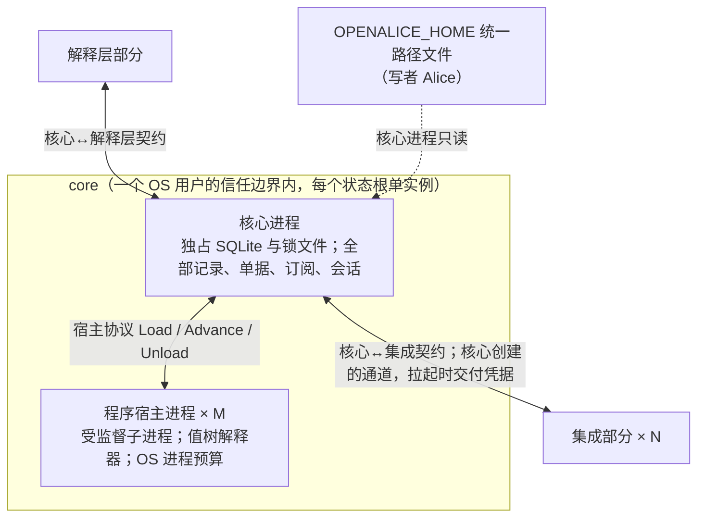
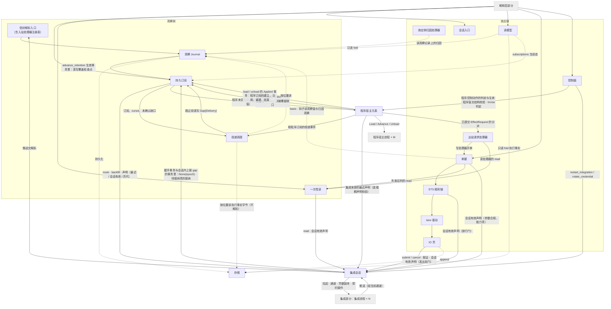

# core：系统上下文

## 0 定位

- **层级与元素：** C4 L1，core 部分作为黑盒；核心进程（C4 L2）的模型、组件划分与走查也写在本文。上级是景观文档 [../README.md](../README.md)，全局原则、问题域与需求编号都定义在那里。
- **本文决定：** core 为谁服务、与哪些外部部分和系统交换什么、分配到哪些需求、拆成哪两个容器及理由；核心进程内部的模型（§3）；它分解成哪些组件、每个组件拥有与隐藏什么（§4.4、§4.5）；对外接口总表（§4.6）；组件之间的接口（§4.7）与 Rust 映射（§4.8）；W1–W20 的组件级走查（§5.1）。
- **读者：** 实现 core 的人，以及实现集成、解释层时需要知道 core 边界的人。审批者无（K3）。
- **状态：** 已定。
- **非目标：** 本文不写任何契约的操作规格（它们在实现各操作的核心进程组件文档里），也不写任何组件的内部（状态机、转移表），它们写在各组件文档，本文以链接指过去；核心进程的进程视图与生命周期在 [runtime/design.md](runtime/design.md)，程序宿主进程的内部在 [runtime/program-host-process.md](runtime/program-host-process.md)。
- **阅读约定：** 证据标签 `[证据]`/`[设计]`/`[推断]`、编号前缀与跨文档引用写法见 [README.md §0.4 阅读约定](../README.md#04-阅读约定)。“观察 J”= 观察 `Journal`，“执行 J”= 执行事实 `Journal`。

## 1 问题域

### 1.1 分配给 core 的需求

- 推出的需求：C1–C7、C9–C14；质量场景 Q1–Q32（Q24、Q30 只到 `Pooled` 接口为止）。分配表见 [../README.md §4.3](../README.md#43-需求分配)。
- 全局原则 [../README.md §1](../README.md#1-全局原则) 在 core 里落地：抽象只在 core 里；core 只对自己的意图及其推进记录有权威。

### 1.2 外部与它们的固有性质

| 外部 | 它是什么 | 与 core 相关的固有性质 |
|---|---|---|
| 解释层部分 | 下游经它接触 core；不持有状态 | 可随时断开、崩溃、重启（Q29）；每个连接带 OS 对端凭据与下游自报的 `actor`（H7） |
| 集成部分 × N | 每个上游一个进程，上游的唯一消费点 | 可崩溃、可成孤儿（H10）；它说的能力只代表那次握手（F6）；写可能无回执（F5） |
| 可选行情派生计算子系统 | 运行原生 op | 可能不存在；它在不在是实例的运行期事实 |
| Alice（经统一路径文件） | `OPENALICE_HOME` 下全部共享配置文件的唯一写者 | 文件以原子替换写入；它可在任何时刻改写文件，core 不能假设文件与运行态一致（H3） |
| OS | 进程、文件锁、对端凭据、时钟 | 进程的存亡只有 OS 能确认；文件锁随进程消亡而释放（H10）；同一 OS 用户的进程互相不隔离（H7）；Windows 无 UDS（H8） |

运维者与程序作者不直接接触 core：运维动作经解释层的控制组到达；程序作者写的程序值文件由 Alice 放进统一路径，经运维的 `load_program` 装载。

### 1.3 分配给核心进程的需求

需求的原文、来源与证伪条件在 [README.md §2.3 需求](../README.md#23-需求)，本文只引用编号。core 系统的两个容器之间，核心进程承担除“求值程序值”之外的全部需求：

| 需求 | 核心进程承担的部分 | 主要落在 |
|---|---|---|
| C1、C2、C12 | 意图先持久化、`SendBarrier` 二分崩溃窗口、unknown 只以来源证据收敛、放弃只结束等待、冷却从 `SendBarrier` 起算 | 单据、STS 规则链、lane 驱动、IO 壳 |
| C3、C9、C10、C11 | 决定带 principal 与依据、过期即否决、参数合规与允许集合、会话 principal 与写授权 | 单据、STS 规则链、会话入口 |
| C4 | 预算的装载、检查、失败抑制与跨重启保持（预算的执行在程序宿主进程） | 程序宿主元素 |
| C5、C6 | 订阅与程序的 owner 是核心；不连续一律显式标出 | 持久订阅、投递调度、程序宿主元素 |
| C7 | 凭据只在“封存文件 → 核心 → 该集成进程”链上 | 集成会话 |
| C13 | 原始负载完整保留（入执行 J 的 `Evidence`） | 信封解析入口、IO 壳 |
| C14 | 格式版本只前进、迁移失败拒绝启动、程序状态版本 | 存储、程序宿主元素 |
| H2、H9、H10 | 程序不可信；程序状态跨重启；单实例与孤儿 | 程序宿主元素、存储、[runtime/design.md §4.1 进程视图与生命周期](runtime/design.md#41-进程视图与生命周期) |

### 1.4 与外部共享的现象（容器粒度）

| 方向 | 现象 | 经过 |
|---|---|---|
| 集成部分 → 核心进程 | 握手投影、推送的观察记录、会话内上报的 `Gap{origin: Source}`、能力变更、readiness、调用的封闭返回值 | 核心创建的通道（集成会话） |
| 核心进程 → 集成部分 | 契约操作调用；拉起、凭据副本、通道一端 | 集成会话 |
| 解释层部分 → 核心进程 | 会话握手、订阅与确认、一次性读、读模型、单据组、结果未知组、控制组 | 会话入口 |
| 核心进程 → 解释层部分 | 投递（记录、投递缺口）、操作结果 | 投递调度、各组件 |
| 核心进程 ↔ 程序宿主进程 | `Load`/`Advance`/`Unload` 与其结果；拉起与终止 | 程序宿主元素 |
| Alice（文件） → 核心进程 | 封存凭据、集成登记、规则、程序清单与程序值、原生计算制品、运行期参数 | [files.md 统一路径文件](boundary/files.md) |
| OS ↔ 核心进程 | 文件锁、进程的拉起与退出确认、停止请求、对端凭据 | 存储、集成会话、程序宿主元素、会话入口 |

## 2 驱动

core 承担的质量场景全部在 [../README.md §3.1](../README.md#31-质量场景)；约束 K1（独立进程、序列化文本或跨语言 RPC）与 K2（优先 Rust）直接塑造本层的划分：

- K1 → core 是独立二进制；它与其余部分、与程序宿主之间的每条边界都由 IDL 或协议定义语义。语义边界不等于物理进程边界：集成与程序宿主各是独立进程，解释层的长连接端点可以落在核心进程内部转发（[../drafts/downstream/design.md §4.1 容器](../drafts/downstream/design.md#41-容器)）。
- H2 + C4 + Q25 → 不可信的程序不能与核心进程同处一个故障域，这是把程序宿主拆成单独容器的理由（§4.1）。
- H10 + Q20 → 每个用户状态根只有一个 core 实例（§4.3）。
- Q22（秒级负载）→ 线缆编码与单写者的吞吐要实测（验收 #19，[runtime/design.md §6.3 验收标准](runtime/design.md#63-验收标准)）。

质量场景 Q1–Q32 的六要素与优先级在 [README.md §3.1 质量场景](../README.md#31-质量场景)，约束 K1–K3 在 [README.md §3.2 约束与偏好](../README.md#32-约束与偏好)。本文不另立场景；每个场景由核心进程承担的响应，在 §5 的走查里逐步落到组件，其可测部分是 §6.1 的验收项与各组件文档的验收项。核心进程级的负载与时间度量只有两处由 [runtime/design.md](runtime/design.md) 负责：

- Q17、Q20、Q21 的重启、接管与停止的正确性（[runtime/design.md §4.1 进程视图与生命周期](runtime/design.md#41-进程视图与生命周期)、[runtime/design.md §5.1 崩溃矩阵（#1–#21）](runtime/design.md#51-崩溃矩阵121)），响应度量是“无半条记录、无双写、受控停止后无孤儿、失败分两级”。
- Q22 的编码吞吐：默认文本编码下高频推送流是否达标（[runtime/design.md §4.1 进程视图与生命周期](runtime/design.md#41-进程视图与生命周期)“传输与编码”，[runtime/design.md §6.1 风险 / 敏感点 / 权衡点](runtime/design.md#61-风险--敏感点--权衡点) 权衡）。

## 3 模型

§3.1、§3.2 写两个容器都服从的设计中心，以及它们与集成部分共用同一表示这一决定；§3.3 起是模型本身（含 core 与外部之间各种关联的承载）。流、位置与基础值类型在 [base/design.md §3 模型](base/design.md#3-模型)，gap 的三种来源在 [read/design.md §3.1 gap 的三种来源](read/design.md#31-gap-的三种来源)，无锁定位在 [read-write/design.md §3.1 无锁定位](read-write/design.md#31-无锁定位)，值树表示在 [value-tree.md §3.1 组合子值树与五个 fold](base/value-tree.md#31-组合子值树与五个-fold)。

### 3.1 设计中心

core 的主线是两类记录与它们之间唯一的边：观察（看到了什么，派生部分可撤回、可压缩）与执行事实（UTA 的意图及其推进，只追加）；唯一跨越二者的依赖方向是效应侧引用观察侧的位置，反向不存在。两个容器都服从它：程序宿主进程只算值、不写记录，它交回的派生值与效应请求由核心进程落成记录。展开见 [§3.4 两个类型宇宙与唯一边](#34-两个类型宇宙与唯一边)。

### 3.2 共用的值树表示

规则守卫、处理器触发、单据检查项（核心进程）、程序（程序宿主进程）与记录映射的换算（集成部分）共用同一个组合子值树表示；它们的区别在谁构造、何时校验，校验按各使用方的输入模型落实。理由：程序必须是可静态检查、可预算、状态可显式序列化的封闭值（H2、Q25）；其余几处复用同一个值，两个容器与集成部分就不必各造一套表示。表示、五个 fold、各使用方的校验、不变量、替代方案与证伪条件定义在 [value-tree.md §3.1 组合子值树与五个 fold](base/value-tree.md#31-组合子值树与五个-fold)，随 core 发布给集成作者与程序作者。

### 3.3 两类记录与第一边界

研究中确立的最稳定边界，是**可撤回 / 可压缩的派生内容 | 只追加的执行事实**，而不是问题域现象的分组。本设计把这条代数边界命名为观察（不可写）| 效应（可写）两个类型宇宙。名字借自问题域的现象分组，所指是这条代数边界。[证据：fp-05 命题 12“不能把负 diff 当外部 Write 的补偿”；fp-03 命题 1 log+fold 仅在不可丢/须审计条件下成立]

| 内容 | 修正方式 | 例 |
|---|---|---|
| 派生计算结果（bar、指标、信号、alert） | 撤回旧贡献、加入新贡献、重算受影响子图 | 迟到 tick 修订 bar → 均线重算 → 旧信号撤回 |
| 已发生的决策与执行事实（意图、批准、预约、发出、回执、对账） | 仅追加后续事实，永不改写为“从未发生” | 行情修订导致信号消失，但已发出的买单仍然存在；反向交易属于新行为 |

撤回派生结果不等于删除原始输入证据。原始证据的保留义务由保留语义单独定义（[journal.md §2.4 保留：边界与删除规则](read/journal.md#24-保留边界与删除规则)）。

该边界由三层分别保证，**任何一层均不可替代其他两层**：

1. **代数能力**：`Delta`/`RetractableDelta` 决定能否在代数上表达撤回（[journal.md §2.1 Journal 与撤回代数](read/journal.md#21-journal-与撤回代数)）。
2. **持久化接口**：执行事实侧的存储接口仅暴露 `append`；替换、删除、快照属于独立且需显式授权的操作（[storage.md §3 接口](base/storage.md#3-接口)）。
3. **保留协议**：明确哪些历史必须保留、谁有权批准边界推进（[journal.md §2.4 保留：边界与删除规则](read/journal.md#24-保留边界与删除规则)）。

“无逆元”仅约束第一层，不构成存储层面的不可变保证。

**不变量（执行事实只 append）：** 执行事实侧只 append，永不改写为“从未发生”。由第二层保证。

两侧共用存储原语（单 SQLite 文件、同一 `(stream_id, log_position)` 主键形状）是实现事实；不共享类型宇宙是设计事实。是否物理共表由实现按写放大与查询成本定。不选：**两侧共用同一表结构与代数**：为对账设计的类型扩到全体会污染认知，负 diff 不能当外部 Write 的补偿。

### 3.4 两个类型宇宙与唯一边

所有锁与对账机制都是为写操作存在的。为对账设计的类型若扩展到全体代码，会污染认知，并让组合子处理过多兼容项。因此可写对象与不可写对象是**两套独立的抽象**，不共享类型宇宙。

| | 观察（不可写） | 效应（可写） |
|---|---|---|
| 主体 | range：`StreamId` / `LogPosition` / 进度 / 保留 | 可写对象：有 venue 侧身份、作用域键、能力证据、可能有幂等键 |
| 载体 | `Journal<RetractableDelta>`，可撤回可压缩 | append-only 记录链 |
| 组合子宇宙 | `Pred` / `Comb` / `Fold`：输出是值与派生记录，**没有失败 sum** | guard：`Pred<(Context, RuleState, Input)>` → `Result<_, Failure>`；`Check` 带 `required_inputs` 与 `IntentAlignment` |
| 处理器 | `occurred_at`、`payload_schema` | `idempotency_key`、`attribution`、`cumulative_filled_quantity`、`execution_id`、`execution_revision`、`deadline`、守卫字段、`venue_order_id` |
| 机制 | 订阅、派生 DAG、程序解释① | 单据锁、STS 链、lane、IO 壳、两阶段、证据 gate、程序解释② |
| 核心进程里的组件 | 观察 `Journal`、信封解析入口（含入站处理器注册表）、持久订阅、投递调度、一次性读 | 出站请求处理器、单据、STS 规则链、lane 驱动、IO 壳、效应侧归因处理器（[resolution.md §4.6 效应侧归因处理器](read-write/resolution.md#46-效应侧归因处理器)）、读模型、控制面、会话入口 |

存储、集成会话与程序宿主元素不属任一侧（§4.5 各自的理由）。

**唯一的边是单向的：效应侧读观察侧。** 效应侧读观察侧有四种表现，读的都是位置与记录，不复制观察状态，各用自己的位置集标定读到哪：

| 表现 | 位置集 |
|---|---|
| 意图的 `basis` 引用观察位置 | `basis` |
| 钩子读观察值 | `checked_as_of` |
| 决议读带归因的订单状态观察 | `Found{observation}` |
| 读模型 fold 观察记录（订单状态 / 成交、持仓、健康） | `as_of` |

效应侧也**产生**观察记录：回执、取证、一次性读的结果落观察 J；控制面在开始不沿用旧状态之成员的 `Applied` 事务里 append 程序流开 epoch 的 `Gap{origin: Source}`；控制面在开始、替换与卸载程序成员的 `Applied` 事务里请持久订阅建立、沿用、重建或结束该程序的程序订阅及其项。集成会话按会话状态与调用结果给出健康观察，它不属任一侧，健康观察是观察侧记录。这些都沿效应 → 观察的方向。

**反向不存在**：观察侧的任何类型、组合子、处理器都不引用效应侧类型、不按效应侧状态求值。这条边约束的是**类型依赖与语义消费**，不是不透明的出处元数据 [设计]：

- 观察记录上的 `provenance`（`OneShot{origins, request}`、`Receipt{attempt}`、`Reconciliation{attempt, channel}`）与 `attribution` 字段，只是位置、`AttemptRef`、单据身份、principal、请求参数这类不透明值。
- 观察侧存它、路由它、不解析它，正如载荷字节。
- 解析它们的处理器注册在效应侧：**记录归观察，响应归效应**（[resolution.md §4.6 效应侧归因处理器](read-write/resolution.md#46-效应侧归因处理器)）。

**程序跨两边。** 程序是值不是类型，同一个程序值可以跨两边：解释①（派生）在观察宇宙，解释②（决策）在效应宇宙。两种解释都在程序宿主进程里求值（[derivation.md §3.2 解释①：派生](read/derivation.md#32-解释①派生)），本文定的是它们的**消费约束**：解释①只产出派生记录，读各输入 cursor 之后的观察记录与来源证据证明的覆盖；解释②只产出 `EffectRequest` 值，另读声明的执行事实流与自己的请求流；两者都不直接调用 venue 写接口，解释②的执行状态（请求进度跟踪）不进派生 DAG。它对效应侧的输出仍经核心（Intent、`IntentAlignment`），不构成反向引用。[证据：域 P6]

**不变量（观察侧不引用效应侧）：** 类型依赖与语义消费反向不编译；不透明出处值除外。由单向边 + crate 依赖方向保证（§4.8）。

**为什么 / 不选。** 两套抽象让观察侧派生可自由撤回 / 压缩而不牵动执行事实，效应侧决定可追溯到当时看到的位置（Q1/Q6/Q28）。不选：**双向引用或共用一套类型**：为对账设计的类型扩到观察侧污染认知，撤回 / gap 无法传播；**把观察状态复制进效应对象**：造出第二份状态并引入反向耦合。[证据：fp-05 命题 12；fp-03 命题 1/2]

### 3.5 允许 / 禁止关系

| 主体 | 允许产生 | 允许消费 / 引用 | 禁止 |
|---|---|---|---|
| 观察侧处理器 | 派生记录、进度推进 | 信封字段、派生流 | 引用效应侧任何类型 |
| 效应侧处理器（入站的效应侧分区与出站处理器） | lane / 决议 / 规则记录、写请求 | 信封字段、执行事实记录、经单向边读的观察值 | 绕过效应路径直接写 venue |
| 程序（值） | 派生记录（解释①）、`EffectRequest`（解释②） | 各输入 cursor 之后的记录（观察流；解释②另读声明的执行事实流与自己的请求流）、来源证据证明的覆盖 | 直接调用 venue 写接口 |
| STS 规则链 | `Outcome` 记录 | 执行事实记录（含冷却所读的 `SendBarrier`、lane 步所读的 `bypass_lane` 控制记录）、单据 fold 已算好的状态（`parameter_validity`、`basis_validity`、`alignment`） | 引用读模型；读观察 |
| 读模型 | 供解释层经 `read_model` 读取的只读 fold | 按种类：执行事实记录、观察记录、订阅表当前态 | 被规则引用、被当作权威 |
| IO 壳 | 执行事实记录（`SendBarrier`/`VenueAccepted`/`Expired`/…，回执与取证的 `Evidence` 在其中）；回执与取证读产生的观察记录（与一次性读同形） | `Prepared`、证据响应 | 修改任何记录、知道单据存在 |
| 单据 | `TicketAction` append 记录 | IO 壳 append 的记录（作 `basis` 或检查项依据）、观察值 | 反向耦合进 IO 壳 |
| 效应侧 → 观察侧（单向边） | 观察记录（回执 / 取证 / 一次性读，带不透明 `provenance`；程序流开 epoch 的 `Gap{origin: Source}`）；请持久订阅建立、沿用、重建或结束程序订阅及其项 | 观察位置集 `Set<LogPosition>`（`basis`、`checked_as_of`、`Found{observation}`、`as_of`）、观察值 | — |
| 观察侧 → 效应侧 | — | 只存不解析的出处值（`provenance`/`attribution`）；投递调度按位置搬运执行事实订阅所选记录的字节（经存储读出，不解析、不经读模型） | **类型依赖与语义消费全部禁止**（反向不编译） |

规则禁止引用读模型，因为读模型非权威（[views.md §3.1 读模型是非权威的 fold](boundary/views.md#31-读模型是非权威的-fold)）。

### 3.6 `basis`：方向、基数、可追溯性

`basis` 是意图引用观察侧位置的承载：一个 `Set<LogPosition>`，是 §3.4 四种表现中的第一种。

- **方向**：效应 → 观察，单向。问题域依据是 P6：意图的依据是它引用的观察位置，意图对观察侧的连接点只有 `basis` 这一处。程序输出是现象 P6，不是直接的 venue 调用；venue 调用是 IO 壳的事，不是这条边。
- **基数**：位置集（≅ `Map<StreamId, Seq>`），可同时含两类位置：
  - **派生侧（观察）位置**：真正的跨边引用，例如某决策观察到的行情流 A@120、汇率流 B@57、账户流 C@90；撤 / 改单目标身份来源之三的归因观察记录也在此侧，与其他观察位置同样受保留边界约束。
  - **执行事实侧位置**：`VenueAccepted` / `SendBarrier` / `EffectRequest` 的位置，作为**身份与因果依据**。它属效应宇宙内部的自引用，不是跨边。
- **可追溯性**：`basis` 记录意图实际消费的 `LogPosition` 集。取值不复制进 `basis`，由观察 J 在这些位置 `fold_state` 重建，所以从 `basis` 能重建“这个决定当时看到了什么”。intent ↔ 结果 / 审计 / 重放的名义关联，由执行事实日志的位置 + causation id 承载（§3.10）；`basis` 提供决定的输入侧可追溯性，与结果侧关联互补、不重叠。

`basis` 的有效性语义（`basis_valid`、逐位置判定、`Lag` 窗口）是单据在放行前应用的只读校验门，写在 [ticket.md §3.5 第一层：依据有效性 basis_validity](read-write/ticket.md#35-第一层依据有效性-basis_validity)；它不参与两阶段协议，只决定是否进入 prepare。

不变量：

- `basis` 是位置集，不含观察状态的拷贝。由类型保证。
- 边界推进前必须显式处理仍被 `basis` 引用的派生侧位置。由保留协议保证（§4.7.6）。
- 执行事实侧引用不因年龄变假。由 append-only 语义保证（§3.3 第二层）。

**为什么。** 两个宇宙独立成型后，效应侧仍必须知道“依据什么下的决定”，以支持决议、审批与重放。把依据建成对观察位置的引用，而非把观察状态复制进效应对象，既保持单向，又让依据可随观察侧撤回 / 推进而重算（偏离是状态）。[证据：fp-03 命题 2；域 F9/P11]

**不选。**

- **把观察状态复制进效应对象（自带一份行情快照）**：会在效应侧造出与观察侧并行的第二份状态，撤回 / gap 无法传播，且引入反向耦合。
- **把目标身份塞进 `basis`**：`basis` 是位置语义，身份是名义关联；混同会让“依据滞后”与“目标是谁”两件事互相污染。

### 3.7 读副作用与写副作用

§3.4 分的是**对象**（可写 / 不可写）；本节分的是**动作**。

- **读副作用**：“读进来”这个动作本身就改变了系统内部：多一条记录、进度推进、程序被唤醒。它不改变外部世界。
- **写副作用**：改变世界。

读的推论：

- **向外部来源的读即观察记录**：经集成向来源读（一次性读、回填、取证），读本身就是带 `LogPosition` 的观察记录。一次性查询也写入观察 J：每个结果项一条记录，与推送观察同形，再加一条读结论记录，使空回答与“还没回答”可区分。操作是核心→集成的 `read`（[one-shot-read.md §4.1 核心→集成：read](read/one-shot-read.md#41-核心集成readstream-request-range--answered--unavailable--refused)），记录带 `provenance: OneShot{origins, request}` 与质量标记 `one_shot`。
- **发起者是任何人**：集成推送、程序、单据检查项的“先查后判”、消费方、IO 壳的对账取证都可发起读。
- **程序的定时器是由核心时钟作答的读**：它是一个读处理器（不另设处理器类别），不经集成、不向外部来源读；结果只是请求流上的 `EffectResponse{Fired}`（执行事实），不写观察记录。它同样不改变世界、重做无害、结果总可判定；但已提交的定时器请求不丢：重启由重派重新挂上（[timer.md §4.1 定时器处理器](runtime/timer.md#41-定时器处理器-设计)）。

| | 读副作用 | 写副作用 |
|---|---|---|
| 对外 | 不改变世界；可重复、可批处理、可并发；向外部来源的读可丢（丢了就再读或标 gap） | 改变世界；一次；不可批、不可去重、不可重放 |
| 结果 | 总是可判定（拿到了或没拿到） | 可能不可判定（`Undetermined`） |
| 失败处理 | 重试、换渠道、标 gap | 对账，永不重试 |
| 对内的副作用 | 向外部来源的读：append 观察记录、推进进度、触发处理器与 DAG 重算、唤醒程序、更新单据 `alignment`；对账取证另 append 执行事实侧的 `ResolutionEvidence`。定时器：只在请求流上 append `EffectResponse{Fired}`、唤醒程序 | append 执行事实（`SendBarrier`/回执/`Undetermined`/`Expired`）、推进 lane、关闭单据 |
| 时间 | 事件时间 + 集成的收到时间（`received_at`，只在集成交来的观察记录上）；每条记录另有核心盖的记录时间（[base/design.md §3.2 基础值类型](base/design.md#32-基础值类型)） | 每条执行事实同样有核心盖的记录时间（[base/design.md §3.2 基础值类型](base/design.md#32-基础值类型)）；写特有的时间是发出时间，即 `SendBarrier` 的记录时间（冷却按它计）；venue 的时间是回执里的观察 |
| 发起者 | 任何人 | 只有 IO 壳 |
| 机制 | 进度、保留、去重、批处理 | 单据锁、STS 链、lane、两阶段、证据 gate |

两轴正交，有意义的格子三个：观察对象 × 读（行情、新闻）；可写对象 × 读（`query_by_key`、`list_open`、`list_fills`；IO 壳的对账取证**是读副作用**，所以才能重试、按渠道依次做）；可写对象 × 写（`submit`、`cancel`）。观察对象 × 写不存在。

推论：

- 调用方先撤后下是两张单据、两次写：各自一次，中间看目标是否已结束的读由调用方自己做。撤单的回执或取证 `Found` 只说这次撤单请求的结果，不证明目标已结束；核心不把两次写拼成一个复合操作（[trade-protocol.md §4.1 交易协议：操作种类、目标、可执行性、检查目录](read-write/trade-protocol.md#41-交易协议操作种类目标可执行性检查目录-交易协议)）。
- `replay_by_key` 形式是写、语义是读。分类边界上的操作必须显式声明属于哪边（[resolution.md §4.2 replay_by_key](read-write/resolution.md#replay_by_keykey-key_role-scope-barrier_at--original--unavailable)）。
- `Undetermined` 只属于写：读没有 in-doubt，只有“没拿到”。这就是为什么检查项的 `Unavailable` 可行动（再发一次读），而 IO 壳的 `inconclusive` 只能停等：读已穷尽，写的结果仍未知，只由新到的来源证据终结；principal 可以放弃等待（`Abandoned`），但那不改写结果（[resolution.md §4.4 结果未知组（核心↔解释层）：放弃跟踪与重开](read-write/resolution.md#44-结果未知组核心解释层放弃跟踪与重开)）。
- 定时器的作答来源是核心时钟，所以它不需要集成会话；它的结论只由核心自己的墙钟复核给出，这是核心作为源头的事实（[timer.md §4.1 定时器处理器](runtime/timer.md#41-定时器处理器-设计)）。

不变量：

- 写副作用只由 IO 壳发起、一次、永不重试；读副作用任何人可发起、可重试、可批。由本节对照表 + IO 壳保证。
- 读结果总可判定；`Undetermined` 只属于写，读只有“没拿到”。

**为什么。** UTA 的真正副作用不是数据库写（SQLite 是记录，不是效应），而是对 venue 的写。而写是由读副作用产生的：AI 读了观察发出请求，程序读了观察满足规则产生 Intent，审批人读了待决集合作出决定。三者都是“读的副作用消费为写”，这就是“看到 → 决定 → 执行”的因果方向（[README.md §1.5 一句话与四步](../README.md#15-一句话与四步)）。读的结果总是可判定，失败可重试、可换渠道、可标 gap；写可能不可判定。所以读与写必须分成两类动作分开处理，而非按对象轴划分。[证据：fp-03 命题 4]

### 3.8 本文拥有的不变量

组件内部的不变量在各组件文档的模型节；下列跨组件、由本文的划分或组件间接口保证：

1. 执行事实侧只 append，永不改写为“从未发生”（§3.3；§4.7.3 唯一写入口）。
2. 观察侧不引用效应侧（类型依赖与语义消费），不透明出处值除外（§3.4；§4.8 crate 依赖方向）。
3. 写副作用只由 IO 壳发起；核心内对集成的一切调用只经集成会话的调用通道（§3.7；§4.7.1）。
4. `Prepared` 是单据与 IO 壳唯一的接触点，二者各认一半（[read-write/design.md §4.1 Prepared 双认](read-write/design.md#41-prepared-双认)）。
5. 同事务集合里的记录要么全部持久、要么全部不持久（§4.7.4）；`SendBarrier` 单独 durable append，不在任何集合里。
6. 每个经调用通道发出的调用恰好得到一个封闭结果、恰好计数一次，计数与结果记录同事务（§4.7.5）。
7. 保留边界推进不越过所在观察流已登记引用的最早位置（§4.7.6；判定规则在 [journal.md §2.4 保留：边界与删除规则](read/journal.md#24-保留边界与删除规则)）。
8. 生命周期嵌套：内层在外层之内开始；外层结束锚点写在它的全部内层结束之后（[runtime/design.md §4.1 进程视图与生命周期](runtime/design.md#41-进程视图与生命周期)）。
9. 订阅表只有持久订阅一个写者；进程表按 `role` 分行、各写各的；控制流有三个写者、都经存储的 append 接口（[base/design.md §4.1 持久化视图](base/design.md#41-持久化视图)）。

### 3.9 同名异义（跨组件）

只列两端属于不同组件的词；只在一个组件内部的同名异义写在该组件文档。

| 词 / 概念对 | 甲 | 乙 | 区分依据 | 所在 |
|---|---|---|---|---|
| 意图的三个阶段 | `EffectRequest`：程序发出的请求，未定型、无负责人 | `Ticket` 的 `Version<Intent>`：定型的意图，有负责人与 `basis` | 第三阶段是 STS 的 `Input`：规则输入，含意图、回执、超时、证据 | 出站请求处理器、单据、STS 规则链 |
| `Prepared` | `Ticket.Close(Prepared(position))` 的结果：单据关闭 | IO 壳链的起点：`Prepared → SendBarrier → …` | 同一条记录；单据认“我已交出”，IO 壳认“我该做的”（[read-write/design.md §4.1 Prepared 双认](read-write/design.md#41-prepared-双认)） | 单据、IO 壳 |
| 对账 / 决议 | 对账（alignment）：我的意图还对不对世界（`IntentAlignment`） | 决议（resolution）：我的动作发生了没有（`ResolutionEvidence`） | 前者在 `Prepared` 之前、只看观察侧；后者在之后、由 IO 壳驱动 | 单据、IO 壳 |
| 三种“对齐” | 锚点对齐：集成把上游账户、市场、身份结构对到锚点契约 | 记录映射的字段对齐：上游字段对到契约字段 | 第三种是对账（`IntentAlignment`），与前两者无关 | 信封解析入口、集成会话、单据 |
| 修订 / 撤回 | `Revision<Intent>`：意图版本间结构差，无逆元需求 | `RetractableDelta`：观察侧撤回代数，有逆元 | 前者属效应宇宙，后者属观察宇宙 | 单据、观察 `Journal` |
| 三种“无法判断” | `InputMissing`：检查项需要的观察流根本没有 | `Undecidable`：流存在但有 gap，没有本项主体的观察，或最近观察顺序未确立 | 第三种 `inconclusive`：读渠道穷尽而写结果仍未知，属决议；等待继续，或由 principal 放弃跟踪 | 单据、IO 壳、读模型 |
| 能力未知 / 结果未知 | `Verdict::Unknown`：venue 是否支持该操作不知道 | `Undetermined`：发出的写是否生效不知道 | 前者是握手结果、约束启动；后者是链状态、约束恢复 | 集成会话、IO 壳 |
| `SendBarrier` / `AwaitingDecision` | IO 壳发送屏障：`Prepared` 之后，外部动作即将发生 | 单据送审：`Prepared` 之前，无外部动作 | 二者相隔整条 STS 链 | IO 壳、单据 |
| `basis` / `required_inputs` | 值：这张单据实际引用了哪些 `LogPosition` | 类型：这个检查/处理器要读哪些 `StreamKind` | `required_inputs` 从组合树派生；`basis` 从实际评估记录 | 单据、信封解析入口 |
| `LogPosition` / `Hash` | 日志位置：顺序身份 | 内容寻址：版本身份 | `current_version` 是 `Hash`，`Prepared(position)` 是 `LogPosition` | [base/design.md §3.1 流、位置与三种进度](base/design.md#31-流位置与三种进度)、单据 |
| 四种“过期” | `Ticket.Close(Expired)`：STS 过期步，在 `Prepared` 之前（H6） | `DecisionStep::Expire(t, k)`：程序规则时限，到值树求出的 UTC 时刻 t 执行回调 k；按定义是一条定时器请求加对其 `Fired` 响应的 `On`（[requests.md §3.1 EffectRequest：唯一出口，请求是值](runtime/requests.md#31-effectrequest唯一出口请求是值)） | 第三种：尝试记录 `Expired(deadline)`，已放行而交出前 `deadline` 已过，IO 壳不发并结束等待；写可能已交出之后不再有 `Expired`，结束等待的唯一出口是 `Abandoned`。第四种：写调用的时限在集成里，集成在时限内得不到回执时返回 `NoResponse`，只是 `Undetermined` 的原因之一；核心没有调用时限 | 单据与 STS 规则链、程序宿主进程与出站请求处理器、IO 壳、集成部分 |
| 两种“拒绝” | `VenueRejected`：写已发出，venue 拒了；执行事实、终态之一 | `DecisionRejected`：审批人否决，或 STS 链否决；单据关闭，从未进入 `Prepared` | 前者在链上，后者在单据上 | IO 壳、单据 |
| 两种 schema 身份 | `payload_schema`：观察记录的契约载荷按哪份 schema 读，随 `StreamDecl` 声明 | 意图参数 schema：写意图的参数按哪份 schema 校验，随写能力声明，每版意图带它 | 前者标观察的载荷，核心不校验；后者在输入约束步校验，校验后参数原样交给集成 | 信封解析入口、单据 |
| 上游的两种 `Refused` | `handshake` 返回 `Refused`：上游拒绝集成的身份或配置，整个集成登记 `Halted` | `read`/`backfill` 返回 `Refused`：上游拒绝这一次读，集成照常运行，不是 gap | 都只在上游明确拒绝时返回；不可达、超时一律 `Unavailable` | 集成会话、一次性读、持久订阅 |
| 离线 / 待处理 | `Connecting`：没有会话，会自己恢复 | `Halted`：没有会话，不会自己恢复 | 二者都不发写（发出前门等待）；只有后者要 `restart_integration` 或 `rotate_credential` | 集成会话、IO 壳 |
| 两种“证据” | `CapabilityProof`：venue 有这个能力（握手结果） | `ResolutionEvidence`：我的尝试发生了没（对账结果） | 前者进 `Projection.capabilities`，后者进链 | 集成会话、IO 壳 |
| 读模型 / 归因后的订单观察 | 读模型：核心对记录的非权威 fold，规则不引用 | 集成产出的带出处记录，钩子可读 | 一个是解释、一个是记录 | 读模型、单据 |
| 归因字段的归属 | 记录归观察侧：`attribution` 落在订单/成交观察记录上 | 响应归效应侧：读它的处理器注册在效应侧 | 见 [resolution.md §4.6 效应侧归因处理器](read-write/resolution.md#46-效应侧归因处理器) | 信封解析入口、[resolution.md §4.6 效应侧归因处理器](read-write/resolution.md#46-效应侧归因处理器) |
| 入站处理器 / 出站处理器 | 集成进来的字段出现 → 做什么 | 程序出去的请求出现 → 做什么 | 同一形状，方向相反；后者必须声明读/写 | 信封解析入口、出站请求处理器 |
| 两个 `Start` | 输入声明的起点策略 `Start { Tail, Origin }`：`InputDecl` 与 `FactDecl` 的字段 | cursor 的 `Start{from}` 分支：在 `Origin` 或保留边界上建立、前导尚未确认的 cursor | `Origin` 建出后者，`Tail` 建出 `At` | 程序宿主元素、持久订阅 |
| `Journal` / 段池 | 记录的载体，持久于 SQLite，由保留语义管理 | 可选子系统为高性能计算设的运行期快照，由 `Pooled` 洗入，永不持久 | 两套存储，互不派生；只共用 `LogPosition` 标定 | 观察 `Journal`、程序宿主元素（接口） |
| 读副作用 / 写副作用 | 读：不改变世界，可重试、可批、可丢，结果总可判定 | 写：改变世界，一次，可能 `Undetermined` | 与对象轴正交；对账取证是读 | 本文 §3.7 |
| `Transfer` / 协作 | 换负责人：单据始终只有一个负责人；`AwaitingDecision` 中的 `Transfer` 使 STS 链按新负责人从授权步起重过（已绑定 `current_version` 的人工 Decision 仍算数） | 协作：核心之外（另起单据、给负责人建议） | 单据不支持共同编辑 | 单据、STS 规则链 |
| lane 队首阻塞 / 锁 | 通讯协议语义：后续写的含义依赖队首结果 | 锁：消费者自己持有的互斥 | UTA 不是消费者；队列有序才重要 | lane 驱动、[read-write/design.md §3.1 无锁定位](read-write/design.md#31-无锁定位) |
| `Gap{origin}` 三种来源 | 见 [read/design.md §3.1 gap 的三种来源](read/design.md#31-gap-的三种来源) | | | [read/design.md §3.1 gap 的三种来源](read/design.md#31-gap-的三种来源) |
| 三种去重 | 投递去重：同一条记录被同一订阅者重复看到，按 `LogPosition` 去重 | 按执行计数：同一笔执行经不同渠道成为不同记录，按 `execution_id` 与修订计一次 | 第三种是回填与实时的边界：按范围不重叠（`live_from`），不逐条去重；三者互不替代 | 投递调度、读模型、持久订阅 |
| “快照” | 核心快照：`fold_state` 的重启加速点，只供重启恢复，不对外读 | 读模型 `Snapshot`：`read_model` 的一次读取结果，带 `as_of` | 段池也称“运行期快照”；旧 UTA 的账户快照是组合视图，属业务，UTA 不提供 | 存储、读模型 |
| `Starting` | 操作结果：启动第 5 步开放下游会话之前，除 `handshake` 外的操作一律返回它 | 流 readiness：会话已建立、该流在当前流 epoch 里尚未声明 `live_from` | 前者按整个核心、只在启动期；后者按集成 × 流；开放之后某流处在 `Starting` 不使任何操作返回 `Starting` | 会话入口、读模型 |

### 3.10 五种关系，五种承载

core 与外部之间的关联各有自己的承载，不塞进一个对象的字段互指。[证据：fp-03 命题 2]

| 关系 | 承载 | 验证阶段 |
|---|---|---|
| operation ↔ capability | 能力证据值（[integration.md §3.3 投影 Projection](boundary/integration.md#33-投影-projection)） | 运行期握手 |
| request / resource ↔ provider 身份 | `StreamId`、外部订单 id、幂等键 | 构造期 / 运行期 |
| 多 effect ↔ 同一作用域 | 单条规则链事务 | 构造期 |
| program ↔ 解释器 | 解释选择（①派生 / ②决策） | 构造期 |
| intent ↔ 结果 / 审计 / 重放 | 执行事实日志的位置 + causation id | 运行期，持久 |

## 4 结构

### 4.1 容器

| 容器 | 拥有 | 隐藏的决定 | 假设 | 文档 |
|---|---|---|---|---|
| 核心进程 | SQLite 单文件与锁文件（独占）、观察与执行事实日志、单据与规则链、IO 壳、订阅与投递、读模型、集成会话、程序的活动集合与宿主的监督、控制面；拉起并登记集成进程与程序宿主进程 | 全部核心代数、持久化、进程与会话的生命周期 | 每个用户状态根单实例；集成与宿主不接触 SQLite | [runtime/design.md](runtime/design.md) |
| 程序宿主进程 | 一个程序的值树解释（解释①派生、解释②决策）与增量求值；每个程序一个进程 | 增量引擎、节点粒度的重算与 cutoff、状态的序列化 | 只经宿主协议与核心进程交换值；不接触 SQLite 与凭据；CPU 与内存能由 OS 进程机制限制（[设计] 前提，证伪 #3） | [runtime/program-host-process.md](runtime/program-host-process.md) |

**为什么程序宿主是单独的容器。** 程序是不可信的（H2）：会死循环、吃内存、超产意图。预算与隔离要由 OS 进程机制给出，而不是类型系统（C4、Q25）；宿主死亡只影响该程序。不选让程序在核心进程内运行：一个死循环或内存爆炸的程序会带走全部记录、会话与写路径。宿主为何是受监督子进程而不是 Wasm 见 [runtime/program-host-process.md §6.1 替代方案](runtime/program-host-process.md#61-替代方案)。

**两者之间的关系。** 核心进程拉起宿主，经宿主协议交给它程序并推进它；宿主只交回值，从不写记录，记录由核心进程落下。协议规格在 [program-host.md §4.6 宿主协议](runtime/program-host.md#46-宿主协议)。经过两个容器的场景是 W10（程序超预算隔离）与 W17（程序发出读请求），trace 在 [§5.1 W10](#w10q25程序超预算隔离) 与 [§5.1 W17](#w17-程序-emit-读处理器fetchbars闭环走观察侧)。

SQLite 文件与锁文件是核心进程独占的持久化资源，不作为容器：只有核心进程读写它们（[storage.md](base/storage.md)）。

### 4.2 与外部的关系

每条关系的规格写在实现它的核心进程组件文档里；这里只写交换什么、谁发起。

| 外部 | 交换什么 | 谁发起 | 规格所在 |
|---|---|---|---|
| 解释层部分 | 会话与 principal；订阅、确认与投递；一次性读；读模型与健康；单据操作与决定；结果未知的放弃与重开；控制动作 | 解释层开会话、发请求；核心进程在会话上投递 | 各操作一行，见 [§4.6 对外接口总表](#46-对外接口总表) |
| 集成部分 | 握手与能力声明；推送（观察记录、来源 gap、能力变更、readiness）；`route`、`backfill`、`read`；`submit`、`cancel` 与取证读 | 核心进程拉起集成进程、创建通道、交付凭据、发起调用；集成在会话上推送 | [integration.md §4.3 核心↔集成契约的会话部分](boundary/integration.md#43-核心集成契约的会话部分)，各操作见 [§4.6 对外接口总表](#46-对外接口总表) |
| 可选子系统 | `Pooled` 段视图；原生 op 的安装记录与每次宿主执行交出的制品内容；原生 op 的输出值 | 核心进程在拉起宿主之前交出 | [program-host.md §4.7 核心↔可选行情派生计算子系统](runtime/program-host.md#47-核心可选行情派生计算子系统)、[derivation.md §4.1 核心↔可选行情派生计算子系统（派生）](read/derivation.md#41-核心可选行情派生计算子系统派生) |
| Alice（文件） | 封存凭据、集成登记、规则、程序装载清单与程序值文件、运行期参数、原生计算制品 | Alice 写；核心进程只在规定时刻读 | [files.md 统一路径文件](boundary/files.md) |
| OS | 文件锁与 fence、进程的拉起与退出确认、对端凭据、UTC 与单调时钟 | 核心进程 | [runtime/design.md §4.1 进程视图与生命周期](runtime/design.md#41-进程视图与生命周期) |

### 4.3 部署与信任

结论如下；机制与规格在所链接处。

- **独立生命周期。** core 独立启动、独立存活、独立停止；下游或解释层退出、崩溃或重启，均不改变 core 的订阅、程序、lane 与日志：订阅与程序的 owner 是 core（H5/C5）。断连期间的投递损失显式标记，不伪造连续性。停止的顺序见 [runtime/design.md §4.1.4 受控停止](runtime/design.md#414-受控停止-设计)。
- **独立进程。** 核心进程、每个集成、每个程序宿主都是独立 OS 进程。下游只经解释层接触 core；Alice 是下游之一，不是核心的父进程或守护者。可选子系统在 core 之外，没有它 core 照常运行。
- **信任单位是 OS 用户（H7）。** 本机非本用户的进程不可信；本用户的进程视为用户本人。能连到 core 不等于有权发写：写权限来自认证得到的 principal × 策略 scope，不来自连接。理由：core 是独立进程，IPC 是正式边界，而 UDS 对端凭据 / 命名管道 ACL 的粒度都是 OS 用户；同用户进程之间要互相隔离属升级路径（证伪 #8，[../README.md §6.1](../README.md#61-证伪条件部分级)）。
- **单实例。** 同一用户状态根（`OPENALICE_HOME`）只有一个 core 实例（H10）；接管与孤儿回收见 [runtime/design.md §4.1.3 启动五步](runtime/design.md#413-启动五步)。
- **核心进程拉起子进程并创建通道。** 集成进程与程序宿主进程都由核心进程拉起；核心↔集成的通道由核心创建、只交给该子进程（[integration.md §3.5 会话：核心创建的通道化身](boundary/integration.md#35-会话核心创建的通道化身-设计)）。
- **凭据只经核心交付。** 凭据链是 `统一路径封存文件 → 核心进程 → 该集成进程`（C7）；程序与消费方只见账户身份（[integration.md §4.5 进程、通道与凭据](boundary/integration.md#45-进程通道与凭据)）。
- **共享配置走文件。** core 与 Alice 共享的配置都是统一路径下的文件，写者是 Alice，核心进程只读（[files.md 统一路径文件](boundary/files.md)）。
- **跨进程语义由 IDL 固定，编码与信道按 OS 选择**（K1、H8）；取舍见 [runtime/design.md §4.1.1 进程形状](runtime/design.md#411-进程形状)。

### 4.4 模块地图

core 的组件文档分五个目录：单读链与读写链各一个，两条链共用的底座、core 与外部之间的边界、进程与程序的运行各一个。各目录的 `design.md` 列出本目录的文件。

| 目录 | 文件 | 内容 |
|---|---|---|
| [base/](base/design.md)：底座，单读链与读写链共用 | [design.md](base/design.md) | 流、位置与三种进度；基础值类型；持久化视图与控制流 |
| | [value-tree.md](base/value-tree.md) | 组合子值树与五个 fold |
| | [storage.md](base/storage.md) | 存储 |
| [read/](read/design.md)：单读链，读副作用读进来只在核心内消费 | [design.md](read/design.md) | gap 的三种来源 |
| | [supply.md](read/supply.md) | 供给 |
| | [backfill.md](read/backfill.md) | 回填 |
| | [one-shot-read.md](read/one-shot-read.md) | 一次性读 |
| | [journal.md](read/journal.md) | 观察 `Journal` |
| | [consumption.md](read/consumption.md) | 持久订阅与投递调度 |
| | [derivation.md](read/derivation.md) | 派生 |
| | [trade-observation.md](read/trade-observation.md) | 交易协议观察 |
| [read-write/](read-write/design.md)：读写链，读的副作用消费为写 | [design.md](read-write/design.md) | 无锁定位；`Prepared` 双认 |
| | [intent.md](read-write/intent.md) | 意图来源 |
| | [ticket.md](read-write/ticket.md) | 单据 |
| | [trade-protocol.md](read-write/trade-protocol.md) | 交易协议 |
| | [decision-chain.md](read-write/decision-chain.md) | STS 规则链 |
| | [lane.md](read-write/lane.md) | lane 驱动 |
| | [write.md](read-write/write.md) | 写边界：IO 壳 |
| | [resolution.md](read-write/resolution.md) | 决议 |
| [boundary/](boundary/design.md)：边界，core 与集成、解释层、Alice 文件之间 | [design.md](boundary/design.md) | 本目录的文件 |
| | [integration.md](boundary/integration.md) | 集成会话 |
| | [envelope.md](boundary/envelope.md) | 信封解析入口与入站处理器注册表 |
| | [session.md](boundary/session.md) | 会话入口 |
| | [control.md](boundary/control.md) | 控制面 |
| | [views.md](boundary/views.md) | 读模型 |
| | [files.md](boundary/files.md) | 统一路径文件 |
| [runtime/](runtime/design.md)：运行，核心进程与程序宿主进程 | [design.md](runtime/design.md) | 核心进程：进程视图与生命周期；崩溃矩阵 |
| | [program-host.md](runtime/program-host.md) | 程序宿主元素 |
| | [program-host-process.md](runtime/program-host-process.md) | 程序宿主进程 |
| | [requests.md](runtime/requests.md) | 出站请求处理器 |
| | [timer.md](runtime/timer.md) | 定时器 |

### 4.5 组件指南

每个组件写它**拥有**什么、**隐藏**什么决定、**假设**什么、对应本文或组件文档里的哪个抽象。约束：没有组件承担两个抽象的秘密。公共值类型（`StreamId`、`LogPosition`、`Projection` 等）被多个组件消费不等于多 owner；owner 约束的是可变状态、状态转换与唯一写入口。组件的接口规格、内部状态机与它实现的对外操作在各自文档，本表不展开。

**观察侧**

| 组件 | 拥有 | 隐藏的决定 | 假设 | 文档 |
|---|---|---|---|---|
| 观察 `Journal` | 观察侧记录载体、`RetractableDelta` 撤回代数、按保留边界压缩；保留边界与引用登记表；`advance_retention` 的判定 | `compact` 与 `fold_state` 的实现、按流种类的保留规则（健康流按键、程序流按流 epoch） | 派生侧可撤回；引用由各持有者的 append 触发登记（§4.7.6） | [journal.md](read/journal.md) |
| 信封解析入口（含入站处理器注册表） | 边界处解析并验证信封字段（parse-don't-validate，隐藏构造器）、契约载荷与原始负载直通；字段→处理器映射（观察侧 / 效应侧分区）、`required_inputs`、触发效果；锚点表、字段注册表与 `payload_schema` 的契约 | 智能构造器、畸形记录拒绝逻辑、载荷语义解释 | 锚点闭合必填、入口即验；处理器字段缺失 = 不触发，不是错误 | [envelope.md §2.2 三部分](boundary/envelope.md#22-三部分-设计) |
| 持久订阅 | 订阅表（订阅、逐项状态、cursor、按（订阅，流）记的投递缺口），唯一写者；按流合成需求与 `route` 义务、配额计量；回填任务与回填进度；序号覆盖与覆盖检查点；程序订阅（每个活动程序 id 一个） | 匹配与路由细节 | 订阅 owner 是核心，与消费方连接无关；供给项按最近声明接纳，只投递项与执行事实 selector 按历代声明；此刻的判定读会话有效声明 | [consumption.md](read/consumption.md)、[supply.md](read/supply.md)、[backfill.md](read/backfill.md) |
| 投递调度 | 投递、背压、conflation；按 cursor 两支（`At`/`Start`）投递；投递缺口的检测（写入请持久订阅）；执行事实按位置原样搬运；程序订阅投递事件的组成 | 传输层 conflation 实现 | 损失语义由消费者显式声明 | [consumption.md 投递调度](read/consumption.md#投递调度) |
| 一次性读 | 除回填外全部 `read` 的发起与完成：在途表（同一会话 epoch 内同一 identity 并入）、`origins` 冻结、各发起方 `deadline`、`Pending`；结果项与读结论记录或 `Gap{origin: Channel}` 与计数同事务提交 | 在途表的数据结构、判定的实现 | 发起方是读处理器、钩子“先查后判”与消费方；它只处理不透明的 `origins`；在途表只在内存，嵌在集成会话之内 | [one-shot-read.md](read/one-shot-read.md) |

**效应侧**

| 组件 | 拥有 | 隐藏的决定 | 假设 | 文档 |
|---|---|---|---|---|
| 出站请求处理器 | `EffectRequest` → 读 / 写处理器分派；读处理器经一次性读立即执行成观察，定时器按核心时钟作答；写处理器以发出成员的装载 principal 开单；`EffectResponse`；请求流；本实例内的在途定时唤醒 | 副作用具体种类 | 写处理器不绕效应路径；请求按发出成员处理 | [requests.md](runtime/requests.md)、[one-shot-read.md §4.5 读处理器](read/one-shot-read.md#45-读处理器)、[timer.md](runtime/timer.md)、[intent.md §4.1 写处理器](read-write/intent.md#41-写处理器-设计) |
| 单据 | 意图形成期锁（`responsible`）、线性版本链、`basis`、两层对账状态（`basis_validity`、`alignment`、`parameter_validity`）、编辑 diff；交易协议 | 意图类型解释、`Revision<Intent>` | 单据不驱动 IO 壳，只单向读其记录 | [ticket.md](read-write/ticket.md)、[trade-protocol.md](read-write/trade-protocol.md) |
| STS 规则链 | 顺序固定链（授权→输入约束→审批→lane→过期）、`RuleState`（记录的 fold，不存储）、`Rejection`、放行判定；规则文件的内容与合法性 | 规则内部守卫（组合子 kind enum） | 规则不引用读模型 | [decision-chain.md](read-write/decision-chain.md) |
| lane 驱动 | 每 `WriteLaneKey` 的阻塞头集合（该 lane 执行事实与 `bypass_lane` 控制记录的 fold）与按 `Prepared` 位置的执行顺序 | 上游账户结构对齐 | 有序与阻塞来自通讯协议，不是 UTA 的锁；lane 等待发生在 `Prepared` 之前 | [lane.md](read-write/lane.md) |
| IO 壳 | 核心内唯一的写调用发起者、`Prepared` 链驱动、两阶段、`SendBarrier`、发出前门、`NotSent` 与 `Abandoned` 的写入、对账驱动、崩溃恢复、`CapabilityObserved` 的 append | 转移表、渠道顺序 | 核心内唯一效应处，写在上游的落实由集成完成；不知道单据存在 | [write.md](read-write/write.md)、[resolution.md](read-write/resolution.md) |
| 效应侧归因处理器 | 键 → 尝试的唯一索引；`ResolutionEvidence{Attributed}` 的 append | 索引的数据结构 | `attribution` 由集成按它自己的关联证据填写 | [resolution.md §4.6 效应侧归因处理器](read-write/resolution.md#46-效应侧归因处理器) |
| 读模型 | 对记录的只读 fold（订单、持仓、lane、单据、订阅、来源、健康），非权威 | fold 的具体数据结构 | 不被规则引用；消费方也可自行 fold 原始记录 | [views.md](boundary/views.md)、[trade-observation.md](read/trade-observation.md) |
| 控制面 | 认证 principal 传入的运维动作通道（P14）的共同部分：按 `(principal, 动作种类)` 授权、`Applied \| Rejected` 控制记录、所读文件的 hash；`reload_config` | 传输 | 只经认证 principal，不经进程信号或 flag 文件；每个动作的生效点与语义在实现它的组件 | [control.md](boundary/control.md) |
| 会话入口 | 核心↔解释层会话（消费方会话）的开始与结束：principal 的组成、契约版本检查、`Starting`、受控停止时关闭入口 | 传输（UDS / 命名管道） | 信任单位是 OS 用户（H7）；请求体里的身份不参与授权；消费方会话不拥有订阅、单据或在途读 | [session.md](boundary/session.md) |

**不属任一侧**

| 组件 | 拥有 | 隐藏的决定 | 假设 | 文档 |
|---|---|---|---|---|
| 存储 | 单文件、表主键、事务原子性、append-only 的接口保证、快照、格式版本与迁移、实例表与进程表的持久接口；按位置交出已提交记录的字节（两侧通用，不解析）；`request_snapshot` | SQL、索引、WAL 细节 | 核心独占；集成 / 宿主不接触 | [storage.md](base/storage.md) |
| 集成会话 | 每个采纳的集成登记的会话状态机与采纳记录；集成进程的拉起、终止与进程表登记，通道、凭据副本、`SessionEpoch`；握手、投影与契约版本的判定；调用通道（全部契约操作经它，每个调用恰好完成一次）；声明的两种解释（最近声明 / 会话有效声明）；声明版本、`IntegrationHalted`、轮换兑现记录；会话与计数健康观察的内容；`rotate_credential`、`restart_integration` | 传输与重连 pacing、进程监督与通道的 OS 机制 | 只按调用的封闭返回值计数；声明只由声明版本与 `CapabilityObserved` 求出；发起方在自己的事务里提交计数 | [integration.md](boundary/integration.md) |
| 程序宿主元素 | 程序的活动集合与失败抑制、已安装 op 集合；装载期两段校验；宿主进程的拉起、登记、OS 确认退出、trap 与预算检查；`Load`/`Advance`/`Unload` 的编排与 `Advance` 输出事务的编排；`ProgramHalted`、`ProgramReset`、`ProgramFailed`、`Checkpoint`；核心↔可选子系统接口 | 宿主进程的 OS 机制（rlimit / job object） | 预算靠宿主进程，不靠类型；只读已提交的控制记录，不向宿主进程取成员事实 | [program-host.md](runtime/program-host.md)、[derivation.md](read/derivation.md) |

**为什么这三个不属任一侧。**

- **存储**：两侧都经它 append 与读，它只保证 append-only 与事务原子，不解释记录。
- **集成会话**：会话状态与声明被两侧共同使用。IO 壳的发出前门、STS 与单据的可执行性读会话有效声明；持久订阅按最近声明接纳供给项、经它发 `route`/`backfill`；一次性读经它发 `read`。放进效应侧，观察侧就要依赖效应侧元素（唯一边反向）；放进观察侧，发出前门就要读观察侧的可变状态。它的接口只以契约值为参数与返回值（IDL 消息，以及声明里的 `StreamDecl`、`Quota`、写能力的 `Verdict` 与作用域键），不暴露它写的执行事实类型，所以观察侧元素依赖它不引入对效应侧类型的依赖。完整论证与不选（由 IO 壳或持久订阅拥有会话、各发起方自己计数、另设健康元素）在 [integration.md §4.1 为什么是一个组件，且不属任一侧](boundary/integration.md#41-为什么是一个组件且不属任一侧)。
- **程序宿主元素**：同一程序值跨两边（§3.4）。它把已提交的 `EffectRequest` 交给出站请求处理器分派，交给持久订阅的只是公共值（历代开始成员的 `Applied` 所记的输出契约：流名与值类型），持久订阅不读 `Applied` 本身。
- **一次性读在观察侧**：它写的全是观察记录，发起方身份以不透明的 `origins` 存储、不解析；效应侧的发起方用它，是效应侧读观察侧的方向。它为什么是独立组件（而不是放进集成会话、各发起方各自发读、或交给持久订阅）见 [one-shot-read.md §3.3 为什么一次性读是单独的组件](read/one-shot-read.md#33-为什么一次性读是单独的组件)。

**不在核心进程里的元素**：派生 DAG（解释①）与程序解释器在程序宿主进程里运行，只算值、不写任何记录（[program-host-process.md](runtime/program-host-process.md)）；集成进程与解释层属另两个部分。控制流不是组件，是记录模型（[base/design.md §4.1 持久化视图](base/design.md#41-持久化视图)）。

### 4.6 对外接口总表

核心进程对外的每个操作、推送与消息，规格写在实现它的组件文档；本表只指路。三处契约的版本与发布：核心↔集成的 IDL 随 release 发布给集成作者，核心↔解释层的 IDL 只在本仓库内部，宿主协议随核心与宿主一起发布（[§4.2 与外部的关系](#42-与外部的关系)）。

| 契约 | 操作 / 消息 | 规格所在 |
|---|---|---|
| 核心↔集成 | 契约粒度与三部分、`Projection`、记录映射与握手静态校验、`handshake`、推送（观察记录的接受、`Gap{origin: Source}` 与 `generation`、能力变更、readiness）、错误映射、集成义务、扩展三轴、通道与凭据交付 | [integration.md §4.3 核心↔集成契约的会话部分](boundary/integration.md#43-核心集成契约的会话部分) |
| 核心↔集成 | 信封、锚点、字段注册、`payload_schema`、公共 / 扩展 / 意图 schema | [envelope.md §2.2 三部分](boundary/envelope.md#22-三部分-设计) |
| 核心↔集成 | 成交与订单状态的契约语义 | [trade-observation.md §3.1 成交的计数身份](read/trade-observation.md#31-成交的计数身份-设计) |
| 核心↔集成 | `submit`、`cancel`、`query_by_key`、`list_open`、`list_fills`、`replay_by_key`、调用方键编码 | [write.md §4.5 写与取证操作的规格（核心→集成）](read-write/write.md#45-写与取证操作的规格核心集成)、[resolution.md §4.2 写与取证操作的规格（核心→集成）（取证）](read-write/resolution.md#42-写与取证操作的规格核心集成取证) |
| 核心↔集成 | `read` | [one-shot-read.md §4.1 核心→集成：read](read/one-shot-read.md#41-核心集成readstream-request-range--answered--unavailable--refused) |
| 核心↔集成 | `route`、`backfill`、实时边界与序号覆盖 | [supply.md §4.2 核心→集成：route](read/supply.md#42-核心集成routestream-subjects-generation--routedrefused--unavailable)、[backfill.md §4.1 核心→集成：backfill](read/backfill.md#41-核心集成backfillstream-window-subjects--covered--unavailable--refused) |
| 核心↔集成 | 交易协议（操作种类、目标、平仓锁、`Replace`） | [trade-protocol.md §4.1 交易协议：操作种类、目标、可执行性、检查目录](read-write/trade-protocol.md#41-交易协议操作种类目标可执行性检查目录-交易协议) |
| 核心↔解释层 | `handshake`（会话）、principal、`Starting` | [session.md §3 模型](boundary/session.md#3-模型) |
| 核心↔解释层 | `subscribe`/`ack`/`unsubscribe`、`rewind_cursor` | [consumption.md §4.1 核心↔解释层：订阅组与 rewind_cursor](read/consumption.md#41-核心解释层订阅组与-rewind_cursor) |
| 核心↔解释层 | 一次性读 `read` | [one-shot-read.md §4.2 核心↔解释层：read](read/one-shot-read.md#42-核心解释层readtargets-deadline--vectargetresult) |
| 核心↔解释层 | `read_model`、`health` | [views.md §4.1 read_model](boundary/views.md#41-read_modelkind-as_of--snapshotvalue-as_of-gaps) |
| 核心↔解释层 | 单据组 | [ticket.md §4.3 单据组（核心↔解释层）](read-write/ticket.md#43-单据组核心解释层) |
| 核心↔解释层 | 结果未知组 `abandon`/`retry_reconciliation` | [resolution.md §4.4 结果未知组（核心↔解释层）：放弃跟踪与重开](read-write/resolution.md#44-结果未知组核心解释层放弃跟踪与重开) |
| 核心↔解释层 | 控制组共同部分、`reload_config` | [control.md §4.2 共同流程](boundary/control.md#42-共同流程) |
| 核心↔解释层 | `load_program`/`unload_program`/`install_native_op`/`remove_native_op` | [program-host.md §4.1 控制动作](runtime/program-host.md#41-控制动作) |
| 核心↔解释层 | `rotate_credential`/`restart_integration` | [integration.md §4.8 控制动作 restart_integration 与 rotate_credential](boundary/integration.md#48-控制动作-restart_integration-与-rotate_credential) |
| 核心↔解释层 | `advance_retention` | [journal.md §3.2 控制动作 advance_retention(to: Set<LogPosition>)](read/journal.md#32-控制动作-advance_retentionto-setlogposition) |
| 核心↔解释层 | `request_snapshot` | [storage.md §3.1 控制动作 request_snapshot](base/storage.md#31-控制动作-request_snapshot) |
| 核心↔解释层 | `bypass_lane` | [lane.md §4.3 显式绕过 bypass_lane(ticket)](read-write/lane.md#43-显式绕过-bypass_laneticket) |
| 核心↔宿主 | `Load`/`Advance`/`Unload`、程序值、`Checkpoint`、预算 | [program-host.md §4.6 宿主协议](runtime/program-host.md#46-宿主协议) |
| 核心↔可选子系统 | `Pooled`、原生 op 的安装与每次交出 | [program-host.md §4.7 核心↔可选行情派生计算子系统](runtime/program-host.md#47-核心可选行情派生计算子系统)、[derivation.md §4.1 核心↔可选行情派生计算子系统（派生）](read/derivation.md#41-核心可选行情派生计算子系统派生) |
| 核心↔Alice 文件 | 统一路径与文件清单 | [files.md 统一路径文件](boundary/files.md)（各文件内容规格见其中所列组件） |

### 4.7 组件间接口

#### 4.7.1 uses 图

箭头起点使用终点给出的接口。只画核心进程的组件与直接相邻的容器 / 部分。

图中没有画出的 append 边（各组件经存储写执行事实、经观察 J 写观察记录）见 §4.7.3 与 [base/design.md §4.1 持久化视图](base/design.md#41-持久化视图)。依赖方向的要点：

- 唯一跨边是效应侧读观察侧（§3.4）。STS 规则链不读观察，它读的是单据 fold 已算好的状态。
- 两侧都经集成会话调用集成、取得声明，它的接口只是契约值。能力证据的记录存在执行事实侧，但写门、订阅接纳与读路由读的都是集成会话给出的声明。
- 投递调度经存储按位置读出执行事实订阅所选记录的字节、原样搬运，不经读模型、不解析。
- 程序宿主元素向投递调度取程序订阅的投递事件，组成 `Advance` 的 `events`；这是单向的使用，投递调度不使用程序宿主元素。程序宿主元素自己经存储写的是：程序流上的派生记录与 `ProgramReset`、`ProgramFailed`，控制流上的 `ProgramHalted`，以及 `Checkpoint` 的表。派生 DAG 在宿主进程里只算值，不写任何记录。
- 程序宿主进程与集成进程是外部进程，不接触存储；可选子系统同样不接触存储，只从程序宿主元素接收核对过的原生 op 内容（图中不画）。

#### 4.7.2 三对互用

两个方向各有一条的组件对恰有三对，都含持久订阅；每对里两个方向用的是对方不同的接口，各自向对方的源头请求。订阅表的写者始终只有持久订阅。

- **持久订阅 ↔ 程序宿主元素**：持久订阅向程序宿主元素取程序来源的接纳依据（输出契约；源头是控制流上的 `Applied`，由程序宿主元素 fold）；程序宿主元素向持久订阅取各观察项的初次接纳结果（源头是订阅表），并在它编排的 `Advance` 事务里请持久订阅写程序订阅的 cursor、删去被覆盖的投递缺口。
- **持久订阅 ↔ 投递调度**：持久订阅把订阅、cursor 与未确认的缺口交给投递调度去投递；投递调度要跳过一段时，请持久订阅先写下 `Gap{origin: Delivery}`。
- **持久订阅 ↔ 集成会话**：持久订阅经集成会话发 `route` 与 `backfill`、取声明；集成会话编排握手事务与会话内上报 gap 的事务，请持久订阅在其中 append 新流 epoch 的 `None{epoch}`，并把待接纳的项按新声明转为接纳或被拒。

这些方向经过的都只是公共值（流名、值类型、接纳结果、位置、声明），不引入任何一侧的类型。其余各对组件之间只有一个方向。§3.4 的“反向不存在”说的是观察侧对效应侧的 crate 依赖方向，不是不属任一侧的组件与观察侧组件之间的互用。

#### 4.7.3 执行事实的唯一写入口

执行事实 J 只经存储暴露的 append 接口写入。各方不争同一秘密：append-only 保证归存储，写内容归各自组件，只读 fold 归读模型（读模型只读、不写）。

| 写入者 | 记录 |
|---|---|
| 单据 | `TicketAction`，含 `Close(Prepared)` + 同事务 `Prepared` |
| STS 规则链 | Decision/`Outcome`/`Rejection`；授权步否决时的安全事件 |
| IO 壳 | `SendBarrier`/`VenueAccepted`/`VenueRejected`/`NotSent`/`Undetermined`/取证 `ResolutionEvidence`/`ReconciliationReopened{SessionRestored}`/`Expired`/`Abandoned`/`CapabilityObserved`/取证 `Gap{origin: Channel}` |
| 效应侧归因处理器 | `ResolutionEvidence{Attributed}` |
| 控制面 | 控制记录 `Applied \| Rejected`（除 `bypass_lane` 之外都落控制流，[base/design.md §4.1 持久化视图](base/design.md#41-持久化视图)）；控制动作与 `abandon` 越权时的安全事件；`ReconciliationReopened{Manual}`。各动作的 `Applied` 以值记下什么，由实现该动作的组件规定（§4.6） |
| 会话入口 | 未完成握手的连接发起请求时的安全事件 |
| 集成会话 | 登记的采纳记录（控制流）、握手成功时的声明版本、`IntegrationHalted`（控制流）、轮换兑现记录（控制流） |
| 出站请求处理器 | `EffectRequest`、`EffectResponse`，都落该程序的请求流（按程序 id 的执行事实流） |
| 程序宿主元素 | `ProgramHalted`（控制流） |

集成产出的外部变更观察是**观察记录**，落观察 J（记录归观察，[resolution.md §4.6 效应侧归因处理器](read-write/resolution.md#46-效应侧归因处理器)）。

#### 4.7.4 同事务集合

下列每一行的记录必须在同一 SQLite 事务里一起提交。“编排者”是开事务、决定何时提交的组件；参与者各写自己拥有的那部分，写者不变。控制记录的写者总是控制面，含控制记录的事务由实现该动作的组件编排（[control.md §4.2 共同流程](boundary/control.md#42-共同流程)）。崩在中途时整行不存在，恢复见 [runtime/design.md §5.1 崩溃矩阵（#1–#21）](runtime/design.md#51-崩溃矩阵121) 所列崩溃窗口。

| 同事务集合 | 编排者 | 参与者及其所写 | 崩在中途 |
|---|---|---|---|
| `Close(Prepared(position))` + `Prepared` | 单据 | 单据 | #1 |
| Decision / `Outcome` / `Rejection` 记录 | STS 规则链 | STS 规则链（`RuleState` 由记录 fold 出，没有要同事务更新的状态表） | 链步未发生，重启按记录重新求值该步 |
| 程序写处理器的 `Draft` + `SubmitForDecision` + `EffectResponse{Drafted}` | 出站请求处理器 | 单据（两条 `TicketAction`）、出站请求处理器（`EffectResponse`） | #21 |
| 读处理器的结果项与读结论记录 / `Gap{origin: Channel}` + 计数观察 + `EffectResponse{Concluded / Unavailable}` | 一次性读 | 一次性读（观察记录与计数）、出站请求处理器（`EffectResponse`） | #21 |
| 写调用 `Ack`：`VenueAccepted`（含 `Evidence`）+ 该回应的观察记录（订单状态；每笔可识别执行一条成交记录）+ 计数观察 | IO 壳 | IO 壳；计数内容由集成会话给出 | #5 |
| 写调用 `NotSent`：`NotSent` + 计数观察 | IO 壳 | IO 壳；计数内容由集成会话给出 | #5 |
| 写调用 `NoResponse` / 会话结束的强制完成：`Undetermined` + 计数观察，并回查已到达的归因观察 | IO 壳 | IO 壳；计数内容由集成会话给出 | #4、#14 |
| 一次取证命中：`ResolutionEvidence{Found}`（含 `Evidence`）+ `provenance: Reconciliation` 的该回应观察记录 + 计数观察 | IO 壳 | IO 壳 | #7 |
| 归因命中：带 `FromAttempt` 的观察记录 + `ResolutionEvidence{Attributed}`（记录来自回执、取证响应或一次性读时，与该回应的其余记录同一事务） | 带来该记录的那个事务的编排者（推送接受、IO 壳或一次性读） | 该编排者（观察记录）、效应侧归因处理器（`ResolutionEvidence`） | 见 #13、#5、#7、#21 各自的行 |
| 回填结果与读结论 / `Gap{origin: Channel}` + 回填进度 + 计数观察；`route` 返回 `Routed` 时的路由结论记录 + 计数观察 | 持久订阅 | 持久订阅；计数内容由集成会话给出 | 调用结果未落、计数不前进；回填从最近的 `covered_to` 续 |
| `Advance` 输出：派生记录 + `EffectRequest` + `Checkpoint` + 程序订阅上的 cursor + 新 cursor 覆盖的 `Gap{origin: Delivery}` 的删除 | 程序宿主元素 | 程序宿主元素（派生记录、`Checkpoint`）、出站请求处理器（`EffectRequest`）、持久订阅（cursor 与缺口） | #10、#16 |
| `ProgramHalted` + `ProgramFailed`（宿主的终止在提交之后） | 程序宿主元素 | 程序宿主元素 | 程序仍在活动集合且未被抑制，重启照常判定装载 |
| `load_program` 的 `Applied`（含替换）+ 程序订阅的建立、沿用或重建 + 新成员程序流开 epoch 的 `Gap{origin: Source}`（`start` / `program_upgrade`）+ 不沿用时的 `ProgramReset` 与旧保留引用的解除 | 程序宿主元素 | 控制面（`Applied`、开 epoch 的 gap）、持久订阅（程序订阅）、程序宿主元素（`ProgramReset`）、观察 `Journal`（引用解除）；何者在集合里由 [program-host.md §4.4 卸载与替换](runtime/program-host.md#44-卸载与替换) 规定 | 未提交：旧成员照旧；已提交：按所记沿用，不重复 `Reset` |
| `unload_program` 的 `Applied` + 程序订阅的结束 + 保留引用的解除（宿主已 OS 确认退出、已发出的装载步骤都得出结论之后） | 程序宿主元素 | 控制面（`Applied`）、持久订阅、观察 `Journal` | 程序仍在活动集合里 |
| 握手成功：声明版本 + `Established` 健康观察 + 开新 epoch 的流的 `Gap{origin: Source}` 与各自的 `None{epoch}` + 待接纳项的接纳或被拒；有未兑现轮换时另加控制流上的轮换兑现记录 | 集成会话 | 集成会话（声明版本、健康观察、gap、兑现记录）、持久订阅（`None{epoch}`、接纳结果） | 会话未建立，轮换仍未兑现 |
| 会话内上报开新 epoch：`Gap{origin: Source}` + 该逻辑流的 `None{epoch}` | 集成会话 | 集成会话把推送交信封解析入口，观察 `Journal` append 这条 gap；持久订阅写 `None{epoch}` | 这条 gap 未被接受，重启后在新会话的握手里决定 |
| 启动第 3 步：采纳记录 + 每个采纳的集成的初始会话健康观察 | 集成会话 | 集成会话 | 由继任实例第 3 步重来 |
| `IntegrationHalted` + `Halted` 健康观察（进程的终止在提交之后） | 集成会话 | 集成会话 | 仍在上一状态，重启按执行事实重判 |
| 解除 `Halted` 的 `Applied` + `Connecting` 健康观察（只在上一次运行结束之后提交）；`restart_integration` 采纳本实例尚未运行的 id：`Applied` + `Connecting` 健康观察 | 集成会话 | 控制面（`Applied`）、集成会话（健康观察） | 仍 `Halted` / 该 id 不在采纳集合里 |
| fence 取得 + 实例表新一行（`instance_id` 加一） | 存储 | 存储 | 旧 `instance_id` 仍有效，重来 |
| 单条观察 append + `LogPosition` 分配 | 观察 `Journal` | 观察 `Journal` | #9 |
| `advance_retention` 生效：各流新边界 + `Applied` + 覆盖检查点 + 边界之下应删行的删除 | 观察 `Journal` | 观察 `Journal`（边界、删除）、控制面（`Applied`）、持久订阅（覆盖检查点） | 四者皆无，边界不变，动作没有结论（[journal.md §3.2 控制动作 advance_retention(to: Set<LogPosition>)](read/journal.md#32-控制动作-advance_retentionto-setlogposition)） |
| `request_snapshot`：快照 + `Applied` | 存储 | 存储（快照）、控制面（`Applied`） | #11 |

- `SendBarrier` 不在任何集合里：它单独 durable append（fsync）后才允许该尝试的写调用，这正是把崩溃窗口二分的屏障（[write.md §4.2 发送屏障与发出前门](read-write/write.md#42-发送屏障与发出前门)）。
- 保留引用的登记随 `Prepared`、`Checkpoint`、等待仍 `Active` 时的 `ResolutionEvidence` 在它们各自的事务里写（§4.7.6）。

#### 4.7.5 调用结果与计数的提交协议

核心进程对集成的一切调用只经集成会话的调用通道。三方分工：

1. **集成会话给出结果与计数内容**：每个经调用通道发出、属当前会话的调用恰好得到一个封闭结果；集成会话按返回值的标签（失败 / 非失败）给出这次调用的计数观察的内容，不看结果对发起方意味着什么，不读 Attempt、单据或订阅记录（计数的键与规则在 [integration.md §4.10 调用结果的计数](boundary/integration.md#410-调用结果的计数)）。一次并入了多个发起方的 `read` 仍是一个调用，计一次。
2. **会话结束的强制完成**：会话结束时（离开 `Established`、`Connecting` 中的会话结束、受控停止第 3 步），经该通道发出、尚未返回的每个调用立即以封闭返回值完成（写为 `NoResponse`，其余为 `Unavailable`），再丢弃该会话全部未了的 `route` 义务，然后关闭通道；关闭之后迟到的回应读不到，不再完成已完成的调用，也不再计数（[integration.md §4.6 会话状态机](boundary/integration.md#46-会话状态机)）。
3. **发起方在自己的结果事务里提交**：IO 壳（写与取证的结果记录、`Undetermined`）、持久订阅（回填结论与进度、路由结论）、一次性读（读结论或 `Gap{origin: Channel}`）各在记录这次结果的同一事务里提交计数观察（§4.7.4）。所以崩溃不会留下与结果记录分叉的计数。
4. **读侧**：健康面 fold 这些计数观察（[views.md §3.2 健康面](boundary/views.md#32-健康面-设计)）。

**为什么这样分。** 计数的单一写者必须是看得到全部调用结果的那一个（集成会话），否则“连续失败数”这种状态值没有唯一的前一值可接；而提交必须跟着结果记录走，否则崩溃留下计了数却无结果（或反之）的持久态。让集成会话给内容、发起方提交，两条同时成立。不选：**各发起方自己计数**：同一目标的计数有多个写者；**另设健康元素**：它看不到调用结果，只能再从各发起方收一遍，成了没有秘密的转发者。

实例崩溃时在途调用随实例结束：结束锚点是继任者的 fence 事务，调用结果无从记录，不留结论、gap 或计数，由发起方按各自规则重来（写由重建记为 `Undetermined(CrashWindow)`，取证重做，读处理器的请求重派，消费方凭 `Pending.instance_id` 得知不再有结果）。

#### 4.7.6 保留引用的登记与解除

哪些位置被登记为引用、何时登记、何时解除、未登记与已在边界之下的引用怎样处理，规则只在 [journal.md §2.5 引用登记](read/journal.md#25-引用登记-设计)；推进判定在 [journal.md §2.6 推进判定](read/journal.md#26-推进判定-设计)。本节只定触发登记与解除的 append 由哪个组件编排、落在哪个事务：登记与解除不是独立的写者动作，观察 `Journal` 在这些事务里写登记表。

| 引用 | 触发登记的事务（编排者） | 触发解除的事务（编排者） |
|---|---|---|
| 单据 `basis` 中的观察位置 | `Close(Prepared)` + `Prepared`（单据） | 结束该尝试等待的记录的事务（IO 壳） |
| 取证与归因引用的观察位置 | 等待仍 `Active` 时的 `ResolutionEvidence`（IO 壳或效应侧归因处理器） | 同上（IO 壳） |
| 程序 `Checkpoint` 依赖的 cursor | `Advance` 输出事务（程序宿主元素） | 下一个 `Advance` 输出事务；`unload_program` 或不沿用旧状态的替换的 `Applied` 事务（程序宿主元素） |

### 4.8 Rust 映射

所需机制均不依赖 HKT，也不需要 ZIO 式 API。ZIO 解决效应多态与依赖注入；UTA 把效应收敛到“IO 壳是核心内唯一效应处”，依赖注入就是 `Context` 参数，两个问题在设计层已消掉。这一节是可行性论证：把已定的类型与抽象落到 Rust 的可行形状。

| 档 | 机制 | Rust 形状 |
|---|---|---|
| 直接 | `Journal<Record, Delta>`、`fold_state`、`compact_below_retention` | 泛型 struct + supertrait；`compact` 是一个 `impl<D: RetractableDelta>` 块 |
| 直接 | 三种进度（完备进度为序号覆盖） | 自写 `Antichain<T: PartialOrder>`，不引 timely |
| 直接 | `Program` 值、`Ticket` 状态机、IO 壳链转移表 | `serde` → enum → 穷尽 match；`Id` 越界与环在装载期校验 |
| 直接 | 增量 DAG | `salsa`（cycle panic 与 fp-05 案例 9⑤ 同形）；运行在程序宿主进程 |
| 直接 | 唯一单向边（§3.4） | crate 依赖方向，反向不编译 |
| 直接 | SQLite 单写者 | `rusqlite`，事务即函数 |
| 变形 | 组合子多种解释 | 一个 enum 值树 + 五个 fold（启动/装载期），不是泛型关联类型派生（[value-tree.md §3.1 组合子值树与五个 fold](base/value-tree.md#31-组合子值树与五个-fold)） |
| 变形 | 规则组合 | 具名 struct + 具名 enum `#[from]`，不是泛型 `Embed` |
| 变形 | 处理器注册表 | `HashMap<Kind, Box<dyn Handler>>` + 元数据（schema、`required_inputs`、读/写）；启动期求并集与握手比对；不宣称全局穷尽 |
| 变形 | 发送屏障 | move-semantics token（私有构造器 + 内含 fsync），不是泛型 typestate |
| 变形 | 检查项 | `CheckName` 为 per-`Intent` 闭合 enum；`AlignmentCheck` 的 `eval` 写作 `fn` 指针，Rust 里为对象安全 trait 的 `Box<dyn …>`，二者同一意图；`Hash` 需规定 canonical 序列化 |
| 变形 | capability | 不可伪造 token 类型只授权不执行 |

- 痛点全是同一个缺口（Rust 没有类型级和 / 积的自动构造）的不同面孔。规避一律是“值化 + 启动期校验”或“具名类型 + 显式 `From`”。
- 增量引擎按指标是否可撤回，选节点图（Incremental 式）或 differential；具体库由实现期 profiling 定。二者不是任选，都不能承载外部 unknown Write。不选：只用其一并强制承载外部 unknown Write。
- 不迁移 tagless-final 多态与 Haxl `<*>` 违反 `ap` 的技巧。

**Rust 形状不反向决定模型。** 若实测只推翻某个落点（如 `salsa` vs 手写节点图、`dyn` vs 静态分发、文本 JSON-RPC vs 同一 IDL 的二进制编码），改的是落点而非模型。模型由本文 §3 与各组件文档的推导与不变量决定，不由 Rust 表达能力反推。唯一例外是证伪 #1（[value-tree.md §6.2 证伪条件](base/value-tree.md#62-证伪条件)）：若规则 / 程序 / 处理器需要不同代数或生命周期，或同一树得不到稳定规范化描述，改的是表示，而不只是落点。

## 5 走查

### 5.1 场景 trace（W1–W20）

每个 W 的场景定义与端到端成败标准在 [README.md §5 场景（W1–W20）](../README.md#5-场景w1w20)；本节是它在核心进程组件粒度上的主 trace。组件内部的状态转移只链接，不展开。

**每步写法**：输入 → 经过哪个组件 → 输出 / append 的记录（持久化落点）→ 对外可见结果 → 行动者 / 恢复者与其稳定身份或 fence 依据。**走通** = 整条路径能由已定设计闭合，且每步的行动者与恢复归属可推出；**卡点**登记进 §5.2。

**持久化落点简称**：观察 J、执行 J、单据记录（`TicketAction`，执行 J 上）、订阅表 / cursor、程序状态、快照。规则状态不是落点：它每次由执行 J fold 出。

#### W1（Q1）正常下单闭环

1. 程序宿主进程在满足规则时交出 `Emit(EffectRequest{effect_kind: trade.place, basis, ...})`，请求不带调用方键。程序宿主元素在 `Advance` 输出事务里提交它（出站请求处理器 append `EffectRequest`，记下发出成员 `member`），提交之后交给出站请求处理器分派。行动者：程序宿主元素，以发出成员的**装载 principal** 为身份。
2. 出站请求处理器的写处理器以装载 principal 为 `responsible` 让单据 `Draft{basis}` 并 `SubmitForDecision`，与 `EffectResponse{Drafted}` 同一事务（执行 J，§4.7.4）。对外可见：事务提交后，读模型 `tickets` 看到一张 `AwaitingDecision` 单据（[requests.md §3.2 处理器注册表：出现了什么，则做什么](runtime/requests.md#32-处理器注册表出现了什么则做什么)）。
3. STS 规则链按顺序固定链求值（授权 → 输入约束 → 审批 → lane → 过期），放行前读单据 fold 的 `basis_validity == Fresh`、必要项 `alignment == Aligned`、审批依据绑定当前版本（[decision-chain.md §4.5 放行门](read-write/decision-chain.md#45-放行门)）。它读集成会话给出的会话有效声明判可执行性。append `Outcome` 与单据记录（执行 J，同事务）；策略要求人工时另有 Decision。行动者：STS 规则链，身份 = 决定的 principal 或 `rule_version`。
4. 放行：单据同一事务 append `Prepared` 并 `Close(Prepared(position))`（[read-write/design.md §4.1 Prepared 双认](read-write/design.md#41-prepared-双认)、§4.7.4）；`basis` 中的观察位置随之登记保留引用（§4.7.6）。行动者：单据（交出）→ IO 壳（接手）。
5. IO 壳过发出前门（读会话有效声明），durable append `SendBarrier`（执行 J；记下写操作 `submit`、声明带键时以 `AttemptRef` 铸造的键及其角色），再经集成会话调用 `submit`（[write.md §4.2 发送屏障与发出前门](read-write/write.md#42-发送屏障与发出前门)）。行动者：IO 壳，身份 = `attempt_position` + `WriteLaneKey`。
6. 集成会话收到 `Ack(venue_id, receipt)` 交回 IO 壳；IO 壳同一事务 append `VenueAccepted{venue_order_id, receipt: Evidence}`（执行 J）、回执的观察记录（观察 J，订单状态一条填 `FromAttempt`；回执已含成交时每笔可识别执行一条成交记录，各按自己的关联证据归因）与计数观察（§4.7.5）。
7. 部分成交、成交经集成推送到达：集成会话读当前通道 → 信封解析入口解析验证 → 观察 J 分配位置 append（观察 J，带 `attribution`）。读模型 fold 出最终成交状态（[trade-observation.md §3.1 成交的计数身份](read/trade-observation.md#31-成交的计数身份-设计)）；投递调度按各订阅的 cursor 投递。对外可见：订阅者依次收到受理、部分成交、成交，字段与原生身份保真（C13）；读模型最终 = 成交。
   - 程序看自己的结果：投递调度把请求流上的 `EffectResponse{Drafted(ticket_id)}`、声明的执行事实输入（该账户 lane 流上的 `Close(Prepared(p))`、`VenueAccepted`）与观察输入上的归因记录交给程序宿主元素组成 `Advance`。没有声明该作用域时写处理器不开单，得 `NotDrafted(ScopeNotObserved)`（[intent.md §4.1 写处理器](read-write/intent.md#41-写处理器-设计)）。
- 扩展（同一笔执行经多个渠道，Q1/Q5）：回执、推送、`read`、`list_fills`、回填各 append 一条观察记录，入口不去重；读模型与订阅者按 `execution_id` 与修订只计一次（[trade-observation.md §3.1 成交的计数身份](read/trade-observation.md#31-成交的计数身份-设计)）。
- 扩展（venue 专有 / 未列举状态，Q5）：集成按枚举映射表落到契约词表，表外值输出 `Unmapped(raw)` 并附原始负载；核心的信封解析入口只验证（[envelope.md §2.2 三部分](boundary/envelope.md#22-三部分-设计)）。
- 变体（`NotSent`）：步 6 改为 `submit` 返回 `NotSent`：IO 壳同事务 append `NotSent{reason, evidence}` 与计数观察，等待结束、lane 解除，不进对账；冷却照常从 `SendBarrier` 起算。

- 变体（程序规则时限）：程序的决策含 `Expire(t, k)`，而到截止时刻前后它的输入上没有新记录。该步生效的那次 `Advance` 输出事务里有一条定时器请求（`fire_at = t`）；出站请求处理器分派时挂上唤醒；核心墙钟到 t 之后 append `EffectResponse{Fired}`（请求流）；它是程序的隐含输入，投递调度把它交给程序宿主元素组成下一次 `Advance`，解释②执行 k（例如 `Require(仍在等, …)` 不成立时放弃这一步）。宿主进程不读时钟（[program-host.md §5.6 程序规则时限（W1、W17 的时限变体）](runtime/program-host.md#56-程序规则时限w1w17-的时限变体)）。

**走通**（含程序规则时限的变体）。

#### W2（Q2+Q3）SendBarrier 后崩溃、三渠道收敛、放弃跟踪、脑裂变体

1. 承 W1 步 5：`SendBarrier` 已 fsync，回执前 `kill -9`。持久状态：`Prepared` 有、`SendBarrier` 有、无后继（崩溃 #3）。
2. 重启第 1 步：存储取 fence，按进程表回收旧集成进程。第 2 步：IO 壳从执行 J fold 各尝试，`SendBarrier` 无后继 → append `Undetermined(CrashWindow)`，不接触任何集成。对外可见：该尝试 `Undetermined`；lane 驱动的阻塞头集合含它（[lane.md §3.3 阻塞头集合](read-write/lane.md#33-阻塞头集合)）；无第二次 `SendBarrier`。
3. 第 3 步集成会话为该集成建立新会话；第 4 步 IO 壳按 `SendBarrier` 所记写证明声明的渠道经集成会话依次取证（读，可重试）；会话建立之前不对它发读、也不记 `Gap{origin: Channel}`（[resolution.md §4.1 对账驱动](read-write/resolution.md#41-对账驱动)）。
   - `query_by_key`：`Found` → IO 壳同事务 append 观察记录与 `ResolutionEvidence{ByKey, Found}`，结果确立、等待结束、移出阻塞头集合；`Absent` → 结果确立（本次未发生）；键超出上游唯一期时集成答 `Unavailable`。
   - listing + 身份：命中 → `Found`；未命中 → `Inconclusive`（listing 未见不证明未递）。
   - 渠道穷尽仍 `Inconclusive` → append 后停等；停等由 `ReconciliationReopened`（会话重建 / `retry_reconciliation`）、到达的归因观察、同一会话里的能力变更推进，或由 principal 的 `abandon` 结束等待（[resolution.md §4.1 对账驱动](read-write/resolution.md#41-对账驱动)）。
   - 放弃跟踪：解释层经控制面授权调 `abandon`；IO 壳停发新取证，等在途取证完成，结果仍未知才 append `Abandoned`；该尝试移出阻塞头集合（[resolution.md §4.4 结果未知组（核心↔解释层）：放弃跟踪与重开](read-write/resolution.md#44-结果未知组核心解释层放弃跟踪与重开)）。
4. 迟到回执收敛：旧会话的通道随会话结束关闭，其消息读不到。集成在新会话上以观察记录重新送达带可关联身份的回执；集成会话 → 信封解析入口 → 观察 J；效应侧归因处理器见 `attribution: FromAttempt(r)` 且 r 结果未知，同事务 append `ResolutionEvidence{Attributed, Found}`（[resolution.md §4.6 效应侧归因处理器](read-write/resolution.md#46-效应侧归因处理器)），不产生第二次下单。
- 脑裂变体（Q2③）：旧核心退出前已把 `submit` 交给集成进程 A；A 作为孤儿仍可能送达 venue。安全性由三条共同保证，不依赖 A 的回执：`SendBarrier` durable = “可能已发出”；阻塞头集合非空时同 lane 无新普通写；对账驱动经新会话 B 独立取证。A 的通道只通向已退出的旧核心，新核心不读它；A 在第 1 步被回收。对外可见：fixture venue 调用 ≤ 1；该意图恰一条 `SendBarrier`。

**走通**（[验收 #8（崩溃矩阵可测项），runtime/design.md §6.3 验收标准](runtime/design.md#63-验收标准)；取证记录模型 [resolution.md §6.3 验收](read-write/resolution.md#63-验收) #17）。

#### W3（Q4）Prepared 未发前崩溃

1. 承 W1 步 4：`Prepared` + `Close(Prepared)` 已提交，IO 壳尚未 durable append `SendBarrier` 时 `kill -9`（崩溃 #2）。
2. 重启第 2 步：IO 壳 fold 出 `Prepared` 无 `SendBarrier` = 确未发出。第 4 步过发出前门：读 `Prepared` 自带的 `deadline` 与意图身份、集成会话的会话状态与会话有效能力，不触碰单据（单据已 `Closed`）。
   - 未过期、会话已建立且可执行：durable append `SendBarrier` 后调用写操作（继续 W1）。
   - 未过期但无会话或不可执行：保持 `Prepared`、不 append，仍占阻塞头；会话建立或能力恢复时再过门。
   - 已过期：append `Expired(deadline)`，等待结束，结果是“未交出”，不误升为 `Undetermined`、不补偿（H6）。
3. 对外可见：崩溃窗口不产生 venue 调用；末态“已发”“等待后已发”或 `Expired`，都不经 `Undetermined`。

**走通**（[runtime/design.md §6.3 验收标准](runtime/design.md#63-验收标准) #8(a)；[write.md §6.3 验收](read-write/write.md#63-验收) #14）。

#### W4（Q6）外部变更归因

1. venue 推送一笔对不上任何本地尝试的成交 / 余额变动：集成填 `External`（上游证据表明不是经本集成发出）或 `Unattributed`（判断不了），经集成会话 → 信封解析入口 → 观察 J。
2. 效应侧归因处理器只看 `FromAttempt`：这条不是，不归因、不 append `ResolutionEvidence`；核心不把 `Unattributed` 判为 `External`，也不按键字节补归因（[resolution.md §4.6 效应侧归因处理器](read-write/resolution.md#46-效应侧归因处理器)）。
3. 后续证据可引用该记录的 `LogPosition` 作依据，不回改原记录。对外可见：外部变更记录存在且无意图引用；订阅者经投递调度收到它。

**走通。**

#### W5（Q7）同 lane 并发与队首阻塞

1. UI 与 AI 在 100 ms 内各经解释层 `draft` + `submit_for_decision` 提交一笔到同一 `WriteLaneKey`：单据各以会话 principal 为 `responsible` 进入 `AwaitingDecision`。STS 规则链的 lane 步读 lane 驱动的阻塞头集合：放行第一笔（W1 步 4），第二笔停在 lane 步，不产生 `Prepared`（[lane.md](read-write/lane.md)）。
2. 第一笔 `submit` 后进入 `Undetermined`（承 W2）：阻塞头集合非空，第二笔继续停在 lane 步并告警；其 `basis_validity`/`alignment` 照常重算，`deadline` 到期则过期步 `Close(Expired)`。队首等待结束、集合清空后，lane 步因该 lane 上的新记录重新求值而放行（[decision-chain.md §3.5 等待与重入](read-write/decision-chain.md#35-等待与重入-设计)）。
3. 另一账户的写同时进行，不等待（H4）。对外可见：fixture 调用不重叠；`Undetermined` 期间无第二次调用。
- 扩展（撤阻塞头）：以第一笔 `SendBarrier` 记为订单键的调用方键为 `target` 起撤单单据；来源不接受 `IdemKey` 目标时在输入约束步 `TargetNotAccepted`；接受时 lane 步不等待阻塞头，放行后集合为两条，各自独立收敛（[lane.md §4.2 无第二类越顶队列；撤阻塞头的撤单](read-write/lane.md#42-无第二类越顶队列撤阻塞头的撤单)）。撤单的回执或 `Found` 不决议第一笔。
- 扩展（显式绕过）：运维 principal 经控制面 `bypass_lane(ticket)`，lane 驱动的控制记录 `Applied` 落在该 lane 的流上，记下当时的 `current_version` 与阻塞头位置集；第二笔已获批准时越过 lane 步（[lane.md §4.3 显式绕过 bypass_lane(ticket)](read-write/lane.md#43-显式绕过-bypass_laneticket)）。

**走通。**

#### W6（Q11+Q12+Q31）行情断线 gap、慢消费者、三种消费方式

1. 订阅 200 个 instrument 的 tick（持久订阅写订阅表）；集成断线 30 s 重连，venue 无游标。集成会话结束旧会话，在旧进程 OS 确认退出后拉起新进程与新会话；握手时集成不能以游标证明续接 → 集成会话编排握手事务：append 新 epoch 首条 `Gap{origin: Source, reason: disconnect}`（观察 J），持久订阅同事务写该逻辑流的 `None{epoch}`（§4.7.4）。
2. 会话建立后持久订阅为该流起 `route` 义务，经集成会话下发需求全集（这 200 个主体，`generation` 为 0）；`Routed` 时持久订阅 append 路由结论记录（[supply.md §4.2 核心→集成：route](read/supply.md#42-核心集成routestream-subjects-generation--routedrefused--unavailable)）。断线期间 readiness 由读模型从会话状态派生为 `Disconnected`，核心不为它 append 记录（[views.md §3.2 健康面](boundary/views.md#32-健康面-设计)）。
   - 有游标变体：集成报可信续传游标 → 续用原 epoch，不新建 gap。
3. 慢消费者（Q12）：三订阅者中一个以 `latest` 订阅且不确认，投递缓冲耗尽 → 投递调度请持久订阅在该订阅的这条流上写 `Gap{origin: Delivery, slow_consumer}`（订阅表），写下之后停投并交出它（§4.7.2；[consumption.md §4.8 背压、conflation 与停投](read/consumption.md#48-背压conflation-与停投)）。以 `ordered` 订阅的慢者只背压。两快者不受影响。
4. 慢者确认一个不低于缺口 `to` 的 cursor：持久订阅在同一次写里推进 cursor 并删除缺口（[consumption.md §3.3 投递缺口 Gap{origin: Delivery}](read/consumption.md#33-投递缺口-gaporigin-delivery)）。
5. 三种消费方式（Q31）：`await-all` 只按序号覆盖或核心日志位置触发；本例按 200 个主体订阅、需求不是 `All`，没有序号覆盖，要求覆盖的 `await-all` 声明在程序装载时被拒（[program-host.md §4.2 装载期校验](runtime/program-host.md#42-装载期校验)）；`latest` 的合并以 `conflated` 缺口或声明的等待窗口记。读模型 `Snapshot` 带 `as_of` 与 `gaps`（只列 `Gap{origin: Source}`，[read/design.md §3.1 gap 的三种来源](read/design.md#31-gap-的三种来源)）。

**走通。**

细化：[consumption.md §5.7 W6 的投递细化（慢消费者与三种消费方式）](read/consumption.md#57-w6-的投递细化慢消费者与三种消费方式)、[consumption.md §5.1 W6 的持久订阅细化（断线、慢消费者）](read/consumption.md#51-w6-的持久订阅细化断线慢消费者)。

#### W7（Q17）核心 append 中途崩溃

1. 核心在“追加观察记录”或“替换订阅表”中途 `kill -9`（崩溃 #9）。
2. 重启：存储的事务原子性使半写事务不提交；第 2 步 `fold_state` 从快照 + 已提交记录重建（[storage.md §3 接口](base/storage.md#3-接口)）。恢复者：存储（独占 SQLite，H10 的 OS 文件锁与 SQLite 锁同向）。
3. 对外可见：无半条记录；订阅者按 cursor 续接。

**走通。**

#### W8（Q18）配置热变更 / 换凭据

1. 运维者经控制面 `reload_config(rules)`：控制面授权、读文件、记 hash；规则合法性校验与生效在 STS 规则链（[decision-chain.md §4.9 规则文件的内容与合法性](read-write/decision-chain.md#49-规则文件的内容与合法性)）；`Applied` 落控制流。此后每条 `Outcome`/`Rejection` 带新 `rule_version`。
2. 待决单据并存：规则不冻结进单据；`reload_config(rules)` 提交后 STS 规则链对待决单据重新求值（[decision-chain.md §4.6 规则版本变更](read-write/decision-chain.md#46-规则版本变更-设计)），单据 fold 重算必要项与授权（[ticket.md §3.6 第二层：意图专属对账 alignment；偏离是状态](read-write/ticket.md#36-第二层意图专属对账-alignment偏离是状态)）；放行时按当时规则重过五步，收紧的规则使其 `Rejection`（带 `rule_version`）。世界或规则变了、必要项不再相符 → 单据呈 `Diverged`，审批人看到。
3. 换凭据：控制面授权 `rotate_credential(integration)`，集成会话结束该集成的会话（在途写 `NoResponse`、读 `Unavailable`，发起方同事务提交计数，§4.7.5）、终止进程、OS 确认退出后清行；`Applied` 提交，之后重读封存文件拉起新进程；新会话握手时各流开新 epoch（`credential_rotated`），同一事务 append 轮换兑现记录（[integration.md §4.9 轮换强制的新流 epoch](boundary/integration.md#49-轮换强制的新流-epoch-设计)）。其他集成 `Seq` 连续。
4. 上游拒绝凭据：`handshake` 返回 `Refused` → 集成会话同事务 append `IntegrationHalted` 与 `Halted` 健康观察，提交之后结束会话、终止进程（[integration.md §4.6 会话状态机](boundary/integration.md#46-会话状态机)）。IO 壳：已放行未发出的尝试在发出前门等待或 `Expired`；已 `Undetermined` 的停在原处。持久订阅：需求保留。恢复：`rotate_credential` 或 `restart_integration` 的 `Applied` 引用 `IntegrationHalted`，与 `Connecting` 健康观察同事务。
5. 上游暂时不可达：`handshake` 返回 `Unavailable`，同一通道上重握手，不换进程。
6. 集成登记改动：`restart_integration(Y)` 采纳新 id；`restart_integration(Z)` 对已删的 id 得 `Rejected(UnknownIntegration)`；下次启动 Z 按“被移除的登记”处理（[integration.md §4.7 集成登记的采纳](boundary/integration.md#47-集成登记的采纳)）。
- 重载失败：文件原子替换保证无半写；失败保留上一有效版本，控制记录 `Rejected(reason)`（崩溃 #12）。

**走通**（[integration.md §6.3 验收标准](boundary/integration.md#63-验收标准) #36、#79、#80）。

细化：[control.md §5.1 W8 改规则的本组件细化（Q18）](boundary/control.md#51-w8-改规则的本组件细化q18)、[integration.md §5.2 W8 换凭据的本组件细化（Q18）](boundary/integration.md#52-w8-换凭据的本组件细化q18)、[integration.md §5.3 上游拒绝凭据与会话中吊销（W8 失败路径、Q32）](boundary/integration.md#53-上游拒绝凭据与会话中吊销w8-失败路径q32)、[integration.md §5.5 登记改动（W8 扩展路径）](boundary/integration.md#55-登记改动w8-扩展路径)。

#### W9（Q20）双实例

1. 第二个核心对同一用户状态根启动：存储第 1 步取不到 fence，以专用退出码退出，不做接管。
2. 持有者死亡后接管：新实例取 fence，`instance_id` 加一；旧实例没有结束锚点，它的失权点就是这次事务提交。存储第 1 步按进程表回收旧进程；集成会话为每个集成拉起新进程、创建新通道；在途 `SendBarrier`/`Undetermined` 由 IO 壳从执行 J 重建（同 W2）。对外可见：接管不产生双写；进程表中无旧 `instance_id` 名下的存活进程。
3. 受控停止变体：原持有者按 [runtime/design.md §4.1.4 受控停止](runtime/design.md#414-受控停止-设计) 从内到外结束：第 1 步会话入口关闭会话、控制面对未提交的 `restart_integration`/`rotate_credential` 给 `Rejected(Stopping)`；第 2 步程序宿主元素等在途 `Advance` 后 `Unload`；第 3 步集成会话强制完成在途调用（一次性读的 `Gap{origin: Channel}` 由一次性读与计数同事务提交）；第 4 步 OS 确认进程退出；第 5 步写结束锚点；第 6 步释放 fence。新实例启动：第 1 步没有要回收的行，第 2 步没有无后继的 `SendBarrier`。
4. 停止失败变体：有进程得不到 OS 确认退出，或原生 op 交出始终没有回答：不写结束锚点、不释放 fence；外力结束后按变体 2 接管。

**走通**（[runtime/design.md §6.3 验收标准](runtime/design.md#63-验收标准) #81；[integration.md §6.3 验收标准](boundary/integration.md#63-验收标准) #78）。

#### W10（Q25）程序超预算隔离

1. 程序死循环 / 超内存 / 超意图速率（H2/C4）。预算由程序宿主进程的 OS 限额与程序宿主元素的检查执行（[program-host-process.md §5.3 超预算与 trap（W10 的宿主细化）](runtime/program-host-process.md#53-超预算与-trapw10-的宿主细化)、[program-host.md §4.6.4 预算](runtime/program-host.md#464-预算)）。
2. 超预算或 trap：程序宿主元素同一事务 append `ProgramHalted{Budget(kind) | Trap}`（执行 J，控制流）与 `ProgramFailed`（观察 J），提交之后终止宿主进程，OS 确认退出后清行。其他程序、账户、核心不受影响。
3. 程序停在失败抑制：仍在活动集合里，不自动装载，直到 `load_program` 的 `Applied` 以位置引用这条 `ProgramHalted`。`Checkpoint` 的保留引用在抑制期间不解除（§4.7.6）。
4. 跨重启：第 5 步按控制流 fold 不装载它；程序值文件被改过时，内容 hash 不符 → `ProgramHalted{ContentUnavailable}`。

**走通**（[program-host-process.md §6.4 验收](runtime/program-host-process.md#64-验收) #15；[program-host.md §6.4 验收](runtime/program-host.md#64-验收) #16、#82）。

细化：[program-host.md §5.2 超预算、跨重启与内容变更（W10 的程序宿主元素细化）](runtime/program-host.md#52-超预算跨重启与内容变更w10-的程序宿主元素细化)、[program-host-process.md §5.2 Load 与跨重启续跑（W10 变体的宿主细化）](runtime/program-host-process.md#52-load-与跨重启续跑w10-变体的宿主细化)。

#### W11（Q26）单据并发编辑与 SendBack

1. 第二个 principal 对已有负责人的单据 `Revise`：单据锁拒绝，不排队不分叉（[ticket.md §4.2 状态机与穷尽转移](read-write/ticket.md#42-状态机与穷尽转移)）。线性化点 = 存储单写者 append 顺序 + `Ticket` fold。
2. `SendBack` 分支：审批人经单据组 `SendBack{reason}`，单据 `AwaitingDecision → Drafting`；此后 `Revise` 使 `current_version` 前进，旧 Decision 自然失效。`revise` 的 diff 构造不出锚点 → `Rejected(Malformed)`，不 append。
3. 决定版本冲突：STS 规则链对同一 `(ticket, current_version)` 的第二个 `decide` 返回 `Conflict(AlreadyDecided)`：不执行，不 append Decision 或任何记录，意图状态不因它改变（[decision-chain.md §4.3 审批步](read-write/decision-chain.md#43-审批步)）。对外可见：第二个决定者得冲突返回；该版本仍只有第一条 Decision。
4. 负责人失联：STS 过期步 `Close(Expired)`；或持控制授权的 principal `transfer`，单据在 `AwaitingDecision` 时 STS 链按新负责人从授权步重过（[decision-chain.md §4.7 移交](read-write/decision-chain.md#47-移交-设计)）。

**走通。**

#### W12（Q27）Replace：原子改单，或由调用方组合撤单与下单

1. 改单意图 `Replace` 构造期必须携带 `target`；单据的参数合规读集成会话给出的会话有效能力：`Supported` 且 schema 与目标种类接受 → 照常走 STS 链；放行后 IO 壳一条 `SendBarrier`（写操作 `submit`），集成在上游一次写完成（[trade-protocol.md §4.1 交易协议：操作种类、目标、可执行性、检查目录](read-write/trade-protocol.md#41-交易协议操作种类目标可执行性检查目录-交易协议)）。
2. `Unsupported` → 输入约束步 `NotSupported` + `Close(DecisionRejected)`；能力未确立或无会话 → `CapabilityNotEstablished`，停在输入约束步等待；目标种类不接受 → `TargetNotAccepted`。
3. 不能原子改单时调用方组合两张单据：`Cancel` 单据完整走 STS 链与 IO 壳；撤单尝试的结果只说撤单请求到达没有；调用方读 `orders` 读模型看原单是否已结束，再起 `Place` 单据，`basis` 引用原单观察位置；撤单尝试仍在等待时它停在 lane 步。核心里没有把二者连成一条的状态。
- 扩展（取证记录模型）：撤单或改单尝试的每次命中取证，IO 壳同事务落该回应的观察记录与 `ResolutionEvidence{Found}`；目标订单的记录按自己的证据归因，若归因到另一次尝试，由效应侧归因处理器经 `Attributed` 决议那次尝试（[resolution.md §4.6 效应侧归因处理器](read-write/resolution.md#46-效应侧归因处理器)）。

**走通**（[read-write/design.md §6.1 验收标准](read-write/design.md#61-验收标准) #41；[resolution.md §6.3 验收](read-write/resolution.md#63-验收) #17、#51、#66）。

#### W13（Q28）保留边界推进与被引用位置

1. 运维经控制面 `advance_retention(to)`，每条流一个新边界；观察 `Journal` 对核心墙钟采样一次得 `now`，逐流判定：越过该流已登记引用最早位置 → `Rejected(ReferencedBelow{min})`；越过留存窗口下界（该流上记录时间 ≥ `now − D` 的最小位置；没有这样的记录时取该流下一个待分配的位置）→ `Rejected(InsideWindow{bound})`；结论记录以这个 `now` 作自身的记录时间（[journal.md §2.6 推进判定](read/journal.md#26-推进判定-设计)、[journal.md §3.2 控制动作 advance_retention(to: Set<LogPosition>)](read/journal.md#32-控制动作-advance_retentionto-setlogposition)）。
2. 引用来自单据 `basis`（`Prepared` 时登记）、程序 `Checkpoint` cursor、等待仍 `Active` 时的 `ResolutionEvidence`（§4.7.6）。程序 `Window` 节点的累加器随 `Checkpoint` 持久化，不回读历史；`Pooled` 窗口不登记。
3. 各流都通过：观察 `Journal` 编排一个事务，写新边界、控制面写 `Applied`、持久订阅为要删当前 epoch 记录的流写覆盖检查点、删去边界之下应删的行，一起提交（§4.7.4；[supply.md §4.3 序号覆盖与覆盖检查点](read/supply.md#43-序号覆盖与覆盖检查点)）；序号覆盖不因压缩改变；压缩只作用于观察 J，执行 J 不删。提交之前崩溃则四者皆无，之后崩溃则四者皆有。
4. 落到边界下的 `basis` 位置在单据放行前的校验里为 `BeyondRetention`（[ticket.md §3.5 第一层：依据有效性 basis_validity](read-write/ticket.md#35-第一层依据有效性-basis_validity)）。对外可见：边界推进从不越过仍被登记引用的最早位置；执行事实无记录被删。

**走通**（[journal.md §6.2 验收](read/journal.md#62-验收) #4）。

#### W14（Q29）下游（Alice）断连重连

1. Alice 或解释层崩溃 / 重启，核心独立存活。消费方会话随传输关闭结束：会话入口不为它写任何记录；订阅、单据与在途读不属于会话（[session.md §4.4 会话的生命周期](boundary/session.md#44-会话的生命周期-设计)）。
2. 重连：会话入口 `handshake(contract_version, actor)` 取 `principal = (os_user, actor)`；持久订阅把同一 principal 的订阅重新挂接，投递调度从已确认 cursor 续投，先交出未确认的 `Gap{origin: Delivery}`（[consumption.md §4.1 核心↔解释层：订阅组与 rewind_cursor](read/consumption.md#41-核心解释层订阅组与-rewind_cursor)）。执行事实订阅同样从已确认 cursor 续，没有投递损失。
3. `read_model(kind)` 由读模型给出 `Snapshot`（`subscriptions`、`tickets` 只给当前态）。未确认区间可能重复可见，按 `LogPosition` 去重。解释层内部的续传令牌与缺失通知在 [downstream/endpoint/design.md §5.1 W14（Q29）下游断连重连](../drafts/downstream/endpoint/design.md#51-w14q29下游断连重连)。

**走通。**

细化：[consumption.md §5.8 W14 的投递细化（重新挂接）](read/consumption.md#58-w14-的投递细化重新挂接)、[views.md §5.1 重连后取当前状态（W14 的读模型细化）](boundary/views.md#51-重连后取当前状态w14-的读模型细化)、[session.md §5.2 W14 的本组件细化（Q29）](boundary/session.md#52-w14-的本组件细化q29)、[consumption.md §5.2 W14 的持久订阅细化（下游断连重连）](read/consumption.md#52-w14-的持久订阅细化下游断连重连)、[downstream/endpoint/design.md §5.1 W14（Q29）下游断连重连](../drafts/downstream/endpoint/design.md#51-w14q29下游断连重连)。

#### W15（Q24）含 `Pooled` 的程序

1. 无子系统：`load_program` 的结构校验不看子系统，控制面得 `Applied`；程序宿主元素的声明校验发现本实例没有子系统 → 同事务 `ProgramHalted{LoadRejected}` + `ProgramFailed`；其余程序不受影响（[program-host.md §4.7 核心↔可选行情派生计算子系统](runtime/program-host.md#47-核心可选行情派生计算子系统)）。
2. 有子系统：声明校验判定 `Pooled` 的四条前置条件；拉起宿主之前程序宿主元素读制品、核对 hash，把内容交给子系统，被接受才拉起宿主。op 的输出是普通节点值，只有 `outputs` 导出时才随 `Advance` 输出事务写上程序流。
3. op 进程 panic / OOM：只死计算进程，核心记失败观察（观察 J 上该程序的派生失败记录），不改名为 `Gap{origin: Source}` 或 `NoResponse`；核心与其他消费者不受影响。
4. 核心崩溃时，继任实例第 1 步回收宿主进程、结束这次宿主执行，交出随之结束；子系统内部的回收不属核心。若消费者产生外部写，仍经单据 → STS → IO 壳（走 W1）。

**走通**（核心层结论；[program-host.md §6.4 验收](runtime/program-host.md#64-验收) #7）。

细化：[program-host.md §5.3 含 Pooled 的程序（W15 的程序宿主元素细化）](runtime/program-host.md#53-含-pooled-的程序w15-的程序宿主元素细化)。

#### W16 行情修订撤回旧派生信号但不动已发执行事实

1. 迟到 tick 修订 bar：程序宿主进程里的派生 DAG 撤回旧贡献、加新贡献、重算；程序宿主元素把新的值记录写上程序流（观察 J），旧派生信号随之撤回（[journal.md §2.1 Journal 与撤回代数](read/journal.md#21-journal-与撤回代数)）。
2. 若该信号此前已产生意图并已发出：执行事实只 append，永不改写为“从未发生”（§3.3）。已发出的买单仍在；反向交易属于新行为。
3. 关联单据的 `basis` 引用被撤回的派生位置 → 单据 fold 的 `basis_validity` 变 `Retracted`/`Stale`，单据呈 `Diverged`；`Prepared` 之后则由对账而非撤回代数处理。撤回不跨过唯一边。

**走通。**

#### W17 程序 Emit 读处理器（fetch.bars）闭环走观察侧

1. 程序交出 `Emit(EffectRequest{effect_kind: fetch.bars, basis})`，经 `Advance` 输出事务提交，出站请求处理器分派到读处理器。
2. 读处理器经一次性读立即执行：一次性读按判定顺序（来源登记、有过声明、此刻有会话、会话有效声明、请求 schema）决定是否经集成会话调用 `read`（[one-shot-read.md §4.1 核心→集成：read](read/one-shot-read.md#41-核心集成readstream-request-range--answered--unavailable--refused)）。作答时一次性读同事务 append 结果项、读结论记录、计数观察，出站请求处理器在同一事务 append `EffectResponse`（§4.7.4）。
3. 程序经投递调度按位置看到结果项与读结论：闭环走观察侧，不进单据 / STS / IO 壳。
4. 未调用集成的情形（无会话 / 不支持 / 未确认 / 请求不合法）：不 append 观察记录，`EffectResponse` 记下这一结论；不返回看似成功的空数组。崩溃于响应持久化前按 #21 重派。

5. 变体（程序规则时限）：程序以 `Expire(t, k)` 等待读结果，而结果与其他输入都没有到达：定时器请求随该步生效的 `Advance` 输出提交，核心墙钟到 t 之后请求流上出现 `EffectResponse{Fired}`，下一次 `Advance` 把它交给程序，解释②执行 k；读结果之后才到时，它是请求流与观察输入上的普通记录，由程序按自己的状态处理。

**走通**（含程序规则时限的变体）。

细化：[one-shot-read.md §5.1 W17 的一次性读细化（读处理器）](read/one-shot-read.md#51-w17-的一次性读细化读处理器)、[program-host.md §5.1 一轮 Advance（W17 的程序宿主元素细化）](runtime/program-host.md#51-一轮-advancew17-的程序宿主元素细化)、[program-host-process.md §5.1 一轮 Advance（W17 的宿主细化）](runtime/program-host-process.md#51-一轮-advancew17-的宿主细化)。

#### W18（Q8+Q9+Q10）送审即否决、人工审批与过期、决定版本冲突、冷却

1. 消费方经会话入口认证后，经单据组 `draft(intent)` 开单（不经出站请求处理器）；参数不合规不挡开单，单据 fold 的 `parameter_validity` 从 `Draft` 起为 `Invalid`；锚点构造不出才 `Rejected(Malformed)`（[ticket.md §3.4 参数合规：意图参数 schema](read-write/ticket.md#34-参数合规意图参数-schema-设计)）。
2. 送审后 STS 规则链逐步求值：只读账户在授权步 `Unauthorized` 并 append 安全事件；参数不合规在输入约束步一次列出全部违反；instrument 属他账户而在允许集合内时照常放行，由上游拒绝 → IO 壳 `VenueRejected`。否决 = `Close(DecisionRejected)` + `Rejection`（带 `rule_version`）。
3. 人工审批：审批步把单据留在 `AwaitingDecision(current_version)`，审批人经单据组提交 Decision；批准后链继续 lane → 冷却 → 过期 → 放行。冷却变体：lane 步读上一次下单尝试的 `SendBarrier` 时刻 → `Rejection::Cooldown`（[decision-chain.md §4.4 lane 步、冷却与过期步](read-write/decision-chain.md#44-lane-步冷却与过期步)）。
4. 过期：STS 过期步在 `deadline` 到时 `Close(Expired)`，不补偿、不递送。
5. 决定版本冲突：同 W11 步 3。

**走通**（第 5 步同 W11 步 3；[decision-chain.md §6.3 验收](read-write/decision-chain.md#63-验收) #11、#32；[ticket.md §6.3 验收](read-write/ticket.md#63-验收) #30）。

#### W19（Q19）会话身份与未授权控制

1. 未认证连接发起写或控制请求：会话入口拒绝，不进入任何组件，append 安全事件（执行 J）（[session.md §4.2 请求的身份与授权的入口](boundary/session.md#42-请求的身份与授权的入口)）。
2. 已认证会话在请求体里伪造 principal：单据组只取会话绑定的 principal；越权由 STS 授权步否决并记安全事件。
3. 已认证但无 scope 的控制请求：控制面按 `(principal, 动作种类)` 授权 → `Rejected(Unauthorized)` + 安全事件，无其他副作用（[control.md §4.2 共同流程](boundary/control.md#42-共同流程)）。对外可见：无 venue 调用、无配置变更。

**走通**（[control.md §6.2 验收标准](boundary/control.md#62-验收标准) #13）。

细化：[control.md §5.2 W19 第 3 步的本组件细化（Q19）](boundary/control.md#52-w19-第-3-步的本组件细化q19)、[session.md §5.1 W19 第 1、2 步的本组件细化（Q19）](boundary/session.md#51-w19-第-12-步的本组件细化q19)、[downstream/endpoint/design.md §5.2 W19（Q19）会话身份与未授权控制](../drafts/downstream/endpoint/design.md#52-w19q19会话身份与未授权控制)。

#### W20（Q13+Q15+Q16）解释层取得声明、按账户与无账户来源读、推送待审与结果未知

1. 集成 X 与公共行情来源 P 各自握手成功：集成会话各 append 一个声明版本（执行 J）。
2. 解释层 `read_model(sources)`：读模型按规则 fold 声明版本与 `CapabilityObserved`（[views.md §4.2 读模型集合](boundary/views.md#42-读模型集合)）；解释层再经持久订阅以 `(X, 作用域?)`、`(P)` 订阅执行事实。
3. 一次性读：解释层 `read(targets, deadline)`；一次性读对每个 target 独立判定：X 在重连 → `Unavailable{source_state}`，不调用、不记 gap；P 有会话且 `Supported` → 调用，作答同事务 append；`Unknown` → `Unconfirmed`；上游明确拒绝 → `Refused`；`deadline` 先到 → `Pending{from, request, instance_id}`，调用照常完成，结论或 `Gap{origin: Channel}` 后续落在流上，等待者以只投递项从 `from` 订阅收到（[one-shot-read.md §4.2 核心↔解释层：read](read/one-shot-read.md#42-核心解释层readtargets-deadline--vectargetresult)）。
4. 订阅接纳：持久订阅逐项接纳（被拒、`QuotaExceeded`、活），集成不收到超限主体；X 会话建立后持久订阅对持仓流 `route` 一次全集（[consumption.md §4.1 核心↔解释层：订阅组与 rewind_cursor](read/consumption.md#41-核心解释层订阅组与-rewind_cursor)）。
5. 声明变化与推送：X 重连后新声明把某作用域的 `account_ref` 改成另一个值，集成会话照常按键路由、该引用标为不可解析；待审与结果未知的执行事实经解释层的执行事实订阅到达（投递调度按位置搬运字节）。

**走通**（[consumption.md §6.1 验收标准](read/consumption.md#61-验收标准) #54；[views.md §6.1 验收](boundary/views.md#61-验收) #25；[one-shot-read.md §6.1 验收标准](read/one-shot-read.md#61-验收标准) #27；[backfill.md §6.2 验收标准](read/backfill.md#62-验收标准) #28、[consumption.md §6.1 验收标准](read/consumption.md#61-验收标准) #29、[supply.md §6.2 验收标准](read/supply.md#62-验收标准) #47、[consumption.md §6.1 验收标准](read/consumption.md#61-验收标准) #48）。

细化：[one-shot-read.md §5.2 W20 步 3 的一次性读细化（多 target 与 Pending）](read/one-shot-read.md#52-w20-步-3-的一次性读细化多-target-与-pending)、[views.md §5.2 取得声明（W20 的读模型细化）](boundary/views.md#52-取得声明w20-的读模型细化)、[consumption.md §5.3 W20 步 4 的持久订阅细化（多项订阅与配额）](read/consumption.md#53-w20-步-4-的持久订阅细化多项订阅与配额)、[downstream/design.md §5.1 W20（Q13+Q15+Q16）取得声明、按账户与无账户来源读、推送待审与结果未知](../drafts/downstream/design.md#51-w20q13q15q16取得声明按账户与无账户来源读推送待审与结果未知)。

### 5.2 卡点

按组件划分逐个走完 W1–W20 与 #1–#21，每步的行动者、恢复归属与对外可见结论都能由本文与所指组件文档推出，卡点：无。走查所依赖的几处归属：

- 推送的接受由三个组件分担：集成会话读当前通道（接受条件“经当前会话的通道读入”属于它），信封解析入口在边界处解析验证，观察 J 分配位置并 append；会话内上报 `Gap{origin: Source}` 的事务由集成会话编排（W1 步 7、W6、#13；[integration.md §4.3.2 集成→核心的推送](boundary/integration.md#432-集成核心的推送)、[envelope.md §2.2 三部分](boundary/envelope.md#22-三部分-设计)、[journal.md §2.2 位置的分配与记录的接受](read/journal.md#22-位置的分配与记录的接受-设计)）。
- 程序的失败记录只由程序宿主元素 append（W10 步 2）；宿主进程不接触存储。
- 需要实测才能给出数字的步（崩溃注入、宿主预算、秒级负载）是验收项；可选子系统的实现期数字不在核心范围，核心接口不依赖其结果。

## 6 评估

本层的决定只有一个：把程序宿主拆成单独的容器（§4.1，替代方案“程序在核心进程内运行”与不选的理由写在那里）。它依赖的前提是 OS 进程机制能给出 CPU / 内存预算与终止语义，这是一条 [设计] 前提，由证伪 #3 与验收 #15 检验（[runtime/program-host-process.md §6 评估](runtime/program-host-process.md#6-评估)）。本层没有另外的证伪条件与验收项；§6.1 是核心进程的验收标准。

### 6.1 验收标准

以下标准可测，以质量场景与 [runtime/design.md §5.1 崩溃矩阵（#1–#21）](runtime/design.md#51-崩溃矩阵121) 为可观测入口；编号是全局编号，其余编号在拥有该决定的文档里。

- **#1 结构**（[README.md §1.1 根本约束：权威不在 UTA](../README.md#11-根本约束权威不在-uta)、[views.md](boundary/views.md)）：代码库中不存在同时承载 provider 字段与业务状态的 `struct`；订单状态只作为对记录（执行事实与订单状态 / 成交观察）的 `fold` 或非权威读模型存在；持仓只作为观察记录及对其的非权威读模型存在，没有从本地成交或回执推算持仓的代码路径；写侧基本类型“订单”的意图类型只含核心代数实际读取的字段（[envelope.md §2.4 推论](boundary/envelope.md#24-推论)）。（对应 Q1/Q5）
- **#9 两故障面唯一判别**（[read/design.md §3.1 gap 的三种来源](read/design.md#31-gap-的三种来源)、[resolution.md §4.5 崩溃恢复与集成崩溃两故障面](read-write/resolution.md#45-崩溃恢复与集成崩溃两故障面)）：集成崩溃的观察流侧（`Gap{origin: Source}`）与写提交侧（`NoResponse`→`Undetermined`）的判别边界唯一 = 是否落在写调用（`submit`/`cancel`）路径上。（对应 Q11/Q18/Q2）
- **#10 fail-closed 与效应路径唯一**（[value-tree.md §3.1 组合子值树与五个 fold](base/value-tree.md#31-组合子值树与五个-fold)、[requests.md](runtime/requests.md)、[ticket.md](read-write/ticket.md)）：（对应 Q8/Q25/Q26）
    - 引用了握手未提供字段的树在装载 / 启动期被拒（无运行期 fail-open）；
    - 注册为写处理器的 `EffectRequest` 只能经单据 → STS → IO 壳到达集成写接口（`submit`/`cancel`），代码中不存在第二条到集成写接口的调用路径；
    - 一张单据在 `Close(Prepared)` 后拒绝任何 `TicketAction`。
- **#12 外部变更与状态保真**（[resolution.md §4.6 效应侧归因处理器](read-write/resolution.md#46-效应侧归因处理器)、[integration.md §3.3 投影 Projection](boundary/integration.md#33-投影-projection)、[base/design.md §3.2 基础值类型](base/design.md#32-基础值类型)、[trade-observation.md §3.1 成交的计数身份](read/trade-observation.md#31-成交的计数身份-设计)）：对不上任何本地 Attempt 的观察记录归因为 `External`/`Unattributed` 且无意图引用；记录映射的枚举映射表中不存在“其他 → rejected”，未列举值以 `Unmapped(raw)` 保留。（对应 Q5/Q6）
