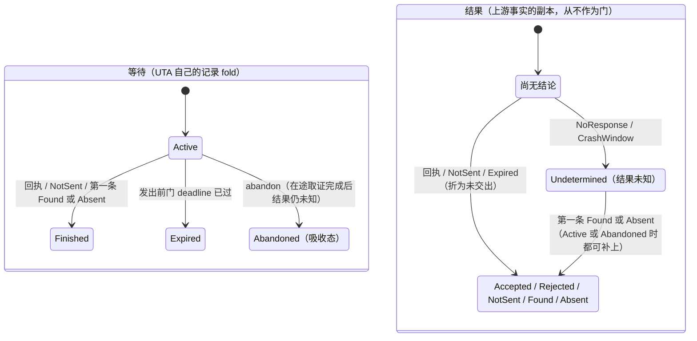
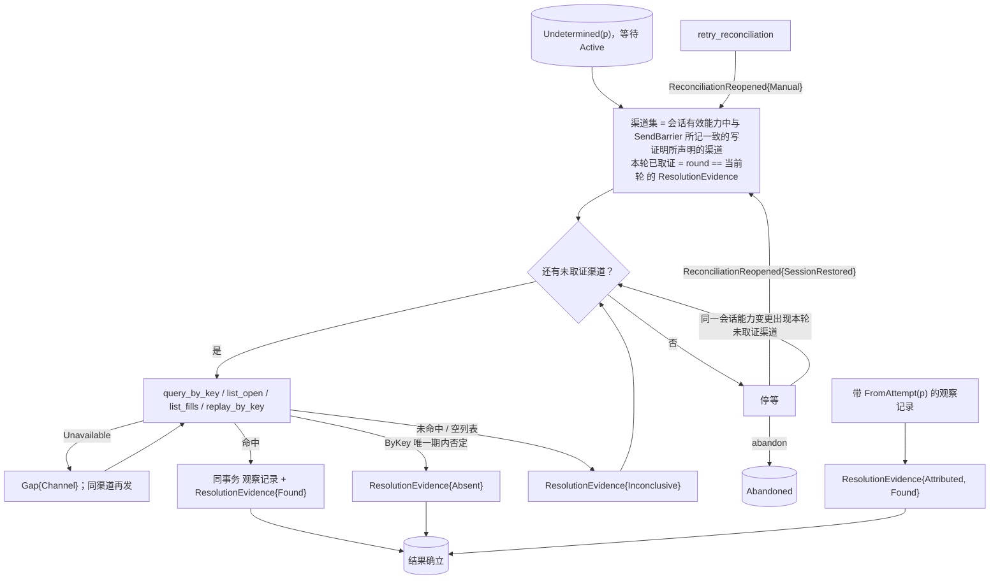
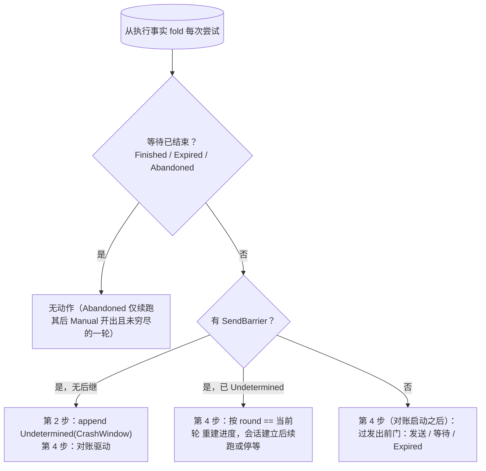

# 决议

## 3 模型

### 3.1 等待与结果：两根轴 [设计]

一次尝试有两个不同源头的问题，分开记、分开 fold：

| 轴 | 问题 | 源头 | 值 |
|---|---|---|---|
| **等待**（continuation） | UTA 还要不要为这次尝试等下去、问下去 | UTA 自己的记录 | `Active` \| `Finished` \| `Expired` \| `Abandoned` |
| **结果**（outcome） | 这次写在上游发生没有 | 上游（经集成的回执、取证与推送取回的副本）；`NotSent` 与 `Expired` 是 UTA 自己确知的“未交出” | `Accepted` \| `Rejected` \| `NotSent`（确知未交出：`NotSent` 记录，或 `Expired` 折为同一个值，不另写 `NotSent` 记录）\| `Unknown` → `Found` \| `Absent` |

**等待** 是执行事实的 fold，不另存：

- `Active`：`Prepared` 无 `SendBarrier` 且无 `Expired`；或 `SendBarrier` 无后继；或 `Undetermined` 之后既无 `Found`/`Absent` 的 `ResolutionEvidence`，也无 `Abandoned`。
- `Finished`：结果已确立，即 `VenueAccepted`、`VenueRejected`、`NotSent`，或 `Undetermined` 之后第一条 `Found`/`Absent`（任一渠道、任一轮次，含 `Attributed`）。
- `Expired`：发出前门判定 `deadline` 已过，尚未交出即终止。它的结果就是“未交出”，由 UTA 确知：结果轴上折为 `NotSent` 这个值，不是写调用的结果，也不另写 `NotSent` 记录。
- `Abandoned`：principal 在结果仍未知时放弃跟踪（§4.4）。

`Expired` 与 `Abandoned` 是 UTA 拥有的两种出口；`Abandoned` 是唯一一种在可能已交出之后由 UTA 结束等待的出口。**`Abandoned` 是吸收态**：此后到达的 `Found`/`Absent` 只补上结果，不改变等待，不重新阻塞 lane，也不恢复保留钉。

**结果** 是上游事实的副本，从不作为门：

- `Undetermined` 的尝试，在等待是 `Active` 或 `Abandoned` 时都可以由第一条 `Found`/`Absent` 补上结果；此后的 `ResolutionEvidence` 照常 append 作审计，结果不再改变。
- `Found` 只回答“这次写到达了上游”；观察记录里 venue 已受理 / 已拒 / 已成交的状态，由读模型与钩子 fold。
- 放弃之后结果仍未知，对外显示“已放弃跟踪，结果未知”，不显示为已发生或未发生（[views.md §4.2 读模型集合](../boundary/views.md#42-读模型集合)）。

等待离开 `Active` 的那一刻，这次尝试移出 lane 阻塞头集合（[lane.md §3.3 阻塞头集合](lane.md#33-阻塞头集合)），它对观察记录的保留钉随之释放（[core/design.md §4.7.6 保留引用的登记与解除](../design.md#476-保留引用的登记与解除)）。



## 4 结构

### 4.1 对账驱动

**取证渠道与轮次。**

- 一次尝试的取证渠道集取自当前会话有效能力：会话有效声明的写证明与 `SendBarrier` 所记的写操作、键角色都相同时，是它声明的渠道；否则为空，尝试停等。渠道集按当前能力求，所以某次尝试停等之后，能力变更使集合出现本轮尚未取证的渠道，它就是下一渠道。
- 本轮已取证渠道 = `round` 等于当前轮（最近一条 `ReconciliationReopened` 的位置）的 `ResolutionEvidence`。因此“渠道穷尽”与“下一渠道”都由 fold 重建（崩溃 #7）。
- IO 壳自动取证只为等待是 `Active` 的 `Undetermined`；等待是 `Abandoned` 的尝试只在 principal 的 `retry_reconciliation` 开出的那一轮里取证，渠道穷尽即停。

**渠道顺序。** 进入 `Undetermined` 后，只要等待是 `Active`，IO 壳按该尝试的取证渠道集**自动**依次取证：

```
by-key → listing + venue 身份 → fills/positions → replay-by-key
```

`by-key` 与 `replay-by-key` 都以该尝试 `SendBarrier` 所记的调用方键发问，不以意图的 `target`；该尝试未带键时，这两条渠道不会出现在它的声明里。两者都带 `barrier_at`（该 `SendBarrier` 的核心时刻）、作用域与键角色：这个键此刻是否仍在上游的保留期与唯一期内，由集成按 `barrier_at` 判断，窗口之外返回 `Unavailable`，不返回 `Absent`。核心不持有上游的保留期或唯一期，也不自己比较。

**`replay_by_key`。** 形式上似写，但保留期内同幂等键重放在语义上是查询：Stripe 同 key 拿回原响应。保留期判断错误即重复下单（Longbridge 10 分钟缓存、IBKR 无键）。因此它**默认关闭，按 venue 显式开启**，渠道顺序里排最后。IO 壳每次调用都带 `barrier_at`；这个键是否仍在上游保留期内由集成判断，保留期之外返回 `Unavailable`、不重放。上游的保留期是上游的性质，核心不持有它的副本。

**撤单尝试的取证** [设计]。撤单尝试问的是“这次撤单请求到达上游没有”，不是目标订单此刻处于什么状态。它的回执（`Ack` → `VenueAccepted`）是同一次调用的回应，直接给出结果，不经归因；回执里目标订单的状态照常是目标订单的记录。归因到撤单尝试的记录只有一种：上游以该尝试的请求键把某条记录关联到这次撤单请求，集成在它声明的键作用域与唯一期内据此填了 `FromAttempt(撤单尝试)`。目标订单自己的记录（订单状态、成交、listing 里的条目、带目标订单键的记录）归目标订单所属的尝试，或按集成的判定为 `External`/`Unattributed`，不因为它说的是目标就归因到撤单尝试，也就不是撤单尝试的 `Found`。各渠道因此是：

- by-key、replay-by-key：以撤单尝试自己的请求键发问，回答的是这次撤单请求，`Found`/`Absent`/`Inconclusive` 照常；只在该尝试带请求键时声明。
- listing、fills/positions：listing 列的是未结订单，成交对账列的是订单的执行，返回的记录都不是撤单请求，永远不会归因到撤单尝试。撤单写证明不声明这两条渠道（[integration.md §3.4 记录映射](../boundary/integration.md#34-记录映射-设计)）。
- `Attributed` 照常。不带键的撤单尝试因此没有自动取证渠道，只由 `Attributed`（集成能以别的上游关联证据把记录归到这次撤单请求时）收敛，或由 principal 放弃跟踪。

撤单尝试有了结果，也**不证明目标已结束**：`VenueAccepted` 或 `Found` 只说明撤单请求到达了上游，目标可能已在此前成交、仍在撤单中，或上游随后拒绝了撤单。目标是否已结束只看目标订单自己的记录（[trade-observation.md §3.2 订单身份、来源顺序与最近观察](../read/trade-observation.md#32-订单身份来源顺序与最近观察-设计)）。把撤单与后续下单组合成改单的调用方，按目标的记录决定是否提交第二张单据（[trade-protocol.md §4.1 交易协议：操作种类、目标、可执行性、检查目录](trade-protocol.md#41-交易协议操作种类目标可执行性检查目录-交易协议)）。

理由：listing 上仍有目标，不证明撤单没到（可能滞后，F10）；不再有目标，也不证明撤单到了（目标可能已成交或被别人撤掉）。把目标的记录当作撤单尝试的 `Found`，一笔结果未知的撤单就被当成已送达，这是 heuristic。不选：**撤单写证明可以声明 listing 与成交对账，命中目标即 `Found`**：理由同上；**可以声明，但规定它们永不命中**：一条注定只得 `Inconclusive` 的声明渠道只增加调用与 pacing 负载，而声明应如实；**只禁成交对账、留 listing**：没有记录能在 listing 上归因到撤单请求；**撤单有了结果就自动重开阻塞头的取证**：把撤单的受理当作阻塞头的新证据。

**取证结果与记录的对应（固定矩阵）。**

| 取证结果 | 记录 | 尝试 |
|---|---|---|
| 命中归因到该尝试的订单 / 成交 / 原响应（撤单尝试见上） | 同事务：观察记录 + `ResolutionEvidence{Found}` | 结果确立 |
| 渠道给出明确否定 | `ResolutionEvidence{Absent}` | 结果确立 |
| 未命中 | `ResolutionEvidence{Inconclusive}` | 转下一渠道 |
| `Unavailable` | 只落 `Gap{origin: Channel}` | 不变；同渠道按 pacing 再发 |

- 明确否定只有 by-key 的 `Absent`，且只在集成判断该键仍在上游唯一期内时给出；listing/fills 没有这一语义（F10）。**空列表永远不是 `Absent`**：listing 或 fills 的空答只是 `Inconclusive`。listing 是否需要隔一段时间再确认一次、间隔多长，都由集成按上游的保证判断，保证之外返回 `Unavailable`。
- `Unavailable` **不算取证**、不换渠道。一个不可用的渠道不是证据；跳过它会把“没查到”伪装成“查过了”。
- **集成无已建立会话时不取证** [设计]：IO 壳不对它发任何取证读，也不因此记 `Gap{origin: Channel}`；没有发出的读不是渠道不可用。会话重新建立后，本轮进行中的驱动从本轮进度续跑；已渠道穷尽而停等、等待仍是 `Active` 的尝试按下文 `SessionRestored` 重开一轮。理由：无会话时的“调用”只会是核心自造的失败，把它记成 `Gap{Channel}` 等于伪造渠道证据的出处。

**停等。** 渠道穷尽仍 `Inconclusive`，append 后**停下**。停等可由四种事件推进：

- 一条 `ReconciliationReopened{attempt, cause}` [设计] 重开一轮；
- 被动渠道 `Attributed` 在任一时刻到达（§4.3）；
- 同一会话里的能力变更（`CapabilityObserved`）使渠道集出现本轮尚未取证的渠道 [设计]：只对等待是 `Active` 的尝试；本轮继续，该渠道就是下一渠道，不开新一轮；
- principal 经 `abandon` 放弃跟踪（§4.4）：它结束等待，不给出结果。

IO 壳**永不 heuristic**。取证是读副作用，可以重试；写调用是写副作用，永不重试。

**重开与轮次。**

- 新一轮的已取证渠道集从空开始。
- `ResolutionEvidence.round` 在**发起读**时取当前轮，并随记录落盘。
- 旧轮在途读的迟到响应带旧 `round`，不计入新轮：响应归属其发起轮次，不按到达顺序冒充。
- 结果已确立的尝试不受重开影响：重开只重置读进度，不撤销结果。

| cause | 谁 append | 何时 | 对象 |
|---|---|---|---|
| `SessionRestored` | IO 壳自动 | 该 venue 的集成会话实际建立（新会话）时 | 该集成所有停等、等待仍是 `Active` 的 `Undetermined` |
| `Manual(principal)` | 运维 principal | 经 `retry_reconciliation`（§4.4） | 一次结果仍未知的 `Undetermined`，等待是 `Active` 或 `Abandoned` |

- `SessionRestored` 的理由：渠道穷尽常因 venue 当时不可达。它不作用于 `Abandoned` 的尝试：放弃之后不再有自动的询问。
- `Manual` 重开的一轮对 `Abandoned` 的尝试也依序取证一遍、渠道穷尽即停；它只能补上结果，不改变等待。
- 两种触发在 append 前都重查目标尝试仍处于 `Undetermined` 且结果未知，否则不写。



### 4.2 写与取证操作的规格（核心→集成）（取证）

共同约定（调用通道、每个调用恰好完成一次、会话结束时的强制完成、集成在这些操作里的义务）见 [write.md §4.5 写与取证操作的规格（核心→集成）](write.md#45-写与取证操作的规格核心集成)。

#### `query_by_key(key, key_role, scope, barrier_at) → Found | Absent | Unavailable`

- **语义**：按调用方键回读该键对应的那次写。它只是取证渠道：`key` 是被取证那次尝试 `SendBarrier` 所记的键，`key_role` 是同处所记的键角色，`barrier_at` 是该 `SendBarrier` 的核心时刻。**动作轴**：**读**。
- **返回**：`Found(state)` / `Absent` / `Unavailable`。集成按 `barrier_at` 判断这个键此刻是否仍在上游对该作用域的键唯一期内；在期内才可能给出 `Absent`，期外返回 `Unavailable`，包括无法排除上游执行时刻晚于 `barrier_at` 所留的余量时。
- **核心内部结果**：`Found` → 同事务 观察记录 + `ResolutionEvidence{ByKey, Found{observation, evidence}}`；`Absent` → `ResolutionEvidence{ByKey, Absent}`。这是唯一有明确否定语义的渠道。
- **错误**：`Unavailable` → `Gap{origin: Channel}`，同渠道再发，不算取证；该尝试的声明里没有此渠道（包括不带键的尝试）则不调用。
- **重试**：可重试。

#### `list_open(scope) → Listing | Unavailable`

- **语义**：列 open orders。只作撤单以外的尝试的取证渠道。**动作轴**：**读**。
- **返回**：`Listing(items)` / `Unavailable`。
- **核心内部结果**：命中归因到被取证尝试的订单 → 同事务 观察记录 + `ResolutionEvidence{Listing, Found}`；未命中 → `ResolutionEvidence{Listing, Inconclusive}`。F10：listing 未见不证明未递；本渠道没有 `Absent`。
- **错误**：`Unavailable`（集成时限内无结果 / 断连 / 配额拒绝 / 超出上游对 listing 的保证）→ `Gap{origin: Channel}`，同渠道再发；该尝试的声明里没有此渠道则不调用；空 `Listing` 永远不是 `Absent`。
- **重试**：可重试、可换渠道。

#### `list_fills(scope, since) → Fills | Unavailable`

- **语义**：列成交。只作撤单以外的尝试的取证渠道。**动作轴**：**读**。
- **返回**：`Fills(items)` / `Unavailable`。`items` 是成交记录，各带 `execution_id`；上游分页在适配器内，任一页失败即整体 `Unavailable`。
- **核心内部结果**：命中归因到被取证尝试的成交 → 同事务 观察记录 + `ResolutionEvidence{Fills, Found}`；未命中 → `ResolutionEvidence{Fills, Inconclusive}`（本渠道没有 `Absent`，空 `Fills` 也不是）。
- **错误**：`Unavailable`（集成时限内无结果 / 断连 / 配额拒绝）→ `Gap{origin: Channel}`，同渠道再发；缺 `since` 游标 → 范围按声明保守取，仍只作 advisory；该尝试的声明里没有此渠道则不调用；结果中某笔执行给不出身份时整体返回 `Unavailable`，不交出删掉它的缺项集合；上游那些不是执行的行（如 Binance `t = -1`）由记录映射丢弃，不是错误（[trade-observation.md §3.1 成交的计数身份](../read/trade-observation.md#31-成交的计数身份-设计)）。
- **重试**：可重试。

#### `replay_by_key(key, key_role, scope, barrier_at) → Original | Unavailable`

- **语义**：以被取证那次尝试的键重放、取原响应。**动作轴**：**读**（形式似写、语义是读）。
- **返回**：`Original(response)` / `Unavailable`。
- **核心内部结果**：`Original` → 同事务 观察记录 + `ResolutionEvidence{Replay, Found}`；集成确认该键在上游保留期内而上游答无此键 → `ResolutionEvidence{Replay, Inconclusive}`。
- **错误**：保留期判断错误即重复下单。所以集成按 `barrier_at` 判断该键是否仍在上游保留期内，期外或无法判断时返回 `Unavailable`、不向上游重放；核心不持有保留期。默认关闭、按 venue 显式开启、渠道顺序排最后。
- **重试**：保留期内幂等；期外集成不发。

不选（按键取证的窗口由谁判断）：**核心持有声明的保留期并自己比较**：核心持有上游性质的一份副本，副本错时就是重复下单；**集成凭它自己保存的发送记录判断**：集成不持有意图与执行记录。

### 4.3 被动渠道 `Attributed`

顺序之外还有一条被动渠道。它的追加由效应侧归因处理器执行（[§4.6 效应侧归因处理器](#46-效应侧归因处理器)），规则在这里：

- 带 `attribution: FromAttempt(r)` 的观察记录到达时，若 r 处于 `Undetermined` 且结果未知（等待是 `Active` 或 `Abandoned`），在同一事务 append `ResolutionEvidence{r, Attributed, Found{observation: 该记录, evidence: 该记录的载荷与原始负载}}`；结果已是 `Found`/`Absent` 的不再 append。
- 推送来的观察记录上，`FromAttempt(r)` 由集成填写（回执与取证记录上 IO 壳按该条自己的关联证据填写的情形见 [write.md §4.3 输出与记录模型](write.md#43-输出与记录模型-设计)），核心不从键字节推出它：只带调用方键的记录是否属于 r，由集成在它声明的键作用域与唯一期内判断，其外集成填 `Unattributed`。核心也从不把一条记录判为 `External`。
- append `Undetermined(r)` 的事务内，同样检查已到达的、归因到 **r** 的观察。
- r 仍在 `SendBarrier` 等回执时不产生该记录：链保持线性，回执由写调用返回值落 `VenueAccepted`/`VenueRejected`/`NotSent`。
- 迟到回执由此并入同一尝试，与取证 `Found` 同效。

[证据：fp-06 修正 7；域 C1/C2/C12]

### 4.4 结果未知组（核心↔解释层）：放弃跟踪与重开

`abandon(attempt: AttemptRef, note) → Abandoned(position) | Rejected(NotUndetermined) | Unauthorized`；`retry_reconciliation(attempt: AttemptRef)`。

- **动作轴**：写。`abandon` 重查结果仍未知才 append `Abandoned`；`retry_reconciliation` append `ReconciliationReopened{Manual}`；二者都带 principal。
- **授权**：按 `(principal, 动作种类)`，与写授权、控制动作同一规则族（[decision-chain.md §4.8 授权与审批策略的表示](decision-chain.md#48-授权与审批策略的表示)）；越权 → `Unauthorized`，并记安全事件。
- 不要求渠道已穷尽：principal 可在任一时刻放弃跟踪；在途取证总是先完成。
- 没有人工写结果的操作：尝试的结果是上游事实的副本，只由上游证据给出。

**`abandon(attempt, note)`** [设计] 回答的是 UTA 自己的问题：**还要不要为这次尝试等下去**；它不回答“这次写发生没有”。

- **资格**：该尝试处于 `Undetermined`、等待是 `Active`、结果未知。否则返回 `Rejected(NotUndetermined)`，不写记录。
- **次序**（在途的取证调用是集成会话的内层，[runtime/design.md §4.1 进程视图与生命周期](../runtime/design.md#41-进程视图与生命周期)）：
  1. IO 壳不再为该尝试发起新的取证调用；
  2. 已在途的取证调用照常完成，各自按 §4.1 的矩阵 append 自己的结果；
  3. 然后 IO 壳在一个事务里重查：结果仍未知则 append `Abandoned{attempt, principal, note, rule_version}` 并返回 `Abandoned(position)`；在途调用已给出结果则不写，返回 `Rejected(NotUndetermined)`。不写任何中间记录。
- **受控停止时正在进行的 `abandon`**：照常完成（[runtime/design.md §4.1.4 受控停止](../runtime/design.md#414-受控停止-设计)“停止之前已在执行的控制动作”）。第 2 步等的在途取证调用自行完成，或在停止第 3 步随会话结束被强制完成为 `Unavailable`（只记 `Gap{Channel}`，不给出结果）；然后照第 3 步重查，`Abandoned` 或 `Rejected(NotUndetermined)` 都在实例结束锚点之前得出。发起它的消费方会话已在停止第 1 步关闭，调用方重连之后从该尝试的执行事实看到结果。
- **不设持久的“放弃中”标志**：第 1 步只是 IO 壳进程内的停发，不是记录。第 3 步之前崩溃，日志里没有 `Abandoned`，恢复后该尝试照常 `Active`；调用方没有收到返回，重发 `abandon` 即可（崩溃 #8）。
- **效果**：等待变为 `Abandoned`（吸收态）。该尝试移出 lane 阻塞头集合，集合为空才解除普通写的等待；它的保留钉释放；IO 壳不再自动取证，`SessionRestored` 不再重开它。
- **结果仍可补上**：被动的 `Attributed` 与 principal 的 `retry_reconciliation` 照常可以给出 `Found`/`Absent`；它们只补结果，不恢复等待，不重新阻塞 lane。
- **对外**：结果未补上时显示“已放弃跟踪，结果未知”，从不显示为已发生或未发生；补上之后显示补上的结果，并保留曾放弃跟踪的记录（[views.md §4.2 读模型集合](../boundary/views.md#42-读模型集合)）。
- **代价**：放弃之后 lane 放行后续写，而这次写可能已经发生，后续写所依据的 buying power 与持仓可能不含它（H1）。这是 principal 带名承担的取舍，记录在 `Abandoned` 上（会推翻它的观测见证伪 #26）。

理由：尝试的结果是上游事实，UTA 只持有它的副本；能否继续是 UTA 自己的决定。principal 能拍板的只有后者。放弃因此只写 UTA 拥有的那一半，结果仍等上游证据。

不选：

- **principal 直接写 `Found`/`Absent`（人工决议）**：那是由 UTA 一侧写出一份上游事实，没有上游证据作源头；之后到达的真实证据与它矛盾时，无从裁决。
- **先持久化“放弃中”，再等在途调用**：多出一条需要与在途调用结果对账的记录。
- **取消在途的取证调用**：它们的回答是证据，丢弃等于放弃一个可能的结果。
- **放弃后仍按会话恢复自动重开**：放弃就是不再为它自动询问；要再问一次由 principal 经 `retry_reconciliation` 显式发起。

**`retry_reconciliation(attempt)`**：重开一轮取证（控制面 append `ReconciliationReopened{Manual(principal)}`，新 `round`，旧轮在途响应不计入）。对等待仍是 `Active` 的尝试，这一轮与自动取证相同；对 `Abandoned` 的尝试，这一轮依序取证一遍、渠道穷尽即停，只能补上结果，不改变等待。错误：尝试不处于 `Undetermined` 或结果已确立 → `Rejected(NotUndetermined)`。

### 4.5 崩溃恢复与集成崩溃两故障面

**恢复。** 恢复分两段，对应启动五步的第 2 步与第 4 步（[runtime/design.md §4.1.3 启动五步](../runtime/design.md#413-启动五步)）[设计]：

- **启动第 2 步：本地重建，不接触任何集成。** IO 壳从日志 fold 各 lane 上每次尝试的等待与结果；对 `SendBarrier` 无后继者 append `Undetermined(CrashWindow)`。这一步的结论只来自记录。
- **启动第 4 步：先对账，后发出。** 集成会话已在第 3 步开始建立；IO 壳按下面的分类，先为未决尝试启动或续跑对账，再对无 `SendBarrier` 者过发出前门（取证在前，已结束等待的尝试先移出阻塞头集合）。发送与取证都需要该集成已建立的会话，尚无会话的等会话建立。

每次尝试按 fold 出的状态落入且只落入下面一类：

1. **等待已结束者无动作**：`Finished`（`VenueAccepted`、`VenueRejected`、`NotSent`，或已有 `Found`/`Absent`）、`Expired` 或 `Abandoned`。`Expired` 不会被再过一次发出前门；`Abandoned` 的尝试只有在最近一次重开是它之后的 `Manual`、且该轮渠道尚未穷尽时，才在会话建立后续跑该轮（第 4 步）。
2. **`SendBarrier` 无后继者**：第 2 步 append `Undetermined(CrashWindow)`，第 4 步进入对账驱动。
3. **`Undetermined` 且等待 `Active` 者**：第 4 步按 `round == 当前轮` 的 `ResolutionEvidence` 重建本轮进度（发起轮次归属，不按 append 先后），在该集成会话建立后续跑下一渠道或停等。
4. **无 `SendBarrier` 者**仍是确未发出的尝试：第 4 步在对账启动之后过发出前门：发送、等待（该集成尚无已建立会话或会话有效能力不可执行）或 `Expired`。

崩溃前正在进行的 `abandon` 若尚未 append `Abandoned`，日志里没有它的痕迹，尝试按第 3 类照常 `Active`。IO 壳不对任何已有 `SendBarrier` 的尝试再调用写操作。

下图是上面四类的逻辑分类，不是启动时序；时序是先第 2 步、后第 4 步，第 4 步里先对账、后发出。



**集成崩溃两故障面。** 集成崩溃按崩溃发生在哪条路径分为两个面。判别边界唯一：**崩溃是否落在 IO 壳的写调用（`submit`/`cancel`）投放路径上**。

| 故障面 | 判别边界 | 领域状态 | 收敛 |
|---|---|---|---|
| 观察流侧崩溃 | 崩溃在订阅 / 推送路径上（无在途写调用） | `Gap{origin: Source}` | 续传 / 重连补齐（[backfill.md §3.1 回填任务与回填进度](../read/backfill.md#31-回填任务与回填进度)） |
| 写投放侧崩溃 | 崩溃在写调用路径上（已 `SendBarrier`、等业务回执） | `NoResponse` = `Undetermined` | 对账驱动取证 |

- 两面**可以并发**：同一集成进程既跑观察流又有在途 `submit` 时崩溃，观察流记 `Gap{origin: Source}`，在途尝试记 `Undetermined`。它们是同一进程的两个不同职责面，各自独立收敛，互不替代。
- 前者是流内记录，可续、可标 gap；后者是一次可能已发生的写，只能由对账收敛。
- 写投放侧不区分“集成挂了”和“venue 没回”；区分靠后续证据（`ResolutionEvidence`），不靠猜。

### 4.6 效应侧归因处理器

归因字段落在观察记录上，但读它的处理器注册在效应侧：**记录归观察，响应归效应**。本组件是入站处理器注册表效应侧分区里的 `attribution` 与 `idempotency_key` 处理器（字段注册见 [envelope.md §3.2 处理器字段注册表](../boundary/envelope.md#32-处理器字段注册表)），不单独成文：它隐藏的只是一个索引的数据结构；追加规则在 IO 壳的被动渠道。

- **拥有**：`SendBarrier` 所记键到尝试的唯一索引（键由核心按 `AttemptRef` 单射铸造，[write.md §3.4 调用方键的铸造](write.md#34-调用方键的铸造-设计)）。
- **执行**：带 `attribution: FromAttempt(r)` 的观察记录到达时，在带来该记录的事务里按被动渠道的规则 append `ResolutionEvidence{r, Attributed, Found}`。追加条件（r 的结果仍未知，含已 `Abandoned`；结果已确立不再 append）、`append Undetermined(r)` 时的同事务回查、`SendBarrier` 期间不产生，只在 [§4.3 被动渠道 Attributed](#43-被动渠道-attributed) 定义；本节不另立条件。
- **只看 `FromAttempt`**：`External` 与 `Unattributed` 的记录不归因到任何等待中的尝试。
- **谁填 `attribution`**：集成依上游关联证据填写（只凭调用方键时限于它声明的键作用域与唯一期，[integration.md §4.4 集成义务清单](../boundary/integration.md#44-集成义务清单)）；IO 壳只在回执与取证的观察记录上为由该条自己的关联证据确定的记录填 `FromAttempt`（[write.md §4.3 输出与记录模型](write.md#43-输出与记录模型-设计)）。核心不按键字节补归因，也从不断定 `External`。
- **读的另一方**：读模型的归因（订单状态按归因分组）读同一字段，也注册在效应侧（[views.md](../boundary/views.md)）。

## 5 走查

**W2 的 IO 壳细化（Q2+Q3）。**

1. `SendBarrier(p)` fsync 后、回执前核心 `kill -9`。重启第 2 步：p 有 `SendBarrier` 无后继 → `Undetermined(CrashWindow)`，同事务回查已到达的归因观察；这一步不接触任何集成。
2. 重启第 3 步为该集成建立新会话；会话建立之前不取证、不记 `Gap`。第 4 步起取证：by-key `query_by_key(K(p), key_role, scope, barrier_at)` → `Found` → 同事务观察记录 + `ResolutionEvidence{ByKey, Found}`；或 `Absent`（唯一期内）→ 结果确立；或 `Unavailable` → `Gap{Channel}`、同渠道再发。无 by-key：listing → fills → replay，未命中各 `Inconclusive`，穷尽停等。
3. 停等中 principal `abandon(p, note)`：停发新取证 → 等在途调用完成并 append → 一个事务重查仍未知 → `Abandoned`。p 移出集合、保留钉释放。
4. 迟到回执：集成在新会话上以观察记录重送、填 `FromAttempt(p)` → 同事务 `ResolutionEvidence{p, Attributed, Found}`；p 已 `Abandoned` 时只补结果。
5. 脑裂变体：旧核心的集成进程 A 可能把 `submit` 送达 venue；A 的通道只通向已退出的旧核心，新核心不读它。安全性来自三条不变量：`SendBarrier` durable = 可能已发出；阻塞头集合非空时同 lane 无新普通写；对账经新会话独立收敛。fixture venue 调用 ≤ 1。

**W5 扩展路径的取证细化。** 撤阻塞头的撤单尝试 p3 `VenueAccepted`：回执里目标订单的记录按它自己的证据归因。没有 `FromAttempt(p1)` 的证据时，p1 的等待不变，IO 壳不自动重开 p1；principal `retry_reconciliation(p1)` → `ReconciliationReopened{p1, Manual}` → 从 by-key 重走：读到目标（任何状态）即 `Found`；by-key 明确否定即 `Absent`；listing 未见仍 `Inconclusive`。有 `FromAttempt(p1)` 的证据时，同事务 `ResolutionEvidence{p1, Attributed, Found}`，p1 结果确立、等待结束，也不出现 p1 的 `ReconciliationReopened`。

**`SendBarrier` 之后重握手改变键角色。** 这次尝试的渠道集因声明与记录不一致而为空，停等；同一会话里的 `CapabilityObserved` 使声明恢复一致时，本轮从尚未取证的渠道续跑，不 append `ReconciliationReopened`。

## 6 评估

### 6.1 风险 / 敏感点 / 权衡点

- **权衡点：每步取证写日志的体积 vs 审计**（§4.1）：每次取证都 append 一条记录，换来重启零丢失与审计完整；代价是存储体积与噪音。留存由保留语义与运行期参数约束（[journal.md §2.4 保留：边界与删除规则](../read/journal.md#24-保留边界与删除规则)）。
- **权衡：集成在 `submit` 中途崩溃 = `NoResponse` = `Undetermined`**：核心与集成之间是进程边界（JSON-RPC），写投放侧不区分“集成挂了”与“venue 没回”。

### 6.2 证伪条件

25. **键的作用域与唯一期可信**（[write.md §3.4 调用方键的铸造](write.md#34-调用方键的铸造-设计)、§4.1、[integration.md §4.4 集成义务清单](../boundary/integration.md#44-集成义务清单)）：在集成声明的键作用域与唯一期内，观测到一条带核心键编码、却没有任何 `SendBarrier` 记过该键的上游记录（别的写者用了同样的编码，或上游在声明期内复用了键），或上游对某键执行的时刻晚于 `barrier_at` 加集成所留余量 → 该来源的按键归因与按键 `Absent` 不可信：集成须把键角色降为 `None` 或缩小声明期，受影响期间的 `FromAttempt` 与 `Absent` 须按 `Unattributed` 与 `Unavailable` 重看；若普遍如此，键须带部署身份前缀并由运维保证其唯一。
26. **放弃跟踪只结束等待**（§4.4）：实际运维中 `abandon` 之后放行的后续写，频繁因被放弃的那笔写实际已执行而造成重复敞口（H1），而 principal 在放弃前无从获得更多证据 → “放弃只写 UTA 自己的等待、之后 lane 照常放行”须重审：例如放弃只解除减仓类写，或要求放弃前先有一笔撤该订单的请求结束等待。

### 6.3 验收

17. **取证记录矩阵**（[write.md §4.3 输出与记录模型](write.md#43-输出与记录模型-设计)、§4.1）：任一取证渠道的一次 venue 交互，按结果恰产生（下列各项里的“一条 `ResolutionEvidence`”都是被问尝试自己这条渠道的证据）：（对应 Q3/Q27）
    - `Found` → 该回应的观察记录（观察 J：回应含订单状态时订单状态一条，及每笔可识别执行一条成交记录；带 `provenance: Reconciliation{AttemptRef, channel}`，`attribution` 按各条自己的关联证据）+ 一条 `ResolutionEvidence{Found{observation, evidence}}`（执行 J，含 `Evidence`：契约载荷与原始负载），同一事务；
    - `Absent`/`Inconclusive` → 仅一条 `ResolutionEvidence`；
    - `Unavailable` → 仅一条 `Gap{Channel}`，不推进渠道；
    - 同一回应里带 `attribution: FromAttempt(r)` 的记录归到别的、结果仍未知的尝试 r 时，r 的 `ResolutionEvidence{r, Attributed, Found}` 按 §4.3 在同一事务 append，它是 r 的证据，不计入上面被问尝试的那一条；
    - 该回应的观察记录落到保留边界下后，执行 J 的 `Evidence` 仍可读。
35. **发出前门**（[write.md §4.2 发送屏障与发出前门](write.md#42-发送屏障与发出前门)、§4.1）：以 fixture 上游驱动，对已放行、尚无 `SendBarrier` 的尝试观测：（对应 Q2/Q4/Q7）
    - 集成断开（`Connecting`）或 `Halted` 期间：不 append `SendBarrier`，fixture 上游写调用数为 0，不出现 `Undetermined`，该 lane 的阻塞头保持；会话在 `deadline` 前重新建立则恰发出一次，否则记 `Expired(deadline)`；
    - 放行后、发出前，重握手或 `CapabilityObserved` 使该意图对会话有效能力不再可执行（该 `(WriteLaneKey, OperationKind)` 不再 `Supported`、不再接受其参数 schema 或其目标种类）：尝试不发，恢复且 `deadline` 未过则恰发出一次，否则 `Expired`；
    - `SendBarrier` fsync 之后切断会话：集成不能证明未交出时得 `Undetermined(NoResponse)`，该尝试不回到等待、不再有第二条 `SendBarrier`；
    - 集成无会话期间不发取证读、不记 `Gap{origin: Channel}`；会话建立后本轮进行中的驱动续跑，渠道已穷尽、等待仍 `Active` 的尝试出现一条 `ReconciliationReopened{SessionRestored}`，`Abandoned` 的尝试不出现；
    - 某流 readiness 为 `Degraded` 不影响发送。
51. **撤单尝试的取证**（§4.1）：（对应 Q3/Q27）
    - 撤单声明 listing 或成交 / 持仓对账渠道：投影不合法，集成 `Halted{ProjectionInvalid}`；
    - 带请求键的撤单尝试 `Undetermined`，目标订单此后经推送或一次性读显示为终态、或在其他尝试的 listing 上不见：撤单尝试仍 `Undetermined`、没有它的 `Found`；`query_by_key` 以它的请求键得到上游关联到这次撤单的记录：撤单尝试 `Found`，该记录归因 `FromAttempt(撤单尝试)`；
    - 不带键的撤单尝试 `Undetermined`：IO 壳不调用任何取证渠道，尝试停等，直到一条上游以请求关联到它的记录（`Attributed`），或 principal `abandon`；
    - 撤单的回执 `Ack`，撤单的目标是结果未知的阻塞头的订单：撤单尝试 `VenueAccepted`，回执里的目标订单状态是目标订单的记录、归因按它自己的关联证据；该记录没有归因到阻塞头时，阻塞头的等待不变；该记录按它自己的证据归因 `FromAttempt(阻塞头)` 时，这是一条 `Attributed` 的 `Found`：同一事务 append `ResolutionEvidence{阻塞头, Attributed, Found}`，阻塞头的结果确立、等待结束；两种情形都不出现阻塞头的 `ReconciliationReopened`。
58. **放弃跟踪**（§3.1、§4.4、[runtime/design.md §4.1.4 受控停止](../runtime/design.md#414-受控停止-设计)）：以 fixture 上游驱动一次停等的 `Undetermined`：（对应 Q3/Q7）
    - principal `abandon`：在途的一次 `query_by_key` 照常完成并 append 自己的结果之后才出现 `Abandoned{principal, note, rule_version}`；在途调用给出 `Found`/`Absent` 时没有 `Abandoned`，返回 `Rejected(NotUndetermined)`；越权得 `Unauthorized` 与安全事件；对非 `Undetermined`、已有结果或已 `Abandoned` 的尝试得 `Rejected(NotUndetermined)`；
    - `Abandoned` 之后该尝试移出阻塞头集合，同 lane 等待中的单据放行；它不再有自动取证调用，会话重建也不出现它的 `ReconciliationReopened{SessionRestored}`；它引用的保留钉释放；
    - 之后 fixture 推送一条归因到它的记录：append `ResolutionEvidence{Attributed, Found}`，结果确立而等待仍是 `Abandoned`，lane 不再被它阻塞；principal `retry_reconciliation` 开出的一轮依序取证一遍、渠道穷尽即停；这一轮里得 `Inconclusive` 的渠道不改变任何状态：等待仍是 `Abandoned`、结果仍未知、lane 不被重新阻塞；
    - 在停发之后、`Abandoned` 之前注入崩溃：日志中没有任何“放弃中”的记录，重启后该尝试等待仍 `Active`、仍在阻塞头集合里，按本轮进度续跑；
    - 在 `abandon` 等在途 `query_by_key` 时受控停止（fixture 不作答）：该调用在停止第 3 步得 `Unavailable`（只一条 `Gap{Channel}`），之后在实例结束锚点之前出现 `Abandoned`；fixture 在停止第 3 步之前作答 `Found`/`Absent` 时没有 `Abandoned`，结果由这条证据确立；两种情形里重启之后都没有“放弃中”的遗留，该尝试的等待与停止之前得出的结论一致（同 [runtime/design.md §6.3 验收 #81](../runtime/design.md#63-验收标准)）；
    - 不存在由 principal 写 `Found`/`Absent` 的操作；`read_model(lanes)` 与下游对它显示“已放弃跟踪，结果未知”，结果补上后显示该结果。
65. **按键取证的窗口**（§4.1、§4.2）：以 fixture 上游设定键唯一期与保留期：（对应 Q3）
    - `barrier_at` 已超出唯一期的尝试，`query_by_key` 得 `Unavailable`（`Gap{origin: Channel}`），从不得 `Absent`；超出保留期时 `replay_by_key` 得 `Unavailable`，fixture 上游未收到重放；
    - listing 或 fills 的空答只产生 `Inconclusive`；fixture 声明需要隔一段时间再确认缺席的上游，间隔之内集成返回 `Unavailable`；
    - 核心的配置与声明里没有上游保留期或唯一期的数值，核心代码不比较它们。
66. **撤单结果不证明原单结束**（§4.1、[trade-protocol.md §4.1 交易协议：操作种类、目标、可执行性、检查目录](trade-protocol.md#41-交易协议操作种类目标可执行性检查目录-交易协议)）：撤单尝试 `VenueAccepted` 而 fixture 上的原单此后仍成交：核心没有因撤单结果放行任何写，`orders` 按原单自己的记录显示成交；调用方组合的下单单据只在它自己提交后才进入 STS，照常经授权、审批与冷却。（对应 Q27）
