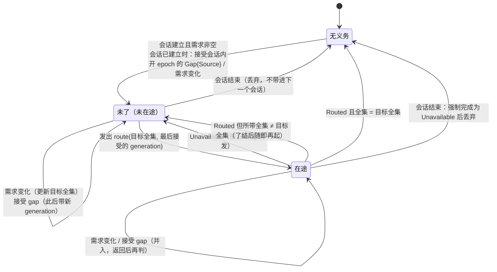

# 供给

## 3 模型

### 3.1 需求、`route` 义务与路由结论记录

- **需求** [设计]：一条流的需求由两部分合成：
  - 该流上各订阅的供给项的主体之并，不带主体集的供给项计为 `All`。只投递项不计入（它只搬运已有的记录）；挂起（`StreamUndeclared`、`QuotaExceeded`、`WholeStreamInPool`）与被拒的项不计入。
  - 核心自己的需求：每个作用域的订单状态流与成交流，只要不在配额池里，恒为 `All`。效应侧的被动取证渠道 `Attributed`（[resolution.md §4.3 被动渠道 Attributed](../read-write/resolution.md#43-被动渠道-attributed)）与成交完整性（[trade-observation.md §3.3 精确重建的前提与完整界](trade-observation.md#33-精确重建的前提与完整界-设计) 条件 2）都靠这些流的推送，不能等某个消费方恰好订阅了它们。在配额池里的这类流不接受 `All`（§4.1 配额），核心对它没有自己的需求：该作用域只有被订阅主体的推送，被动渠道只看得见这些主体，成交完整性的条件 2 不成立，`orders` 不给完整界。重新握手使这类流进入配额池时，核心自己的需求随新声明撤去；离开配额池时恢复。两种情形下该流的全集都按新声明重算，由新会话按 §4.2 会话建立的规则下发。
- 需求是 UTA 的意图，存在订阅表里；它不是供给。
- **`route` 义务**：本组件在内存里为（集成会话，逻辑流）持有的下发意图，每条流至多一项，嵌在集成会话里（完整规则见 §4.2“谁调、何时调”）。
- **路由结论记录**：`route` 返回 `Routed` 时写在流上的控制记录，记这次生效的主体全集与 `refused` 及原因。它是来源在一个流 epoch 内对供给的结论，是序号覆盖计入的唯一依据（§3.2）。

### 3.2 序号覆盖

今天契约里唯一的完备证据（完备进度的定义见 [base/design.md §3.1 流、位置与三种进度](../base/design.md#31-流位置与三种进度)）。**命题与坐标**：流 epoch e 内，venue 序号落在 `[from, through)` 的每条记录都已 append 在核心日志里。坐标是 e 的 venue 序号，只在 e 内可比；它不说事件时间，也不说序号 `through` 及以后。命题由来源的断言（`joinable_venue_seq`、路由结论、`covered_to`、记录上的序号）与核心自己的事实（这些记录已 append）合取而成，不多走一步，所以不是核心替来源断言完备。fold 规则、计入条件与覆盖检查点见 §4.3。

## 4 结构与接口

### 4.1 核心↔解释层：订阅组与 `rewind_cursor`（配额）

**配额** [设计]：配额池属于来源（`Quota` 的声明见 [integration.md §3.3 投影 Projection](../boundary/integration.md#33-投影-projection)）。一个池的用量 = 其各流上当前需求（§3.1）里的不同订阅主体数：同一流上同一主体被多个订阅（含不同 principal）订阅只算一次，因为核心只向集成路由一次；上游拒绝推送的主体仍在需求里，仍计入。配额池里的流只接受带主体集的供给项，不接受整条流的供给项，否则一个请求就能绕过上限。只投递项不进入需求，不受配额约束，整条流的只投递项在配额池里同样接受：它不向上游多要任何东西，而读不按 principal 授权，没有要它守住的范围。

- 接纳以项为单位、不拆分：一项的主体集里尚不在需求中的主体全部放得下，该项才被接纳，否则整项不接纳；已在需求中的主体不再占用量，同一请求里前面各项已接纳的主体也算在需求中。一个请求内按项在请求里的次序判定。
- 订阅时放不下的项得 `QuotaExceeded`，不留在订阅里，也不会自动恢复；要它就在有余量时另行订阅。程序订阅的项例外：它以“被拒”留到成员结束（[consumption.md §4.3 程序订阅](consumption.md#43-程序订阅)）。
- 重新握手使上限变小时，按订阅创建先后、订阅内按项的次序重新接纳既有的供给项，放不下的项转“挂起”（原因 `QuotaExceeded`），留在订阅里，有余量时按同一顺序恢复。一个订阅的项可能因此全部挂起，这时订阅整体为“挂起”。程序订阅在这个次序里的位置按创建它的那条 `Applied` 计（[consumption.md §4.3 程序订阅](consumption.md#43-程序订阅)）。
- 重新握手使一条流进入配额池时，该流上整条流的供给项转“挂起”（原因 `WholeStreamInPool`），留在订阅里，不计入需求；该流不再列在任何配额池里时恢复。它与 `QuotaExceeded` 分开：挂起的原因是项的形状在池里不合法，不是余量不够，余量再多也不会恢复它；要在池里继续得到推送，消费方改订带主体集的项。同一次握手使核心自己的 `All` 需求随之撤去（§3.1），该流的全集按新声明重算，由新会话按 §4.2 会话建立的规则下发（需求为空则不下发）。
- 接纳与配额读集成会话给出的**最近声明**：需求是核心自己保存的意图，按集成最后说过的话管理，不断言来源此刻能供给（声明的两种解释见 [integration.md §3.6 声明的两种解释](../boundary/integration.md#36-声明的两种解释-设计)）。

### 4.2 核心→集成：`route(stream, subjects, generation) → Routed{refused} | Unavailable`

- **语义**：订阅需求，即 P4 里“机→集成”的那一半：本会话内要集成为该流推送哪些主体。`subjects` 是一个主体集，或 `All`（整条流）；空集撤回该流的全部需求。每次调用给出全集而不是增减，集成以本会话内最后收到的一次为准。核心对同一流同一时刻至多有一次 `route` 在途，上一次返回后才发下一次，所以“最后收到的”就是核心最新的需求，迟到的旧调用不会覆盖新的；重发同一全集幂等。**动作轴**：非动作（会话内的供给声明，不改变上游的业务状态）。
- **`generation`** [设计]：指名这次调用问的是该流的哪个流 epoch。集成在会话内为某流上报的每条 `Gap{origin: Source}` 都带一个 `generation`：它由集成创建，按流、按会话计，会话开始时为 0，该流每上报一条加一并带上新值（[integration.md §4.3.2 集成→核心的推送](../boundary/integration.md#432-集成核心的推送)）。核心在 `route` 里带上它在本会话里为该流最后接受的那个：本会话里集成为该流上报、核心已接受的最近一条 `Gap{origin: Source}` 所带的值，还没有这样一条则为 0。握手事务里 append 的与 `backfill_incomplete` 的 `Gap{origin: Source}` 不是集成在会话内上报的，不带 `generation`，不改变这个值。核心只转交集成给的值，不自己计数；下一个会话从 0 重新开始。
- **谁调、何时调**：本组件，只在该集成会话已建立时调用，经集成会话的调用通道发出、取会话有效声明（[integration.md §3.6 声明的两种解释](../boundary/integration.md#36-声明的两种解释-设计)）。**每条流至多一项未了的 `route` 义务** [设计]：义务是本组件在内存里为（集成会话，逻辑流）持有的下发意图，嵌在集成会话里，由本组件确认。
  - **开始**：会话建立时，为此刻需求非空的每条流各起一项；需求为空的流不起，新会话里没有要撤回的供给。会话已建立期间，核心接受该流一条会话内上报的 `Gap{origin: Source}`（新流 epoch），或该流的需求变化，也起一项；义务已在时，这两种事件并入它，不另起一项：需求变化把它的目标全集更新为新需求，gap 不改变义务本身，只改变此后发出所带的 `generation`。
  - **发出**：义务在“同一时刻至多一次在途”之下逐次发出，每次带发出时的目标全集与上文所说的 `generation`；得 `Unavailable` 的在本会话内按 pacing 再发，仍是这一项。
  - **结束**：第一次 `Routed` 了结它；这次调用所带的全集已不是目标全集的（需求在它在途期间变了），了结之后随即以目标全集再起一项。会话结束时，在途的 `route` 先按“会话结束时在途调用恰好完成一次”完成（[integration.md §4.6 会话状态机](../boundary/integration.md#46-会话状态机)），然后在核心关闭通道之前丢弃该会话的全部未了义务，不再重发；下一个会话建立时按那时的需求重新起。没有已建立的会话时没有义务，需求变化只改变需求本身。
  - 所以核心接受一条开 epoch 的 gap 之后，按 pacing 的重试与这条 gap 触发的重发是同一项义务，新 epoch 的第一条路由结论记录来自一次带新 `generation` 的 `route`。流 epoch 的供给只由在它之内向来源问得的路由结论证明，不沿用上一 epoch 的（§4.3）。一个 epoch 在任何 `Routed` 之前就结束的，没有自己的路由结论记录，也就没有确认的供给；它只能由下一条开 epoch 的 gap 结束。会话结束只丢弃该会话的义务，不结束流 epoch：之后的会话握手以游标续接这个 epoch 时，那个会话的 `Routed` 写下这个 epoch 的路由结论记录。
  - 需求的合成见 §3.1。
- **返回**：
  - `Routed{refused}`：`refused` 是上游明确拒绝推送的主体（或整条流）及原因，例如未开通或主体不受支持；其余主体此后由集成推送。
  - `Unavailable`：没有得到上游的完整结论，比如任一次上游调用失败；或这次调用所带的 `generation` 早于集成为该流最近上报的那个（见“错误”）。
- **对端义务**（集成侧的完整清单见 [integration.md §4.4 集成义务清单](../boundary/integration.md#44-集成义务清单)）：只推送最近一次 `route` 给出且未拒绝的主体；在送出 `Routed` 之后才推送新加入主体的记录；会话开始或新流 epoch 开始后，在收到该流带当前 `generation` 的 `route` 之前不推送该流；只以 `Routed` 回答带它当前 `generation` 的调用；上报 `Gap{origin: Source}` 之前先以 `Unavailable` 完成已收到的这条流的 `route`。
- **核心内部结果**：
  - `Routed` → 同一事务在该流上 append 一条**路由结论记录**：这次生效的主体全集（与这次 `route` 的 `subjects` 相同，`All` 或一个主体集），及 `refused` 与原因；相对同一流 epoch 内上一条的增减由相邻两条算出。它同读结论记录一样是流上的控制记录，不是载荷。同一会话上集成→核心的消息按发送顺序处理，所以这条记录总在新主体的第一条记录之前。记全集而不记增减，一条记录自己就说出此刻确认的供给，序号覆盖的计入（§4.3）只读这一条，不需从上一 epoch 或上一会话的记录累加。计数观察与这条记录同一事务提交（[core/design.md §4.7.5 调用结果与计数的提交协议](../design.md#475-调用结果与计数的提交协议)）；调用目标是该逻辑流。
  - 一个主体在一个流 epoch 内的记录，从加入它的那条路由结论记录之后开始。此前没有它的记录不是缺口，那时没有它的需求，这一点由这条记录显式标出（C6）。以 `from` 订阅较早位置的订阅者由此知道该主体从哪里起有记录。握手以游标续接原 epoch 时，新会话的第一条路由结论记录只表示需求在本会话恢复，不重置已在需求里的主体的记录起点。
  - `refused` 里的主体在选中它的每个订阅的状态里逐主体列为“来源拒绝”（P4）。它仍在需求之内，仍计入配额；本会话内核心不为它自动重发，直到该流下一次 `route` 或下一个会话：上游的明确拒绝不会自己好，与 `read` 的 `Refused` 同理。
- **错误**：
  - `Unavailable` → 不 append 路由结论记录；该流的 `route` 义务未了，本会话内按 pacing 再发，每次带其时的目标全集；会话结束时的强制完成也是 `Unavailable`，之后义务随会话丢弃，不再发。最近一条路由结论记录仍是已确认的供给，这次的增减未经确认；集成因这次失败失去了对已路由主体的供给时，按断代上报 `Gap{origin: Source}`。
  - 调用跨过会话内的流 epoch 更替 → 只由集成按 `generation` 判定，核心不另判：集成上报 `Gap{origin: Source}` 之前，先以 `Unavailable` 完成已收到的这条流的 `route`；集成送出 gap 之后才收到、带旧 `generation` 的 `route`，集成答 `Unavailable`，不改变任何供给。所以集成只以 `Routed` 回答带它当前 `generation` 的调用；同一会话上集成→核心的消息按发送顺序处理，在 gap 之前送出的 `Routed` 总在 gap 之前到达，它的路由结论记录落在它确认的那个 epoch 里。这两种 `Unavailable` 按上一条处置，两种到达次序都有定义：在 gap 之前送出的那种先于 gap 到达核心，核心在接受 gap 之前按 pacing 再发的仍带旧 `generation`，集成照样答 `Unavailable`，只多一次无害的失败；核心接受 gap 之后的每次再发都带这条 gap 的 `generation`。接受 gap 前后的这些发出是同一项义务，不多出一次。
- **重试**：同一全集的重发幂等；重试前需求已变的，重发的是新的全集。

[设计] 需求按流的全集下发，而不是按订阅或增减下发。全集可以在每个新会话上原样重发，崩溃后不需要知道集成已经收到过什么；同流串行，最后一次即最新需求；多个订阅对同一主体的需求在核心合并一次，配额只在核心计量。路由结论记录落在流上而不是执行事实侧：需求是按主体的，`Gap{origin: Source}` 按流，只有带主体的记录能如实说出哪个主体从哪里起有记录、来源此刻确认了哪些供给；它落在流上，读这条流的程序与订阅者才看得见，序号覆盖也只读它而不读订阅表。不选：
- 集成对声明的每条流一律全量推送：公共行情做不到，按主体计的配额也就无从执行；
- 按订阅逐个下发：同一主体被重复要求，退订时集成要自己做引用计数；
- 增减式下发：丢一次或乱序一次，集成与核心对需求的认识就分叉，重连后要先对账；
- 路由结论记录只记增减：计入覆盖要从上一 epoch 或上一会话的记录累加；
- 路由结论记录带发出 epoch、由各读者按它过滤：覆盖、记录起点、`refused`、增减的每个读者都要各做一次同一判断，而一条已结束 epoch 的供给结论不说明任何在新 epoch 里仍成立的事。

[设计] `route` 跨过流 epoch 更替只有一个判定者，就是集成。流 epoch 的边界属于集成：上游连接是它的，`Gap{origin: Source}` 也是它上报的，所以只有它答得出一次 `route` 问的是不是它当前的 epoch。核心因此只用集成拥有的名字指名自己问的是哪个 epoch，即它最后接受的 `generation`。集成从不以 `Routed` 回答旧 `generation`；集成→核心的消息按发送顺序处理，此前的 `Routed` 都先于 gap 到达。所以核心不需要再判一次。`read` 与 `backfill` 不同，仍由核心按发出 epoch 处置（[backfill.md §4.1 核心→集成：backfill](backfill.md#41-核心集成backfillstream-window-subjects--covered--unavailable--refused)、[one-shot-read.md §3.5 发出 epoch](one-shot-read.md#35-发出-epoch)）：它们的发出 epoch 是 UTA 自己记下的事实（`dispatch_end`、回填任务）。不选：
- 核心按发出 epoch 过滤迟到的 `Routed`、把它完成为 `Unavailable`：这次路由是否属于当前 epoch，这一件事有核心与集成两个判定者（按 [README.md §1.2 权威源头与生命周期](../../README.md#12-权威源头与生命周期)“机制即信号”，这说明权威划错了）；集成已答 `Routed` 而核心不认，供给就在两边分叉；
- 集成上报 gap 之后等核心回一条确认，再处理之后的 `route`：多一种 IDL 消息和一段等待状态，而它要表达的“核心已接受这条 gap”，调用所带的 `generation` 本来就说出了。

### 4.3 序号覆盖与覆盖检查点

**存在与计入只看记录** [设计]：流 epoch e 的序号覆盖只在 e 开始时（首条 `Gap{origin: Source}` 所在会话）的会话有效声明含 `joinable_venue_seq` 时存在。推送的 venue 序号计入覆盖，要求它 append 在 e 上一条**确认整条流供给**的路由结论记录 R 之后：R 与这条推送带同一 `SessionEpoch`，R 表明 e 的有效供给是 `All` 且 `refused` 为空（R 在 e 之内，上一 epoch 的路由结论不算），且从 R 到这条推送之间同一会话里没有不再这样确认的路由结论记录。覆盖从 R 的位置起才有推送证据。

- 理由：覆盖说的是整条流，而推送与 `Covered` 只证明来源确认供给了的主体，只有来源确认了整条流被供给、没有拒绝，推送才证明整条流。供给是来源在 e 之内对 `route` 的结论，落在路由结论记录里；订阅表里的需求只是 UTA 要什么，不是输入，所以覆盖崩溃后从记录（声明版本、路由结论记录、推送与回填记录、覆盖检查点）重建，不读订阅表。
- 之后同一会话里一条路由结论记录不再确认整条流供给（例如该流进入配额池，核心的 `All` 随之撤去；上游拒绝了部分主体），此后的推送不计入，`through` 停在当时的值，直到又有一条确认整条流供给的记录；其间 append 而未计入的序号仍是缺口，压住 `through`。续接 e 的某次握手的声明不再含 `joinable_venue_seq` 时，覆盖在 e 内停住，不再恢复。`route` 返回 `Unavailable` 不 append 记录，不改变计入；需求变了而来源尚未确认，也不改变。此前由证据建立的覆盖始终成立（它说的是那时已 append 的记录）。没有这些条件的流 epoch 没有序号覆盖，也就没有完备进度。流 epoch 结束不闭合 `through` 处的缺口：缺口里的序号是否存在过，来源没有给出结论。
- **来源证据**（都是来源给的，核心只 fold）：`joinable_venue_seq` 的声明（来源断言序号在 epoch 内连续、回填与推送同一序号空间）；回填读结论记录里的 `covered_to`（来源断言 `[窗口 from, covered_to)` 是连续前缀）；推送与回填记录上的 venue 序号。一次性读、回执与取证的结果不计入：它们的序号不在这份断言之内。
- **fold**：`from` 为 `live_from`；该 epoch 的回填任务 `Closed` 后（来源的 `Covered` 答复从任务起点连到 `live_from`，任务的主体集为 `All`，记在读结论记录里）为任务起点，起点为 `Origin` 时即 `Origin`。`through` 为从 `live_from` 起、计入的推送的 venue 序号连续到达的第一个缺口（尚未计入的最小序号）：缺口在补上之前一直压住它；乱序的计入记录补上缺口时 `through` 前进，重复的序号不改变它。
- **生命周期**：随 e 开始（首条 `Gap{origin: Source}`）而存在，随 e 结束（下一 epoch 的 `Gap{origin: Source}`）而停止变化；它是上述记录的 fold，崩溃后从记录重建。
- **消费者**：程序 `await-all` 输入的覆盖要求（覆盖推进事件的取得见 [consumption.md §4.9 程序订阅投递事件的取得](consumption.md#49-程序订阅投递事件的取得)，事件的契约见 [program-host.md §4.6 宿主协议](../runtime/program-host.md#46-宿主协议)）与 `orders` 的完整界（[trade-observation.md §3.3 精确重建的前提与完整界](trade-observation.md#33-精确重建的前提与完整界-设计)）。放行门不读它（[ticket.md §3.5 第一层：依据有效性 basis_validity](../read-write/ticket.md#35-第一层依据有效性-basis_validity)）。

[设计] 完备只来自来源证据，今天唯一的是序号覆盖；没有事件时间上的完备。不选：
- 单一“进度”标量同时表达消费、完备与保留：它把“读到哪”与“之前不再变”混同，`latest` 消费者被误当作已跟上完备进度，阈值策略误触发；
- 由 `received_at`、核心或运维声明的滞后界、上游文档的迟到上限推出事件时间完备：越过上限的迟到记录与从未发出的记录不可区分，违反不可观察，是以就近数据代替源头；
- 核心维持跨流的事件时间对齐：没有任何来源证据支撑，对齐点只是核心的猜测；
- 以核心自己的需求（订阅表里的 `All`）代替来源的确认计入推送：需求是 UTA 要什么，不是来源给了什么。
[证据：fp-05 案例 10④/11⑤/13⑤；fp-04 命题 10]

#### 覆盖检查点

覆盖所依的记录会被保留边界推进删掉，所以保留边界推进要删掉当前 epoch 内的记录时，本组件把严格低于新边界的前缀的 fold 状态作为健康观察 append：`{epoch, from, through, above, frozen, folded_below}`，`folded_below` = 新边界，键是逻辑流，按键保留（[journal.md §2.4 保留：边界与删除规则](journal.md#24-保留边界与删除规则)）。它与新边界、`Applied` 和那次删除在同一个事务里提交，事务由观察 `Journal` 编排（[journal.md §3.2 控制动作 advance_retention(to: Set<LogPosition>)](journal.md#32-控制动作-advance_retentionto-setlogposition)），所以不存在边界已推进而检查点不在的持久状态。

- `above` 是被删记录里序号不小于 `through` 的那些序号（按连续段记），缺口之后补到时 `through` 靠它越过。
- `frozen` 记下到 `folded_below` 为止的计入状态：声明是否已撤去 `joinable_venue_seq`，以及被删的最近一条路由结论记录（带它的 `SessionEpoch`）是否确认整条流供给。R 在 e 之内，所以删 R 的就是这条规则里的删除，不另设触发。
- 它只说 `folded_below` 之下的记录，是核心自有的派生记录，写下它的锚点是那次删除，不是周期：它不是当前值的重发，是被删证据的唯一留存。
- 之后的 fold 从当前 epoch 最近的检查点起，接着读 `folded_below` 及以上的记录，`as_of` 不低于 `folded_below` 的读因此与压缩前相等；`as_of` 低于它得 `BeyondRetention`。
- 检查点在 e 内不失效，被同键下一个检查点取代，e 结束后不再被读。

## 5 走查

### 5.1 序号覆盖的压缩与重启

`live_from = 10`，R（`All`，`refused` 空）已在 e 上。序号 10、12 到达并计入：`through = 11`。`advance_retention` 要删掉这两条记录：观察 Journal 编排的推进事务里，本组件写覆盖检查点 `{e, from = 10, through = 11, above = [12], frozen, folded_below}`，与新边界和删除一起提交。压缩之后序号 11 到达：fold 从检查点起接着读，`through` 越过 11 与 `above` 里的 12，为 13。重启核心：覆盖从检查点与 `folded_below` 及以上的记录重建，与压缩前相同，不读订阅表。

## 6 评估

### 6.1 证伪条件

- **证伪 #29 完备只来自序号覆盖**：某在范围内的上游随流给出自己的事件时间闭合陈述（“此后不再发出 `occurred_at` 早于 t 的记录”），且它可被证伪（之后到达的早于 t 的记录就是违反），而下游（S10）确实需要按事件时间对齐多条流 → “契约里没有事件时间完备”过于保守：须把该陈述定为第二种完备证据，写进流声明、`await-all` 的要求点与一致性测试；若只能靠核心或运维设定的滞后界得到它，本决定不变。（§4.3）

### 6.2 验收标准

- **验收 #47 订阅需求下发**（对应 Q13/Q14/Q29）：以 fixture 上游驱动：
  - 会话建立后，fixture 在收到某流的第一次 `route` 之前不推送该流；每条需求非空的流恰收到一次全集，其主体集等于各供给项主体之并（加上非配额池作用域的订单状态流与成交流的 `All`），挂起、被拒与只投递项都不在其中；
  - 同一主体被三个订阅选中、退订其中两个：`route` 全集不变；退订第三个：该主体从下一次全集中消失，fixture 停止推送它；
  - fixture 明确拒绝一个主体：该流上一条路由结论记录列出它与原因，选中它的订阅逐主体显示“来源拒绝”，该主体仍计入配额，本会话内核心不自动重发；
  - `route` 返回 `Unavailable`：不 append 路由结论记录，按 pacing 重发，需求未变时是同一全集，直到 `Routed`；重连后每条需求非空的流再恰收到一次全集；上一会话未了的 `route` 义务不带进新会话：某流的撤回（空集的 `route`）到会话结束仍未 `Routed`，新会话建立时该流需求为空，fixture 在新会话里收不到该流的 `route`；没有已建立的会话期间需求变了的流，核心不为它发任何 `route`，下一个会话建立时按那时的需求判定（非空才恰收到一次全集）；
  - 某流的 `route` 在途时需求再变：fixture 在上一次返回之前收不到下一次；之后收到的是新的全集，旧全集不在它之后生效；
  - 以 `from` 订阅较早位置的订阅者，从路由结论记录看出每个主体从哪里起有记录；每条路由结论记录带这次生效的全集；握手以游标续接原 epoch 时，新会话的路由结论记录不改变已有主体的记录起点；会话内集成上报 `Gap{origin: Source}` 开新流 epoch 后，核心为该流重发 `route`，所带 `generation` 等于这条 gap 所带的值，新 epoch 有自己的路由结论记录；`generation` 在每个会话里从 0 起、不沿用上一会话的值：核心接受该流任何一条会话内上报的 `Gap{origin: Source}` 之前发出的 `route` 带 0，之后发出的带最后接受的值；
  - gap 先于第一次 `route`：握手以游标续接原 epoch，fixture 集成在收到该流本会话的任何 `route` 之前暂存溢出、上报 `Gap{origin: Source}`（带 1）：核心接受它之后发出的该流 `route` 都带 1，核心此前尚未发出的本会话第一次 `route` 也带 1；核心在接受之前已发出的（带 0）由集成答 `Unavailable`、供给不变；fixture 集成只以 `Routed` 回答带 1 的，新 epoch 的推送在它之后；
  - 健康把 `route` 的结果计在该逻辑流上；
  - 集成一致性：只推送最近一次 `route` 给出且未拒绝的主体；续接原 epoch 时等待 `route` 期间的上游记录在 `route` 后补送、不丢，补不上则上报 `Gap{origin: Source}`；已路由主体的供给中断时（含上游推送通道重连）上报 `Gap{origin: Source}`，会话内的每条带 `generation`：每条流的 `generation` 在会话开始时为 0，每上报一条加一并带上新值，所以本会话第一条带 1；之后在收到带这个新 `generation` 的 `route` 之前不推送该流；带旧 `generation` 的 `route` 得 `Unavailable`，供给与推送都不变。

- **#57 配额池变化、持仓一流与恢复时的需求**（[runtime/design.md §4.1.3 启动五步](../runtime/design.md#413-启动五步) 第 5 步、[trade-observation.md §3.2 订单身份、来源顺序与最近观察](trade-observation.md#32-订单身份来源顺序与最近观察-设计)、[§4.2 核心→集成：route](#42-核心集成routestream-subjects-generation--routedrefused--unavailable)、[§4.1 核心↔解释层：订阅组与 rewind_cursor（配额）](#41-核心解释层订阅组与-rewind_cursor配额)、[views.md §4.2 读模型集合](../boundary/views.md#42-读模型集合)）：（对应 Q13/Q14/Q29）
    - 重新握手使一条有整流供给项的订单状态流进入配额池：该项转挂起（原因 `WholeStreamInPool`，与 `QuotaExceeded` 可区分），核心自己的 `All` 撤去，fixture 在新会话里收不到该流的 `route`（重算后的需求为空）；该流上的只投递项不受影响；该流离开配额池时该项恢复，新会话按会话建立的规则下发；
    - fixture 集成把同一持仓身份放到同一作用域的两条持仓流上：`positions` 对它标出跨流冲突、并列两条流各自的最近观察、不选其一、不相加；对该持仓的敞口检查与持仓在检查得 `Undecidable`；
    - 核心重启后第 5 步：对已建立会话的集成，每条不在配额池里的订单状态流与成交流的 `route` 全集含 `All`，即使没有任何订阅选中它们。

- **验收 #68 序号覆盖**（对应 Q11/Q14/Q31）：以 fixture 上游驱动声明 `joinable_venue_seq` 的流：
  - 推送序号 1..5、7 到达：覆盖 `through` 为 6；序号 6 乱序补到后 `through` 为 8；重复的序号 5 不改变它；
  - 回填任务从 `Origin` 起 `Closed` 后，覆盖的 `from` 下移到 `Origin`；有限深度回填 `Closed` 后下移到任务起点；回填 `Refused` 或历史穷尽时 `from` 停在 `live_from`；
  - 该流只路由部分主体（路由结论记录不是 `All`）、路由结论 `refused` 非空、或流不声明 `joinable_venue_seq`：没有序号覆盖，依赖它的读得“完备未确立”；epoch 中途重握手不再声明 `joinable_venue_seq`：覆盖停在当时的值，之后再声明也不恢复；
  - 计入只看路由结论记录：e 上第一条确认 `All` 且 `refused` 为空的路由结论记录之前到达的推送不计入覆盖；先确认一部分主体、之后才确认 `All` 时，`from` 仍是 `live_from`，确认之前缺的序号使 `through` 停在那里；之后一条不确认 `All` 或 `refused` 非空的路由结论记录使计入停住（`through` 不再推进），直到下一条确认的记录；路由 `Unavailable`、订阅增减而没有新的路由结论记录时覆盖不变；崩溃重启后覆盖由记录与检查点重建，与崩溃前相同，重建不读订阅表；
  - 会话内集成上报 `Gap{origin: Source}` 开新流 epoch：核心为它重发 `route`，新 epoch 有自己的路由结论记录，覆盖只计入其中确认之后的推送，上一 epoch 的路由结论记录不使新 epoch 的推送计入；
  - 流 epoch 以 `Gap{origin: Source}` 结束：该 epoch 的覆盖不再变化，`through` 处的缺口不被闭合，新 epoch 的覆盖从新的 `live_from` 起；
  - 一次性读、回执与取证结果上的序号不推进覆盖；
  - `advance_retention` 删掉当前 epoch 的记录时，同一事务里健康流上出现该逻辑流的覆盖检查点；`live_from` = 10，序号 10、12 到达后二者都被删掉，之后序号 11 到达：`through` 为 13（检查点的 `above` 记着 12）；epoch 中途重握手去掉 `joinable_venue_seq` 后再压缩：覆盖仍停在当时的值；之后重启核心，覆盖与压缩前相同，对 `as_of ≥ folded_below` 的读与压缩前相等。

- **#84 会话内开的新流 epoch**（[views.md §3.2 健康面](../boundary/views.md#32-健康面-设计)、[backfill.md §4.2 实时边界、回填任务与回填进度](backfill.md#42-实时边界回填任务与回填进度)、[§4.2 核心→集成：route](#42-核心集成routestream-subjects-generation--routedrefused--unavailable)、[integration.md §4.3.2 集成→核心的推送](../boundary/integration.md#432-集成核心的推送)）：fixture 集成在一个已建立的会话里，对一条声明 `joinable_venue_seq` 且 readiness 为 `Live` 的流上报 `Gap{origin: Source}`（fixture 上游推送通道断开重连）：（对应 Q11/Q14/Q31）
    - `Gap{origin: Source}` 与该逻辑流的 `None{新 epoch}` 在同一事务 append：集成会话编排这一事务，这条 gap 经信封解析入口由观察 J append，集成会话请持久订阅在同一事务写 `None{新 epoch}`；`health` 上该流的 readiness 立即回到 `Starting`，会话仍是 `Established`，旧 epoch 的 `Live` 不再出现；核心没有为该流 append `Disconnected` 或 `Starting`；
    - 核心为该流重发 `route`，fixture 集成在收到之前不送出该流的推送；新 epoch 的路由结论记录 append 在新 epoch 里，覆盖只计入它确认之后的推送；
    - fixture 集成为新 epoch 声明 `Live{live_from}` 之后，回填任务在这个 `live_from` 声明时按回填进度的条件判定一次，与握手时开的新 epoch 相同：回填深度为 `Origin` 且声明含 `backfill_from_origin` 时建立从 `Origin` 起的任务，深度为 0 时不建立；同一 epoch 里之后的需求变化不补建任务；
    - 旧 epoch 的覆盖、路由结论与回填进度都不沿用：旧 epoch 的完整界不再给出，新 epoch 的完整界只在它自己的回填 `Closed` 后给出；
    - 在 `Gap{origin: Source}` 已 append、`route` 结论尚未 append 时注入核心崩溃：重启后该流在新会话的握手里按续接或新 epoch 决定，不把崩溃前的路由结论当作新 epoch 的确认。
    - 判定例：同一会话 s，该流在 epoch e0 里报过 `Live`；集成上报 `Gap{origin: Source}`，`None{e1}` 随之 append，e1 里尚无 readiness：`health`（及按健康面规则独立 fold 健康流与控制流的参照实现）给出 `Starting`，不给 e0 的 `Live`；会话记录仍是 s 的 `Established`，所以只按 `SessionEpoch` 取舍的 fold 在这里会给出 e0 的 `Live`，它被本条判为不合格。
